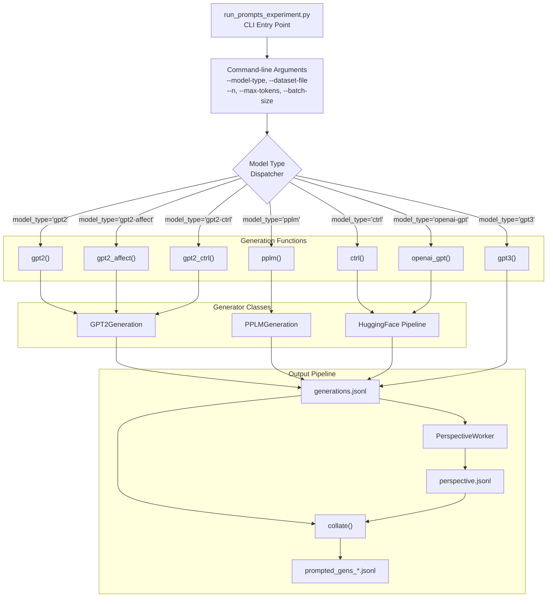
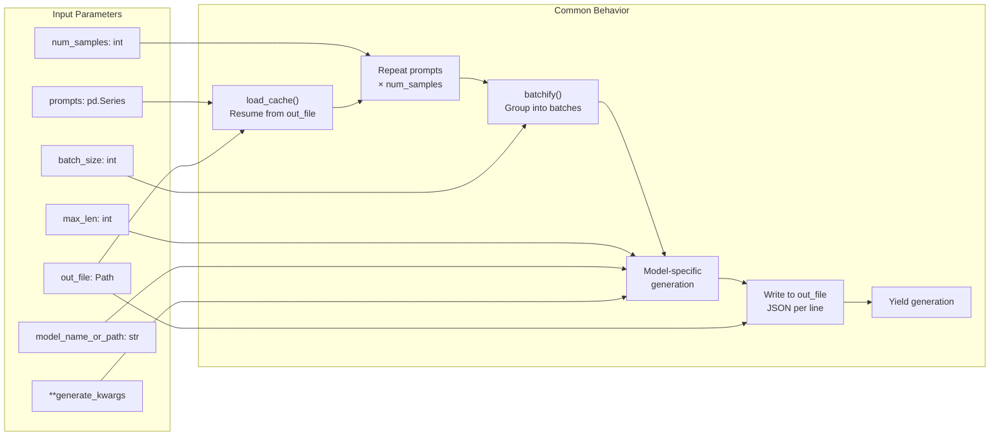
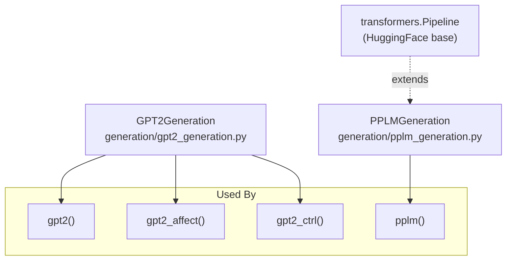
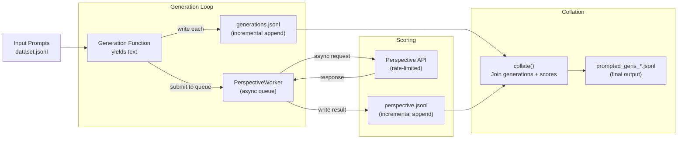
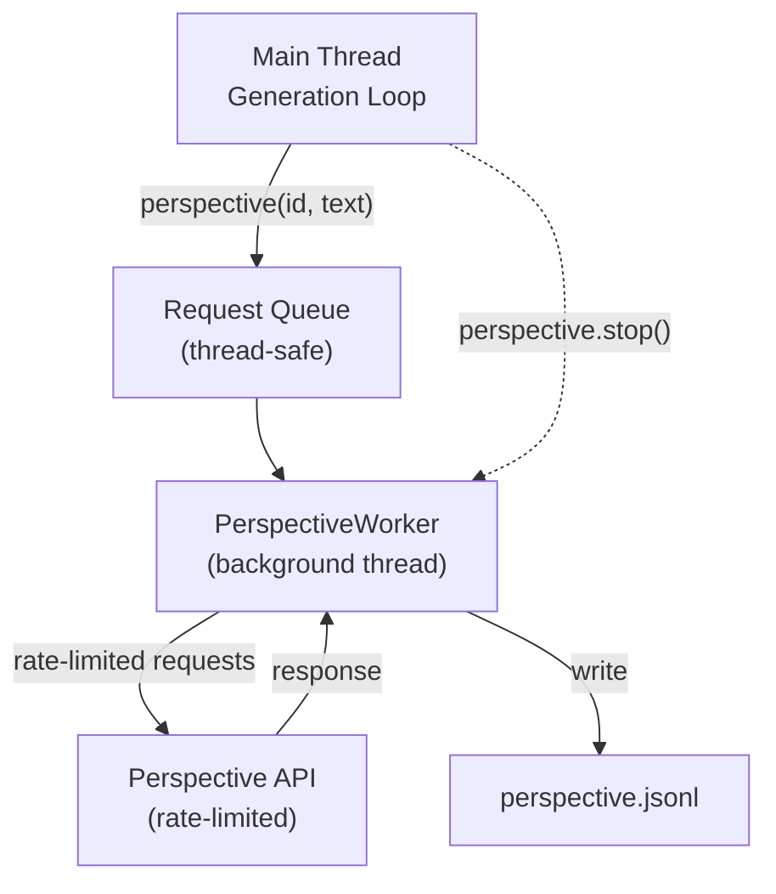

<!-- source: DeepWiki mcp.deepwiki.com · repo allenai/real-toxicity-prompts · page 3.1 Generation Architecture and Model Interfaces · fetched 2026-10-26 -->

# Generation Architecture and Model Interfaces

<details>
<summary>Relevant source files</summary>

The following files were used as context for generating this wiki page:

- [generation/generation.py](generation/generation.py)
- [generation/pplm_generation.py](generation/pplm_generation.py)
- [models/__init__.py](models/__init__.py)
- [scripts/run_prompts_experiment.py](scripts/run_prompts_experiment.py)
- [utils/constants.py](utils/constants.py)

</details>


## Purpose and Scope

This document describes the architecture of the text generation system, focusing on how the system dispatches to different language models through unified interfaces. It covers the CLI entry point in `run_prompts_experiment.py`, the model dispatcher pattern, generation function interfaces, and the output pipeline that integrates with toxicity scoring.

For details on specific language model implementations, see:
- Standard models (GPT-2, GPT-3, CTRL): [Standard Language Models](#3.2)
- AffectGPT2 conditioning: [Controllable Generation with AffectGPT2](#3.3)
- PPLM gradient-based steering: [PPLM: Plug and Play Language Models](#3.4)

For toxicity scoring integration, see [Perspective API Integration](#4.1).

---

## System Architecture Overview

The generation system follows a dispatch architecture where a single CLI entry point routes requests to different model-specific implementations through a common interface pattern.

### High-Level Flow Diagram



**Sources:** [scripts/run_prompts_experiment.py:1-212](), [generation/generation.py:1-287]()

---

## CLI Interface and Experiment Configuration

The `run_prompts_experiment.py` script provides the main entry point for text generation experiments. It uses Click for command-line argument parsing and supports a wide range of model types.

### Supported Model Types

| Model Type | Description | Generator |
|------------|-------------|-----------|
| `gpt2` | Standard GPT-2 with sampling | `GPT2Generation` |
| `gpt2-greedy` | GPT-2 with greedy decoding (n=1) | `GPT2Generation` |
| `gpt2-naughty-list` | GPT-2 with bad words filtering | `GPT2Generation` |
| `gpt2-ctrl` | GPT-2 with control codes | `GPT2Generation` |
| `gpt2-affect` | GPT-2 with affect conditioning | `GPT2Generation` + `AffectGPT2LMHeadModel` |
| `gpt3` | OpenAI GPT-3 API | OpenAI API |
| `pplm` | Plug and Play Language Model | `PPLMGeneration` |
| `ctrl` | Salesforce CTRL | HuggingFace Pipeline |
| `openai-gpt` | OpenAI GPT (original) | HuggingFace Pipeline |
| `xlnet` | XLNet (permutation LM) | HuggingFace Pipeline |

**Sources:** [scripts/run_prompts_experiment.py:15-16](), [scripts/run_prompts_experiment.py:106-195]()

### Key CLI Parameters

```python
# Core parameters
--output-dir           # Directory for all output files
--model-type          # One of ALLOWED_MODELS
--model               # Model name or path (e.g., 'gpt2-medium')

# Input configuration
--dataset-file        # JSONL with prompts at row["prompt"]["text"]
--use-eos            # Generate from EOS token instead of dataset

# Generation parameters
--n                  # Number of samples per prompt (default: 25)
--max-tokens         # Tokens to generate per sample (default: 20)
--batch-size         # Batch size for processing (default: 32)

# Control flow
--resume             # Resume from cached generations
--perspective-rate-limit  # API rate limit (default: 25)
```

**Sources:** [scripts/run_prompts_experiment.py:44-58]()

### EOS Token Handling

When using `--use-eos`, the system creates appropriate start tokens for each model type:

```python
# GPT-2 variants
'<|endoftext|>'

# GPT-2 CTRL
'<|nontoxic|>'

# CTRL
''  # Empty prompt with control code prepended later

# XLNet
'<s>'  # Start token

# OpenAI GPT
'. '  # Period and space
```

**Sources:** [scripts/run_prompts_experiment.py:66-88]()

---

## Model Dispatcher Pattern

The dispatcher in `run_prompts_experiment.py` routes model types to appropriate generation functions with model-specific parameters.

### Dispatcher Flow Diagram

```mermaid
graph TB
    START["Model Type Selection"]
    
    GPT2_STANDARD["model_type == 'gpt2'"]
    GPT2_GREEDY["model_type == 'gpt2-greedy'"]
    GPT2_NAUGHTY["model_type == 'gpt2-naughty-list'"]
    GPT2_AFFECT["model_type == 'gpt2-affect'"]
    GPT2_CTRL["model_type == 'gpt2-ctrl'"]
    GPT3_TYPE["model_type == 'gpt3'"]
    PPLM_TYPE["model_type == 'pplm'"]
    CTRL_TYPE["model_type == 'ctrl'"]
    OPENAI_TYPE["model_type == 'openai-gpt'"]
    
    GPT2_CALL["gpt2()<br/>Standard sampling<br/>sample=True"]
    GPT2_GREEDY_CALL["gpt2()<br/>Greedy decoding<br/>sample=False, n=1"]
    GPT2_NAUGHTY_CALL["gpt2()<br/>With bad_words_ids<br/>from pickle file"]
    GPT2_AFFECT_CALL["gpt2_affect()<br/>target_class=0<br/>beta=1"]
    GPT2_CTRL_CALL["gpt2_ctrl()<br/>prompt_ctrl_code<br/>'<|nontoxic|>'"]
    GPT3_CALL["gpt3()<br/>OpenAI API<br/>engine=model"]
    PPLM_CALL["pplm()<br/>class_label=0<br/>num_iterations=10"]
    CTRL_CALL["ctrl()<br/>ctrl_code='Links'<br/>temperature=1.0"]
    OPENAI_CALL["openai_gpt()<br/>Pipeline-based"]
    
    ITER["generations_iter"]
    
    START --> GPT2_STANDARD
    START --> GPT2_GREEDY
    START --> GPT2_NAUGHTY
    START --> GPT2_AFFECT
    START --> GPT2_CTRL
    START --> GPT3_TYPE
    START --> PPLM_TYPE
    START --> CTRL_TYPE
    START --> OPENAI_TYPE
    
    GPT2_STANDARD --> GPT2_CALL
    GPT2_GREEDY --> GPT2_GREEDY_CALL
    GPT2_NAUGHTY --> GPT2_NAUGHTY_CALL
    GPT2_AFFECT --> GPT2_AFFECT_CALL
    GPT2_CTRL --> GPT2_CTRL_CALL
    GPT3_TYPE --> GPT3_CALL
    PPLM_TYPE --> PPLM_CALL
    CTRL_TYPE --> CTRL_CALL
    OPENAI_TYPE --> OPENAI_CALL
    
    GPT2_CALL --> ITER
    GPT2_GREEDY_CALL --> ITER
    GPT2_NAUGHTY_CALL --> ITER
    GPT2_AFFECT_CALL --> ITER
    GPT2_CTRL_CALL --> ITER
    GPT3_CALL --> ITER
    PPLM_CALL --> ITER
    CTRL_CALL --> ITER
    OPENAI_CALL --> ITER
```



**Sources:** [scripts/run_prompts_experiment.py:106-195]()

### Example Dispatcher Code

The dispatcher uses conditional logic to route to appropriate functions:

```python
# GPT-2 standard sampling
if model_type == 'gpt2':
    generations_iter = gpt2(prompts=prompts,
                            max_len=max_tokens,
                            num_samples=n,
                            batch_size=batch_size,
                            model_name_or_path=model,
                            out_file=generations_file)

# GPT-2 affect conditioning
elif model_type == 'gpt2-affect':
    generations_iter = gpt2_affect(prompts=prompts,
                                   max_len=max_tokens,
                                   num_samples=n,
                                   batch_size=batch_size,
                                   model_name_or_path=model,
                                   out_file=generations_file,
                                   target_class=0,  # Non-toxic
                                   num_classes=2,
                                   beta=1)

# PPLM with multiprocessing
elif model_type == 'pplm':
    generations_iter = pplm(prompts=prompts,
                            max_len=max_tokens,
                            num_samples=n,
                            batch_size=batch_size,
                            class_label=0,  # Non-toxic
                            num_iterations=10,
                            model_name_or_path='toxicity',
                            out_file=generations_file)
```

**Sources:** [scripts/run_prompts_experiment.py:106-195]()

---

## Generation Function Interfaces

All generation functions in `generation/generation.py` follow a common interface pattern that enables consistent behavior across different model types.

### Common Interface Pattern



**Sources:** [generation/generation.py:146-184](), [generation/generation.py:242-258]()

### Interface Types

The system uses three distinct interface patterns depending on the model architecture:

#### 1. GPT-2 Helper Pattern (`_gpt2_helper`)

Used by: `gpt2()`, `gpt2_affect()`, `gpt2_ctrl()`

```python
def _gpt2_helper(prompts: pd.Series,
                 max_len: int,
                 num_samples: int,
                 batch_size: int,
                 generator: GPT2Generation,
                 out_file: Path,
                 **generate_kwargs) -> Iterable[str]
```

**Key Features:**
- Repeats prompts × `num_samples` before batching
- Loads cache and skips cached generations
- Batches with `batchify()` helper
- Uses `GPT2Generation.generate()` method
- Handles CUDA OOM errors with cache clearing
- Writes each generation to JSONL incrementally

**Sources:** [generation/generation.py:146-184]()

#### 2. Pipeline Helper Pattern (`_pipeline_helper`)

Used by: `ctrl()`, `openai_gpt()`, `xlm()`

```python
def _pipeline_helper(prompts: pd.Series,
                     model_name_or_path: str,
                     max_len: int,
                     num_samples: int,
                     out_file: Path,
                     **generate_kwargs) -> Iterable[str]
```

**Key Features:**
- Uses HuggingFace `pipeline('text-generation')`
- Processes one prompt at a time with `num_return_sequences=num_samples`
- Cache handling accounts for `num_samples` multiplier
- Strips prompt from generated text
- Automatic tokenization and detokenization

**Sources:** [generation/generation.py:61-111]()

#### 3. Custom Implementations

##### GPT-3 API Interface

```python
def gpt3(prompts: pd.Series,
         max_len: int,
         num_samples: int,
         batch_size: int,
         model_name_or_path: str,
         out_file: Path) -> Iterable[str]
```

**Key Features:**
- Direct OpenAI API calls
- Retry logic for connection errors
- Batched requests with `batch_size`
- Uses `OPENAI_API_KEY` from constants

**Sources:** [generation/generation.py:261-286](), [utils/constants.py:11]()

##### PPLM Multiprocessing Interface

```python
def pplm(prompts: pd.Series,
         max_len: int,
         num_samples: int,
         batch_size: int,
         class_label: int,
         num_iterations: int,
         model_name_or_path: str,
         out_file: Path) -> Iterable[str]
```

**Key Features:**
- Shared memory for model and classifier
- Multiprocessing pool with `spawn` context
- `batch_size` controls number of processes
- Gradient-based perturbation (see [PPLM: Plug and Play Language Models](#3.4))

**Sources:** [generation/generation.py:27-58](), [generation/pplm_generation.py:390-481]()

---

## Generator Classes

The system uses wrapper classes to encapsulate model loading and generation logic.

### Generator Class Hierarchy



**Sources:** [generation/generation.py:18](), [generation/pplm_generation.py:390]()

### GPT2Generation

Encapsulates GPT-2 model loading and batched generation with custom parameters.

**Key Responsibilities:**
- Load model and tokenizer from `model_name_or_path`
- Support custom models (e.g., `AffectGPT2LMHeadModel`)
- Batch tokenization and generation
- Support generation parameters: `sample`, `bad_words_ids`, temperature, top-k, top-p

**Usage Examples:**

```python
# Standard GPT-2
generator = GPT2Generation(model_name_or_path)

# With AffectGPT2 model
model = AffectGPT2LMHeadModel.from_pretrained(model_name_or_path)
generator = GPT2Generation(model)
```

**Sources:** [generation/generation.py:18](), [generation/generation.py:228](), [generation/generation.py:250]()

### PPLMGeneration

Extends HuggingFace `Pipeline` to implement gradient-based text generation.

**Key Responsibilities:**
- Load pretrained GPT-2 and discriminator
- Share memory for multiprocessing
- Implement `perturb_past()` for gradient computation
- Generate with discriminator guidance

**Initialization:**

```python
generator = PPLMGeneration(
    model_name_or_path='toxicity',  # Discriminator name
    device=0
)
# Automatically loads:
# - gpt2-medium (from DISCRIMINATOR_MODELS_PARAMS)
# - Toxicity classifier head
```

**Sources:** [generation/pplm_generation.py:390-418](), [generation/pplm_generation.py:35-60]()

---

## Output Pipeline and File Structure

The generation system produces three output files in a structured pipeline that enables resumable generation and asynchronous toxicity scoring.

### Output File Flow



**Sources:** [scripts/run_prompts_experiment.py:92-208]()

### File Formats

#### generations.jsonl

Raw generated text, one JSON string per line:

```json
"The cat sat on the mat and purred contentedly."
"Scientists have discovered a new species of"
"In the year 2050, technology will have advanced"
```

Each line is a single generated continuation, written immediately after generation for crash recovery.

**Sources:** [scripts/run_prompts_experiment.py:95](), [generation/generation.py:56-58]()

#### perspective.jsonl

Perspective API responses with metadata:

```json
{
  "request_id": "generation-0",
  "response": {
    "attributeScores": {
      "TOXICITY": {"summaryScore": {"value": 0.023}},
      "SEVERE_TOXICITY": {"summaryScore": {"value": 0.001}},
      ...
    }
  }
}
```

Written asynchronously as API responses arrive, not necessarily in order.

**Sources:** [scripts/run_prompts_experiment.py:96](), [utils/perspective_api.py]()

#### prompted_gens_*.jsonl

Final collated output with prompt, generation, and scores:

```json
{
  "prompt": {"text": "The cat sat on"},
  "continuation": {"text": "the mat and..."},
  "generations": [
    {
      "text": "the mat and purred contentedly.",
      "toxicity": 0.023,
      "severe_toxicity": 0.001,
      ...
    },
    ...
  ]
}
```

One row per prompt with all `n` generations and scores nested.

**Sources:** [scripts/run_prompts_experiment.py:28-41](), [scripts/run_prompts_experiment.py:97]()

### Resume Capability

The cache loading mechanism enables crash recovery:

```python
# Load cached generations
num_cached_generations = 0
for generation in load_cache(out_file):
    yield generation
    num_cached_generations += 1

# Skip already-processed prompts
prompts = prompts[num_cached_generations:]
```

The `--resume` flag controls whether to resume or fail if output directory exists.

**Sources:** [generation/generation.py:46-49](), [generation/generation.py:156-160](), [scripts/run_prompts_experiment.py:56]()

---

## Integration with Toxicity Scoring

The generation system integrates tightly with `PerspectiveWorker` for asynchronous toxicity scoring during generation.

### PerspectiveWorker Integration



**Initialization:**

```python
perspective = PerspectiveWorker(
    out_file=perspective_file,
    total=len(prompts) * n,  # Expected total for progress bar
    rate_limit=perspective_rate_limit  # Requests per second
)
```

**Usage in Generation Loop:**

```python
generations = []
for i, gen in enumerate(generations_iter):
    generations.append(gen)
    perspective(f'generation-{i}', gen)  # Non-blocking call

# Wait for all scores to complete
perspective.stop()
```

**Sources:** [scripts/run_prompts_experiment.py:99-204](), [utils/perspective_api.py]()

---

## Error Handling and Robustness

The generation system includes multiple error handling mechanisms to ensure robustness during long-running experiments.

### CUDA Out-of-Memory Handling

```python
try:
    batch = generator.generate(prompt, max_len, **generate_kwargs)
except RuntimeError as e:
    print("Error during generation with prompt:", prompt)
    print(e)
    print("Emptying CUDA cache and continuing...")
    torch.cuda.empty_cache()
    
    batch = ["GENERATION_ERROR_CUDA"] * len(prompt)
```

Failed generations are written as sentinel values for later filtering.

**Sources:** [generation/generation.py:169-178](), [generation/generation.py:99-105]()

### API Retry Logic

For GPT-3 API calls:

```python
def request(prompts: List[str]):
    while True:
        try:
            return openai.Completion.create(
                engine=model_name_or_path,
                prompt=prompts,
                max_tokens=max_len,
                n=1
            )
        except Exception as e:
            tqdm.write(str(e))
            tqdm.write("Retrying...")
```

Indefinite retry with exponential backoff handled by OpenAI client library.

**Sources:** [generation/generation.py:269-281]()

### Incremental File Writing

All generation functions write to output files incrementally:

```python
for generation in batch:
    with out_file.open('a') as f:
        print(json.dumps(generation), file=f)
    yield generation
```

This ensures partial results are saved even if the process crashes.

**Sources:** [generation/generation.py:180-183]()

---

## Summary

The generation architecture implements a flexible dispatch pattern that supports multiple language model types through unified interfaces. Key architectural principles include:

1. **Single Entry Point**: `run_prompts_experiment.py` provides a unified CLI for all model types
2. **Consistent Interfaces**: All generation functions follow common signature patterns
3. **Incremental Output**: JSONL files written line-by-line for crash recovery
4. **Async Scoring**: `PerspectiveWorker` scores generations in parallel with generation
5. **Resume Capability**: Cache loading enables resuming interrupted experiments
6. **Error Recovery**: CUDA OOM and API errors handled gracefully

This architecture enables the system to run large-scale experiments (100K prompts × 25 generations = 2.5M texts) reliably across diverse model types.

**Sources:** [scripts/run_prompts_experiment.py:1-212](), [generation/generation.py:1-287]()

---

