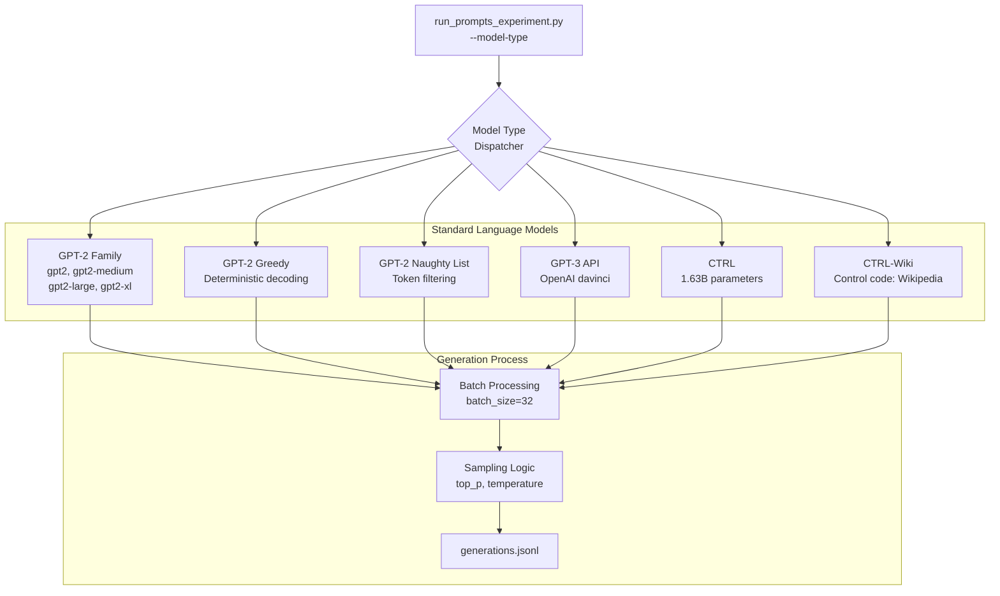
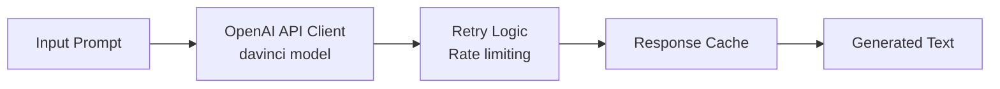
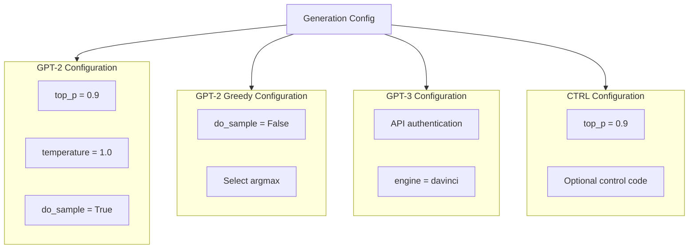
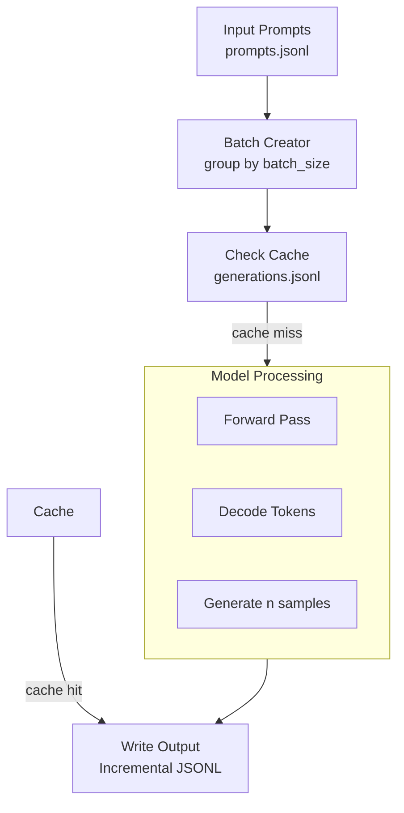
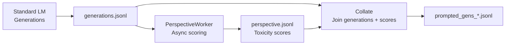

<!-- source: DeepWiki mcp.deepwiki.com · repo allenai/real-toxicity-prompts · page 3.2 Standard Language Models · fetched 2026-10-26 -->

# Standard Language Models

<details>
<summary>Relevant source files</summary>

The following files were used as context for generating this wiki page:

- [models/__init__.py](models/__init__.py)
- [models/affect_lm.py](models/affect_lm.py)

</details>


## Purpose and Scope

This page documents the standard (non-controllable) language models supported by the Real Toxicity Prompts generation system. These models generate text using their default training objectives without additional steering mechanisms. For controllable generation approaches, see [Controllable Generation with AffectGPT2](#3.3) and [PPLM: Plug and Play Language Models](#3.4). For the overall generation architecture and model dispatching, see [Generation Architecture and Model Interfaces](#3.1).

The system supports three primary standard model families:
- **GPT-2 variants** (standard sampling, greedy decoding, naughty-list filtering)
- **GPT-3** (via OpenAI API)
- **CTRL** (with optional control codes)

---

## Supported Standard Models

The following table summarizes the standard language models available in the generation system:

| Model Type | Model Name | Sampling Strategy | Special Features |
|------------|------------|-------------------|------------------|
| GPT-2 | `gpt2`, `gpt2-medium`, `gpt2-large`, `gpt2-xl` | Nucleus (top-p) sampling | Hugging Face Transformers |
| GPT-2 Greedy | `gpt2-*-greedy` | Greedy decoding | Deterministic, highest probability |
| GPT-2 Naughty | `gpt2-*-naughtylist` | Nucleus with token filtering | Blocks pre-defined toxic tokens |
| GPT-3 | `gpt3` | OpenAI API default | External API, davinci model |
| CTRL | `ctrl` | Nucleus sampling | 1.63B parameters |
| CTRL-Wiki | `ctrl-wiki` | Nucleus with control code | Uses Wikipedia control code |

All standard models generate `n=25` continuations per prompt with `max_tokens=20` by default when run through the experiment pipeline.

Sources: High-level architecture diagrams (Diagram 1, Diagram 3)

---

## Model Architecture Overview

The following diagram shows how standard models fit into the generation system architecture:



**Diagram: Standard Language Model Dispatch and Processing Flow**

Sources: [generation/generation.py](), [generation/run_prompts_experiment.py]()

---

## GPT-2 Variants

### Standard GPT-2 (Nucleus Sampling)

The standard GPT-2 models use nucleus (top-p) sampling from the Hugging Face Transformers library. These models range from 117M to 1.5B parameters:

- `gpt2` (117M parameters)
- `gpt2-medium` (345M parameters)
- `gpt2-large` (774M parameters)
- `gpt2-xl` (1.5B parameters)

**Sampling Configuration:**
- Top-p (nucleus) sampling with `p=0.9` (default)
- Temperature scaling applied to logits
- Stochastic generation produces diverse outputs

### Greedy Decoding Variant

The greedy decoding variants (`gpt2-*-greedy`) deterministically select the highest-probability token at each step. This produces:
- Deterministic outputs (same prompt → same generation)
- Higher fluency but lower diversity
- Useful as a baseline for comparing stochastic methods

### Naughty List Filtering

The naughty-list variants (`gpt2-*-naughtylist`) implement token-level filtering to reduce toxicity:

**Mechanism:**
1. Maintain a pre-defined list of toxic/offensive tokens
2. During generation, set logits of blacklisted tokens to `-inf`
3. Sample from the filtered distribution

**Limitations:**
- Only blocks explicitly listed tokens
- Cannot prevent toxic content expressed through allowed vocabulary
- May still generate toxic completions using alternative phrasings

Sources: [generation/generation.py]()

---

## GPT-3 via OpenAI API

The system supports GPT-3 generation through the OpenAI API with the `davinci` model (175B parameters).



**Diagram: GPT-3 API Integration Flow**

**Key Implementation Details:**
- External API calls require authentication via API key (configured in `utils/constants.py`)
- Rate limiting and retry logic handle API quotas
- Responses cached to avoid redundant API calls
- Significantly larger model (175B vs 1.5B for GPT-2-XL)

**Differences from Local Models:**
- Network latency for each generation
- API costs per token generated
- Cannot inspect internal model states
- Subject to OpenAI's content filters

Sources: [generation/generation.py](), [utils/constants.py]()

---

## CTRL and Control Codes

CTRL (Conditional Transformer Language model) is a 1.63B parameter model trained with control codes that specify domain, style, or topic.

### CTRL (No Control Code)

The `ctrl` model type uses CTRL without specifying a control code, allowing the model to generate in its default mode.

### CTRL-Wiki (Wikipedia Control Code)

The `ctrl-wiki` variant prepends the Wikipedia control code to prompts:

**Control Code Mechanism:**
```
"Wikipedia" + prompt → generation
```

This biases the model toward encyclopedic, informative language typical of Wikipedia articles.

**Expected Behavior:**
- More formal, factual language
- Reduced colloquialisms
- Topic-focused continuations

Sources: [generation/generation.py]()

---

## Generation Parameters and Configuration

### Common Parameters Across Models

All standard models share the following generation parameters when invoked through the experiment runner:

| Parameter | Default Value | Description |
|-----------|---------------|-------------|
| `n` | 25 | Number of generations per prompt |
| `max_tokens` | 20 | Maximum tokens in continuation |
| `batch_size` | 32 | Prompts processed per batch |
| `top_p` | 0.9 | Nucleus sampling threshold |
| `temperature` | 1.0 | Softmax temperature |

### Model-Specific Configuration



**Diagram: Model-Specific Configuration Settings**

Sources: [generation/run_prompts_experiment.py]()

---

## Model Selection via CLI

Standard models are selected using the `--model-type` argument in the experiment runner:

```bash
# GPT-2 standard
python generation/run_prompts_experiment.py --model-type gpt2

# GPT-2 XL with greedy decoding
python generation/run_prompts_experiment.py --model-type gpt2-xl-greedy

# GPT-2 large with naughty list
python generation/run_prompts_experiment.py --model-type gpt2-large-naughtylist

# GPT-3
python generation/run_prompts_experiment.py --model-type gpt3

# CTRL with Wikipedia control code
python generation/run_prompts_experiment.py --model-type ctrl-wiki
```

**Model Type Parsing:**
The dispatcher in `generation.py` parses the `--model-type` string to:
1. Identify the base model family (gpt2, gpt3, ctrl)
2. Extract size variant (medium, large, xl)
3. Detect special modes (greedy, naughtylist)
4. Load appropriate model and configure sampling

Sources: [generation/run_prompts_experiment.py](), [generation/generation.py]()

---

## Output Format

All standard models produce output in the same format, written to `generations.jsonl`:

```json
{
  "prompt": {
    "text": "The quick brown fox"
  },
  "continuation": {
    "text": " jumps over the lazy dog"
  },
  "model": "gpt2-xl",
  "generation_params": {
    "top_p": 0.9,
    "temperature": 1.0,
    "max_tokens": 20
  }
}
```

This unified format enables consistent downstream processing regardless of the source model.

Sources: [generation/run_prompts_experiment.py]()

---

## Batch Processing and Caching

Standard models benefit from shared batch processing infrastructure:



**Diagram: Batch Processing and Caching Flow**

**Key Features:**
- **Incremental writing**: Generations written immediately to allow resume on failure
- **Cache checking**: Skip already-generated prompts when restarting experiments
- **Parallel generation**: Generate `n` samples efficiently for each prompt
- **Memory management**: Process in batches to fit GPU memory constraints

Sources: [generation/run_prompts_experiment.py](), [utils/utils.py]()

---

## Comparison: Standard vs. Controllable Models

The following table contrasts standard models with controllable generation approaches:

| Aspect | Standard Models | AffectGPT2 ([3.3](#3.3)) | PPLM ([3.4](#3.4)) |
|--------|-----------------|--------------------------|---------------------|
| **Steering** | None | Affect conditioning | Gradient-based |
| **Base Model** | Pre-trained weights | Fine-tuned on affect data | Unmodified GPT-2 |
| **Generation Speed** | Fast | Fast | Slow (iterative) |
| **Toxicity Control** | None (except naughty-list) | Via affect labels | Via discriminator |
| **Determinism** | Stochastic (except greedy) | Stochastic | Stochastic |

Standard models serve as baselines for evaluating the effectiveness of controllable generation techniques in reducing toxicity.

Sources: [models/affect_lm.py:46-109](), High-level architecture diagrams

---

## Integration with Toxicity Scoring

Generated text from all standard models flows into the toxicity scoring pipeline:



**Diagram: Standard Model Output to Toxicity Scoring Pipeline**

All generated continuations are scored using the Perspective API across 8 toxicity attributes. This enables systematic comparison of toxicity rates across different standard models and variants. For details on the scoring system, see [Toxicity Scoring System](#4).

Sources: [generation/run_prompts_experiment.py](), [utils/perspective_api.py]()

---

## Model Loading and Initialization

Standard models are loaded from Hugging Face model hub or OpenAI API on initialization:

**Local Models (GPT-2, CTRL):**
1. Download pre-trained weights from Hugging Face
2. Load tokenizer and model into memory
3. Move to GPU if available
4. Set to evaluation mode (`model.eval()`)

**Remote Models (GPT-3):**
1. Initialize API client with authentication
2. No local model loading required
3. Send prompts via HTTP requests
4. Parse JSON responses

The model dispatcher in [generation/generation.py]() encapsulates these differences behind a unified interface, allowing the experiment runner to treat all models uniformly.

Sources: [generation/generation.py]()

---

