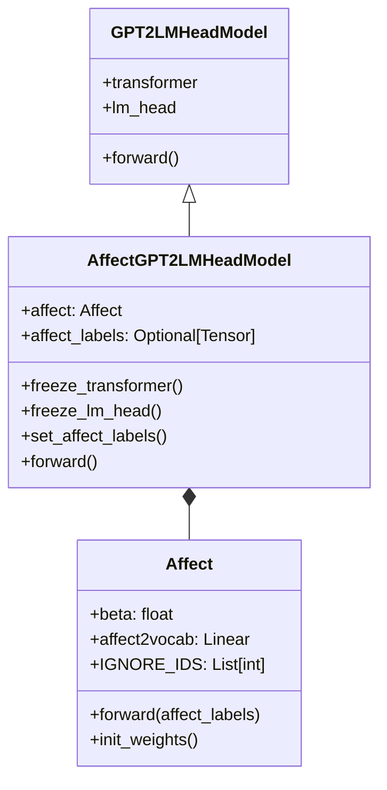
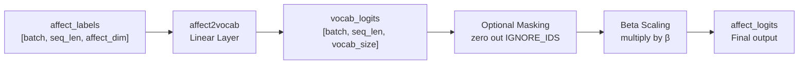
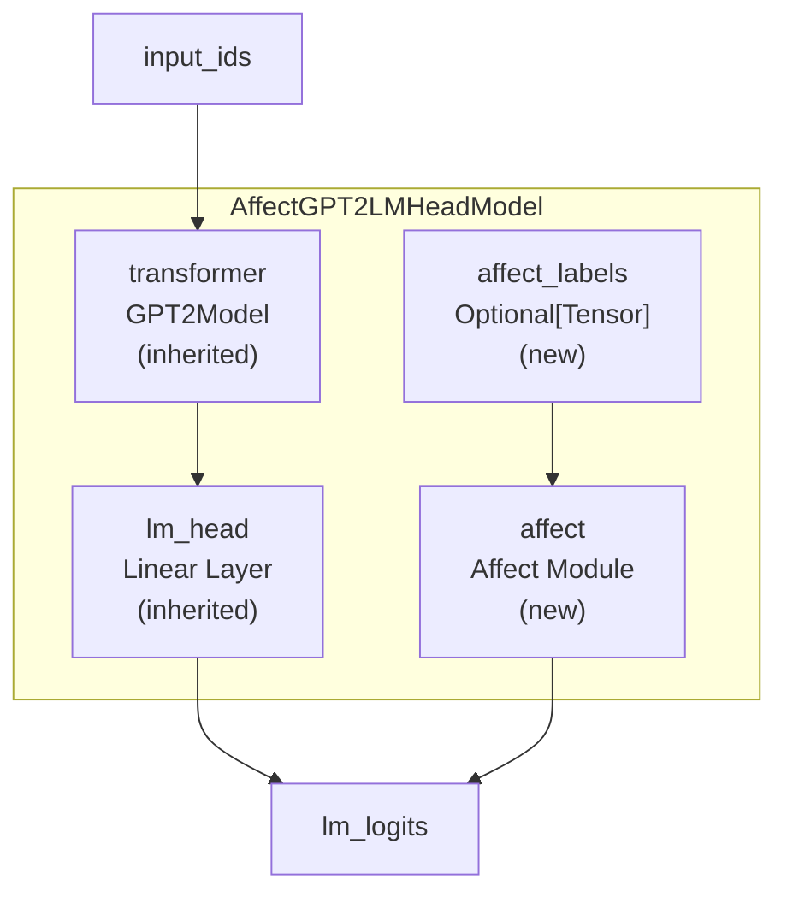
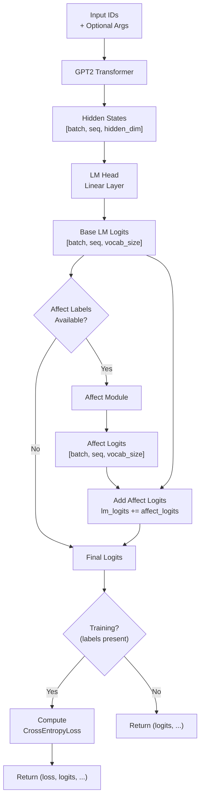
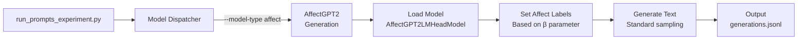
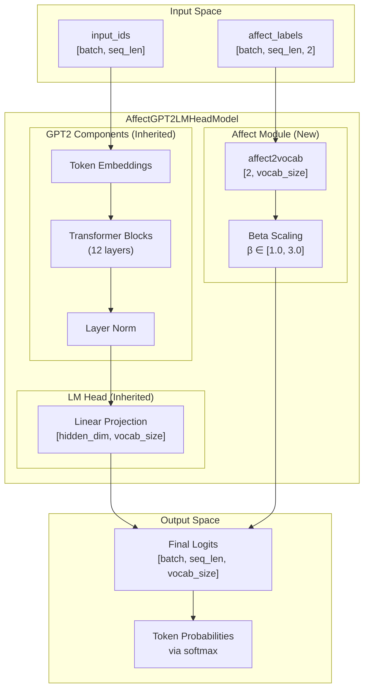
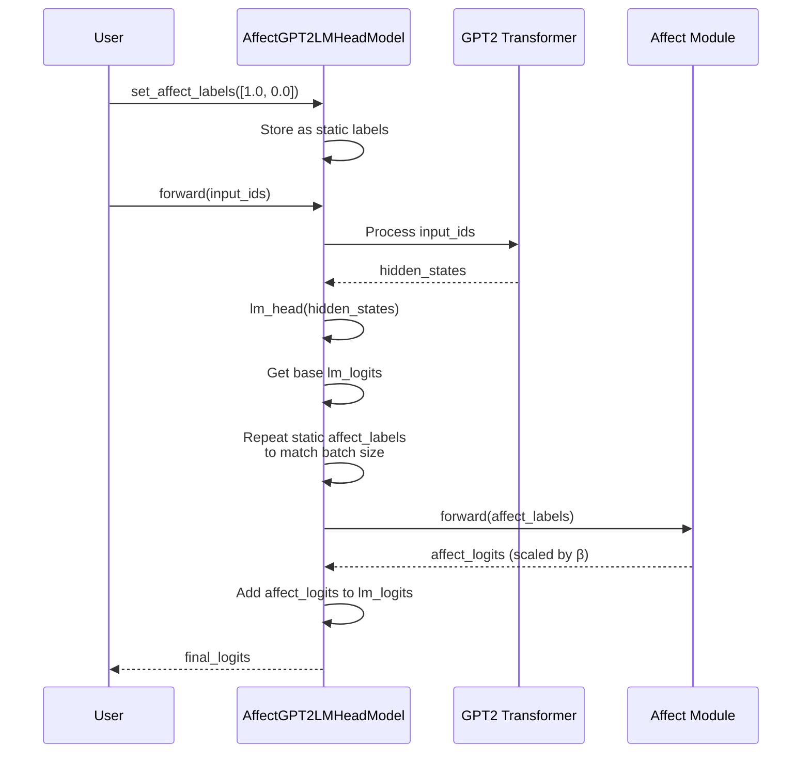

<!-- source: DeepWiki mcp.deepwiki.com · repo allenai/real-toxicity-prompts · page 3.3 Controllable Generation with AffectGPT2 · fetched 2026-10-26 -->

# Controllable Generation with AffectGPT2

<details>
<summary>Relevant source files</summary>

The following files were used as context for generating this wiki page:

- [models/affect_lm.py](models/affect_lm.py)

</details>


## Purpose and Scope

This document provides a comprehensive technical reference for the AffectGPT2 controllable text generation system. AffectGPT2 extends the standard GPT-2 language model with affect-based conditioning, enabling control over the emotional or tonal characteristics of generated text through affect labels and a tunable strength parameter (β).

For general text generation architecture and model dispatching, see [Generation Architecture and Model Interfaces](#3.1). For other generation strategies like PPLM, see [PPLM: Plug and Play Language Models](#3.4). For standard GPT-2 variants without affect conditioning, see [Standard Language Models](#3.2).

---

## Overview

AffectGPT2 is based on the Affect-LM architecture described in section 4.3 of Ghosh et al., which conditions language model predictions on affect categories. The model predicts the next word based on both the contextual information from previous words and an affect vector that represents emotional or tonal characteristics. The affect conditioning is implemented as an additive bias to the language model's logits, with the influence controlled by a scalar parameter β.

**Key characteristics:**
- Extends `GPT2LMHeadModel` from the transformers library
- Uses 2-dimensional affect vectors (`NUM_AFFECTS = 2`)
- Supports beta values typically in range [1.0, 3.0]
- Can accept affect labels dynamically during inference or use static labels
- Allows selective freezing of transformer and language model head parameters

**Sources:** [models/affect_lm.py:1-110]()

---

## Architecture Components

The AffectGPT2 system consists of two main components: the `Affect` module that maps affect vectors to vocabulary space, and the `AffectGPT2LMHeadModel` that integrates affect conditioning into GPT-2's generation process.

### Class Hierarchy



**Sources:** [models/affect_lm.py:11-110]()

---

## The Affect Module

The `Affect` class implements the core affect conditioning mechanism. It projects affect label vectors into the model's vocabulary space, creating bias terms that shift the probability distribution over next-word predictions.

### Architecture

| Component | Type | Shape | Purpose |
|-----------|------|-------|---------|
| `affect2vocab` | `nn.Linear` | `[affect_dim, vocab_size]` | Maps affect vectors to vocabulary logits |
| `beta` | `float` | scalar | Controls strength of affect conditioning |
| `IGNORE_IDS` | `List[int]` | `[50256, 247, 251, 250]` | Special tokens to ignore during conditioning |

**Initialization:**
```
Affect(affect_dim, vocab_size, beta=1.0, ignore_special_tokens=False)
```

**Sources:** [models/affect_lm.py:11-43]()

### Forward Pass

The affect module's forward pass is straightforward:



The computation is: `affect_logits = β * affect2vocab(affect_labels)`, with optional masking of special tokens at positions `[50256, 247, 251, 250]`.

**Sources:** [models/affect_lm.py:34-38]()

### Beta Parameter

The `beta` parameter controls the influence of affect conditioning on the final logits. According to the implementation comments, typical values range from 1.0 to 3.0:

| Beta Value | Effect |
|------------|--------|
| β = 1.0 | Baseline affect influence |
| β = 1.5 | Moderate conditioning |
| β = 2.0 | Strong conditioning |
| β = 2.5 | Very strong conditioning |
| β = 3.0 | Maximum tested conditioning |

Higher beta values amplify the affect signal, making the model more strongly biased toward tokens associated with the specified affect category.

**Sources:** [models/affect_lm.py:18-29]()

### Weight Initialization

The affect module uses GPT-2's standard initialization scheme:
- Weights: Normal distribution with mean=0.0, std=0.02 (from `GPT2Config.initializer_range`)
- Bias: Initialized to zeros

**Sources:** [models/affect_lm.py:40-43]()

---

## AffectGPT2LMHeadModel

The `AffectGPT2LMHeadModel` class extends `GPT2LMHeadModel` to incorporate affect conditioning into the generation process.

### Model Components



**Sources:** [models/affect_lm.py:46-52]()

### Affect Label Handling

The model supports two modes for providing affect labels:

#### 1. Static Affect Labels

Set once and reused for all forward passes:

```
model.set_affect_labels(affect_labels)  # affect_labels: [1, 1, NUM_AFFECTS]
```

When set, the labels are automatically repeated to match the batch size during forward pass.

**Sources:** [models/affect_lm.py:62-64]()

#### 2. Dynamic Affect Labels

Provided during each forward call:

```
outputs = model.forward(input_ids, affect_labels=affect_labels)
```

Dynamic labels take precedence over static labels.

**Sources:** [models/affect_lm.py:91-97]()

### Forward Pass with Affect Conditioning



**Sources:** [models/affect_lm.py:66-109]()

### Key Method: forward()

The forward method signature:

```
forward(
    input_ids=None,
    past=None,
    attention_mask=None,
    token_type_ids=None,
    position_ids=None,
    head_mask=None,
    inputs_embeds=None,
    labels=None,
    affect_labels=None,
)
```

**Processing steps:**
1. Pass inputs through GPT-2 transformer to get hidden states [models/affect_lm.py:78-86]()
2. Project hidden states to vocabulary logits via `lm_head` [models/affect_lm.py:89]()
3. If affect labels are available (dynamic or static), compute affect logits [models/affect_lm.py:91-97]()
4. Add affect logits to base LM logits [models/affect_lm.py:97]()
5. If training labels present, compute cross-entropy loss [models/affect_lm.py:100-107]()
6. Return outputs tuple [models/affect_lm.py:109]()

**Sources:** [models/affect_lm.py:66-109]()

---

## Parameter Freezing

AffectGPT2 provides methods to selectively freeze components during fine-tuning:

### Freeze Transformer

```python
model.freeze_transformer()
```

Sets `requires_grad=False` for all transformer parameters, preventing updates to the pretrained GPT-2 weights during training.

**Sources:** [models/affect_lm.py:54-56]()

### Freeze Language Model Head

```python
model.freeze_lm_head()
```

Sets `requires_grad=False` for the language model head parameters, allowing only the affect module to be trained.

**Sources:** [models/affect_lm.py:58-60]()

**Typical training scenario:**
1. Freeze transformer and lm_head
2. Train only the affect module parameters
3. This allows affect conditioning to be learned without disrupting pretrained language modeling capabilities

---

## Integration with Generation Pipeline

AffectGPT2 integrates into the broader text generation system described in [Generation Architecture and Model Interfaces](#3.1).

### Usage in Generation Experiments



**Parameters:**
- `--model-type affect` selects AffectGPT2
- Beta value controls affect conditioning strength
- Affect labels determine the target emotional/tonal characteristics

**Sources:** [models/affect_lm.py:1-110]()

---

## Technical Specifications

### Affect Dimensionality

```python
NUM_AFFECTS = 2
```

The system uses 2-dimensional affect vectors. This allows representation of a 2D emotional space (e.g., valence and arousal, or positive/negative sentiment dimensions).

**Sources:** [models/affect_lm.py:8]()

### Special Token Handling

The affect module can optionally ignore special tokens during conditioning:

| Token ID | Description |
|----------|-------------|
| 50256 | End of text token |
| 247 | Special token |
| 251 | Special token |
| 250 | Special token |

When `ignore_special_tokens=True`, affect logits for these positions are zeroed out, preventing affect conditioning from interfering with special token predictions.

**Sources:** [models/affect_lm.py:21]()

---

## Model Architecture Summary

### Component Relationships



**Sources:** [models/affect_lm.py:1-110]()

---

## Example: Affect Conditioning Process

### Mathematical Formulation

For a given input sequence at position `t`:

1. **Base LM logits**: `lm_logits[t] = W_lm · h[t]` where `h[t]` are hidden states
2. **Affect logits**: `affect_logits[t] = β · W_affect · a[t]` where `a[t]` is the affect vector
3. **Final logits**: `final_logits[t] = lm_logits[t] + affect_logits[t]`
4. **Next token probability**: `P(w | context, affect) ∝ exp(final_logits[t])`

The affect conditioning acts as an additive bias in log-probability space, shifting the distribution toward tokens that align with the specified affect category.

### Inference Flow



**Sources:** [models/affect_lm.py:62-109]()

---

## Implementation Notes

### Compatibility with Transformers Library

AffectGPT2LMHeadModel inherits from `transformers.GPT2LMHeadModel`, maintaining compatibility with:
- Hugging Face tokenizers
- Model loading and saving utilities
- Generation methods (`.generate()`)
- Training loops and optimization

The affect conditioning is transparent to the generation APIs, which see only the final adjusted logits.

**Sources:** [models/affect_lm.py:46]()

### Training Considerations

When training AffectGPT2:
1. The affect module parameters are typically initialized randomly while GPT-2 parameters are pretrained
2. Freezing transformer/lm_head prevents catastrophic forgetting
3. The `CrossEntropyLoss` in the forward pass operates on the combined (LM + affect) logits
4. Training requires paired data: input sequences and corresponding affect labels

**Sources:** [models/affect_lm.py:100-107]()

---

## Related Components

- **Generation System**: See [Generation Architecture and Model Interfaces](#3.1) for how AffectGPT2 integrates with the model dispatcher
- **Experiment Execution**: See [Experiment Configuration and Execution](#6.1) for command-line arguments to use AffectGPT2
- **Alternative Control Methods**: See [PPLM: Plug and Play Language Models](#3.4) for gradient-based controllable generation

**Sources:** [models/affect_lm.py:1-110]()

---

