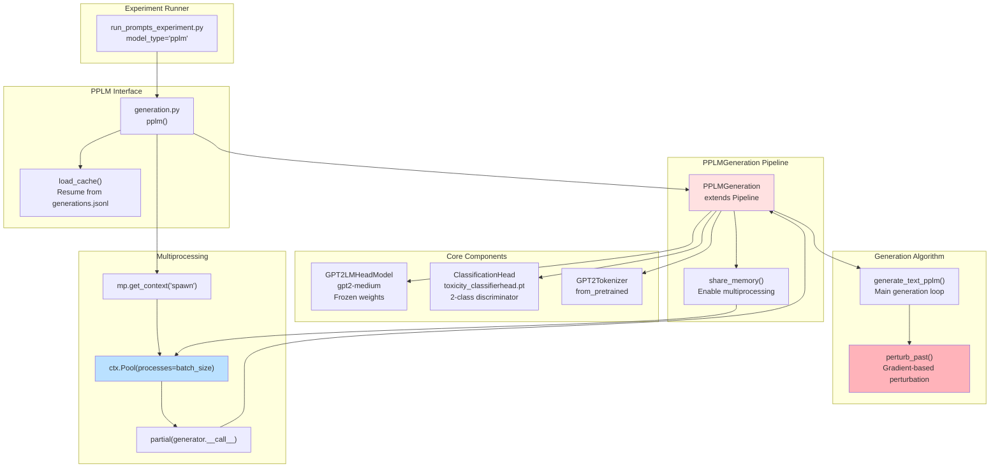
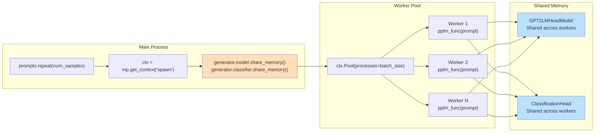
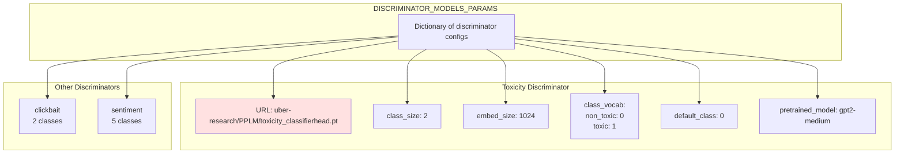
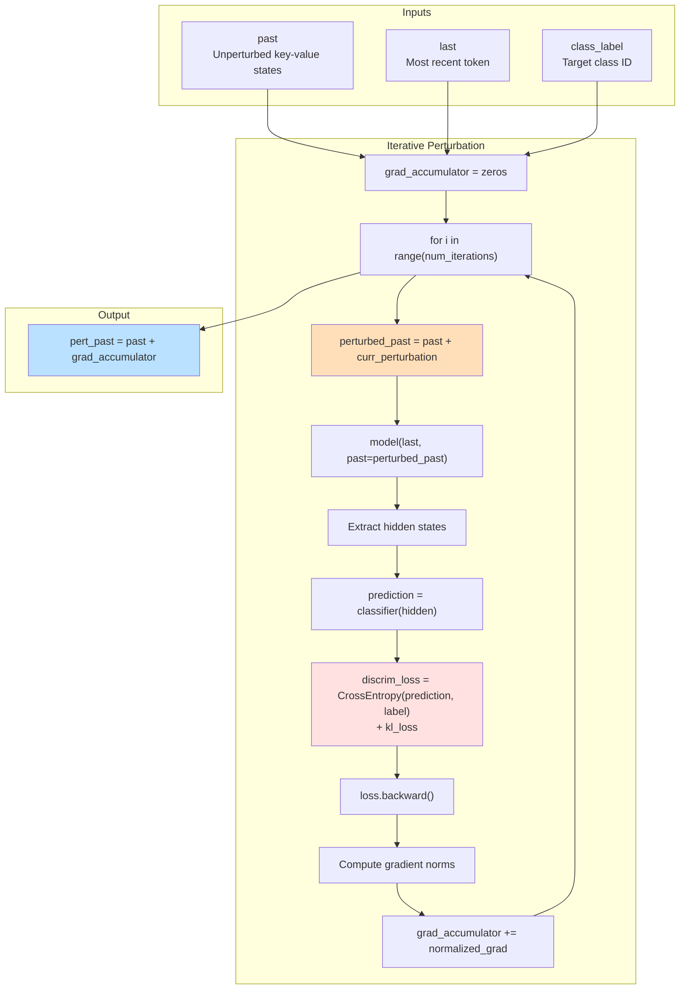
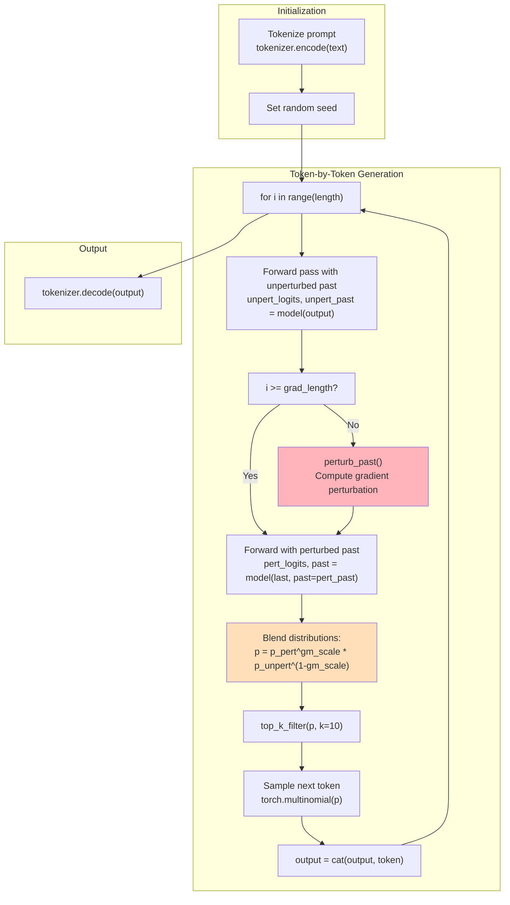
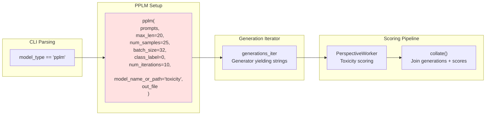
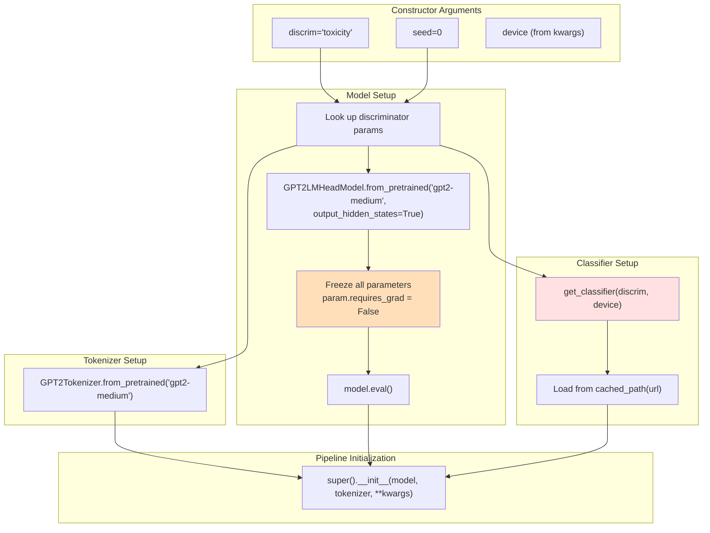

<!-- source: DeepWiki mcp.deepwiki.com · repo allenai/real-toxicity-prompts · page 3.4 PPLM: Plug and Play Language Models · fetched 2026-10-26 -->

# PPLM: Plug and Play Language Models

<details>
<summary>Relevant source files</summary>

The following files were used as context for generating this wiki page:

- [generation/generation.py](generation/generation.py)
- [generation/pplm_generation.py](generation/pplm_generation.py)
- [models/__init__.py](models/__init__.py)
- [scripts/run_prompts_experiment.py](scripts/run_prompts_experiment.py)
- [utils/constants.py](utils/constants.py)

</details>


## Purpose and Scope

This document explains the PPLM (Plug and Play Language Models) generation strategy implementation in the Real Toxicity Prompts codebase. PPLM is a controllable text generation technique that uses gradient-based perturbation of hidden states and a discriminator model to steer generation toward or away from specific attributes like toxicity.

This page covers the PPLM-specific implementation including the discriminator architecture, gradient perturbation algorithm, multiprocessing setup, and integration with the experiment pipeline. For general generation architecture and model interfaces, see [Generation Architecture and Model Interfaces](#3.1). For standard language model generation without gradient-based steering, see [Standard Language Models](#3.2).

## Overview

PPLM (Dathathri et al., 2019) enables controlled text generation by iteratively perturbing the hidden states of a pre-trained language model using gradients from a discriminator. Unlike fine-tuning approaches like AffectGPT2 (see [Controllable Generation with AffectGPT2](#3.3)), PPLM requires no model retraining and can be applied to any frozen language model.

### Key Characteristics

| Aspect | Implementation |
|--------|----------------|
| **Base Model** | GPT-2 Medium (frozen) |
| **Discriminator** | Pre-trained toxicity classifier |
| **Perturbation Method** | Gradient-based modification of past key-value states |
| **Parallelization** | Multiprocessing with shared memory |
| **Class Labels** | `0` = non-toxic, `1` = toxic |
| **Iterations per Token** | 10 (default) |

Sources: [generation/pplm_generation.py:390-481](), [generation/generation.py:27-59]()

## System Architecture

### Component Overview



Sources: [generation/generation.py:27-59](), [generation/pplm_generation.py:390-419](), [scripts/run_prompts_experiment.py:185-193]()

### Multiprocessing Setup

PPLM uses a unique multiprocessing architecture to parallelize generation across prompts:



**Implementation Details:**
- Uses `spawn` context (not `fork`) for clean process isolation [generation/generation.py:37]()
- Model and classifier placed in shared memory for efficiency [generation/generation.py:38-39]()
- Each worker independently generates text but shares model weights [generation/generation.py:53-58]()
- Pool size equals `batch_size` parameter, enabling parallel prompt processing

Sources: [generation/generation.py:35-59]()

## Discriminator Models

PPLM requires a pre-trained discriminator to guide generation. The codebase supports three discriminator types, with toxicity being the primary one used for Real Toxicity Prompts experiments.

### Discriminator Configuration



**Toxicity Discriminator Specifications:**
- Binary classifier: non-toxic (0) vs toxic (1)
- Operates on GPT-2 Medium hidden states (1024 dimensions)
- Pre-trained on toxicity-labeled data
- Default target class is 0 (non-toxic) for detoxification

Sources: [generation/pplm_generation.py:35-60]()

### ClassificationHead Architecture

The discriminator is a simple feedforward classifier operating on averaged hidden states:

| Component | Description |
|-----------|-------------|
| **Input** | Averaged hidden states from all layers |
| **Architecture** | Linear layer: `embed_size` → `class_size` |
| **Weights** | Loaded from pre-trained checkpoint |
| **Mode** | Evaluation mode (no training) |

Sources: [generation/pplm_generation.py:87-98](), [models/pplm_classification_head.py]()

## Gradient-Based Perturbation Algorithm

PPLM's core innovation is gradient-based perturbation of the language model's past key-value states. This allows steering generation without modifying model weights.

### Perturbation Process



Sources: [generation/pplm_generation.py:124-250]()

### Perturbation Hyperparameters

| Parameter | Default | Purpose |
|-----------|---------|---------|
| `num_iterations` | 10 | Number of gradient updates per token |
| `stepsize` | 0.02 | Gradient step size |
| `gamma` | 1.0 | Gradient normalization exponent |
| `kl_scale` | 0.01 | KL divergence penalty weight |
| `horizon_length` | 1 | Look-ahead window for prediction |
| `window_length` | 0 | Past window to perturb (0 = all) |
| `gm_scale` | 0.9 | Geometric mean blending factor |

Sources: [generation/pplm_generation.py:422-439]()

### Loss Function Components

The perturbation loss combines discriminator loss with KL divergence:

**1. Discriminator Loss:**
```
discrim_loss = CrossEntropyLoss(classifier(hidden), target_class)
```
- Steers generation toward target class (non-toxic: 0)
- Applied to averaged hidden states over horizon

**2. KL Divergence Loss:**
```
kl_loss = kl_scale * sum(p_perturbed * log(p_perturbed / p_unperturbed))
```
- Prevents perturbed distribution from diverging too far from original
- Acts as a fluency regularizer

**3. Combined Loss:**
```
total_loss = discrim_loss + kl_loss
```

Sources: [generation/pplm_generation.py:189-215]()

## Text Generation Process

### Generation Flow



Sources: [generation/pplm_generation.py:253-388]()

### Probability Blending

PPLM blends perturbed and unperturbed probability distributions using geometric mean:

```
p_final = (p_perturbed ^ gm_scale) * (p_unperturbed ^ (1 - gm_scale))
```

**Blending Behavior:**
- `gm_scale = 0.9` (default): Strong influence from perturbation
- `gm_scale = 1.0`: Pure perturbed distribution (may lose fluency)
- `gm_scale = 0.0`: Pure unperturbed distribution (no control)

This balances controllability with fluency, preventing the discriminator from dominating the generation.

Sources: [generation/pplm_generation.py:359-374]()

## Integration with Experiment Pipeline

### Experiment Configuration

PPLM is invoked in experiments using the command-line interface:

```bash
python scripts/run_prompts_experiment.py output_dir \
    --model-type pplm \
    --dataset-file prompts.jsonl \
    --n 25 \
    --max-tokens 20 \
    --batch-size 32
```

**Key Parameters:**
- `--model-type pplm`: Selects PPLM generation strategy
- `--n`: Number of samples per prompt (repeated for multiprocessing)
- `--batch-size`: Number of parallel worker processes
- `--max-tokens`: Generation length

Sources: [scripts/run_prompts_experiment.py:185-193]()

### Invocation in run_prompts_experiment.py



**Fixed Configuration:**
- `class_label=0`: Target non-toxic class
- `num_iterations=10`: 10 gradient steps per token
- `model_name_or_path='toxicity'`: Use toxicity discriminator

Sources: [scripts/run_prompts_experiment.py:185-193]()

### Output Format

PPLM generates text incrementally and caches to disk:

**generations.jsonl:**
```json
"generated continuation text without prompt"
"another generation for next prompt"
```

**Format Details:**
- One JSON string per line (raw text, not object)
- Excludes the input prompt (only continuation)
- Cacheable for resume functionality
- Total generations: `len(prompts) * num_samples`

Sources: [generation/generation.py:56-58](), [generation/pplm_generation.py:473-480]()

## PPLMGeneration Class

The `PPLMGeneration` class extends the Hugging Face `Pipeline` interface and encapsulates all PPLM functionality.

### Class Structure

| Component | Description |
|-----------|-------------|
| **Base Class** | `transformers.Pipeline` |
| **Model** | `GPT2LMHeadModel.from_pretrained('gpt2-medium')` |
| **Tokenizer** | `GPT2Tokenizer.from_pretrained('gpt2-medium')` |
| **Classifier** | `ClassificationHead` loaded from checkpoint |
| **Parameters** | Frozen (no gradients) |

Sources: [generation/pplm_generation.py:390-419]()

### Initialization Process



Sources: [generation/pplm_generation.py:391-419]()

### __call__ Method Signature

The `__call__` method provides the main interface for PPLM generation:

| Parameter | Type | Default | Description |
|-----------|------|---------|-------------|
| `cond_text` | str | `''` | Conditioning text (prompt) |
| `num_samples` | int | 1 | Number of generations |
| `class_label` | int | -1 | Target class (0=non-toxic) |
| `length` | int | 20 | Number of tokens to generate |
| `stepsize` | float | 0.02 | Gradient step size |
| `temperature` | float | 1.0 | Sampling temperature |
| `top_k` | int | 10 | Top-k filtering |
| `sample` | bool | True | Sample vs greedy decoding |
| `num_iterations` | int | 10 | Gradient iterations per token |
| `grad_length` | int | 10000 | Max position for gradients |
| `horizon_length` | int | 1 | Future prediction horizon |
| `window_length` | int | 0 | Past window (0=all) |
| `decay` | bool | False | Apply decay mask |
| `gamma` | float | 1.0 | Gradient norm exponent |
| `gm_scale` | float | 0.9 | Geometric mean blend |
| `kl_scale` | float | 0.01 | KL divergence weight |
| `repetition_penalty` | float | 1.0 | Penalty for repeated tokens |

Sources: [generation/pplm_generation.py:422-441]()

## Performance Considerations

### Computational Characteristics

| Aspect | Impact |
|--------|--------|
| **Speed** | 10-100x slower than standard generation |
| **Memory** | ~2x model size (stores gradients) |
| **Parallelization** | Process-level via multiprocessing |
| **Gradient Computation** | `num_iterations` backward passes per token |

### Optimization Strategies

**1. Multiprocessing:**
- Shared memory avoids duplicating model weights [generation/generation.py:38-39]()
- Each worker processes independent prompts
- Scales linearly with worker count (up to hardware limits)

**2. Gradient Length Limit:**
```python
if i >= grad_length:
    current_stepsize = stepsize * 0  # Disable perturbation
```
- Stops gradient computation after `grad_length` tokens
- Improves speed for long generations
- Default 10000 effectively disables limit for short generations

**3. Caching:**
- Resumes from `generations.jsonl` if interrupted [generation/generation.py:46-49]()
- Avoids recomputing already generated text
- Essential for long-running experiments

Sources: [generation/pplm_generation.py:302-305](), [generation/generation.py:46-59]()

## Usage Examples

### Basic PPLM Generation

From the experiment runner:
```bash
python scripts/run_prompts_experiment.py output/pplm_test \
    --dataset-file data/prompts.jsonl \
    --model-type pplm \
    --model toxicity \
    --n 25 \
    --max-tokens 20 \
    --batch-size 8
```

**Parameters:**
- Loads prompts from `data/prompts.jsonl`
- Generates 25 samples per prompt
- 20 tokens per generation
- 8 parallel workers

Sources: [scripts/run_prompts_experiment.py:185-193]()

### Direct PPLMGeneration Usage

For programmatic use:
```python
from generation.pplm_generation import PPLMGeneration

generator = PPLMGeneration('toxicity', device=0)
generations = generator(
    cond_text="Once upon a time",
    num_samples=5,
    class_label=0,  # non-toxic
    length=20,
    num_iterations=10
)
```

Sources: [generation/pplm_generation.py:390-481]()

## Relationship to Other Generation Methods

PPLM differs from other generation strategies in the codebase:

| Method | Approach | Training Required | Speed | Control Strength |
|--------|----------|-------------------|-------|------------------|
| **Standard GPT-2** | Unmodified sampling | No | Fast | None |
| **AffectGPT2** | Fine-tuned model | Yes | Fast | Strong |
| **PPLM** | Gradient perturbation | No | Very slow | Moderate |
| **Naughty List** | Token blocking | No | Fast | Coarse |

**When to Use PPLM:**
- Need controllability without fine-tuning
- Want to experiment with different control signals
- Computational cost is acceptable
- Moderate control sufficient

For stronger control with acceptable speed, see [Controllable Generation with AffectGPT2](#3.3).

Sources: [scripts/run_prompts_experiment.py:15-16](), [generation/generation.py:27-258]()

---

