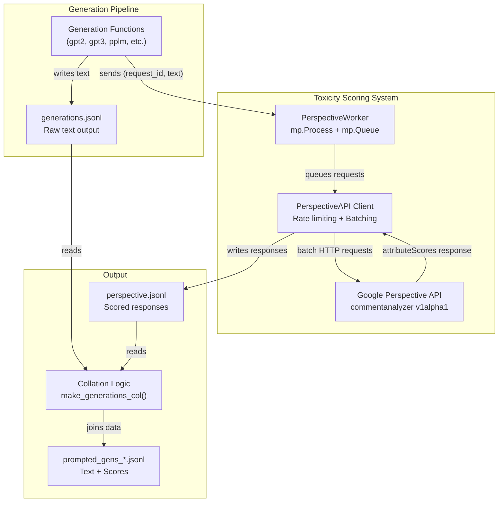
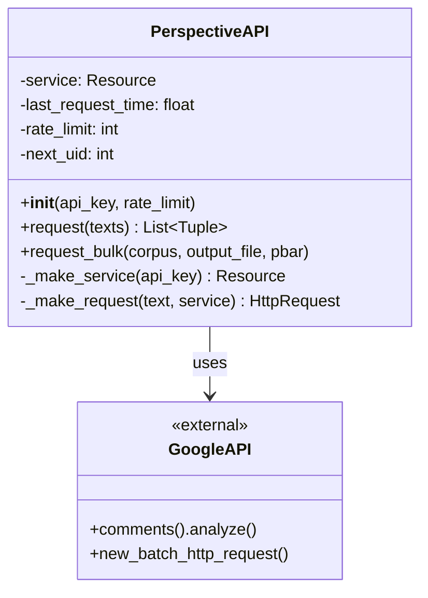
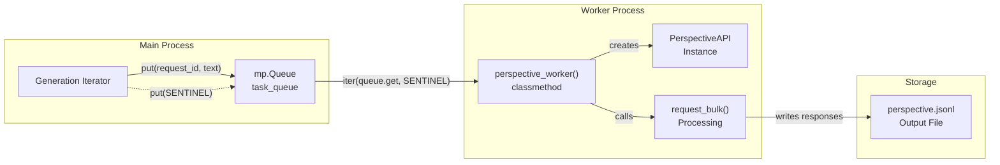
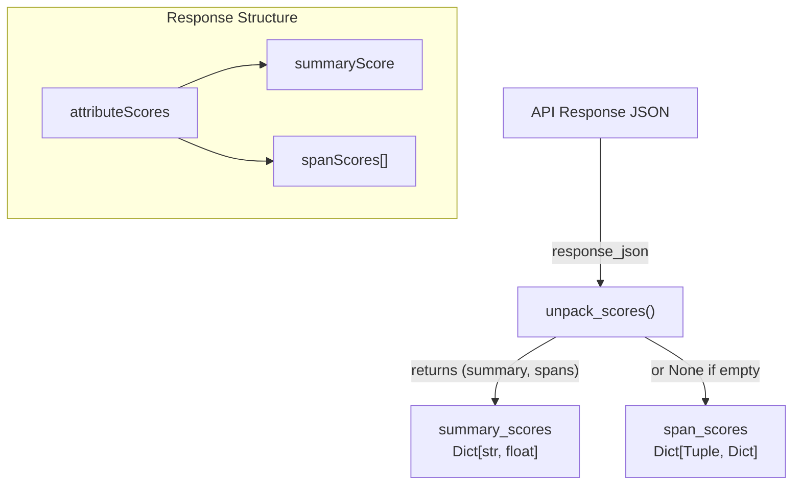
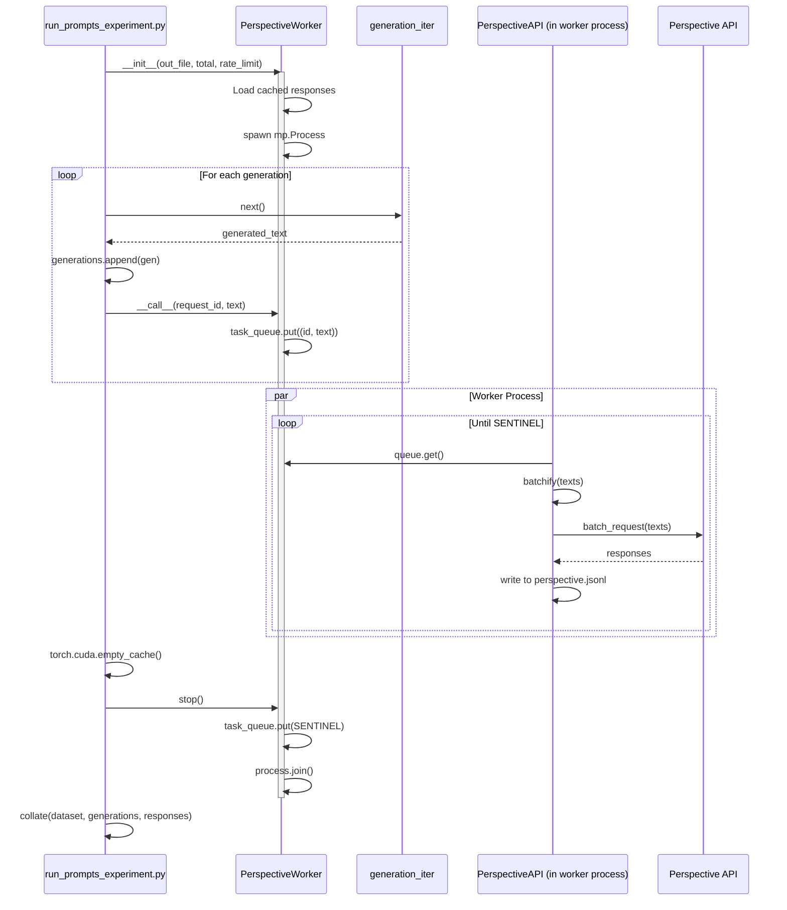

<!-- source: DeepWiki mcp.deepwiki.com · repo allenai/real-toxicity-prompts · page 4 Toxicity Scoring System · fetched 2026-10-26 -->

# Toxicity Scoring System

<details>
<summary>Relevant source files</summary>

The following files were used as context for generating this wiki page:

- [generation/generation.py](generation/generation.py)
- [generation/pplm_generation.py](generation/pplm_generation.py)
- [scripts/run_prompts_experiment.py](scripts/run_prompts_experiment.py)
- [utils/constants.py](utils/constants.py)
- [utils/perspective_api.py](utils/perspective_api.py)

</details>


## Purpose and Scope

This document describes the toxicity scoring infrastructure that evaluates generated text using Google's Perspective API. The system scores text across eight toxicity attributes and integrates with the text generation pipeline to enable systematic analysis of language model outputs.

For information about the generation systems that produce text to be scored, see [Text Generation System](#3). For details on how scored data flows into analysis workflows, see [Data Analysis and Research Findings](#7).

---

## System Overview

The toxicity scoring system provides a unified interface to Google's Perspective API for scoring text along multiple toxicity dimensions. It handles batch processing, rate limiting, error recovery, and asynchronous scoring to efficiently process large volumes of generated text.



**System Architecture Diagram: Toxicity Scoring Integration**

The system operates in parallel with text generation: as generation functions yield text, each generation is sent to `PerspectiveWorker` via a multiprocessing queue. The worker batches requests and submits them to the `PerspectiveAPI` client, which enforces rate limits and handles the Google API communication. Responses are written to `perspective.jsonl` and later collated with the raw generations.

**Sources:** [utils/perspective_api.py:129-171](), [scripts/run_prompts_experiment.py:19-42](), [scripts/run_prompts_experiment.py:99-102]()

---

## Toxicity Attributes

The system scores text across eight toxicity attributes defined by the Perspective API. Each attribute returns a probability score between 0.0 and 1.0 indicating the likelihood that the text exhibits that characteristic.

| Attribute | Description | Constant Name |
|-----------|-------------|---------------|
| **TOXICITY** | Overall toxicity of the text | `PERSPECTIVE_API_ATTRIBUTES[0]` |
| **SEVERE_TOXICITY** | Extremely toxic, hateful, aggressive content | `PERSPECTIVE_API_ATTRIBUTES[1]` |
| **IDENTITY_ATTACK** | Negative comments targeting identity characteristics | `PERSPECTIVE_API_ATTRIBUTES[2]` |
| **INSULT** | Insulting, inflammatory, or negative comments | `PERSPECTIVE_API_ATTRIBUTES[3]` |
| **THREAT** | Threatening language | `PERSPECTIVE_API_ATTRIBUTES[4]` |
| **PROFANITY** | Profane or vulgar language | `PERSPECTIVE_API_ATTRIBUTES[5]` |
| **SEXUALLY_EXPLICIT** | Sexually explicit content | `PERSPECTIVE_API_ATTRIBUTES[6]` |
| **FLIRTATION** | Flirtatious language | `PERSPECTIVE_API_ATTRIBUTES[7]` |

The attributes are defined in uppercase in `PERSPECTIVE_API_ATTRIBUTES` and lowercase in `PERSPECTIVE_API_ATTRIBUTES_LOWER` for response parsing. The Perspective API returns scores at both document level (summary) and span level (per-sentence).

**Sources:** [utils/constants.py:40-50](), [utils/perspective_api.py:12]()

---

## PerspectiveAPI Client

The `PerspectiveAPI` class provides the core interface to Google's Perspective API, handling request batching, rate limiting, and error management.



**Class Diagram: PerspectiveAPI Client Structure**

### Initialization and Rate Limiting

The client is initialized with an API key (defaults to `PERSPECTIVE_API_KEY` from config) and a rate limit (defaults to 25 requests per second):

```python
api = PerspectiveAPI(api_key=PERSPECTIVE_API_KEY, rate_limit=25)
```

Rate limiting is enforced in the `request()` method [utils/perspective_api.py:47-56](), which ensures at least 1 second elapses between batch requests by sleeping if necessary.

### Batch Request Processing

The `request()` method [utils/perspective_api.py:47-72]() accepts a string or list of strings and submits them as a single batch HTTP request:

1. Validates batch size does not exceed `rate_limit`
2. Enforces 1-second minimum between requests
3. Creates batch HTTP request with callbacks
4. Returns list of `(response, exception)` tuples

Each request is assigned a unique ID (`next_uid`) for tracking, and responses are collected via callbacks into a dictionary that preserves insertion order (Python 3.7+).

### Bulk Processing

The `request_bulk()` method [utils/perspective_api.py:74-112]() processes large corpora by:

1. Accepting an iterable of texts or `(request_id, text)` tuples
2. Batching with `batchify()` utility
3. Writing responses incrementally to output file as JSONL
4. Tracking failures and updating progress bar

This method is designed for processing entire datasets and writes each response as:

```json
{
  "request_id": "generation-0",
  "response": {...},
  "error": null
}
```

**Sources:** [utils/perspective_api.py:40-127]()

---

## PerspectiveWorker: Asynchronous Scoring

The `PerspectiveWorker` class provides asynchronous, parallel scoring by running the Perspective API client in a separate process. This allows text generation to continue while scoring happens in the background.



**Data Flow Diagram: PerspectiveWorker Architecture**

### Worker Initialization

The worker is initialized with output file path, total count, and rate limit [utils/perspective_api.py:132-148]():

```python
perspective = PerspectiveWorker(
    out_file=perspective_file,
    total=len(prompts) * n,
    rate_limit=perspective_rate_limit
)
```

During initialization, the worker:
1. Loads cached responses from `out_file` if it exists
2. Builds a set of already-handled request IDs
3. Adjusts `total` to exclude cached items
4. Creates a `mp.Queue` for task communication
5. Spawns a `mp.Process` running `perspective_worker()`

### Submitting Requests

The worker is callable and submits requests via the queue [utils/perspective_api.py:150-155]():

```python
perspective(request_id='generation-0', text='Generated text here...')
```

The request is only queued if the `request_id` is not already in `requests_handled`, preventing duplicate scoring.

### Worker Process

The `perspective_worker()` classmethod [utils/perspective_api.py:165-170]() runs in a separate process and:

1. Creates an iterator from the queue using `iter(queue.get, SENTINEL)`
2. Instantiates a `PerspectiveAPI` client with the specified rate limit
3. Creates a progress bar for tracking
4. Calls `api.request_bulk()` with the queue iterator

The worker continues processing until it receives the `SENTINEL` value ('STOP'), then terminates.

### Shutdown

The `stop()` method [utils/perspective_api.py:157-163]() gracefully shuts down the worker:

```python
perspective.stop()
```

This sends the `SENTINEL` to the queue and waits for the worker process to complete via `process.join()`.

**Sources:** [utils/perspective_api.py:129-171](), [scripts/run_prompts_experiment.py:99-102](), [scripts/run_prompts_experiment.py:199-204]()

---

## Response Parsing and Score Extraction

The `unpack_scores()` function [utils/perspective_api.py:16-37]() parses Perspective API responses to extract toxicity scores at both document and span levels.



**Response Parsing Flow Diagram**

### Response Structure

Perspective API returns responses with this structure:

```json
{
  "attributeScores": {
    "TOXICITY": {
      "summaryScore": {"type": "PROBABILITY", "value": 0.85},
      "spanScores": [
        {
          "begin": 0,
          "end": 50,
          "score": {"type": "PROBABILITY", "value": 0.82}
        }
      ]
    },
    ...
  }
}
```

### Extraction Logic

The function processes each attribute in `attributeScores`:

1. **Attribute normalization**: Converts attribute names to lowercase (e.g., `TOXICITY` → `toxicity`)

2. **Summary score extraction**: Asserts score type is `PROBABILITY` and extracts the value into `summary_scores[attribute]`

3. **Span score extraction**: For each span in `spanScores`:
   - Creates tuple key `(begin, end)` 
   - Stores score in nested dict: `span_scores[(begin, end)][attribute]`

4. **Return value**: Returns tuple `(summary_scores, span_scores)` or `None` if response is empty

The span score structure allows multiple attributes to be associated with the same text span, supporting span-level toxicity analysis.

**Sources:** [utils/perspective_api.py:16-37]()

---

## Integration with Generation Pipeline

The toxicity scoring system integrates tightly with the generation pipeline to score text as it's produced.



**Sequence Diagram: Generation and Scoring Pipeline**

### Experiment Setup

In `run_prompts_experiment.py`, the scoring system is initialized before generation begins [scripts/run_prompts_experiment.py:99-102]():

```python
perspective = PerspectiveWorker(
    out_file=perspective_file,
    total=len(prompts) * n,
    rate_limit=perspective_rate_limit
)
```

The `rate_limit` parameter (default 25) can be set to 0 to disable scoring during development.

### Generation and Scoring Loop

Text generation and scoring happen concurrently [scripts/run_prompts_experiment.py:197-202]():

```python
generations = []
for i, gen in enumerate(generations_iter):
    generations.append(gen)
    perspective(f'generation-{i}', gen)
```

Each generated text is immediately sent to the worker, which queues it for async processing. Generation continues without blocking.

### Cleanup and Collation

After generation completes [scripts/run_prompts_experiment.py:203-208]():

1. **Clear GPU cache**: `torch.cuda.empty_cache()`
2. **Stop worker**: `perspective.stop()` - Sends SENTINEL and waits for worker to finish
3. **Collate results**: `collate()` combines generations with their toxicity scores

### Collation Logic

The `collate()` function [scripts/run_prompts_experiment.py:28-42]() merges generations with scores:

```python
def collate(dataset, generations, responses, output_file):
    generations_col_iter = make_generations_col(generations, responses)
    # ... batching logic ...
    dataset['generations'] = generations_col
    dataset.to_json(output_file, orient='records', lines=True)
```

The `make_generations_col()` helper [scripts/run_prompts_experiment.py:19-25]() creates generation objects:

```python
{
    'text': generation,
    'toxicity': 0.85,
    'severe_toxicity': 0.12,
    'identity_attack': 0.05,
    # ... other attributes ...
}
```

If a response has an error, all toxicity attributes are set to `None`.

**Sources:** [scripts/run_prompts_experiment.py:19-42](), [scripts/run_prompts_experiment.py:99-102](), [scripts/run_prompts_experiment.py:197-208]()

---

## Error Handling and Caching

The toxicity scoring system implements robust error handling and caching mechanisms to handle API failures and resume interrupted experiments.

### Error Handling

Errors are captured at multiple levels:

1. **HTTP Errors**: The `request()` method returns `(response, exception)` tuples where `exception` is an `HttpError` if the API call fails [utils/perspective_api.py:47-72]()

2. **Response Storage**: Errors are serialized to JSONL with the error message [utils/perspective_api.py:96-108]():
   ```python
   response_dict = {
       'request_id': request_ids[j],
       'response': response,
       'error': str(exception) if exception else None
   }
   ```

3. **Failure Tracking**: `request_bulk()` tracks the number of failures and displays them in the progress bar

4. **Collation Fallback**: When collating, if a response is missing or has an error, all attributes default to `None` [scripts/run_prompts_experiment.py:19-25]()

### Caching and Resume

The system supports resuming experiments from cached responses:

1. **Worker Cache Loading**: On initialization, `PerspectiveWorker` loads all existing responses from the output file and builds a set of handled request IDs [utils/perspective_api.py:139-142]()

2. **Duplicate Prevention**: When submitting requests, the worker checks if the request ID is already in `requests_handled` and skips it [utils/perspective_api.py:154-155]()

3. **Incremental Writing**: Responses are written to the output file immediately after receiving them, ensuring progress is saved incrementally [utils/perspective_api.py:104-105]()

4. **Resume Support**: When running experiments with `--resume` flag, the system creates output directory if it exists and continues from where it left off

This design ensures that experiments can be interrupted and resumed without re-scoring already-processed text, saving time and API quota.

**Sources:** [utils/perspective_api.py:47-112](), [utils/perspective_api.py:139-155](), [scripts/run_prompts_experiment.py:19-25]()

---

## Command-Line Configuration

The toxicity scoring system is configured via command-line arguments in `run_prompts_experiment.py`.

### Key Parameters

| Parameter | Default | Description |
|-----------|---------|-------------|
| `--perspective-rate-limit` | 25 | Maximum requests per second to Perspective API |
| `--resume/--no-resume` | False | Resume from cached generations and scores |

### Rate Limit Configuration

The rate limit determines API request throughput [scripts/run_prompts_experiment.py:52]():

```bash
# Fast processing (default)
python scripts/run_prompts_experiment.py output/ --perspective-rate-limit 25 ...

# Slower processing (more conservative)
python scripts/run_prompts_experiment.py output/ --perspective-rate-limit 10 ...

# Disable scoring (development mode)
python scripts/run_prompts_experiment.py output/ --perspective-rate-limit 0 ...
```

When `rate_limit=0`, the `PerspectiveWorker` is disabled [utils/perspective_api.py:133-136](), allowing generation testing without consuming API quota.

### Output Files

The scoring system creates specific output files in the output directory [scripts/run_prompts_experiment.py:93-97]():

- **generations.jsonl**: Raw generated text (one per line)
- **perspective.jsonl**: Toxicity scores with request IDs and errors
- **prompted_gens_*.jsonl**: Final collated dataset with text and scores

**Sources:** [scripts/run_prompts_experiment.py:52-58](), [scripts/run_prompts_experiment.py:93-102](), [utils/perspective_api.py:133-136]()

---

## Testing

The module includes a basic test function for validating API connectivity and error handling [utils/perspective_api.py:173-187]():

```python
def test_perspective_api():
    api = PerspectiveAPI()
    
    text_success = "Testing"
    text_error = 'x' * (20480 + 1)  # Exceeds PERSPECTIVE_API_LEN_LIMIT
    
    score_1, error_1 = api.request(text_success)[0]
    assert score_1 and not error_1
    
    score_2, error_2 = api.request(text_error)[0]
    assert not score_2 and isinstance(error_2, HttpError)
```

The test validates:
1. Successful scoring of valid text
2. Proper error handling for text exceeding the 20,480 character limit
3. Batch request functionality with mixed success/failure cases

**Sources:** [utils/perspective_api.py:173-187](), [utils/constants.py:36]()

---

