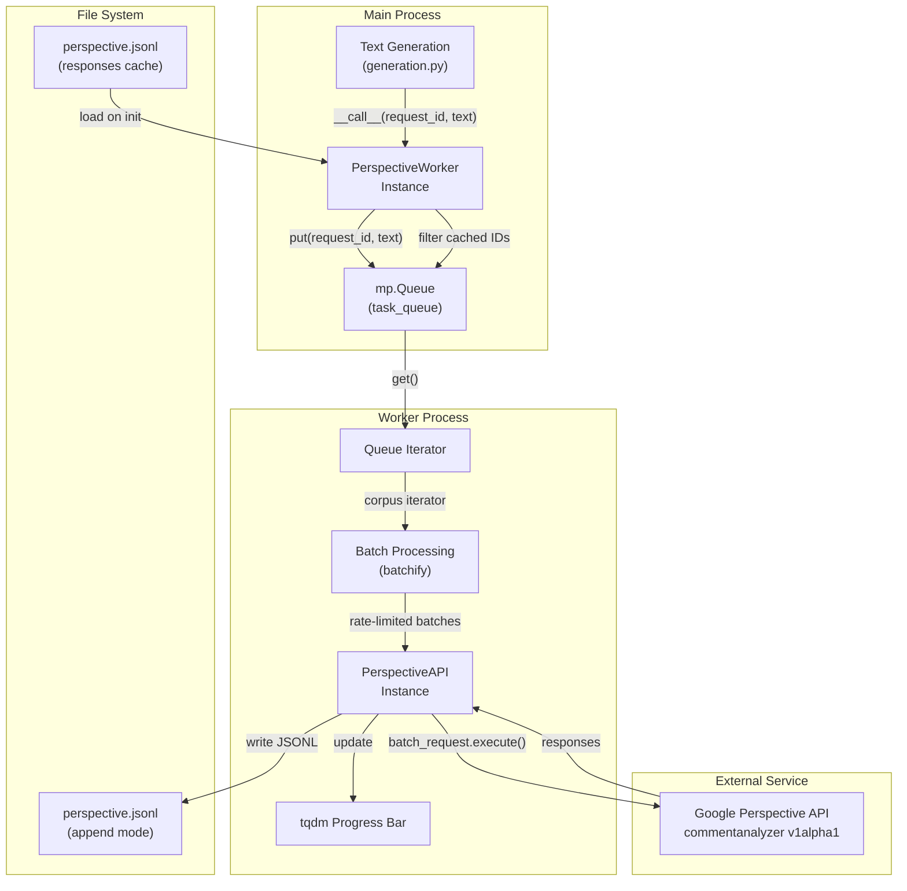
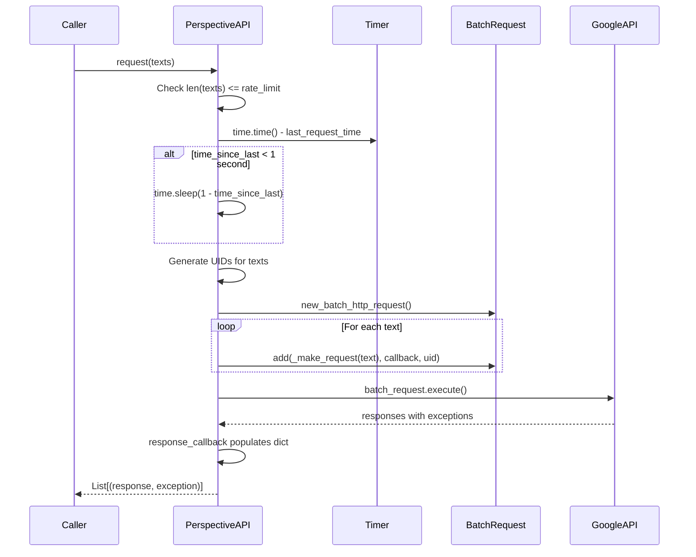
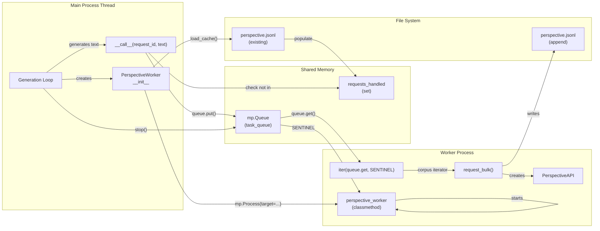
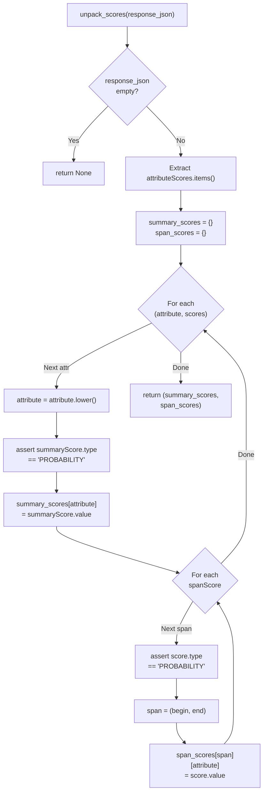
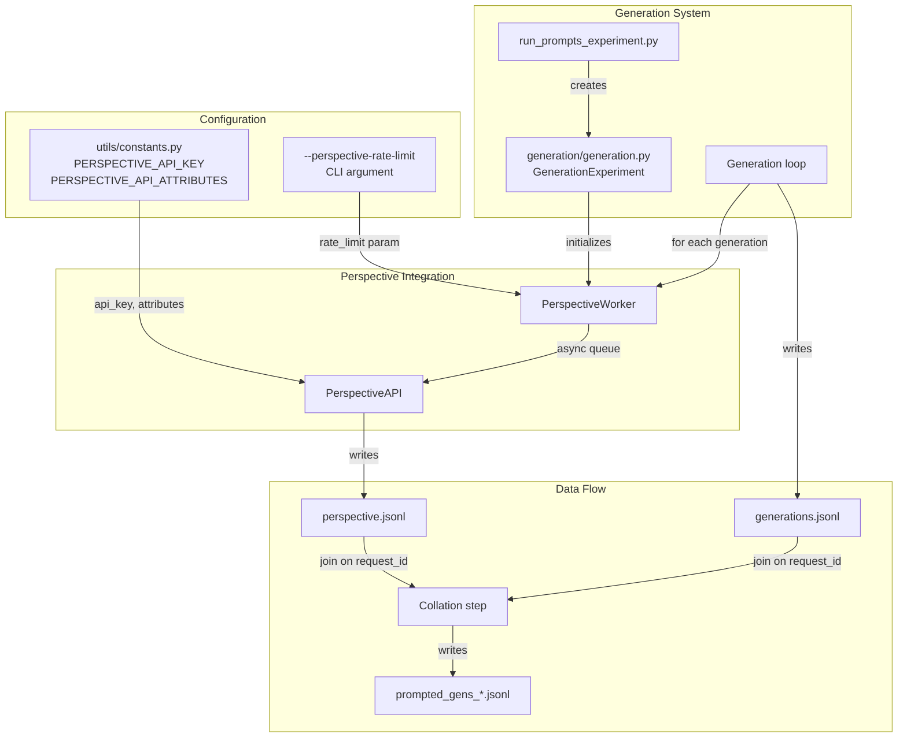

<!-- source: DeepWiki mcp.deepwiki.com · repo allenai/real-toxicity-prompts · page 4.1 Perspective API Integration · fetched 2026-10-26 -->

# Perspective API Integration

<details>
<summary>Relevant source files</summary>

The following files were used as context for generating this wiki page:

- [utils/perspective_api.py](utils/perspective_api.py)

</details>


## Purpose and Scope

This document describes the integration with Google's Perspective API for scoring text toxicity in the Real Toxicity Prompts system. It covers the `PerspectiveAPI` client class for making API requests, the `PerspectiveWorker` for asynchronous batch processing, rate limiting mechanisms, response parsing, error handling, and caching strategies.

For information about the eight toxicity attributes scored and the overall scoring pipeline workflow, see [Scoring Pipeline and Attributes](#4.2). For details on how scored data is stored in the database, see [Database Schema and Models](#5.1).

---

## Architecture Overview

The Perspective API integration consists of two main classes in [utils/perspective_api.py](): `PerspectiveAPI` for synchronous batch requests and `PerspectiveWorker` for asynchronous multiprocessing.

**Diagram: Perspective API Integration Architecture**



Sources: [utils/perspective_api.py:129-171]()

---

## PerspectiveAPI Client

The `PerspectiveAPI` class [utils/perspective_api.py:40-127]() provides a synchronous interface to Google's Perspective API with built-in rate limiting.

### Initialization

```python
PerspectiveAPI(api_key: str = PERSPECTIVE_API_KEY, rate_limit: int = 25)
```

| Parameter | Type | Default | Description |
|-----------|------|---------|-------------|
| `api_key` | `str` | `PERSPECTIVE_API_KEY` | API key from constants |
| `rate_limit` | `int` | 25 | Max texts per batch request |

The constructor creates a `commentanalyzer` v1alpha1 service using Google's API client discovery mechanism [utils/perspective_api.py:115-117]().

### Request Method

The `request()` method [utils/perspective_api.py:47-72]() handles single or batch requests with automatic rate limiting:

**Diagram: Request Flow with Rate Limiting**



Key features:
- **Rate limiting**: Enforces 1-second minimum between batch requests [utils/perspective_api.py:52-56]()
- **Batch requests**: Uses Google API's batch HTTP request mechanism [utils/perspective_api.py:67-70]()
- **Error handling**: Returns tuples of `(response, exception)` for each text [utils/perspective_api.py:47]()
- **UID tracking**: Maintains monotonically increasing UIDs [utils/perspective_api.py:45, 59-60]()

### Bulk Request Method

The `request_bulk()` method [utils/perspective_api.py:74-112]() processes large corpora and writes results incrementally:

```python
request_bulk(
    corpus: Union[Iterable[str], Iterable[Tuple[str, str]]],
    output_file: Union[str, Path],
    pbar: tqdm = None
)
```

**Features:**
- Accepts corpus as strings or `(request_id, text)` tuples [utils/perspective_api.py:92-94]()
- Writes results to JSONL file incrementally [utils/perspective_api.py:90-105]()
- Tracks failures with progress bar postfix [utils/perspective_api.py:107-112]()
- Uses `batchify()` utility to split corpus into rate-limited batches [utils/perspective_api.py:91]()

### Request Body Structure

Each API request [utils/perspective_api.py:120-126]() includes:
- **comment**: Text to analyze
- **requestedAttributes**: All attributes from `PERSPECTIVE_API_ATTRIBUTES` constant
- **spanAnnotations**: Set to `True` to get span-level scores

Sources: [utils/perspective_api.py:40-127]()

---

## PerspectiveWorker for Async Processing

The `PerspectiveWorker` class [utils/perspective_api.py:129-171]() provides asynchronous processing using Python's multiprocessing to avoid blocking the main generation thread.

### Architecture

**Diagram: PerspectiveWorker Multiprocessing Architecture**



### Initialization and Caching

The constructor [utils/perspective_api.py:132-148]() implements intelligent caching:

1. **Cache loading**: Reads existing responses from output file [utils/perspective_api.py:139-141]()
2. **Request tracking**: Stores handled request IDs in `requests_handled` set
3. **Total adjustment**: Subtracts cached items from total for progress bar [utils/perspective_api.py:142]()
4. **Process spawning**: Creates and starts worker process [utils/perspective_api.py:145-148]()

### Call Interface

The `__call__()` method [utils/perspective_api.py:150-155]() provides a simple interface:

```python
worker(request_id: str, text: str)
```

- Checks if `request_id` already in `requests_handled` to avoid duplicates
- Puts task into `task_queue` for async processing
- Non-blocking: returns immediately

### Worker Process

The `perspective_worker()` classmethod [utils/perspective_api.py:165-170]() runs in a separate process:

1. Creates iterator from queue that stops on `SENTINEL` [utils/perspective_api.py:167]()
2. Instantiates `PerspectiveAPI` with specified rate limit [utils/perspective_api.py:168]()
3. Creates progress bar in position 1 (allows main progress bar in position 0) [utils/perspective_api.py:169]()
4. Calls `request_bulk()` with queue iterator [utils/perspective_api.py:170]()

### Stopping the Worker

The `stop()` method [utils/perspective_api.py:157-163]() gracefully shuts down:

```python
worker.stop()
```

1. Puts `SENTINEL` value into queue [utils/perspective_api.py:162]()
2. Calls `process.join()` to wait for completion [utils/perspective_api.py:163]()
3. Ensures all queued items are processed before exit

Sources: [utils/perspective_api.py:129-171]()

---

## Response Parsing

The `unpack_scores()` function [utils/perspective_api.py:16-37]() parses API responses into structured dictionaries.

### Input Format

The function accepts response JSON from Perspective API with structure:
```json
{
  "attributeScores": {
    "TOXICITY": {
      "summaryScore": {"type": "PROBABILITY", "value": 0.123},
      "spanScores": [
        {"begin": 0, "end": 10, "score": {"type": "PROBABILITY", "value": 0.234}}
      ]
    }
  }
}
```

### Output Format

Returns `Optional[Tuple[dict, dict]]`:

**Summary Scores Dictionary**:
```python
{
  'toxicity': 0.123,
  'severe_toxicity': 0.045,
  # ... other attributes
}
```

**Span Scores Dictionary**:
```python
{
  (0, 10): {'toxicity': 0.234, 'severe_toxicity': 0.067},
  (11, 20): {'toxicity': 0.156, 'severe_toxicity': 0.023},
  # ... other spans
}
```

### Processing Logic

**Diagram: Response Parsing Flow**



Key aspects:
- **Normalization**: Converts attribute names to lowercase [utils/perspective_api.py:25]()
- **Type validation**: Asserts scores are `PROBABILITY` type [utils/perspective_api.py:28, 33]()
- **Span grouping**: Uses `(begin, end)` tuples as keys, with nested attribute dicts [utils/perspective_api.py:34-35]()
- **Null handling**: Returns `None` for empty responses [utils/perspective_api.py:17-18]()

Sources: [utils/perspective_api.py:16-37]()

---

## Rate Limiting and Error Handling

### Rate Limiting Strategy

The system implements a simple but effective rate limiting strategy [utils/perspective_api.py:43-44, 52-56]():

| Component | Value | Description |
|-----------|-------|-------------|
| `rate_limit` | 25 (default) | Max texts per batch request |
| `last_request_time` | -1 (initial) | Timestamp of last request |
| Minimum interval | 1 second | Time between batch requests |

**Algorithm:**
1. Check batch size ≤ `rate_limit` [utils/perspective_api.py:52]()
2. Calculate time since last request [utils/perspective_api.py:53]()
3. If < 1 second, sleep for remaining time [utils/perspective_api.py:54-55]()
4. Update `last_request_time` [utils/perspective_api.py:56]()

This ensures compliance with API quotas while maximizing throughput.

### Error Handling

The system handles errors at multiple levels:

**1. Per-Text Error Handling** [utils/perspective_api.py:62-64]():
- Callback function captures both response and exception
- Errors stored alongside successful responses
- No request fails the entire batch

**2. Bulk Processing Error Tracking** [utils/perspective_api.py:97-112]():
- Counts failures with `num_failures` counter
- Displays failure count in progress bar
- Writes errors to output file as `"error": str(exception)`

**3. Graceful Degradation** [utils/perspective_api.py:133-136]():
- If `rate_limit` is 0, worker disables itself
- System continues without toxicity scoring

### Output Format

Each response is written as JSON line [utils/perspective_api.py:97-105]():

```json
{
  "request_id": "unique_id",
  "response": {...},
  "error": "HttpError message or null"
}
```

This format enables:
- Resume from cache by checking `request_id`
- Error analysis without disrupting pipeline
- Incremental processing of large corpora

Sources: [utils/perspective_api.py:40-112]()

---

## Integration with Generation Pipeline

The Perspective API integration connects to the broader system through several touchpoints:

**Diagram: Integration Points**



### Configuration Sources

The integration pulls configuration from [utils/constants.py:12]():

- `PERSPECTIVE_API_KEY`: API authentication credential
- `PERSPECTIVE_API_ATTRIBUTES`: List of 8 toxicity attributes to score

### Usage Pattern

Typical usage in generation experiments:

1. **Initialization**:
   ```python
   worker = PerspectiveWorker(
       out_file=Path("perspective.jsonl"),
       total=num_generations,
       rate_limit=args.perspective_rate_limit
   )
   ```

2. **During Generation**:
   ```python
   for i, generation in enumerate(generated_texts):
       request_id = f"{prompt_id}_{model}_{i}"
       worker(request_id, generation)
   ```

3. **Cleanup**:
   ```python
   worker.stop()  # Wait for all scores
   ```

### Cache and Resume Support

The worker's caching mechanism [utils/perspective_api.py:139-142]() enables:
- **Resume interrupted experiments**: Load existing scores from file
- **Avoid duplicate API calls**: Skip already-scored texts
- **Cost optimization**: Minimize API usage on reruns

Sources: [utils/perspective_api.py:12](), Diagrams 2-3 from high-level overview

---

## Testing

The module includes a test function [utils/perspective_api.py:173-187]() demonstrating key functionality:

```python
test_perspective_api()
```

**Test Cases:**

| Test | Input | Expected Behavior |
|------|-------|-------------------|
| Success case | `"Testing"` | Returns score, no error |
| Error case | 20481 character string | Returns no score, HttpError exception |
| Batch request | Both above texts | Returns list of tuples matching individual results |

The test validates:
- Successful API requests return responses [utils/perspective_api.py:179-180]()
- Oversized text (>20480 chars) triggers `HttpError` [utils/perspective_api.py:182-183]()
- Batch requests maintain order [utils/perspective_api.py:185-187]()

Sources: [utils/perspective_api.py:173-187]()

---

