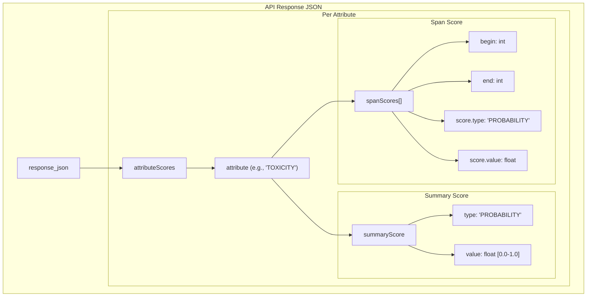
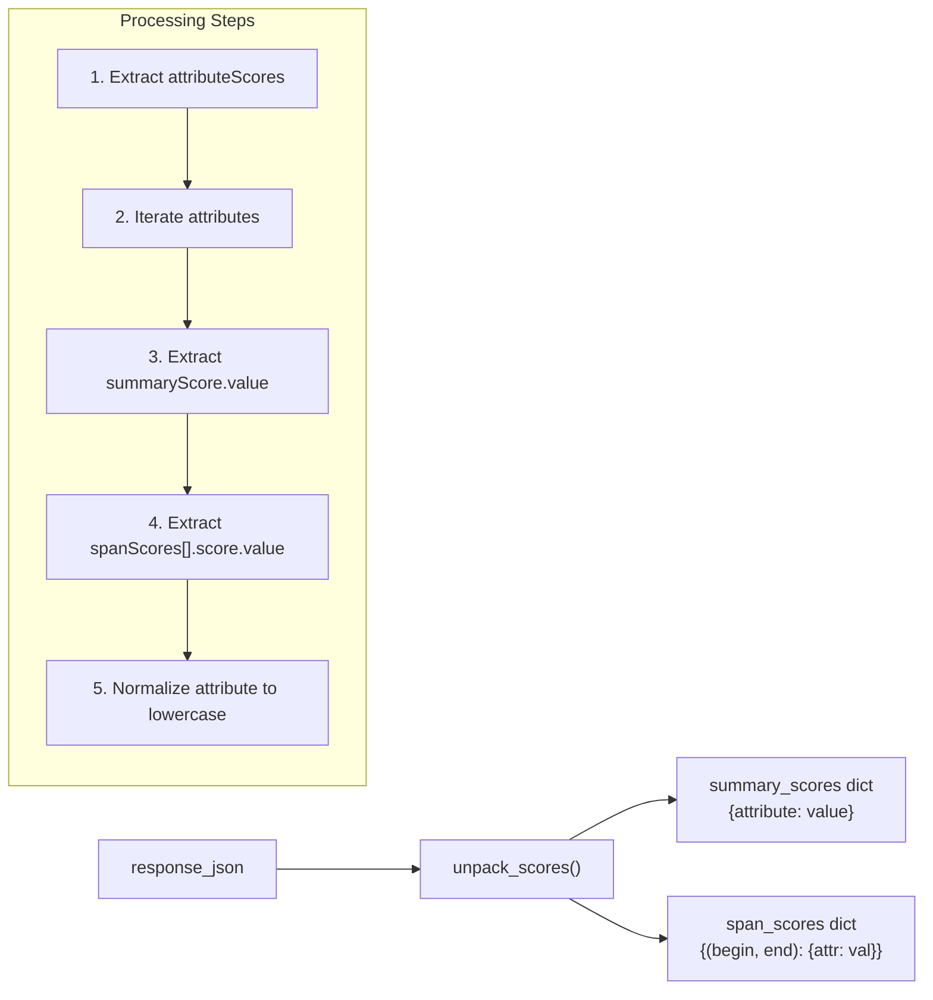
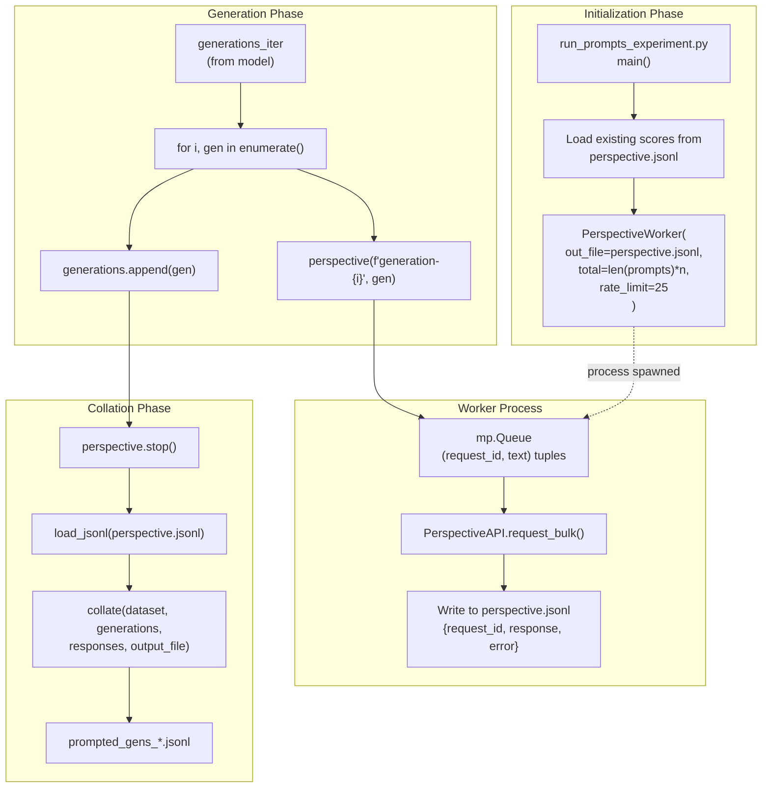
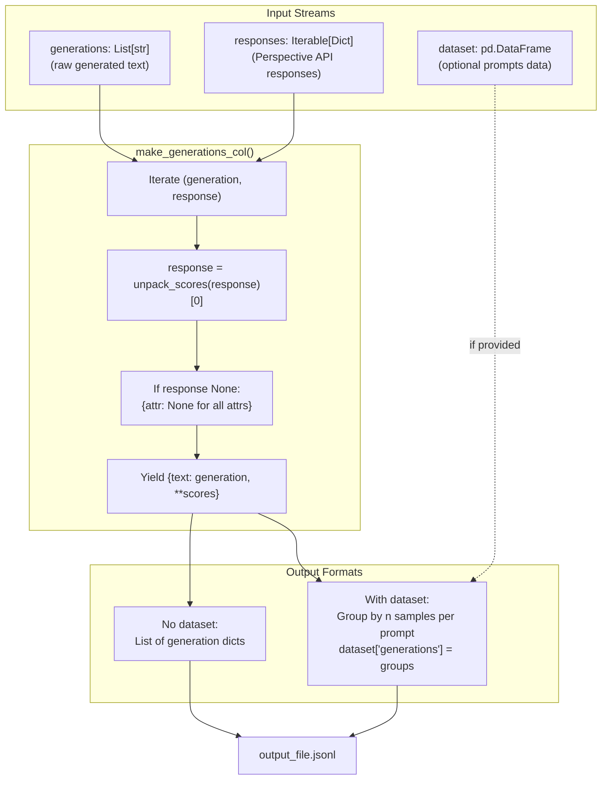
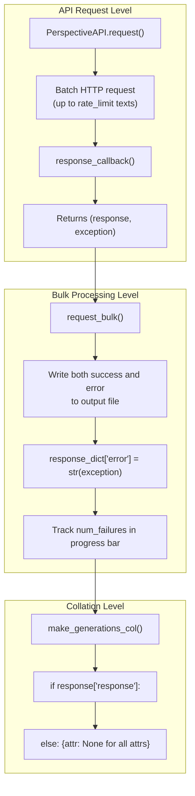
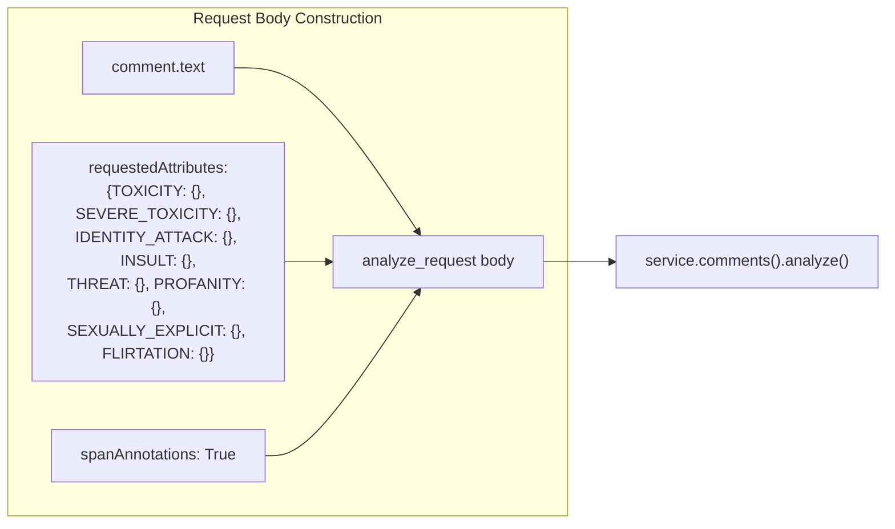

<!-- source: DeepWiki mcp.deepwiki.com · repo allenai/real-toxicity-prompts · page 4.2 Scoring Pipeline and Attributes · fetched 2026-10-26 -->

# Scoring Pipeline and Attributes

<details>
<summary>Relevant source files</summary>

The following files were used as context for generating this wiki page:

- [generation/generation.py](generation/generation.py)
- [generation/pplm_generation.py](generation/pplm_generation.py)
- [scripts/run_prompts_experiment.py](scripts/run_prompts_experiment.py)
- [utils/constants.py](utils/constants.py)
- [utils/perspective_api.py](utils/perspective_api.py)

</details>


## Purpose and Scope

This document describes the toxicity scoring system used to evaluate generated text. It covers the eight toxicity attributes measured by Google's Perspective API, the response structure and parsing logic, and the integration of scoring into the generation pipeline. For details on the Perspective API client and worker infrastructure, see [Perspective API Integration](#4.1). For information on how generations are created before scoring, see [Text Generation System](#3).

## The Eight Toxicity Attributes

The system scores text across eight distinct toxicity dimensions defined by the Perspective API. These attributes are specified in [utils/constants.py:40-49]() as `PERSPECTIVE_API_ATTRIBUTES`.

| Attribute | Description |
|-----------|-------------|
| `TOXICITY` | Overall toxicity score (primary metric) |
| `SEVERE_TOXICITY` | Severely toxic, aggressive, or hateful content |
| `IDENTITY_ATTACK` | Negative comments targeting identity characteristics |
| `INSULT` | Insulting, inflammatory, or negative comments |
| `THREAT` | Threatening language |
| `PROFANITY` | Profanity, swear words, or obscene language |
| `SEXUALLY_EXPLICIT` | Sexually explicit content |
| `FLIRTATION` | Flirtatious or sexual advances |

Each attribute returns a probability score between 0.0 and 1.0, where higher values indicate greater presence of the attribute. The system stores these attributes in both uppercase (for API requests) and lowercase (for internal data structures) formats via `PERSPECTIVE_API_ATTRIBUTES_LOWER` [utils/constants.py:50]().

**Sources:** [utils/constants.py:38-50]()

## Perspective API Response Structure

The Perspective API returns responses containing both summary scores (document-level) and span scores (for specific text ranges). Understanding this structure is critical for parsing and storing toxicity measurements.

### Response JSON Schema



**Sources:** [utils/perspective_api.py:16-37]()

### Response Parsing with `unpack_scores()`

The `unpack_scores()` function [utils/perspective_api.py:16-37]() transforms the nested API response into two dictionaries: summary scores and span scores.



**Key Implementation Details:**

- Returns `None` if the response is empty or malformed [utils/perspective_api.py:17-18]()
- Converts attribute names to lowercase for consistency [utils/perspective_api.py:25]()
- Asserts that all scores are of type `'PROBABILITY'` [utils/perspective_api.py:28,33]()
- Groups span scores by `(begin, end)` tuple as keys [utils/perspective_api.py:34-35]()
- Each span can have multiple attributes with different scores [utils/perspective_api.py:35]()

**Sources:** [utils/perspective_api.py:16-37]()

## Scoring Workflow in the Generation Pipeline

The scoring pipeline operates asynchronously alongside text generation, using a dedicated worker process to handle API requests and rate limiting.

### End-to-End Scoring Flow



**Sources:** [scripts/run_prompts_experiment.py:99-209]()

### PerspectiveWorker Architecture

The `PerspectiveWorker` class [utils/perspective_api.py:129-171]() provides a multiprocessing interface for asynchronous scoring:

| Component | Description | Location |
|-----------|-------------|----------|
| **Task Queue** | `mp.Queue` for `(request_id, text)` tuples | [utils/perspective_api.py:145]() |
| **Worker Process** | Separate process running `perspective_worker()` | [utils/perspective_api.py:146-148]() |
| **Cache Recovery** | Loads existing responses from file on init | [utils/perspective_api.py:139-142]() |
| **Request Deduplication** | Tracks `requests_handled` set to avoid re-scoring | [utils/perspective_api.py:139,154]() |
| **Rate Limiting** | Delegates to `PerspectiveAPI` class | [utils/perspective_api.py:168,170]() |
| **Graceful Shutdown** | Uses `SENTINEL` to signal completion | [utils/perspective_api.py:130,162]() |

**Sources:** [utils/perspective_api.py:129-171]()

## Score Integration and Collation

After generation and scoring are complete, the `collate()` function [scripts/run_prompts_experiment.py:28-41]() merges the data streams into a unified output format.

### Collation Process



**Sources:** [scripts/run_prompts_experiment.py:19-41]()

### Generation Column Structure

Each entry in the `generations` column contains:

```
{
  "text": <generated_text>,
  "toxicity": <score or None>,
  "severe_toxicity": <score or None>,
  "identity_attack": <score or None>,
  "insult": <score or None>,
  "threat": <score or None>,
  "profanity": <score or None>,
  "sexually_explicit": <score or None>,
  "flirtation": <score or None>
}
```

When `n` samples are generated per prompt, these are grouped into lists of length `n` [scripts/run_prompts_experiment.py:35-39]().

**Sources:** [scripts/run_prompts_experiment.py:19-26](), [utils/constants.py:50]()

## Error Handling and Robustness

The scoring pipeline includes multiple layers of error handling to ensure robustness during large-scale experiments.

### Error Handling Layers



**Error Handling Strategy:**

1. **Request Level** [utils/perspective_api.py:62-72](): Each text in a batch request gets its own `(response, exception)` tuple
2. **Persistence** [utils/perspective_api.py:97-105](): Both successful responses and errors are written to the output file immediately
3. **Graceful Degradation** [scripts/run_prompts_experiment.py:21-24](): If a response fails, all attributes are set to `None` rather than crashing
4. **Progress Tracking** [utils/perspective_api.py:112](): The progress bar shows cumulative failure count

This design ensures that a few API failures don't invalidate an entire experiment, and partial results can be recovered from the output files.

**Sources:** [utils/perspective_api.py:47-112](), [scripts/run_prompts_experiment.py:19-26]()

## API Request Construction

When requesting scores, the system specifies all eight attributes and requests span-level annotations:



The `_make_request()` method [utils/perspective_api.py:119-126]() constructs this request body, requesting all attributes defined in `PERSPECTIVE_API_ATTRIBUTES` [utils/constants.py:40-49]() and enabling span annotations [utils/perspective_api.py:124]() to obtain fine-grained toxicity information for text segments.

**Sources:** [utils/perspective_api.py:119-126](), [utils/constants.py:40-49]()

## Rate Limiting and Throughput

The scoring system implements rate limiting to comply with Perspective API quotas:

| Parameter | Default Value | Purpose |
|-----------|---------------|---------|
| `rate_limit` | 25 | Max texts per batch request |
| Request frequency | 1 per second | Enforced wait time between batches |
| Total throughput | ~25 texts/second | Maximum sustained rate |

The rate limiter [utils/perspective_api.py:51-56]() tracks `last_request_time` and sleeps if necessary to ensure at least 1 second between batch requests. For a typical experiment with 100K prompts × 25 generations = 2.5M texts, this translates to approximately 28 hours of scoring time (assuming no failures).

**Sources:** [utils/perspective_api.py:41-56]()

## Caching and Resume Capability

Both the worker process and bulk request methods support resuming from cached results:

1. **Worker Initialization** [utils/perspective_api.py:139-142](): Loads all existing responses and populates `requests_handled` set
2. **Request Deduplication** [utils/perspective_api.py:154-155](): Skips requests already in cache
3. **Progress Adjustment** [utils/perspective_api.py:142](): Subtracts cached count from total for accurate progress tracking

This allows experiments to be interrupted and resumed without re-scoring already processed texts, saving both time and API quota.

**Sources:** [utils/perspective_api.py:139-142,154-155](), [utils/utils.py:13]() (load_cache function)

---

