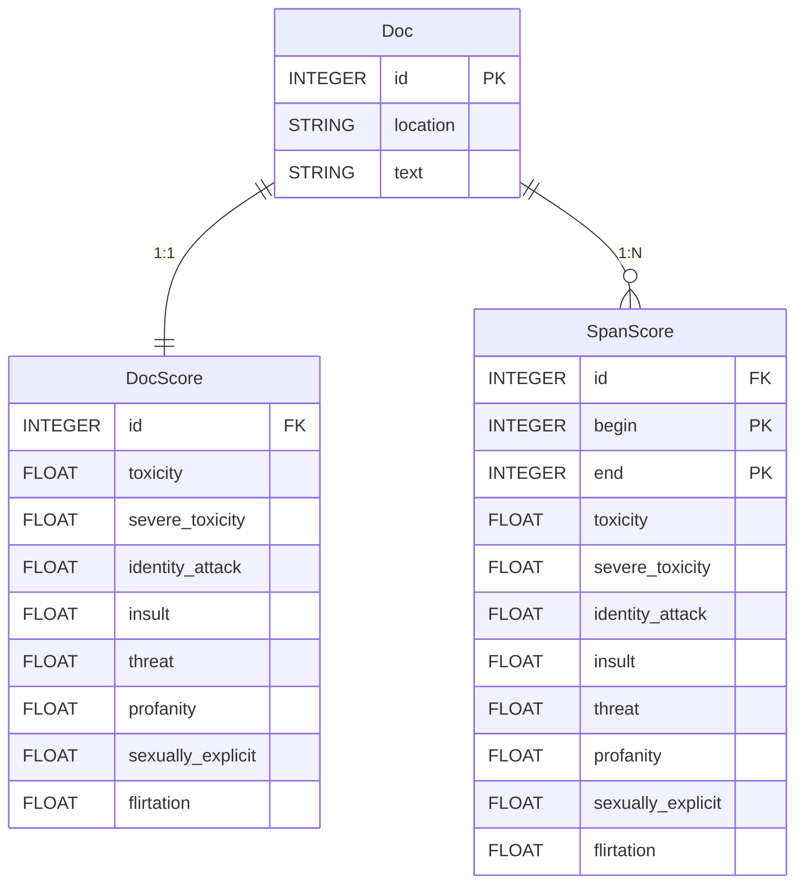
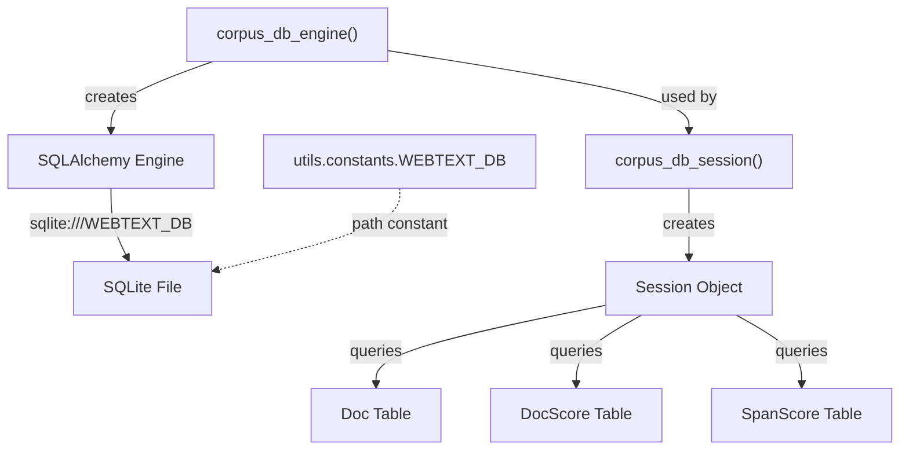
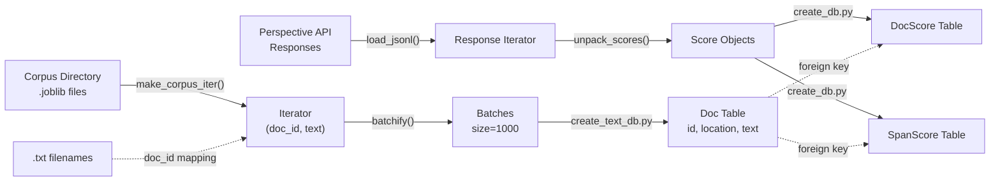
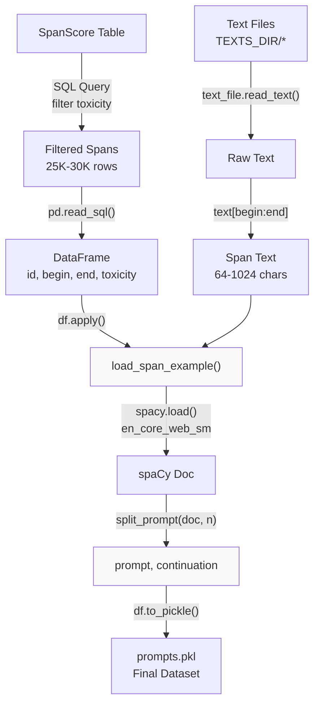
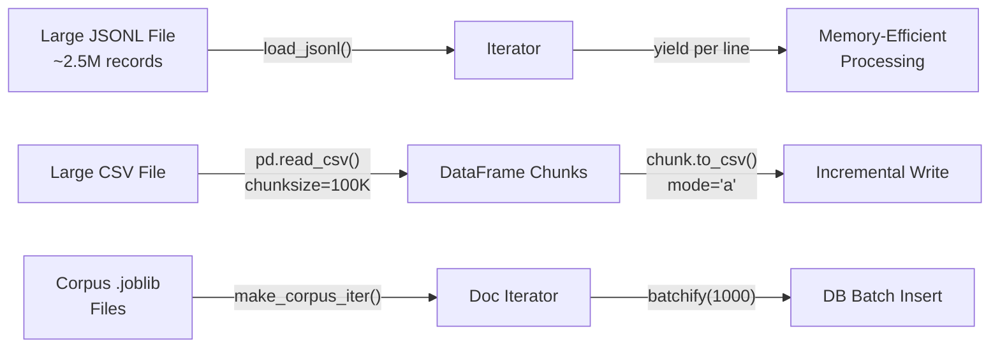
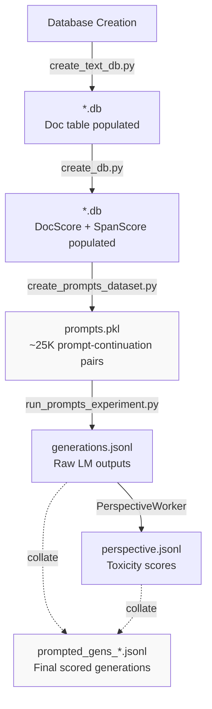
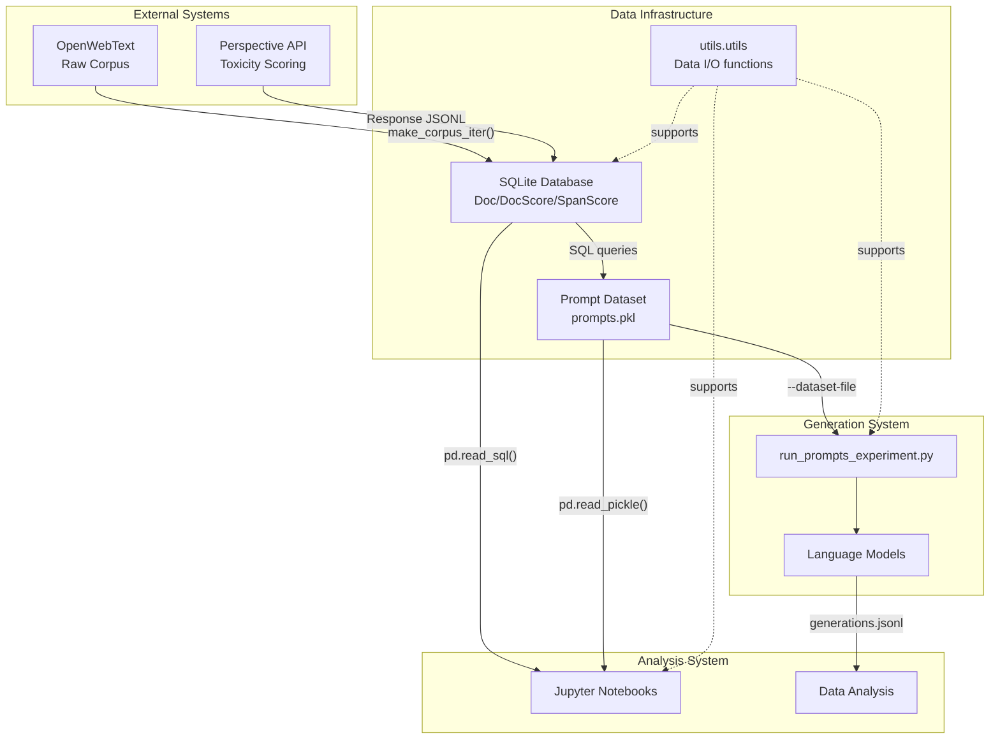

<!-- source: DeepWiki mcp.deepwiki.com · repo allenai/real-toxicity-prompts · page 5 Data Infrastructure · fetched 2026-10-26 -->

# Data Infrastructure

<details>
<summary>Relevant source files</summary>

The following files were used as context for generating this wiki page:

- [scripts/data/create_db.py](scripts/data/create_db.py)
- [scripts/data/create_prompts_dataset.py](scripts/data/create_prompts_dataset.py)
- [scripts/data/create_text_db.py](scripts/data/create_text_db.py)
- [utils/db.py](utils/db.py)
- [utils/utils.py](utils/utils.py)

</details>


## Purpose and Scope

This document describes the data storage, processing, and management systems that support the Real Toxicity Prompts research pipeline. The infrastructure handles corpus ingestion, toxicity scoring storage, and prompt dataset creation, managing approximately 8 million documents from OpenWebText.

The data infrastructure consists of:
- A SQLite database schema for storing documents and toxicity scores
- Scripts for corpus ingestion and database population
- Utility functions for data processing and iteration
- Workflows for creating prompt datasets from scored text spans

For detailed information on specific subsystems:
- Database schema and querying patterns: see [Database Schema and Models](#5.1)
- Corpus loading and database population: see [Corpus Processing and Ingestion](#5.2)
- LSH-based duplicate detection: see [Duplicate Detection with MinHash LSH](#5.3)
- Prompt extraction and filtering: see [Prompt Dataset Creation](#5.4)

**Sources:** Diagram 4 from high-level architecture, [utils/db.py](), [utils/utils.py]()

## Database Architecture

### SQLite Schema

The system uses a SQLite database with three primary tables defined in [utils/db.py](). The schema is built using SQLAlchemy ORM models:



**Table Descriptions:**

| Table | Purpose | Key Characteristics |
|-------|---------|---------------------|
| `Doc` | Stores raw document text and metadata | Primary key: `id`, contains full text content |
| `DocScore` | Stores document-level toxicity scores | Foreign key to `Doc.id`, one row per document |
| `SpanScore` | Stores sentence/span-level toxicity scores | Composite primary key: `(id, begin, end)`, multiple spans per document |

**Sources:** [utils/db.py:12-65]()

### Database Access Patterns

The database is accessed through SQLAlchemy sessions created by helper functions:



The `corpus_db_engine()` function at [utils/db.py:67-68]() creates an engine connected to the database file path specified in `WEBTEXT_DB` constant. The `corpus_db_session()` function at [utils/db.py:71-74]() provides a session for executing queries.

**Sources:** [utils/db.py:67-74](), [utils/constants.py]()

## Data Processing Pipeline

### Corpus Ingestion Workflow

The corpus ingestion process transforms raw text files into a structured database:



**Key Components:**

1. **`make_corpus_iter()` at [utils/utils.py:80-100]()**: Iterates through `.joblib` files in the corpus directory, yielding `(doc_id, text)` tuples. Loads optional filename mappings from `.txt` files.

2. **`batchify()` at [utils/utils.py:14-28]()**: Groups items into batches of specified size for efficient database insertion.

3. **`create_text_db.py`**: Populates the `Doc` table with raw text content. Uses batch insertion with `session.bulk_save_objects()` at [scripts/data/create_text_db.py:66]().

4. **`create_db.py`**: Populates `DocScore` and `SpanScore` tables from Perspective API responses. Uses `unpack_scores()` to parse response JSON at [scripts/data/create_db.py:23]().

**Sources:** [utils/utils.py:80-100](), [utils/utils.py:14-28](), [scripts/data/create_text_db.py](), [scripts/data/create_db.py]()

### Prompt Dataset Creation Pipeline

The prompt dataset is extracted from scored text spans using spaCy for tokenization:



**Process Details:**

1. **Query Spans**: [scripts/data/create_prompts_dataset.py:64-71]() constructs a SQL query filtering `SpanScore` by:
   - Toxicity threshold (e.g., `< 0.25` for low-toxicity prompts)
   - Span length constraints (`MIN_SPAN_LEN=64`, `MAX_SPAN_LEN=1024`)
   - Random ordering with limit (typically 30,000 rows)

2. **Load Text**: `load_span_example()` at [scripts/data/create_prompts_dataset.py:33-48]() reads text from files in `TEXTS_DIR`, trims to span boundaries, and validates length.

3. **Tokenize and Split**: `split_prompt()` at [scripts/data/create_prompts_dataset.py:19-30]() uses spaCy to tokenize text and splits at token position `n`, creating prompt-continuation pairs.

4. **Validate**: Prompts must not exceed `MAX_PROMPT_LEN=128` characters at [scripts/data/create_prompts_dataset.py:27]().

**Sources:** [scripts/data/create_prompts_dataset.py]()

## Data Utilities and File I/O

### Core Utility Functions

The [utils/utils.py]() module provides essential data processing functions:

| Function | Purpose | Key Parameters |
|----------|---------|----------------|
| `load_jsonl()` | Load JSONL files line-by-line | Returns iterator of parsed JSON objects |
| `load_cache()` | Load cached JSONL with progress bar | Shows loading progress via tqdm |
| `batchify()` | Group items into fixed-size batches | `batch_size`: items per batch |
| `make_corpus_iter()` | Iterate through corpus `.joblib` files | Yields `(doc_id, text)` tuples |
| `big_flat_jsonl_to_csv()` | Convert large JSONL to CSV in chunks | `chunksize=100_000` for memory efficiency |

**Memory-Efficient Processing:**

The system handles large datasets using streaming and chunking patterns:



**File Format Support:**

- **JSONL**: Line-delimited JSON for streaming large datasets ([utils/utils.py:50-53]())
- **CSV**: Chunk-based reading/writing for memory efficiency ([utils/utils.py:63-77]())
- **Joblib**: Compressed Python object storage for corpus files ([utils/utils.py:85]())
- **Pickle**: Pandas DataFrame serialization for prompt datasets ([scripts/data/create_prompts_dataset.py:91]())

**Sources:** [utils/utils.py]()

## Data Organization and File Locations

### Database Files

The system uses path constants defined in [utils/constants.py]() to locate database files:

| Constant | Purpose | Typical Value |
|----------|---------|---------------|
| `WEBTEXT_DB` | Main SQLite database path | Path to `.db` file containing Doc/Score tables |
| `OPENWEBTEXT_DB` | OpenWebText-specific database | May reference same file as `WEBTEXT_DB` |
| `TEXTS_DIR` | Raw text files directory | Directory containing `.txt` files referenced by `Doc.location` |

### Generated Datasets

The data infrastructure produces several key datasets:



**Dataset Characteristics:**

| Dataset | Format | Records | Description |
|---------|--------|---------|-------------|
| Main Database | SQLite | ~8M docs | Full corpus with toxicity scores |
| Prompts Dataset | Pickle/JSONL | ~100K | Curated prompt-continuation pairs |
| Generations | JSONL | ~2.5M | Model outputs (25 per prompt × 5 models) |
| Scored Generations | JSONL | ~2.5M | Final dataset with toxicity scores |

**Sources:** [utils/constants.py](), [scripts/data/create_prompts_dataset.py:89-91]()

## Batch Processing and Session Management

### Database Session Lifecycle

Database operations use a consistent session management pattern:

```python
# From scripts/data/create_text_db.py
Session.configure(bind=engine)
session = Session()

try:
    for batch in batchify(corpus_iter, batch_size=1000):
        rows = [Doc(id=i, location=loc, text=txt) for ...]
        session.bulk_save_objects(rows)
        session.commit()
        session.expunge_all()  # Clear session cache
except Exception as e:
    session.rollback()
finally:
    session.close()
```

**Key Patterns:**

1. **Batch Insertion**: Groups objects into batches of ~1000 for efficient writes at [scripts/data/create_text_db.py:48]()
2. **Session Clearing**: `expunge_all()` prevents memory buildup on large datasets at [scripts/data/create_text_db.py:68]()
3. **Error Handling**: Transaction rollback on exceptions at [scripts/data/create_text_db.py:71]()
4. **Progress Tracking**: tqdm progress bars for long-running operations at [scripts/data/create_text_db.py:46]()

**Sources:** [scripts/data/create_text_db.py:40-73](), [scripts/data/create_db.py:59-79]()

## Integration with Other Systems

The data infrastructure integrates with other system components:



**Cross-System Dependencies:**

- **Perspective API Integration**: See [Perspective API Integration](#4.1) for scoring pipeline details
- **Generation System**: See [Text Generation System](#3) for how prompts are consumed
- **Analysis Pipeline**: See [Analysis Pipeline and Notebooks](#7.1) for data loading patterns
- **Duplicate Detection**: See [Duplicate Detection with MinHash LSH](#5.3) for corpus cleaning

**Sources:** High-level architecture diagrams, [utils/utils.py](), [utils/db.py]()

---

