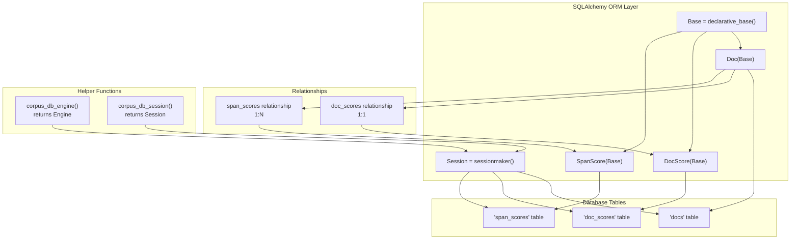
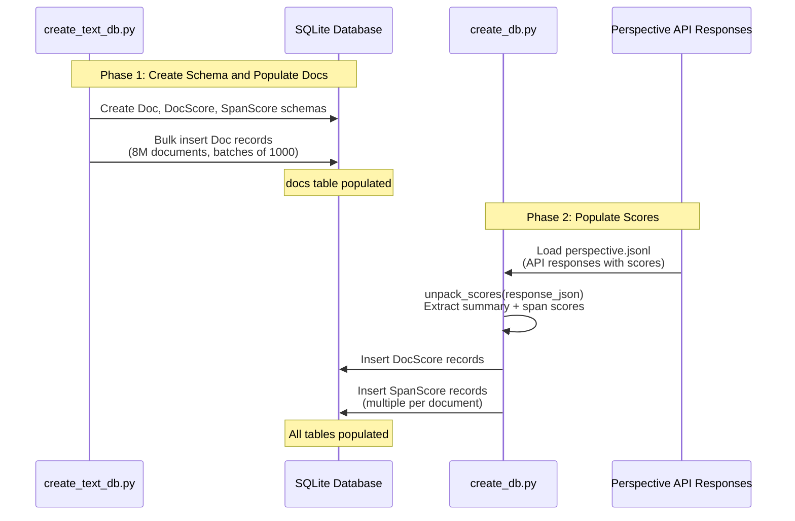

<!-- source: DeepWiki mcp.deepwiki.com · repo allenai/real-toxicity-prompts · page 5.1 Database Schema and Models · fetched 2026-10-26 -->

# Database Schema and Models

<details>
<summary>Relevant source files</summary>

The following files were used as context for generating this wiki page:

- [scripts/data/create_db.py](scripts/data/create_db.py)
- [scripts/data/create_prompts_dataset.py](scripts/data/create_prompts_dataset.py)
- [scripts/data/create_text_db.py](scripts/data/create_text_db.py)
- [utils/db.py](utils/db.py)

</details>


## Purpose and Scope

This page documents the SQLite database schema and SQLAlchemy ORM models used to store and query the OpenWebText/WebText corpus with toxicity scores. The database consists of three main tables (`Doc`, `DocScore`, `SpanScore`) that store document text, document-level toxicity scores, and span-level toxicity scores respectively.

For information about populating this database with corpus data, see [Corpus Processing and Ingestion](#5.2). For details about how toxicity scores are computed, see [Perspective API Integration](#4.1). For information about querying this database to create prompts, see [Prompt Dataset Creation](#5.4).

---

## Database Overview

The system uses a SQLite database to persist approximately 8 million documents from the OpenWebText corpus along with their toxicity scores. The database is accessed via SQLAlchemy ORM models defined in [utils/db.py:1-79]() and is located at the path specified by `WEBTEXT_DB` in [utils/constants.py]().

**Key characteristics:**
- **Storage engine**: SQLite (single-file database)
- **ORM framework**: SQLAlchemy with declarative base
- **Total documents**: ~8 million (OpenWebText corpus)
- **Toxicity attributes**: 8 attributes per document/span

### Database Location and Access

The database file location is defined in [utils/constants.py]() as `WEBTEXT_DB`. Helper functions provide easy access:

| Function | Purpose | Defined In |
|----------|---------|------------|
| `corpus_db_engine()` | Creates SQLAlchemy engine | [utils/db.py:67-68]() |
| `corpus_db_session()` | Creates configured session | [utils/db.py:71-74]() |

**Sources**: [utils/db.py:1-79]()

---

## Database Schema

### Entity-Relationship Diagram

```mermaid
erDiagram
    Doc ||--|| DocScore : "has one"
    Doc ||--o{ SpanScore : "has many"
    
    Doc {
        int id PK
        string location
        string text
    }
    
    DocScore {
        int id PK_FK
        float toxicity
        float severe_toxicity
        float identity_attack
        float insult
        float threat
        float profanity
        float sexually_explicit
        float flirtation
    }
    
    SpanScore {
        int id PK_FK
        int begin PK
        int end PK
        float toxicity
        float severe_toxicity
        float identity_attack
        float insult
        float threat
        float profanity
        float sexually_explicit
        float flirtation
    }
```

**Sources**: [utils/db.py:12-65]()

---

## Table Schemas

### Doc Table

The `Doc` table stores the raw text of each document in the corpus along with metadata about its source location.

**SQLAlchemy Model**: [utils/db.py:12-23]()

| Column | Type | Constraints | Description |
|--------|------|-------------|-------------|
| `id` | Integer | Primary Key | Unique document identifier (0-indexed) |
| `location` | String | - | Source location identifier (shard-index format) |
| `text` | String | - | Full document text content |

**Relationships**:
- One-to-one with `DocScore` via `doc_scores` relationship [utils/db.py:14]()
- One-to-many with `SpanScore` via `span_scores` relationship [utils/db.py:15]()

**Example population**: Documents are loaded from the corpus and assigned sequential IDs in [scripts/data/create_text_db.py:48-60]().

**Sources**: [utils/db.py:12-23](), [scripts/data/create_text_db.py:1-78]()

---

### DocScore Table

The `DocScore` table stores document-level toxicity scores for each document, representing the overall toxicity of the entire text.

**SQLAlchemy Model**: [utils/db.py:25-43]()

| Column | Type | Constraints | Description |
|--------|------|-------------|-------------|
| `id` | Integer | Primary Key, Foreign Key → `docs.id` | References parent document |
| `toxicity` | Float | - | Overall toxicity score (0.0-1.0) |
| `severe_toxicity` | Float | - | Severe toxicity score |
| `identity_attack` | Float | - | Identity-based attack score |
| `insult` | Float | - | Insult/profanity score |
| `threat` | Float | - | Threatening language score |
| `profanity` | Float | - | Profanity score |
| `sexually_explicit` | Float | - | Sexual content score |
| `flirtation` | Float | - | Flirtatious content score |

**Primary Key**: The `id` column serves as both the primary key and foreign key, enforcing a strict one-to-one relationship with the `Doc` table.

**Population**: DocScore records are created from Perspective API responses in [scripts/data/create_db.py:21-35]().

**Sources**: [utils/db.py:25-43](), [scripts/data/create_db.py:21-35]()

---

### SpanScore Table

The `SpanScore` table stores toxicity scores for specific text spans within documents, enabling fine-grained toxicity analysis at the sentence or paragraph level.

**SQLAlchemy Model**: [utils/db.py:45-65]()

| Column | Type | Constraints | Description |
|--------|------|-------------|-------------|
| `id` | Integer | Composite Primary Key, Foreign Key → `docs.id` | References parent document |
| `begin` | Integer | Composite Primary Key | Character offset where span begins |
| `end` | Integer | Composite Primary Key | Character offset where span ends |
| `toxicity` | Float | - | Span toxicity score (0.0-1.0) |
| `severe_toxicity` | Float | - | Span severe toxicity score |
| `identity_attack` | Float | - | Span identity attack score |
| `insult` | Float | - | Span insult score |
| `threat` | Float | - | Span threat score |
| `profanity` | Float | - | Span profanity score |
| `sexually_explicit` | Float | - | Span sexual content score |
| `flirtation` | Float | - | Span flirtation score |

**Composite Primary Key**: The combination of `(id, begin, end)` uniquely identifies each span, allowing multiple scored spans per document.

**Span Extraction**: The Perspective API automatically identifies and scores toxic spans within text. Multiple spans may exist per document, representing different sentences or passages with varying toxicity levels.

**Sources**: [utils/db.py:45-65](), [scripts/data/create_db.py:21-35]()

---

## SQLAlchemy ORM Models

### Code-to-Database Mapping



**Sources**: [utils/db.py:1-79]()

---

### Model Definitions

#### Base Configuration

The ORM uses SQLAlchemy's declarative base pattern:

```python
Base = declarative_base()  # Line 8
Session = sessionmaker()   # Line 9
```

All models inherit from `Base` and use the configured `Session` for database operations.

**Sources**: [utils/db.py:8-9]()

#### Doc Model

**Definition**: [utils/db.py:12-23]()

- **Table name**: `'docs'`
- **Primary key**: `id` (Integer, auto-incrementing)
- **Relationships**: 
  - `doc_scores`: References associated `DocScore` [utils/db.py:14]()
  - `span_scores`: References list of associated `SpanScore` objects [utils/db.py:15]()

#### DocScore Model

**Definition**: [utils/db.py:25-43]()

- **Table name**: `'doc_scores'`
- **Primary key**: `id` (Integer, also foreign key to `docs.id`)
- **Attributes**: 8 float columns for toxicity scores [utils/db.py:32-39]()
- **Repr**: Returns `<DocScore<id={id}>` [utils/db.py:41-42]()

#### SpanScore Model

**Definition**: [utils/db.py:45-65]()

- **Table name**: `'span_scores'`
- **Composite primary key**: `(id, begin, end)` [utils/db.py:49-51]()
  - `id`: Foreign key to `docs.id`
  - `begin`: Start character offset
  - `end`: End character offset
- **Attributes**: 8 float columns for toxicity scores [utils/db.py:54-61]()
- **Repr**: Returns `<SpanScore<id={id}, begin={begin}, end={end}>` [utils/db.py:63-64]()

**Sources**: [utils/db.py:12-65]()

---

## Database Access Patterns

### Session Creation

The standard pattern for accessing the database is:

1. Call `corpus_db_session()` to get a configured session [utils/db.py:71-74]()
2. Execute queries using the session
3. Close the session when done

```python
session = corpus_db_session()
query = session.query(SpanScore).filter(...)
results = query.all()
session.close()
```

**Example usage**: [scripts/data/create_prompts_dataset.py:61-71]()

**Sources**: [utils/db.py:71-74](), [scripts/data/create_prompts_dataset.py:61-71]()

---

### Common Query Patterns

#### Filtering by Toxicity Range

Queries commonly filter `SpanScore` by toxicity thresholds:

```python
query = (
    session.query(SpanScore)
    .filter(SpanScore.toxicity < 0.25)  # Low toxicity
    .filter(SpanScore.end - SpanScore.begin >= MIN_SPAN_LEN)
    .filter(SpanScore.end - SpanScore.begin <= MAX_SPAN_LEN)
)
```

**Example**: [scripts/data/create_prompts_dataset.py:64-71]()

#### Random Sampling

Use SQLAlchemy's `random()` function for random sampling:

```python
from sqlalchemy.sql.functions import random
query = query.order_by(random()).limit(30_000)
```

**Example**: [scripts/data/create_prompts_dataset.py:69-70]()

#### Loading to Pandas

Convert query results directly to pandas DataFrames:

```python
df = pd.read_sql(query.statement, con=query.session.bind)
```

**Example**: [scripts/data/create_prompts_dataset.py:75]()

**Sources**: [scripts/data/create_prompts_dataset.py:64-76]()

---

## Database Population Workflow

### Creation and Population Process



**Sources**: [scripts/data/create_text_db.py:1-78](), [scripts/data/create_db.py:1-84]()

---

### Phase 1: Schema Creation and Text Loading

**Script**: [scripts/data/create_text_db.py:1-78]()

1. **Schema creation** [scripts/data/create_text_db.py:34-37]():
   - Creates `Doc`, `DocScore`, and `SpanScore` table schemas
   - Note: DocScore and SpanScore tables remain empty at this stage

2. **Text ingestion** [scripts/data/create_text_db.py:44-68]():
   - Iterates through corpus using `make_corpus_iter(corpus_dir)`
   - Creates `Doc` objects with sequential IDs
   - Bulk saves in batches (default: 1000 documents per batch)
   - Uses `session.bulk_save_objects()` for efficiency

**Command example**:
```bash
python scripts/data/create_text_db.py --corpus_dir /path/to/corpus --batch_size 1000 database.db
```

**Sources**: [scripts/data/create_text_db.py:18-73]()

---

### Phase 2: Score Population

**Script**: [scripts/data/create_db.py:1-84]()

1. **Load Perspective API responses** [scripts/data/create_db.py:65-66]():
   - Reads from `perspective.jsonl` containing API responses
   - Each line contains a scored document with `request_id` matching document ID

2. **Unpack scores** [scripts/data/create_db.py:21-35]():
   - Calls `unpack_scores(response_json)` from [utils/perspective_api.py]()
   - Extracts document-level summary scores → `DocScore` record
   - Extracts span-level scores → multiple `SpanScore` records

3. **Create database records**:
   - One `DocScore` per document [scripts/data/create_db.py:25]()
   - Multiple `SpanScore` records per document [scripts/data/create_db.py:32-33]()
   - Composite key `(id, begin, end)` for each span

4. **Bulk insertion** [scripts/data/create_db.py:71-73]():
   - Uses `session.bulk_save_objects()` for efficiency
   - Commits after each response to ensure progress is saved

**Command example**:
```bash
python scripts/data/create_db.py --responses_file perspective.jsonl --total 8000000 database.db
```

**Sources**: [scripts/data/create_db.py:21-74]()

---

## Summary

The database schema provides a normalized structure for storing documents with multi-level toxicity annotations:

| Table | Purpose | Cardinality | Key Attributes |
|-------|---------|-------------|----------------|
| `Doc` | Store document text | 1 per document | `id`, `location`, `text` |
| `DocScore` | Document-level toxicity | 1 per document | `id` (FK), 8 toxicity scores |
| `SpanScore` | Span-level toxicity | N per document | `id` (FK), `begin`, `end`, 8 scores |

This schema enables:
- **Efficient querying** by toxicity ranges to select prompts
- **Fine-grained analysis** at both document and span levels
- **Normalized storage** avoiding data duplication
- **SQLAlchemy ORM integration** for type-safe database access

The database is populated through a two-phase process: first loading raw text, then adding toxicity scores from Perspective API responses. Once populated, it serves as the foundation for prompt extraction and analysis workflows documented in [Prompt Dataset Creation](#5.4) and [Analysis Pipeline and Notebooks](#7.1).

**Sources**: [utils/db.py:1-79](), [scripts/data/create_text_db.py:1-78](), [scripts/data/create_db.py:1-84](), [scripts/data/create_prompts_dataset.py:1-97]()

---

