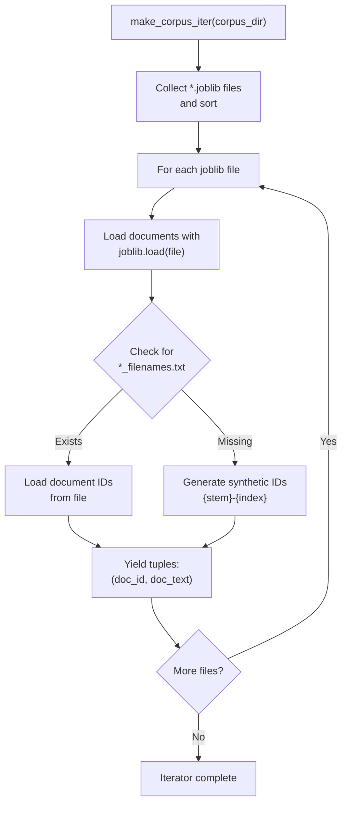
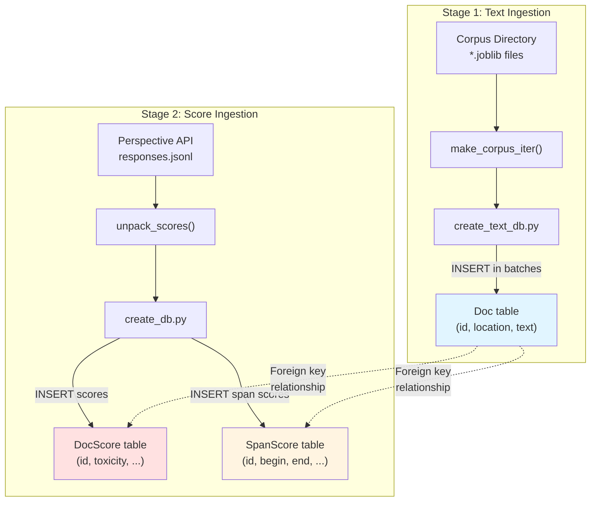
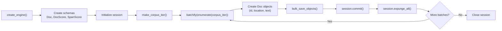
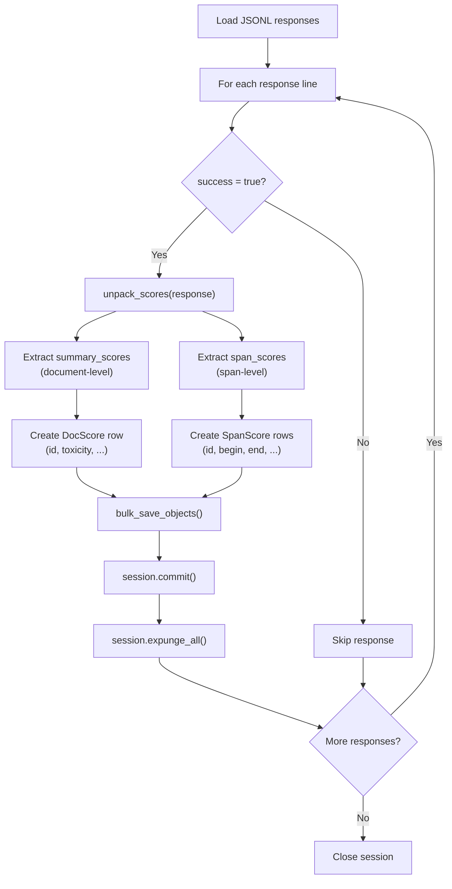
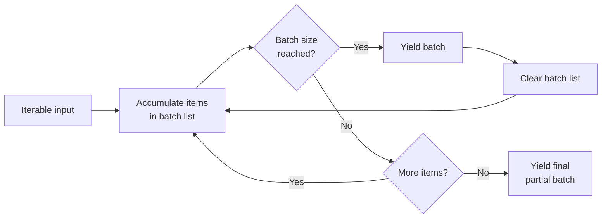
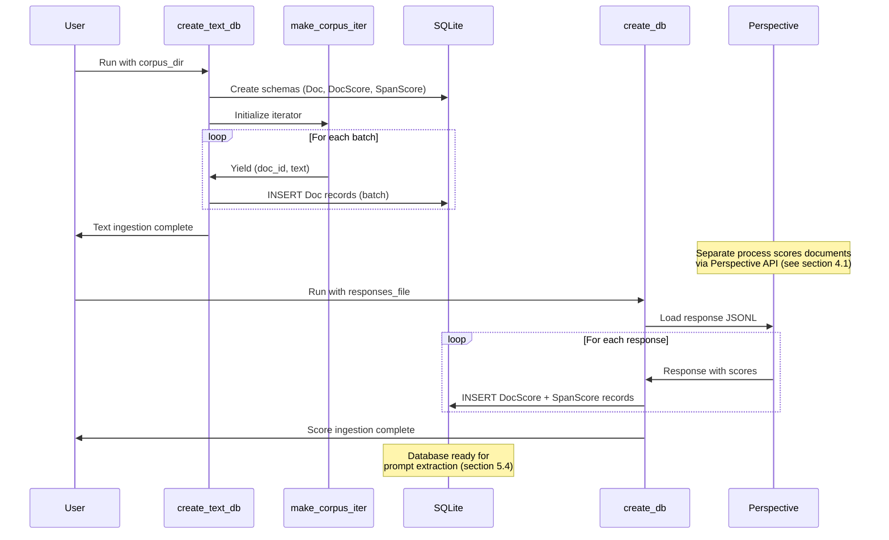

<!-- source: DeepWiki mcp.deepwiki.com · repo allenai/real-toxicity-prompts · page 5.2 Corpus Processing and Ingestion · fetched 2026-10-26 -->

# Corpus Processing and Ingestion

<details>
<summary>Relevant source files</summary>

The following files were used as context for generating this wiki page:

- [scripts/data/create_db.py](scripts/data/create_db.py)
- [scripts/data/create_prompts_dataset.py](scripts/data/create_prompts_dataset.py)
- [scripts/data/create_text_db.py](scripts/data/create_text_db.py)
- [utils/db.py](utils/db.py)
- [utils/utils.py](utils/utils.py)

</details>


## Purpose and Scope

This document covers the technical infrastructure for loading raw text corpora (OpenWebText and WebText) and ingesting them into the SQLite database. It explains the corpus file format, iteration mechanisms, and the two-stage database population workflow that separates text ingestion from toxicity score ingestion.

For information about the database schema structure and table relationships, see [Database Schema and Models](#5.1). For details on duplicate detection performed before ingestion, see [Duplicate Detection with MinHash LSH](#5.3). For information on how the ingested data is queried to create prompt datasets, see [Prompt Dataset Creation](#5.4).

---

## Corpus File Format and Organization

The system processes corpora stored as serialized joblib files organized in a directory structure. The corpus consists of approximately 8 million documents from OpenWebText/WebText, sharded across multiple files.

### File Structure

The corpus is organized as follows:

- **Corpus files**: `*.joblib` files containing lists of document texts
- **Filename metadata**: `*_filenames.txt` files containing document identifiers (one per line)
- **Corpus size**: 8,013,769 documents total
- **Sharding**: Distributed across 20 shards

Each joblib file contains a Python list of document strings. The corresponding `_filenames.txt` file (if present) contains identifiers that map to each document's position in the list. If no filename file exists, synthetic identifiers are generated using the pattern `{shard_name}-{index}`.

**Sources:** [scripts/data/create_text_db.py:14-15](), [utils/utils.py:80-99]()

---

## Corpus Iteration Mechanism

The `make_corpus_iter()` function provides a unified interface for iterating through sharded corpus files. This iterator abstracts the complexity of loading multiple joblib files and handling optional metadata files.

### Iteration Flow



### Implementation Details

The iterator implementation in `make_corpus_iter()`:

1. **File discovery**: Scans the corpus directory for all `.joblib` files and sorts them
2. **Sequential loading**: Loads one joblib file at a time to manage memory usage
3. **Metadata handling**: Checks for corresponding `_filenames.txt` files to load document identifiers
4. **ID generation**: Falls back to synthetic IDs when metadata is unavailable
5. **Lazy evaluation**: Yields documents one at a time rather than loading entire corpus into memory

**Sources:** [utils/utils.py:80-99]()

---

## Database Population Workflow

The database population process consists of two distinct stages: text ingestion and score ingestion. These stages are separated to allow corpus loading to proceed independently of the potentially time-consuming Perspective API scoring process.

### Two-Stage Ingestion Architecture



**Sources:** [scripts/data/create_text_db.py](), [scripts/data/create_db.py]()

---

## Stage 1: Text Ingestion

The `create_text_db.py` script handles the initial population of the `Doc` table with raw text content from the corpus.

### Command-Line Interface

```bash
python scripts/data/create_text_db.py \
    --corpus_dir /path/to/corpus \
    --batch_size 1000 \
    database.db
```

**Parameters:**
- `--corpus_dir`: Directory containing `.joblib` corpus files (required)
- `--batch_size`: Number of documents to insert per transaction (default: 1000)
- `database_file`: Path to SQLite database file (argument, must not exist)

### Text Ingestion Process



### Key Implementation Details

1. **Schema creation**: The script creates all three table schemas (`Doc`, `DocScore`, `SpanScore`) but only populates the `Doc` table [scripts/data/create_text_db.py:34-37]()

2. **Document ID assignment**: Documents are assigned sequential integer IDs based on their enumeration order [scripts/data/create_text_db.py:48-59]()

3. **Location field**: The `location` field stores the original document identifier from the corpus (e.g., `shard05-12345`) [scripts/data/create_text_db.py:58]()

4. **Batch processing**: Documents are inserted in batches to balance memory usage and transaction overhead [scripts/data/create_text_db.py:48-68]()

5. **Session management**: After each batch, `session.expunge_all()` clears the session cache to prevent memory bloat [scripts/data/create_text_db.py:68]()

6. **Progress tracking**: A tqdm progress bar tracks ingestion across all 8M+ documents [scripts/data/create_text_db.py:46]()

**Sources:** [scripts/data/create_text_db.py:18-77]()

---

## Stage 2: Score Ingestion

The `create_db.py` script populates the `DocScore` and `SpanScore` tables from Perspective API response files. This stage occurs after text ingestion and after the corpus has been scored by the Perspective API (see [Perspective API Integration](#4.1)).

### Command-Line Interface

```bash
python scripts/data/create_db.py \
    --responses_file perspective_responses.jsonl \
    --total 8013769 \
    database.db
```

**Parameters:**
- `--responses_file`: JSONL file containing Perspective API responses (required)
- `--total`: Total number of responses for progress tracking (optional)
- `database_file`: Path to existing SQLite database (argument)

### Score Ingestion Process



### Score Row Creation

The `create_rows()` function transforms a single Perspective API response into multiple database rows:

1. **One DocScore row**: Contains document-level toxicity scores for all 8 attributes [scripts/data/create_db.py:25-26]()

2. **Multiple SpanScore rows**: Contains span-level scores for toxic passages within the document, where:
   - Each span is identified by `(id, begin, end)` character offsets
   - All 8 toxicity attributes are provided for each span
   - The function validates that all attributes have values for the same spans [scripts/data/create_db.py:28-33]()

**Sources:** [scripts/data/create_db.py:21-35]()

### Response Format Handling

The input JSONL file contains responses with the following structure:

| Field | Type | Description |
|-------|------|-------------|
| `success` | boolean | Whether the API request succeeded |
| `request_id` | integer/string | Document ID to insert into database |
| `response` | object | Perspective API response containing scores |

Failed requests (where `success` is false) are skipped without creating database rows [scripts/data/create_db.py:66-67]().

**Sources:** [scripts/data/create_db.py:63-73]()

---

## Batch Processing and Performance Considerations

The corpus ingestion system employs several strategies to efficiently process millions of documents:

### Batching Strategy

The `batchify()` utility function groups documents into fixed-size batches for bulk database operations:



The `batchify()` function:
- Accumulates items until `batch_size` is reached
- Yields complete batches immediately
- Yields the final partial batch when the iterator is exhausted
- Ensures no items are lost regardless of whether the total is a multiple of `batch_size`

**Sources:** [utils/utils.py:14-28]()

### Performance Characteristics

| Operation | Strategy | Rationale |
|-----------|----------|-----------|
| **File loading** | Sequential joblib.load() | Limits memory footprint to one shard at a time |
| **Database inserts** | Bulk operations (1000 docs/batch) | Reduces transaction overhead |
| **Session management** | expunge_all() after each batch | Prevents SQLAlchemy cache bloat |
| **Progress tracking** | tqdm with known totals | Provides time estimates for long operations |
| **Error handling** | Try-finally with rollback | Ensures session cleanup on failures |

### Memory Management

The system uses several techniques to handle 8M+ documents without excessive memory usage:

1. **Lazy corpus iteration**: `make_corpus_iter()` yields documents one at a time rather than loading the entire corpus [utils/utils.py:80-99]()

2. **Batch processing**: The `batchify()` wrapper limits in-memory accumulation to `batch_size` documents [utils/utils.py:14-28]()

3. **Session expunging**: SQLAlchemy's `expunge_all()` removes managed objects from the session after each commit [scripts/data/create_text_db.py:68]()

4. **Sequential shard loading**: Only one joblib file is loaded into memory at a time [utils/utils.py:84-85]()

**Sources:** [utils/utils.py:14-28](), [utils/utils.py:80-99](), [scripts/data/create_text_db.py:48-68]()

---

## Database Creation Workflow

The complete corpus ingestion process follows this sequence:



**Sources:** [scripts/data/create_text_db.py](), [scripts/data/create_db.py]()

---

## Related Workflows

After corpus processing and ingestion completes, the populated database enables several downstream workflows:

- **Prompt extraction**: The `SpanScore` table is queried with toxicity filters to identify candidate text spans for prompt creation (see [Prompt Dataset Creation](#5.4))
- **Analysis**: The scored corpus serves as the foundation for analyzing adversarial prompts and source characteristics (see [Data Analysis and Research Findings](#7))
- **Deduplication validation**: The ingested corpus may be analyzed for duplicates before or after ingestion (see [Duplicate Detection with MinHash LSH](#5.3))

**Sources:** [scripts/data/create_prompts_dataset.py:64-71]()

---

