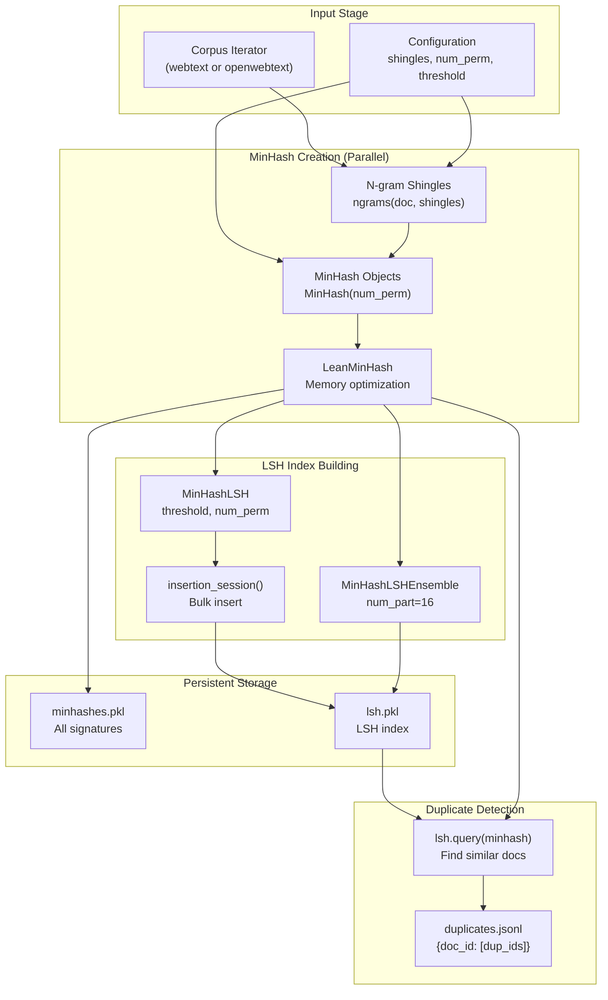
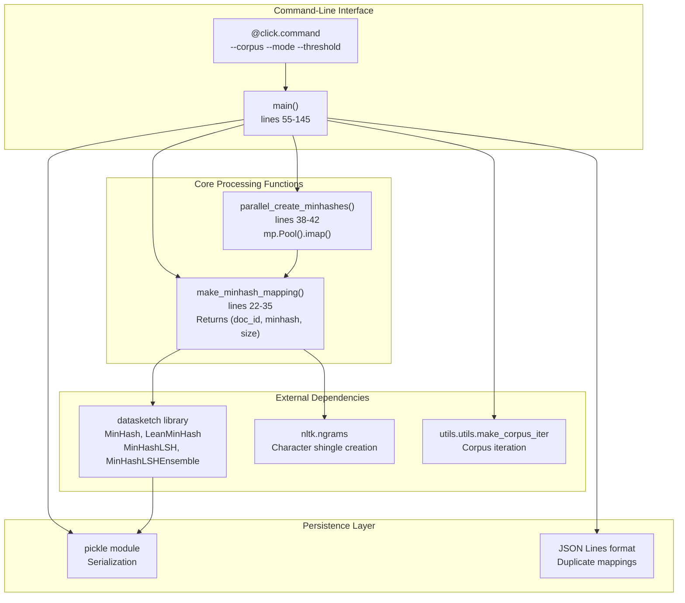

<!-- source: DeepWiki mcp.deepwiki.com · repo allenai/real-toxicity-prompts · page 5.3 Duplicate Detection with MinHash LSH · fetched 2026-10-26 -->

# Duplicate Detection with MinHash LSH

<details>
<summary>Relevant source files</summary>

The following files were used as context for generating this wiki page:

- [scripts/data/find_duplicates_lsh.py](scripts/data/find_duplicates_lsh.py)

</details>


## Purpose and Scope

This document explains the duplicate detection system used to identify near-duplicate documents in the corpus datasets (WebText and OpenWebText). The system uses MinHash signatures for efficient similarity estimation and Locality-Sensitive Hashing (LSH) for fast duplicate detection across millions of documents. This deduplication step is a critical preprocessing stage that occurs before database population and prompt extraction.

For information about the broader corpus processing workflow, see [Corpus Processing and Ingestion](#5.2). For details about the database schema where deduplicated documents are stored, see [Database Schema and Models](#5.1).

## Overview

The duplicate detection system addresses the challenge of identifying similar documents in large text corpora containing 8+ million documents. Direct pairwise comparison would require O(n²) comparisons, which is computationally infeasible. Instead, the system employs:

- **MinHash signatures**: Compact probabilistic fingerprints that estimate Jaccard similarity between document sets
- **LSH indexing**: Data structures that enable sub-linear time similarity search by organizing documents into buckets based on signature similarity
- **Parallel processing**: Multi-core MinHash computation to handle large-scale corpus processing

The system outputs mappings of documents to their near-duplicates, which can then be used to deduplicate the corpus before downstream processing.

Sources: [scripts/data/find_duplicates_lsh.py:1-145]()

## System Architecture

### High-Level Workflow



**Diagram: MinHash LSH Duplicate Detection Pipeline**

The workflow consists of four primary stages:

1. **Input Stage**: Corpus iteration and parameter configuration
2. **MinHash Creation**: Parallel computation of document signatures using n-gram shingles
3. **LSH Index Building**: Construction of searchable index structures for similarity queries
4. **Duplicate Detection**: Querying the index to find near-duplicate documents

Sources: [scripts/data/find_duplicates_lsh.py:38-145]()

### Code Architecture



**Diagram: Code Structure and Dependencies**

The implementation centers on the `main()` function which orchestrates the entire workflow, dispatching to different modes based on command-line arguments. The `make_minhash_mapping()` function is the core transformation that converts documents into MinHash signatures, while `parallel_create_minhashes()` wraps this in a multiprocessing pool for performance.

Sources: [scripts/data/find_duplicates_lsh.py:22-42](), [scripts/data/find_duplicates_lsh.py:45-145]()

## MinHash Signature Creation

### Process Overview

MinHash signatures provide a probabilistic method for estimating document similarity. The process converts each document into a fixed-size signature that preserves similarity properties:

1. **Shingle Generation**: Documents are converted into sets of overlapping n-grams (character sequences)
2. **MinHash Computation**: Multiple hash functions create a signature that estimates set similarity
3. **Memory Optimization**: Conversion to `LeanMinHash` for reduced memory footprint

### Implementation Details

The `make_minhash_mapping()` function implements the signature creation:

```
Function: make_minhash_mapping(item, shingles: int, num_perm: int)
Input: (doc_id, doc), shingles=5, num_perm=128
Process:
  1. Create shingles_set = set(ngrams(doc, shingles))
  2. Initialize MinHash with num_perm permutations
  3. For each shingle s in shingles_set:
       - Encode as UTF-8: s = ''.join(s).encode('utf8')
       - Update MinHash: m.update(s)
  4. Convert to LeanMinHash for memory efficiency
Output: (doc_id, lean_minhash, len(shingles_set))
```

Sources: [scripts/data/find_duplicates_lsh.py:22-35]()

### Configuration Parameters

| Parameter | Default | Description |
|-----------|---------|-------------|
| `shingles` | 5 | Size of character n-grams used for shingling |
| `num_perm` | 128 | Number of permutation functions (signature size) |

**Shingles Parameter**: Controls granularity of similarity detection. Smaller values (e.g., 3-4) detect more distant similarities but increase false positives. Larger values (e.g., 6-8) require closer matches but reduce false positives. The default value of 5 balances these tradeoffs.

**num_perm Parameter**: Determines signature size and accuracy. Higher values provide more accurate similarity estimates but increase computation time and memory usage. With 128 permutations, the Jaccard similarity estimation error is approximately 1/√128 ≈ 8.8%.

Sources: [scripts/data/find_duplicates_lsh.py:22-35](), [scripts/data/find_duplicates_lsh.py:50-51]()

### Parallel Processing

The system uses multiprocessing to accelerate MinHash computation across large corpora:

```
Function: parallel_create_minhashes()
Input: corpus_iter, shingles, num_perm, n_jobs, chunksize=1000
Process:
  1. Create partial function with fixed parameters
  2. Initialize multiprocessing.Pool(n_jobs)
  3. Use pool.imap() with specified chunksize
  4. Yield results as iterator
```

The `chunksize=1000` parameter controls task granularity: larger chunks reduce inter-process communication overhead but may lead to load imbalance. The default uses all available CPU cores (`n_jobs=os.cpu_count()`).

Sources: [scripts/data/find_duplicates_lsh.py:38-42](), [scripts/data/find_duplicates_lsh.py:53]()

## LSH Index Construction

### Index Types

The system supports two LSH index variants:

**MinHashLSH**: Standard LSH index optimized for finding all near-duplicates above a similarity threshold. Uses hash table buckets to group similar signatures together.

**MinHashLSHEnsemble**: Enhanced variant that partitions the index space for improved query performance on large datasets. Uses `num_part=16` partitions by default.

Sources: [scripts/data/find_duplicates_lsh.py:92-102]()

### Building the Index

#### MinHashLSH Mode

```
Process: Building MinHashLSH Index
1. Initialize: lsh = MinHashLSH(threshold=0.9, num_perm=128)
2. Enter insertion session for bulk operations:
   with lsh.insertion_session() as session:
3. For each (key, minhash, size) in minhash_iter:
   - session.insert(key, minhash, check_duplication=False)
4. Exit session (triggers index finalization)
5. Serialize to disk: pickle.dump(lsh, 'lsh.pkl')
```

The `insertion_session()` context manager enables efficient bulk insertion by deferring index reorganization until all documents are inserted. The `check_duplication=False` flag skips duplicate key checking since document IDs are guaranteed unique.

Sources: [scripts/data/find_duplicates_lsh.py:92-99]()

#### MinHashLSHEnsemble Mode

```
Process: Building MinHashLSHEnsemble Index
1. Initialize: lsh = MinHashLSHEnsemble(threshold=0.9, num_perm=128, num_part=16)
2. Index all signatures in one call:
   lsh.index(minhash_iter)
3. Serialize to disk: pickle.dump(lsh, 'lsh.pkl')
```

The ensemble variant requires all signatures upfront and handles partitioning internally. It's recommended for very large datasets (millions of documents) where query performance is critical.

Sources: [scripts/data/find_duplicates_lsh.py:100-102]()

### Similarity Threshold

The `threshold` parameter (default 0.9) defines the minimum Jaccard similarity for documents to be considered duplicates:

- **threshold=1.0**: Only exact duplicates (identical shingle sets)
- **threshold=0.9**: Highly similar documents (90% overlap)
- **threshold=0.7**: Moderately similar documents (70% overlap)

Lower thresholds increase recall but also increase false positives and query time. The default of 0.9 is appropriate for near-duplicate detection while avoiding overly aggressive deduplication.

Sources: [scripts/data/find_duplicates_lsh.py:52](), [scripts/data/find_duplicates_lsh.py:93](), [scripts/data/find_duplicates_lsh.py:101]()

## Operational Modes

The script supports four distinct operational modes, each serving different workflow stages:

### Mode Comparison

| Mode | Purpose | Input Required | Output Generated |
|------|---------|----------------|------------------|
| `minhash-only` | Create signatures only | Raw corpus | `minhashes.pkl` |
| `lsh` | Build standard LSH index | Raw corpus or cached MinHashes | `lsh.pkl`, `minhashes.pkl` |
| `lsh-ensemble` | Build ensemble LSH index | Raw corpus or cached MinHashes | `lsh.pkl`, `minhashes.pkl` |
| `query` | Find duplicates | Cached MinHashes + LSH index | `duplicates.jsonl` |

### Mode 1: minhash-only

Creates MinHash signatures and saves them to disk without building an LSH index. Useful for caching signatures before experimenting with different index configurations.

```
Usage:
  python find_duplicates_lsh.py --corpus openwebtext --mode minhash-only \
    --num_perm 128 --shingles 5 output_dir/

Workflow:
  1. Iterate corpus (8M documents)
  2. Compute MinHash signatures in parallel
  3. Save minhashes.pkl
  
Output: minhashes.pkl (serialized dict: {doc_id: LeanMinHash})
```

Sources: [scripts/data/find_duplicates_lsh.py:128-131]()

### Mode 2: lsh / lsh-ensemble

Computes MinHash signatures (or loads from cache) and builds an LSH index for duplicate detection.

```
Usage:
  # Build from scratch
  python find_duplicates_lsh.py --corpus openwebtext --mode lsh \
    --threshold 0.9 --num_perm 128 output_dir/
  
  # Build from cached MinHashes
  python find_duplicates_lsh.py --corpus openwebtext --mode lsh \
    --minhash_file cached/minhashes.pkl --threshold 0.9 output_dir/

Workflow:
  1. Load or compute MinHash signatures
  2. Build LSH index with insertion_session (lsh mode) or index() (lsh-ensemble)
  3. Save lsh.pkl and minhashes.pkl
  
Output:
  - lsh.pkl (serialized MinHashLSH or MinHashLSHEnsemble)
  - minhashes.pkl (if not provided as input)
```

Sources: [scripts/data/find_duplicates_lsh.py:91-109]()

### Mode 3: query

Queries a pre-built LSH index to find duplicates for each document in the corpus.

```
Usage:
  python find_duplicates_lsh.py --corpus openwebtext --mode query \
    --lsh_file indices/lsh.pkl --minhash_file indices/minhashes.pkl \
    --num_perm 128 output_dir/

Workflow:
  1. Load LSH index from lsh_file
  2. Load MinHash signatures from minhash_file
  3. For each document:
     a. Query LSH: duplicates = lsh.query(minhash)
     b. If duplicates found, write to duplicates.jsonl
  
Output: duplicates.jsonl (JSON Lines format)
  {doc_id: [duplicate_doc_ids]}
  {doc_id: [duplicate_doc_ids]}
  ...
```

Sources: [scripts/data/find_duplicates_lsh.py:110-127]()

## Corpus Support

The script supports two corpus datasets with pre-configured document counts:

### WebText Corpus

```
Configuration:
  Corpus: webtext
  Location: DATA_DIR / 'webtext_detokenized'
  Document count: 8,282,020
  Accessed via: make_corpus_iter(DATA_DIR / 'webtext_detokenized')
```

Sources: [scripts/data/find_duplicates_lsh.py:77-79]()

### OpenWebText Corpus

```
Configuration:
  Corpus: openwebtext
  Location: DATA_DIR / 'openwebtext_shards'
  Document count: 8,013,769
  Accessed via: make_corpus_iter(DATA_DIR / 'openwebtext_shards')
```

Sources: [scripts/data/find_duplicates_lsh.py:80-82]()

Both corpora are accessed through the `make_corpus_iter()` utility function from `utils.utils`, which handles file iteration and text extraction. The document counts are used to configure progress bars during processing.

## Performance Characteristics

### Time Complexity

| Operation | Complexity | Notes |
|-----------|------------|-------|
| MinHash creation per document | O(d × k) | d = document length, k = num_perm |
| LSH index construction | O(n × k) | n = corpus size, k = num_perm |
| Duplicate query per document | O(1) expected | Sub-linear with LSH bucketing |
| Full corpus duplicate detection | O(n) expected | vs O(n²) for pairwise comparison |

### Memory Requirements

**MinHash Storage**: Each `LeanMinHash` signature occupies approximately `num_perm × 4` bytes (assuming 4-byte integers). For 8 million documents with `num_perm=128`:
- Storage per signature: 128 × 4 = 512 bytes
- Total storage: 8M × 512 bytes ≈ 4 GB

**LSH Index**: Additional overhead for hash tables and bucket structures, typically 1.5-2× the MinHash storage.

### Optimization Strategies

**Chunked Processing**: The `chunksize=1000` parameter in `parallel_create_minhashes()` balances multiprocessing overhead with parallelism benefits. Larger chunks reduce inter-process communication but may cause load imbalance.

**Insertion Sessions**: The `insertion_session()` context manager defers index finalization until all documents are inserted, providing significant speedup for bulk operations.

**Lean MinHash**: Converting to `LeanMinHash` after creation reduces memory footprint by removing temporary data structures while preserving the signature.

Sources: [scripts/data/find_duplicates_lsh.py:38-42](), [scripts/data/find_duplicates_lsh.py:33](), [scripts/data/find_duplicates_lsh.py:94-98]()

## Output Formats

### MinHash Signatures (minhashes.pkl)

Serialized Python dictionary mapping document IDs to `LeanMinHash` objects:

```
Format: pickle-serialized dict
Structure: {
  doc_id_1: LeanMinHash(...),
  doc_id_2: LeanMinHash(...),
  ...
}
Size: ~4-5 GB for 8M documents with num_perm=128
```

Sources: [scripts/data/find_duplicates_lsh.py:136-141]()

### LSH Index (lsh.pkl)

Serialized `MinHashLSH` or `MinHashLSHEnsemble` object containing all hash tables and bucket structures:

```
Format: pickle-serialized object
Types: MinHashLSH or MinHashLSHEnsemble
Size: ~6-10 GB for 8M documents
Reusable: Can be loaded for subsequent query operations
```

Sources: [scripts/data/find_duplicates_lsh.py:104-109]()

### Duplicates (duplicates.jsonl)

JSON Lines format where each line contains a document ID and its list of duplicate IDs:

```
Format: JSON Lines (one JSON object per line)
Structure per line: {
  "doc_id_123": ["doc_id_456", "doc_id_789", ...]
}
Appended incrementally: Allows resume on interruption
Only non-empty: Lines only written when duplicates found
```

Example:
```json
{"webtext_001234": ["webtext_005678", "webtext_009012"]}
{"openwebtext_012345": ["openwebtext_067890"]}
```

Sources: [scripts/data/find_duplicates_lsh.py:118-127]()

## Integration with Corpus Processing

The duplicate detection system is a preprocessing step in the broader corpus processing pipeline documented in [Corpus Processing and Ingestion](#5.2). The typical workflow integration is:


**Diagram: Duplicate Detection in Corpus Pipeline**

The `duplicates.jsonl` output is used to identify and remove near-duplicate documents before populating the database, ensuring that the corpus used for prompt extraction contains unique content. This improves the diversity of generated prompts and reduces redundancy in the final dataset.

Sources: [scripts/data/find_duplicates_lsh.py:1-145]()

---

