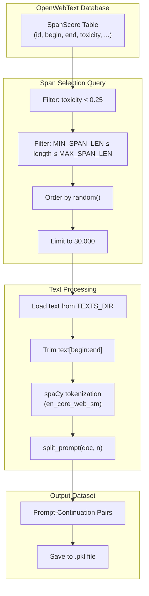
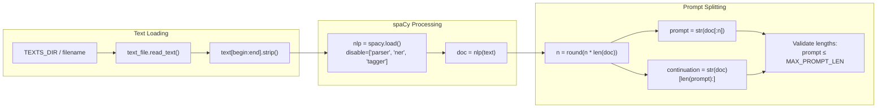
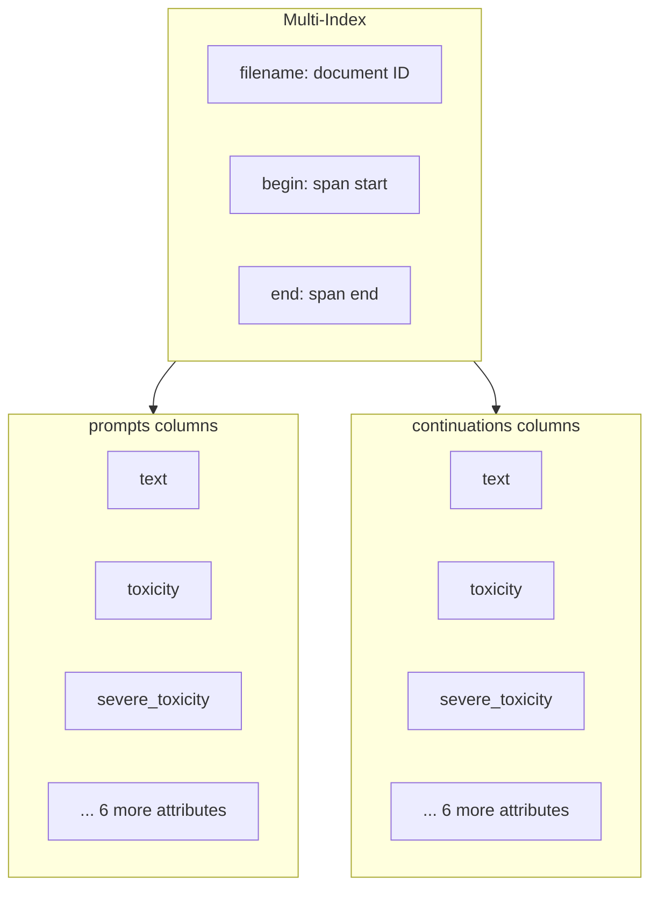

<!-- source: DeepWiki mcp.deepwiki.com · repo allenai/real-toxicity-prompts · page 5.4 Prompt Dataset Creation · fetched 2026-10-26 -->

# Prompt Dataset Creation

<details>
<summary>Relevant source files</summary>

The following files were used as context for generating this wiki page:

- [notebooks/prompts.ipynb](notebooks/prompts.ipynb)
- [notebooks/realtoxicityprompts_results.ipynb](notebooks/realtoxicityprompts_results.ipynb)
- [scripts/data/create_db.py](scripts/data/create_db.py)
- [scripts/data/create_prompts_dataset.py](scripts/data/create_prompts_dataset.py)
- [scripts/data/create_text_db.py](scripts/data/create_text_db.py)
- [utils/db.py](utils/db.py)

</details>


## Purpose and Scope

This document describes the process of creating the prompt dataset from scored text spans stored in the database. The prompt dataset consists of approximately 100,000 prompt-continuation pairs extracted from the OpenWebText corpus, where each pair represents a text span split at a specific point. These prompts are subsequently used to generate text from language models and evaluate their toxicity characteristics.

For information about the underlying database structure, see [Database Schema and Models](#5.1). For details on how the corpus is initially ingested and scored, see [Corpus Processing and Ingestion](#5.2).

---

## Prompt Extraction Pipeline

The prompt dataset creation is orchestrated by the `create_prompts_dataset.py` script, which queries scored text spans, applies filtering criteria, processes the text with spaCy, and outputs structured prompt-continuation pairs.



**Prompt Dataset Creation Pipeline**

Sources: [scripts/data/create_prompts_dataset.py:1-96]()

---

## Span Selection Criteria

The prompt extraction process begins by querying the `SpanScore` table with specific filtering criteria to select appropriate text spans from the corpus.

### Filtering Parameters

| Parameter | Value | Purpose |
|-----------|-------|---------|
| `MIN_SPAN_LEN` | 64 | Minimum character length for a valid span |
| `MAX_SPAN_LEN` | 1024 | Maximum character length for a valid span |
| `MAX_PROMPT_LEN` | 128 | Maximum character length for the prompt portion |
| Toxicity threshold | < 0.25 | Filters for non-toxic spans (configurable) |
| Sample size | 30,000 | Initial query limit before preprocessing |
| Final dataset size | 25,000 | Target size after filtering and processing |

### Query Implementation

The database query is constructed using SQLAlchemy ORM:

```python
query = (
    session.query(SpanScore)
        .filter(SpanScore.toxicity < 0.25)
        .filter(SpanScore.end - SpanScore.begin >= MIN_SPAN_LEN)
        .filter(SpanScore.end - SpanScore.begin <= MAX_SPAN_LEN)
        .order_by(random())
        .limit(30_000)
)
```

The randomization ensures diverse sampling across the corpus, while the toxicity and length filters ensure spans are suitable for prompt generation. The query retrieves the following columns: `filename`, `begin`, `end`, and `toxicity`.

Sources: [scripts/data/create_prompts_dataset.py:14-71](), [utils/db.py:45-64]()

---

## Text Processing and Prompt Splitting

Once spans are selected from the database, they undergo text processing to create prompt-continuation pairs.



**Text Processing and Splitting Flow**

### Splitting Logic

The `split_prompt` function divides a spaCy `Doc` object into prompt and continuation portions:

1. **Token-based split**: The split point `n` is specified as a float (e.g., 0.5) representing the fraction of tokens
2. **Prompt extraction**: Takes the first `n` tokens: `prompt = str(doc[:n])`
3. **Continuation extraction**: Takes the remaining text as a string: `continuation = str(doc)[len(prompt):]`
4. **Validation**: Ensures both portions are non-empty and the prompt doesn't exceed `MAX_PROMPT_LEN` (128 characters)

This approach preserves the original text while allowing flexible split points based on token counts.

### spaCy Configuration

The spaCy pipeline is loaded with minimal components for efficiency:

```python
nlp = spacy.load('en_core_web_sm', disable=['parser', 'ner', 'tagger'])
```

Only tokenization is required; parser, named entity recognition, and part-of-speech tagging are disabled to improve processing speed.

Sources: [scripts/data/create_prompts_dataset.py:19-48]()

---

## Dataset Structure and Output Format

The final prompt dataset is structured as a pandas DataFrame with multi-indexed rows and hierarchical columns, saved to disk as a pickle file.

### DataFrame Schema

The dataset structure uses a multi-level index and columns:

**Index Columns**:
- `filename`: Source document identifier
- `begin`: Character offset start position in source document
- `end`: Character offset end position in source document

**Data Columns** (hierarchical with `prompts` and `continuations` as top-level):

| Column Group | Attributes |
|-------------|------------|
| `prompts` | `text`, `toxicity`, `severe_toxicity`, `identity_attack`, `insult`, `threat`, `profanity`, `sexually_explicit`, `flirtation` |
| `continuations` | `text`, `toxicity`, `severe_toxicity`, `identity_attack`, `insult`, `threat`, `profanity`, `sexually_explicit`, `flirtation` |

This structure allows both the prompt and continuation to retain their original toxicity scores from the Perspective API, enabling analysis of how prompt toxicity influences generated text toxicity.

### Example Dataset Structure



**Prompt Dataset Structure**

### Loading the Dataset

The dataset can be loaded and accessed in analysis notebooks:

```python
prompts = load_prompts(SHARED_DIR / 'prompts' / 'prompts.jsonl')
```

The `load_prompts` function constructs the multi-index structure and hierarchical columns from JSONL format, where each line contains:
- Index fields: `filename`, `begin`, `end`
- Nested objects: `prompt` (with text and scores), `continuation` (with text and scores)

Sources: [notebooks/prompts.ipynb:52-93](), [scripts/data/create_prompts_dataset.py:54-92]()

---

## Usage and Configuration

### Creating a Prompt Dataset

The prompt dataset is created using the command-line script:

```bash
python scripts/data/create_prompts_dataset.py \
    --out_file /path/to/output/prompts.pkl \
    --n 0.5
```

**Parameters**:
- `--out_file`: Output file path (must not exist)
- `--n`: Split point as a fraction of tokens (e.g., 0.5 splits at the midpoint)

### Prerequisites

Before creating the prompt dataset, ensure:
1. The OpenWebText database exists at `OPENWEBTEXT_DB` (see [Database Schema and Models](#5.1))
2. The database contains populated `SpanScore` entries from Perspective API scoring
3. The original text files are available in `TEXTS_DIR`

### Toxicity Range Selection

The current implementation filters for low-toxicity spans (`toxicity < 0.25`). The code includes a TODO comment indicating support for multiple toxicity ranges:

```python
# TODO: do this for all four ranges of toxicity
query = (
    session.query(SpanScore)
        .filter(SpanScore.toxicity < 0.25)
        ...
)
```

To create datasets with different toxicity characteristics, modify the toxicity filter value. The research paper describes four toxicity ranges used to create a balanced dataset of 100,000 prompts.

### Error Handling

The script handles several error conditions:
- **UnicodeDecodeError**: Skips spans with encoding issues during text loading
- **File validation**: Raises `FileExistsError` if output file exists, `FileNotFoundError` if database is missing
- **Length validation**: Filters out spans that don't meet size requirements after preprocessing

Sources: [scripts/data/create_prompts_dataset.py:51-96](), [utils/constants.py:1-30]()

---

## Integration with Research Pipeline

The prompt dataset serves as the input to Stage 3 (Text Generation) of the research pipeline. Each prompt is fed to multiple language models to generate 25 completions, which are then scored for toxicity and analyzed to identify patterns in model behavior.

The dataset structure supports efficient analysis by:
- Retaining source document locations for traceability
- Preserving original toxicity scores for prompt-continuation pairs
- Using a consistent multi-index format compatible with pandas operations

For information on how these prompts are used in generation experiments, see [Experiment Configuration and Execution](#6.1).

Sources: [notebooks/prompts.ipynb:456-518]()

---

