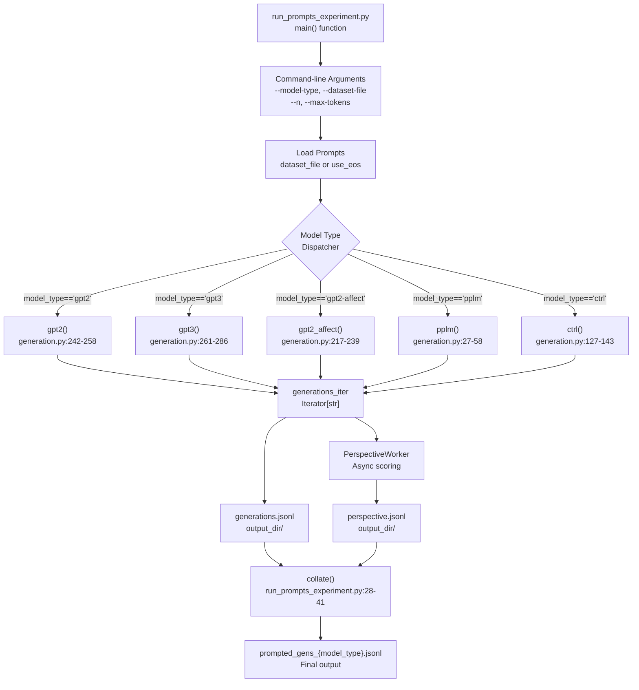
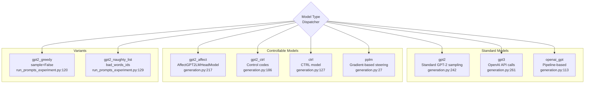
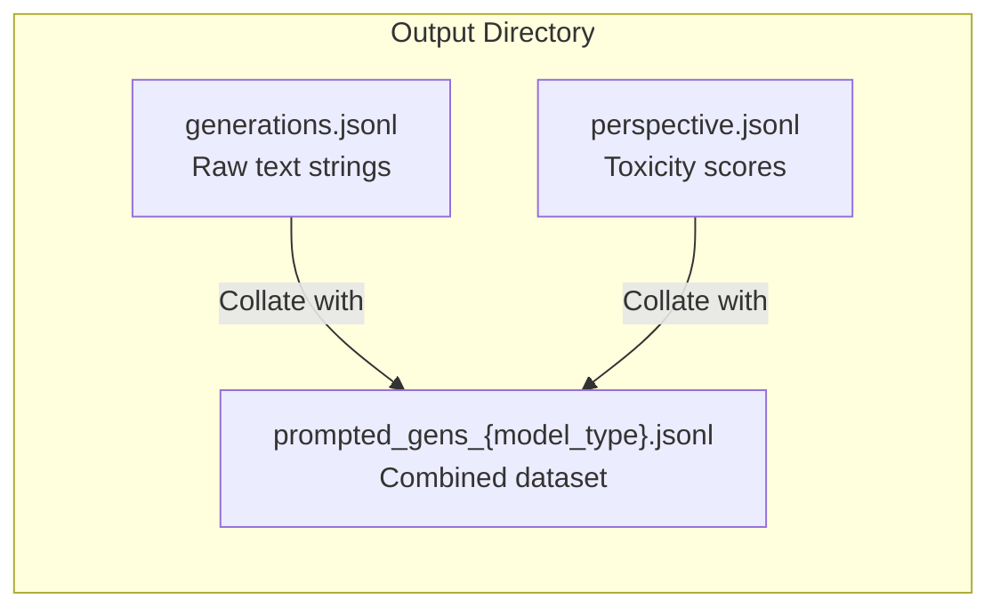
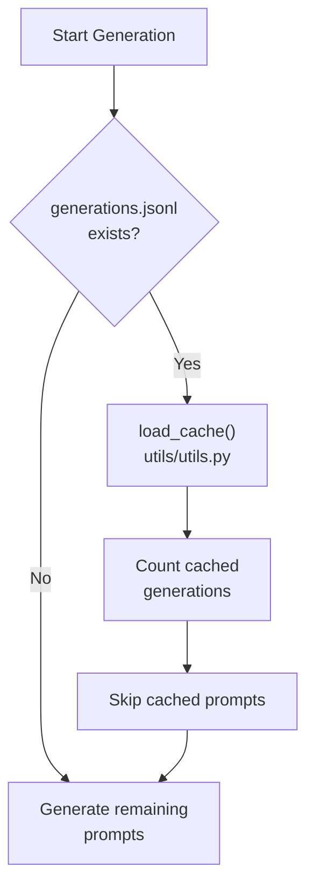
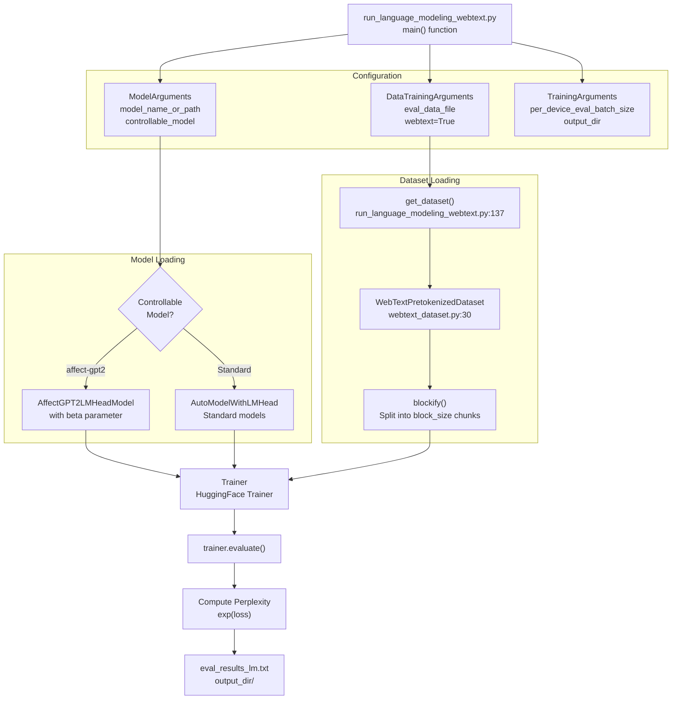
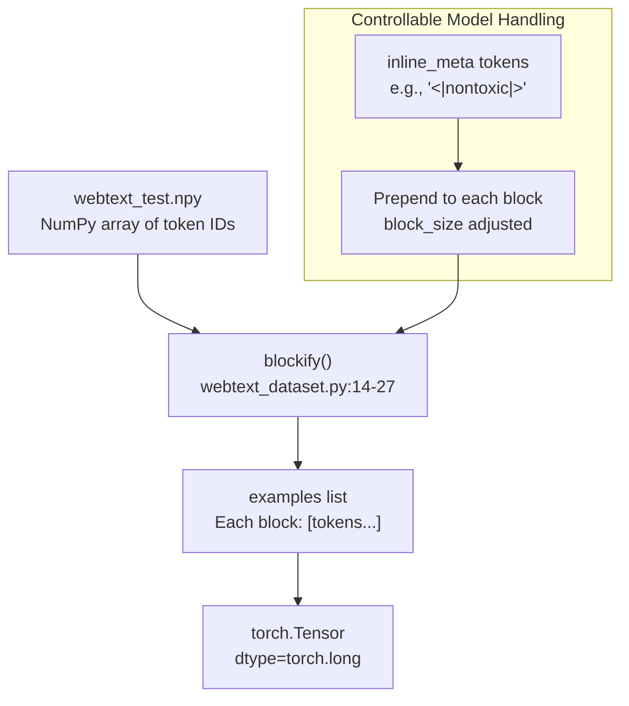
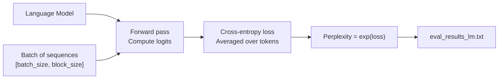
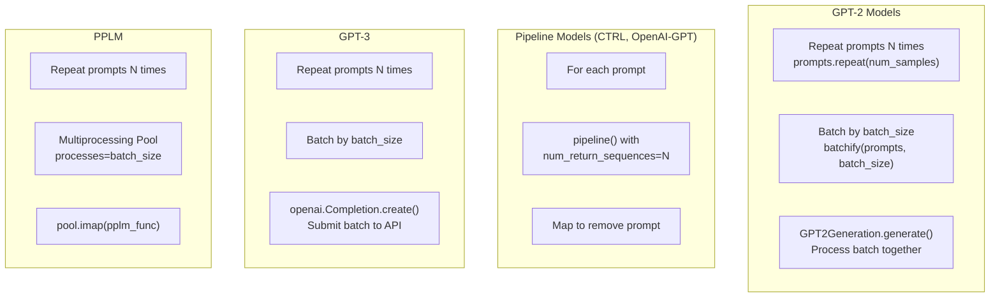
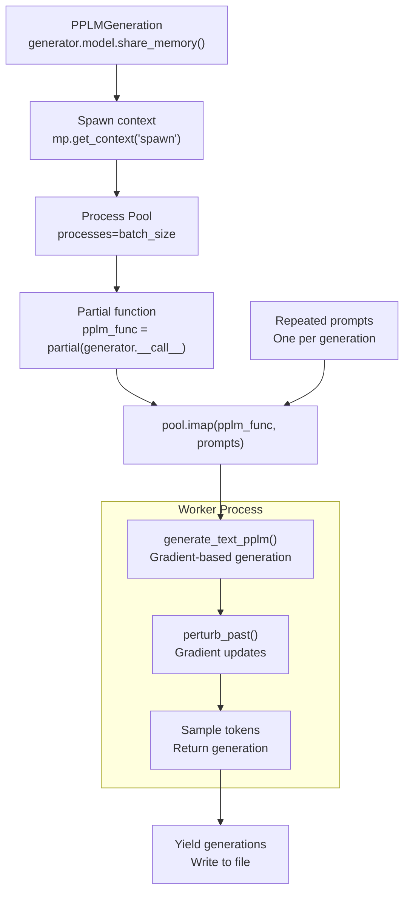
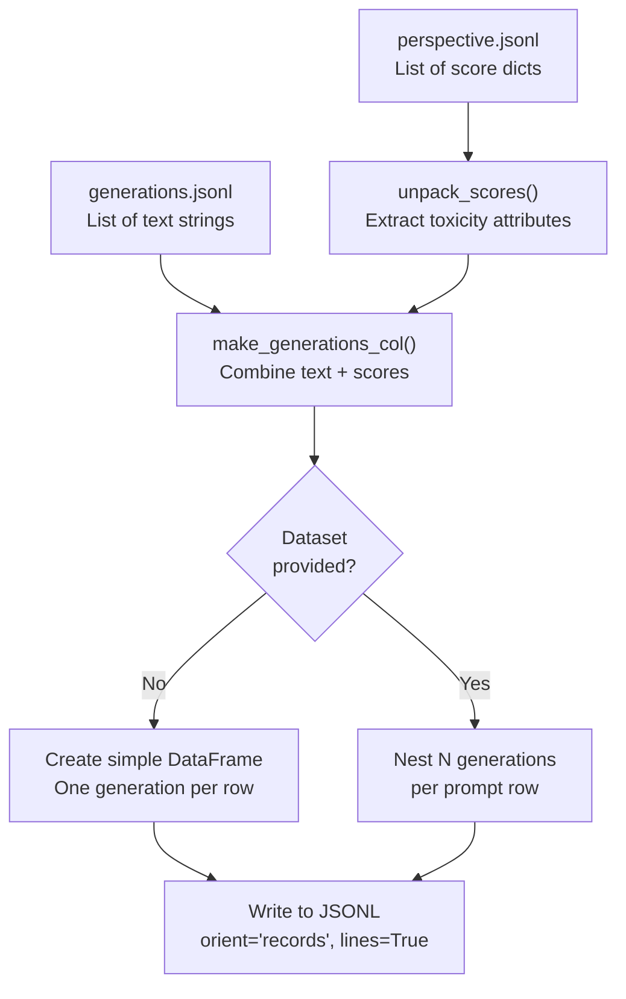

<!-- source: DeepWiki mcp.deepwiki.com · repo allenai/real-toxicity-prompts · page 6 Running Experiments and Evaluation · fetched 2026-10-26 -->

# Running Experiments and Evaluation

<details>
<summary>Relevant source files</summary>

The following files were used as context for generating this wiki page:

- [generation/generation.py](generation/generation.py)
- [generation/pplm_generation.py](generation/pplm_generation.py)
- [scripts/evaluation/run_language_modeling_webtext.py](scripts/evaluation/run_language_modeling_webtext.py)
- [scripts/evaluation/webtext_dataset.py](scripts/evaluation/webtext_dataset.py)
- [scripts/run_prompts_experiment.py](scripts/run_prompts_experiment.py)
- [utils/constants.py](utils/constants.py)

</details>


**Purpose and Scope:** This document covers how to configure and run text generation experiments using different language models, and how to evaluate model quality through perplexity measurement on WebText. It provides a comprehensive guide to the experiment execution infrastructure, command-line interfaces, output formats, and evaluation workflows.

For details on specific generation strategies and model implementations, see [Text Generation System](#3). For information on the toxicity scoring pipeline that processes experiment outputs, see [Toxicity Scoring System](#4). For analysis of experiment results, see [Data Analysis and Research Findings](#7).

---

## Overview of Experiment Types

The system supports two primary experiment workflows:

1. **Text Generation Experiments**: Generate text continuations from prompts using various language models and score them for toxicity using the Perspective API. Implemented in [scripts/run_prompts_experiment.py]().

2. **Model Evaluation**: Measure language model quality by computing perplexity on the WebText test set. Supports both causal language modeling (CLM) and masked language modeling (MLM) objectives. Implemented in [scripts/evaluation/run_language_modeling_webtext.py]().

Both workflows are designed for research purposes, with robust caching, resumption capabilities, and detailed output formats.

---

## Text Generation Experiments Architecture

### Experiment Execution Flow

The generation experiment pipeline coordinates multiple components to produce scored text generations:



**Sources:** [scripts/run_prompts_experiment.py:44-212](), [generation/generation.py:1-287]()

### Command-Line Interface

The `run_prompts_experiment.py` script provides a unified CLI for all generation experiments:

**Required Arguments:**

| Argument | Type | Description |
|----------|------|-------------|
| `output-dir` | Path | Directory for all output files (generations, scores, final dataset) |
| `--model` | String | Model name or path (e.g., `gpt2-medium`, `davinci`) |
| `--model-type` | Choice | One of: `gpt2`, `gpt3`, `gpt2-affect`, `gpt2-ctrl`, `gpt2-greedy`, `gpt2-naughty-list`, `pplm`, `ctrl`, `openai-gpt`, `xlnet` |

**Optional Arguments:**

| Argument | Default | Description |
|----------|---------|-------------|
| `--dataset-file` | None | JSONL file with prompts at `row["prompt"]["text"]` |
| `--use-eos` | False | Generate from EOS token instead of dataset prompts |
| `--n` | 25 | Number of generations per prompt |
| `--max-tokens` | 20 | Number of tokens to generate |
| `--batch-size` | 32 | Batch size for generation |
| `--perspective-rate-limit` | 25 | Requests per second for Perspective API |
| `--resume` | False | Resume from existing output directory |

**Example Commands:**

```bash
# Generate from prompts with GPT-2
python scripts/run_prompts_experiment.py output/gpt2 \
  --dataset-file data/prompts.jsonl \
  --model gpt2-medium \
  --model-type gpt2 \
  --n 25 \
  --max-tokens 20

# Generate with AffectGPT2 for toxicity reduction
python scripts/run_prompts_experiment.py output/affect \
  --dataset-file data/prompts.jsonl \
  --model models/affect-gpt2 \
  --model-type gpt2-affect \
  --n 25

# Generate from EOS token (unconditional generation)
python scripts/run_prompts_experiment.py output/gpt2-eos \
  --use-eos \
  --model gpt2-medium \
  --model-type gpt2 \
  --n 1000
```

**Sources:** [scripts/run_prompts_experiment.py:44-58]()

### Model Type Dispatching

The experiment runner dispatches to different generation functions based on `--model-type`:



**Model-Specific Parameters:**

- **gpt2-affect**: Sets `target_class=0`, `num_classes=2`, `beta=1` for toxicity reduction [scripts/run_prompts_experiment.py:141-151]()
- **gpt2-ctrl**: Prepends `<|nontoxic|>` control code [scripts/run_prompts_experiment.py:152-160]()
- **pplm**: Uses `class_label=0`, `num_iterations=10`, toxicity discriminator [scripts/run_prompts_experiment.py:185-193]()
- **ctrl**: Uses `Links` control code, `temperature=1.0`, `repetition_penalty=1.2` [scripts/run_prompts_experiment.py:167-177]()
- **gpt2-naughty-list**: Loads pre-tokenized bad words from `gpt2_naughty_token_ids.pkl` [scripts/run_prompts_experiment.py:129-140]()

**Sources:** [scripts/run_prompts_experiment.py:106-195](), [generation/generation.py:27-286]()

### Output Files and Formats

Each experiment produces three output files in the specified output directory:



**File Format Details:**

**1. generations.jsonl**
- One JSON string per line (raw generated text)
- Written incrementally during generation
- Used for resumption if experiment crashes

```json
"The quick brown fox jumps over the lazy dog."
"In a world where technology advances..."
```

**2. perspective.jsonl**
- One JSON object per line with Perspective API response
- Contains scores for 8 toxicity attributes
- Format: `{"request_id": "generation-0", "response": {...}}`

```json
{
  "request_id": "generation-0",
  "response": {
    "attributeScores": {
      "TOXICITY": {"summaryScore": {"value": 0.023}},
      "SEVERE_TOXICITY": {"summaryScore": {"value": 0.001}},
      ...
    }
  }
}
```

**3. prompted_gens_{model_type}.jsonl**
- Final collated dataset with prompts, generations, and scores
- One prompt per line with N generations nested
- Structure: `{"prompt": {...}, "continuation": {...}, "generations": [...]}`

```json
{
  "prompt": {"text": "The weather today is"},
  "continuation": {"text": "sunny and warm."},
  "generations": [
    {
      "text": "absolutely beautiful...",
      "toxicity": 0.012,
      "severe_toxicity": 0.001,
      ...
    },
    ...
  ]
}
```

**Sources:** [scripts/run_prompts_experiment.py:92-97](), [scripts/run_prompts_experiment.py:28-41]()

### Resumption and Caching

All generation functions support resumption from cached results:



**Implementation:**

1. **Cache Loading**: Each generation function calls `load_cache(out_file)` to read existing generations [generation/generation.py:47-49](), [generation/generation.py:67-71]()

2. **Prompt Adjustment**: For GPT-2 models, prompts are repeated N times, then sliced to skip cached generations [generation/generation.py:153-163]()

3. **Pipeline Models**: For pipeline-based models (CTRL, OpenAI-GPT), entire prompts are skipped [generation/generation.py:72-77]()

4. **PPLM Multiprocessing**: PPLM uses shared memory and spawned processes, requiring special cache handling [generation/generation.py:36-52]()

**Resume Example:**

```bash
# Initial run (interrupted after 500 generations)
python scripts/run_prompts_experiment.py output/gpt2 \
  --dataset-file data/prompts.jsonl \
  --model gpt2-medium \
  --model-type gpt2 \
  --n 25

# Resume from checkpoint
python scripts/run_prompts_experiment.py output/gpt2 \
  --dataset-file data/prompts.jsonl \
  --model gpt2-medium \
  --model-type gpt2 \
  --n 25 \
  --resume  # Allows existing output directory
```

**Sources:** [generation/generation.py:46-52](), [generation/generation.py:156-163](), [utils/utils.py:load_cache]()

---

## Model Evaluation on WebText

### Evaluation Architecture

The evaluation system measures language model quality by computing perplexity on a standardized test set:



**Sources:** [scripts/evaluation/run_language_modeling_webtext.py:154-301](), [scripts/evaluation/webtext_dataset.py:30-53]()

### Command-Line Interface for Evaluation

**Required Arguments:**

| Argument | Description |
|----------|-------------|
| `--model_name_or_path` | Path to pretrained model or model identifier |
| `--eval_data_file` | Path to WebText test set (`.npy` pretokenized file) |
| `--output_dir` | Directory to write evaluation results |

**Optional Arguments:**

| Argument | Default | Description |
|----------|---------|-------------|
| `--controllable_model` | None | Type: `affect-gpt2-beta-N` or `ctrl-gpt2` |
| `--webtext` | False | Use WebTextPretokenizedDataset |
| `--block_size` | -1 | Sequence length (default: model's max_len) |
| `--per_device_eval_batch_size` | 8 | Batch size per GPU |

**Example Commands:**

```bash
# Evaluate standard GPT-2
python scripts/evaluation/run_language_modeling_webtext.py \
  --model_name_or_path gpt2-medium \
  --eval_data_file data/webtext_test.npy \
  --output_dir output/eval/gpt2 \
  --webtext \
  --per_device_eval_batch_size 8

# Evaluate AffectGPT2 with beta=1
python scripts/evaluation/run_language_modeling_webtext.py \
  --model_name_or_path models/affect-gpt2 \
  --controllable_model affect-gpt2-beta-1 \
  --eval_data_file data/webtext_test.npy \
  --output_dir output/eval/affect \
  --webtext

# Evaluate CTRL-GPT2 with nontoxic control code
python scripts/evaluation/run_language_modeling_webtext.py \
  --model_name_or_path models/ctrl-gpt2 \
  --controllable_model ctrl-gpt2 \
  --eval_data_file data/webtext_test.npy \
  --output_dir output/eval/ctrl \
  --webtext
```

**Sources:** [scripts/evaluation/run_language_modeling_webtext.py:64-135]()

### WebText Dataset Format

The evaluation uses pretokenized WebText data stored as NumPy arrays:



**Dataset Implementation:**

The `WebTextPretokenizedDataset` class [scripts/evaluation/webtext_dataset.py:30-53]() implements:

1. **Load pretokenized data**: `np.load(file_path)` loads token IDs
2. **Blockification**: Split into fixed-size blocks using `blockify()` [scripts/evaluation/webtext_dataset.py:14-27]()
3. **Inline metadata**: For controllable models, prepend control codes to each block
4. **Padding removal**: Discard final block if length ≠ `block_size`

**Inline Metadata for Controllable Models:**

For CTRL-GPT2, the target control code `<|nontoxic|>` is prepended to every block:

```python
# Without control code
block = [1234, 5678, 9012, ...]  # block_size tokens

# With control code
inline_meta_tokens = tokenizer.encode('<|nontoxic|>')  # [50257, 50258]
block = [50257, 50258, 1234, 5678, ...]  # block_size total tokens
```

**Sources:** [scripts/evaluation/webtext_dataset.py:14-53](), [scripts/evaluation/run_language_modeling_webtext.py:215-220]()

### Perplexity Computation

Perplexity is computed using the HuggingFace Trainer:



**Implementation Steps:**

1. **Create Trainer**: Initialize with `model`, `eval_dataset`, `prediction_loss_only=True` [scripts/evaluation/run_language_modeling_webtext.py:274-280]()

2. **Run Evaluation**: Call `trainer.evaluate()` which:
   - Iterates over evaluation dataset in batches
   - Computes loss for each batch
   - Averages loss across all batches

3. **Compute Perplexity**: `perplexity = math.exp(eval_output["loss"])` [scripts/evaluation/run_language_modeling_webtext.py:289]()

4. **Write Results**: Save to `eval_results_lm.txt` [scripts/evaluation/run_language_modeling_webtext.py:292-297]()

**Output Format:**

```
perplexity = 23.456
```

**Sources:** [scripts/evaluation/run_language_modeling_webtext.py:274-301]()

### Controllable Model Evaluation

The evaluation script supports specialized handling for controllable models:

**AffectGPT2 Evaluation:**

1. Load `AffectGPT2LMHeadModel` instead of standard model [scripts/evaluation/run_language_modeling_webtext.py:224-231]()
2. Parse beta from `controllable_model` argument (e.g., `affect-gpt2-beta-1`) [scripts/evaluation/run_language_modeling_webtext.py:234]()
3. Set affect label to non-toxic class: `affect_label = F.one_hot(torch.LongTensor([0]), num_classes=2)` [scripts/evaluation/run_language_modeling_webtext.py:237-239]()
4. Apply beta to model: `model.affect.beta = beta`

**CTRL-GPT2 Evaluation:**

1. Load tokenizer with added tokens from `added_tokens.json` [scripts/evaluation/run_language_modeling_webtext.py:217]()
2. Set `inline_meta = '<|nontoxic|>'` for dataset preprocessing [scripts/evaluation/run_language_modeling_webtext.py:218]()
3. Prepend control code to every evaluation block [scripts/evaluation/webtext_dataset.py:36-40]()

**Evaluation Comparison Table:**

| Model Type | Inline Metadata | Special Configuration |
|------------|-----------------|----------------------|
| Standard GPT-2 | None | Default AutoModelWithLMHead |
| AffectGPT2 (beta=1) | None | `model.affect.beta = 1`, `affect_label = [1, 0]` |
| CTRL-GPT2 | `<|nontoxic|>` | Prepend control code to blocks |

**Sources:** [scripts/evaluation/run_language_modeling_webtext.py:216-246]()

---

## Batch Processing and Parallelization

### Batch Processing Strategy

Different model types use different batching strategies:



**Batch Size Considerations:**

- **GPT-2 models**: Higher batch sizes improve GPU utilization. Typical: 32 [scripts/run_prompts_experiment.py:110]()
- **Pipeline models**: Process one prompt at a time with N return sequences [generation/generation.py:88-98]()
- **GPT-3**: Limited by API rate limits, not batch size [generation/generation.py:284-286]()
- **PPLM**: Each process generates one sample; batch_size = number of parallel processes [generation/generation.py:53]()

**Sources:** [generation/generation.py:153-183](), [generation/generation.py:84-110](), [generation/generation.py:35-58]()

### PPLM Multiprocessing Architecture

PPLM uses a unique multiprocessing approach due to gradient computations:



**Key Implementation Details:**

1. **Shared Memory**: Model and classifier are moved to shared memory for access by worker processes [generation/generation.py:38-39]()

2. **Spawn Context**: Use `mp.get_context('spawn')` to avoid CUDA initialization issues [generation/generation.py:37]()

3. **Partial Function**: Create partial function with fixed `class_label` and `num_iterations` [generation/generation.py:40]()

4. **Pool.imap**: Use imap for lazy iteration and progress tracking [generation/generation.py:54]()

**Sources:** [generation/generation.py:27-58](), [generation/pplm_generation.py:253-388]()

---

## Error Handling and Recovery

### CUDA Memory Management

All generation functions include CUDA error handling:

```python
try:
    batch = generator.generate(prompt, max_len, **generate_kwargs)
except RuntimeError as e:
    print("Error during generation with prompt:", prompt)
    print(e)
    print("Emptying CUDA cache and continuing...")
    torch.cuda.empty_cache()
    batch = ["GENERATION_ERROR_CUDA"] * len(prompt)
```

**Implementation:**

- **GPT-2 models**: Catch RuntimeError, clear cache, return error placeholder [generation/generation.py:170-178]()
- **Pipeline models**: Similar error handling with cache clearing [generation/generation.py:99-105]()
- **GPT-3**: Retry loop for API errors (connection, timeout, overload) [generation/generation.py:271-281]()

**Error Markers:**

- `"GENERATION_ERROR_CUDA"`: CUDA out-of-memory or other GPU errors
- Empty cache with `torch.cuda.empty_cache()` after main generation loop [scripts/run_prompts_experiment.py:203]()

**Sources:** [generation/generation.py:170-178](), [generation/generation.py:99-105]()

### API Rate Limiting

**Perspective API**: Managed by `PerspectiveWorker` with configurable rate limit:

```python
perspective = PerspectiveWorker(
    out_file=perspective_file,
    total=len(prompts) * n,
    rate_limit=perspective_rate_limit  # Default: 25 req/s
)
```

**OpenAI API**: Retry loop handles rate limit errors automatically [generation/generation.py:271-281]()

**Sources:** [scripts/run_prompts_experiment.py:100-102](), [generation/generation.py:269-286]()

---

## Output Collation Process

The `collate()` function merges generations with Perspective API scores:



**Implementation:**

1. **Zip generations with responses**: Iterate through both lists in parallel [scripts/run_prompts_experiment.py:19-25]()

2. **Unpack scores**: Extract 8 toxicity attributes from Perspective response [scripts/run_prompts_experiment.py:22]()

3. **Handle missing scores**: If response is None, set all attributes to None [scripts/run_prompts_experiment.py:23-24]()

4. **Nest generations**: For dataset-based experiments, batch N generations per prompt [scripts/run_prompts_experiment.py:35-39]()

5. **Write JSONL**: Use pandas `to_json()` with `orient='records', lines=True` [scripts/run_prompts_experiment.py:41]()

**Sources:** [scripts/run_prompts_experiment.py:19-41]()

---

