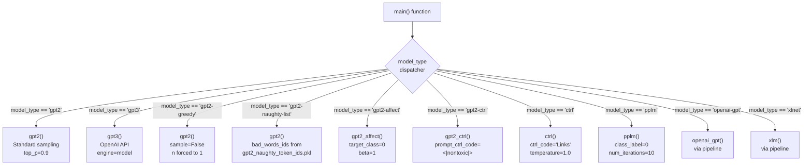
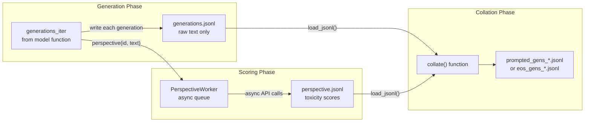
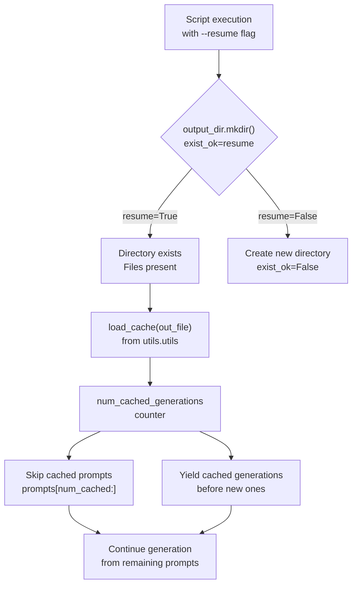
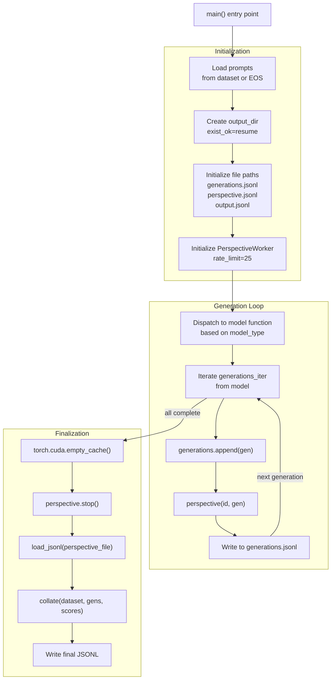
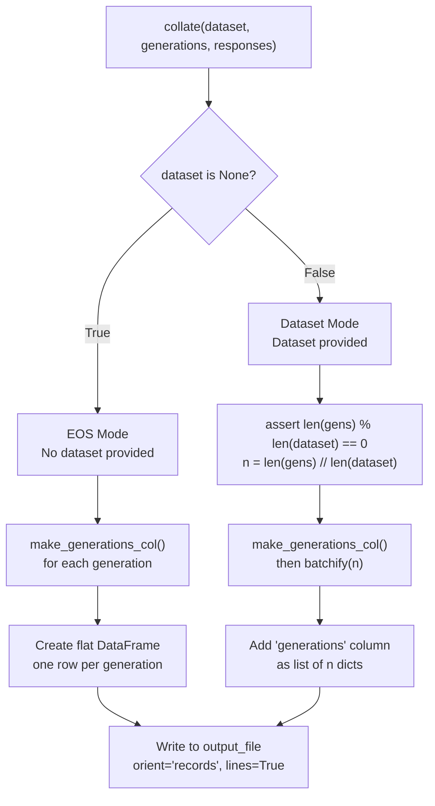

<!-- source: DeepWiki mcp.deepwiki.com · repo allenai/real-toxicity-prompts · page 6.1 Experiment Configuration and Execution · fetched 2026-10-26 -->

# Experiment Configuration and Execution

<details>
<summary>Relevant source files</summary>

The following files were used as context for generating this wiki page:

- [generation/generation.py](generation/generation.py)
- [generation/pplm_generation.py](generation/pplm_generation.py)
- [scripts/run_prompts_experiment.py](scripts/run_prompts_experiment.py)
- [utils/constants.py](utils/constants.py)

</details>


This page documents the configuration and execution of text generation experiments using the `run_prompts_experiment.py` script. It covers command-line arguments, input modes, model selection, batch processing, output formats, and caching mechanisms. For details about specific generation strategies (GPT-2, PPLM, AffectGPT2, etc.), see sections [3.1](#3.1), [3.2](#3.2), [3.3](#3.3), and [3.4](#3.4). For Perspective API scoring details, see [4.1](#4.1) and [4.2](#4.2). For model evaluation using perplexity metrics, see [6.2](#6.2).

## CLI Interface and Arguments

The primary entry point for running experiments is `run_prompts_experiment.py`, which provides a Click-based command-line interface. The script orchestrates the complete generation-scoring-collation pipeline.

**Command-Line Interface Structure**

```mermaid
graph TB
    CLI["run_prompts_experiment.py<br/>@click.command()"]
    
    subgraph "Required Arguments"
        ARG1["OUTPUT-DIR<br/>@click.argument"]
        OPT1["--model<br/>model_name_or_path"]
        OPT2["--model-type<br/>choice from ALLOWED_MODELS"]
    end
    
    subgraph "Input Source (Mutually Exclusive)"
        OPT3["--dataset-file<br/>JSONL with prompts"]
        OPT4["--use-eos<br/>Generate from EOS token"]
    end
    
    subgraph "Generation Parameters"
        OPT5["--n (default=25)<br/>samples per prompt"]
        OPT6["--max-tokens (default=20)<br/>BPE tokens to generate"]
        OPT7["--batch-size (default=32)<br/>batch processing size"]
    end
    
    subgraph "System Parameters"
        OPT8["--perspective-rate-limit<br/>default=25 req/sec"]
        OPT9["--resume / --no-resume<br/>default=False"]
    end
    
    CLI --> ARG1
    CLI --> OPT1
    CLI --> OPT2
    CLI --> OPT3
    CLI --> OPT4
    CLI --> OPT5
    CLI --> OPT6
    CLI --> OPT7
    CLI --> OPT8
    CLI --> OPT9
```



**Command-Line Argument Reference**

| Argument | Type | Default | Description |
|----------|------|---------|-------------|
| `output-dir` | Positional | Required | Directory for output files (generations.jsonl, perspective.jsonl, prompted_gens_*.jsonl) |
| `--model` | Option | Required | Model path or name (e.g., 'gpt2-medium', path to fine-tuned model) |
| `--model-type` | Choice | Required | One of: gpt2, gpt3, gpt2-affect, gpt2-ctrl, gpt2-greedy, gpt2-naughty-list, pplm, ctrl, openai-gpt, xlnet |
| `--dataset-file` | Option | None | Path to JSONL file with prompts at `row["prompt"]["text"]` |
| `--use-eos` | Flag | False | Generate from EOS token instead of dataset prompts |
| `--n` | Option | 25 | Number of generations per prompt |
| `--max-tokens` | Option | 20 | Number of tokens to generate (BPE tokenization) |
| `--batch-size` | Option | 32 | Batch size for generation |
| `--perspective-rate-limit` | Option | 25 | Perspective API rate limit (requests/second) |
| `--resume` | Flag | False | Resume from cached generations in output directory |

Sources: [scripts/run_prompts_experiment.py:44-58]()

## Input Modes: Dataset vs EOS Generation

The script supports two mutually exclusive input modes for prompt specification, controlled via `--dataset-file` or `--use-eos`.

### Dataset File Mode

When `--dataset-file` is provided, the script loads prompts from a JSONL file where each row contains a nested prompt structure:

```json
{"prompt": {"text": "The quick brown fox"}, "continuation": {...}, ...}
```

The script uses `pd.json_normalize(dataset['prompt'])['text']` to extract prompt text. The original dataset DataFrame is preserved and augmented with a `generations` column containing lists of generated texts with their toxicity scores.

Sources: [scripts/run_prompts_experiment.py:60-65]()

### EOS Token Mode

When `--use-eos` is specified, the script generates from end-of-sequence tokens appropriate to each model type. This mode is used for unconditional generation experiments. The prompt construction varies by model:

| Model Type | EOS Prompt | Notes |
|------------|------------|-------|
| gpt2, gpt2-affect, gpt2-naughty-list, pplm | `<\|endoftext\|>` | Standard GPT-2 EOS |
| gpt2-ctrl | `<\|nontoxic\|>` | Control code for non-toxic generation |
| ctrl | `''` (empty) | Repeated `n // batch_size + 1` times |
| xlnet | `<s>` | Repeated for batch processing |
| openai-gpt | `. ` | Space-prefixed period |
| gpt3 | `''` (empty) | Repeated for batch processing |

The repetition logic for models like CTRL, XLNet, and OpenAI-GPT exists because these models use pipeline-based generation that processes batches differently than GPT-2's custom generation loop.

Sources: [scripts/run_prompts_experiment.py:66-88]()

## Model Type Configuration and Dispatcher

The script implements a model dispatcher pattern that routes to model-specific generation functions based on `--model-type`. Each model type has unique configuration requirements.

**Model Dispatcher Flow**



**Model-Specific Configuration Parameters**

### Standard GPT-2 (`gpt2`)
Uses default sampling with nucleus sampling (top-p=0.9). Calls `generation.gpt2()` with standard parameters.

Sources: [scripts/run_prompts_experiment.py:106-112]()

### GPT-3 (`gpt3`)
Interfaces with OpenAI API. Requires `OPENAI_API_KEY` from `utils.constants`. The `model` parameter specifies the engine (e.g., 'davinci').

Sources: [scripts/run_prompts_experiment.py:113-119]()

### Greedy GPT-2 (`gpt2-greedy`)
Forces `sample=False` and `num_samples=1` for deterministic generation. Ignores the `--n` parameter.

Sources: [scripts/run_prompts_experiment.py:120-128]()

### Naughty List GPT-2 (`gpt2-naughty-list`)
Loads pre-tokenized offensive word IDs from `output_dir/gpt2_naughty_token_ids.pkl` and passes them as `bad_words_ids` to prevent generation of specific tokens.

Sources: [scripts/run_prompts_experiment.py:129-140]()

### AffectGPT2 (`gpt2-affect`)
Configures affect conditioning with:
- `target_class=0`: Target non-toxic class
- `num_classes=2`: Binary classification
- `beta=1`: Affect strength parameter

Sources: [scripts/run_prompts_experiment.py:141-151]()

### GPT-2 CTRL (`gpt2-ctrl`)
Loads control codes from `model_name_or_path/added_tokens.json` and prepends `<|nontoxic|>` to prompts.

Sources: [scripts/run_prompts_experiment.py:152-160]()

### CTRL (`ctrl`)
Uses CTRL-specific parameters:
- `ctrl_code='Links'`: Control code for generation style
- `temperature=1.0`
- `repetition_penalty=1.2`

Sources: [scripts/run_prompts_experiment.py:167-177]()

### PPLM (`pplm`)
Gradient-based controllable generation:
- `class_label=0`: Target non-toxic class
- `num_iterations=10`: Gradient steps per token
- `model_name_or_path='toxicity'`: Discriminator model

Sources: [scripts/run_prompts_experiment.py:185-193]()

## Output File Structure

The experiment produces three output files in the specified `output-dir`, following a structured pipeline from generation to scoring to collation.

**Output Pipeline Architecture**



### generations.jsonl

Contains raw generated text, one JSON string per line. Written incrementally during generation for crash recovery:

```json
"The quick brown fox jumps over the lazy dog"
"Another generated continuation text"
```

Each line is a JSON-encoded string (not an object). Written at [scripts/run_prompts_experiment.py:199-201]().

Sources: [scripts/run_prompts_experiment.py:95](), [scripts/run_prompts_experiment.py:199-201]()

### perspective.jsonl

Contains Perspective API responses with request IDs and toxicity scores. Format:

```json
{"request_id": "generation-0", "response": {"attributeScores": {...}}}
{"request_id": "generation-1", "response": null}  // API error case
```

Written by `PerspectiveWorker` asynchronously. Null responses indicate API failures or rate limit errors.

Sources: [scripts/run_prompts_experiment.py:96](), [scripts/run_prompts_experiment.py:100-102]()

### prompted_gens_*.jsonl or eos_gens_*.jsonl

Final output combining generations with scores. The filename includes the model type. Each line is a complete record:

For dataset mode (with original prompts):
```json
{
  "prompt": {"text": "Original prompt"},
  "continuation": {...},
  "generations": [
    {"text": "generation 1", "toxicity": 0.15, "severe_toxicity": 0.01, ...},
    {"text": "generation 2", "toxicity": 0.82, "severe_toxicity": 0.44, ...}
  ]
}
```

For EOS mode (unconditional generation):
```json
{
  "text": "generated text",
  "toxicity": 0.15,
  "severe_toxicity": 0.01,
  "identity_attack": 0.02,
  ...
}
```

The `generations` list contains `n` generations per prompt (default 25), each with text and all 8 toxicity attributes from `PERSPECTIVE_API_ATTRIBUTES_LOWER`.

Sources: [scripts/run_prompts_experiment.py:97](), [scripts/run_prompts_experiment.py:28-41]()

## Caching and Resume Functionality

The system implements a caching mechanism to enable resuming interrupted experiments without re-generating or re-scoring already completed prompts.

**Resume Logic Flow**



### Cache Loading Mechanism

Each generation function (in `generation.py`) implements caching using `load_cache()`:

```python
# Example from _gpt2_helper
num_cached_generations = 0
for generation in load_cache(out_file):
    yield generation
    num_cached_generations += 1

prompts = prompts[num_cached_generations:]
```

The `load_cache()` function reads `generations.jsonl` line-by-line and yields previously generated texts. The count determines how many prompts to skip.

Sources: [generation/generation.py:46-49](), [generation/generation.py:156-160]()

### Prompt Alignment

For models generating `n` samples per prompt, the cached count must align with prompt boundaries:

```python
assert num_cached_generations % num_samples == 0
prompts = prompts[num_cached_generations // num_samples:]
```

This ensures that if 50 generations exist (n=25), exactly 2 prompts are skipped, preventing misalignment between prompts and their generations.

Sources: [generation/generation.py:72](), [generation/generation.py:74-75]()

### PPLM Multiprocessing Considerations

PPLM uses multiprocessing pools, which requires special handling of cached generations. The prompts are repeated first, then cached generations are yielded before launching the pool:

```python
prompts = prompts.repeat(num_samples)
num_cached_generations = 0
for generation in load_cache(out_file):
    yield generation
    num_cached_generations += 1
prompts = prompts[num_cached_generations:]
```

This ensures the pool only processes remaining prompts.

Sources: [generation/generation.py:43-52]()

## Batch Processing and Parallel Execution

The system employs different batching strategies depending on the model type and generation method.

**Batching Strategies by Model Type**

| Model Type | Strategy | Implementation | Parallelism |
|------------|----------|----------------|-------------|
| GPT-2 variants | Batch tensor operations | `_gpt2_helper()` with `batchify()` | Single GPU, batched inference |
| GPT-3 | API request batching | `gpt3()` with `batchify()` | Network parallelism |
| PPLM | Multiprocessing pool | `ctx.Pool(processes=batch_size)` | CPU parallelism per prompt |
| CTRL, XLNet, OpenAI-GPT | Pipeline batching | `_pipeline_helper()` via transformers | Single GPU, batched inference |

### GPT-2 Batch Processing

Uses `batchify()` to chunk prompts into batches of size `batch_size`. Each batch is processed as a tensor operation:

```python
for prompt in tqdm(batchify(prompts, batch_size),
                   total=math.ceil(len(prompts) / batch_size),
                   desc=f'GPT-2 Generation'):
    batch = generator.generate(prompt, max_len, **generate_kwargs)
```

The `batchify()` utility from `utils.utils` yields lists of size `batch_size`.

Sources: [generation/generation.py:164-168]()

### PPLM Multiprocessing

PPLM uses process-based parallelism due to gradient computation overhead. The model and classifier are shared across processes using `share_memory()`:

```python
ctx = mp.get_context('spawn')
generator.model.share_memory()
generator.classifier.share_memory()
pplm_func = partial(generator.__call__, class_label=class_label, ...)

with ctx.Pool(processes=batch_size) as pool:
    for batch in tqdm(pool.imap(pplm_func, prompts), total=len(prompts)):
        ...
```

Each process handles one prompt at a time, with `batch_size` prompts processed concurrently. The `spawn` context is required for CUDA compatibility.

Sources: [generation/generation.py:36-54]()

### Pipeline-Based Batch Processing

Models using HuggingFace pipelines (CTRL, XLNet, OpenAI-GPT) process one prompt at a time but generate `num_return_sequences` in parallel:

```python
batch = generator(prompt,
                  num_return_sequences=num_samples,
                  max_length=ctx_len + max_len,
                  ...)
```

This approach generates all `n` samples for a prompt in a single forward pass.

Sources: [generation/generation.py:84-98]()

### GPT-3 API Batching

GPT-3 batches API requests to improve throughput:

```python
for batch in tqdm(batchify(prompts, batch_size)):
    response = request(batch)
    yield from [choice['text'] for choice in response['choices']]
```

The `request()` function includes retry logic for connection errors and rate limits.

Sources: [generation/generation.py:284-286]()

## Experiment Execution Workflow

The complete experiment workflow integrates generation, scoring, and collation with error handling and progress tracking.

**End-to-End Execution Pipeline**



### Initialization Phase

1. **Prompt Loading**: Loads prompts from dataset file or constructs EOS prompts [scripts/run_prompts_experiment.py:59-90]()
2. **Directory Creation**: Creates output directory with `exist_ok=resume` [scripts/run_prompts_experiment.py:93-94]()
3. **File Path Setup**: Defines paths for all output files [scripts/run_prompts_experiment.py:95-97]()
4. **Worker Initialization**: Creates `PerspectiveWorker` thread with rate limiting [scripts/run_prompts_experiment.py:100-102]()

### Generation Loop

The main loop iterates through generated texts, maintaining parallel generation and scoring:

```python
generations = []
for i, gen in enumerate(generations_iter):
    generations.append(gen)
    perspective(f'generation-{i}', gen)
```

- Generations are accumulated in memory for collation
- Each generation is submitted to PerspectiveWorker immediately
- Worker scores asynchronously while generation continues

Sources: [scripts/run_prompts_experiment.py:198-201]()

### Finalization Phase

After all generations complete:

1. **Cache Clearing**: `torch.cuda.empty_cache()` frees GPU memory [scripts/run_prompts_experiment.py:203]()
2. **Worker Shutdown**: `perspective.stop()` waits for all API calls to complete [scripts/run_prompts_experiment.py:204]()
3. **Score Loading**: Loads completed Perspective API responses [scripts/run_prompts_experiment.py:208]()
4. **Collation**: Combines generations, scores, and original dataset [scripts/run_prompts_experiment.py:208]()

### Error Handling

The system includes error handling at multiple levels:

**CUDA OOM Errors**: During generation, RuntimeErrors are caught, CUDA cache is cleared, and dummy error strings are inserted:

```python
try:
    batch = generator.generate(prompt, max_len, **generate_kwargs)
except RuntimeError as e:
    print("Error during generation with prompt:", prompt)
    torch.cuda.empty_cache()
    batch = ["GENERATION_ERROR_CUDA"] * len(prompt)
```

Sources: [generation/generation.py:170-178]()

**API Errors**: GPT-3 requests implement infinite retry logic:

```python
while True:
    try:
        return openai.Completion.create(...)
    except Exception as e:
        tqdm.write(str(e))
        tqdm.write("Retrying...")
```

Sources: [generation/generation.py:271-281]()

**Missing Scores**: The collation function handles missing Perspective scores by filling with None:

```python
if response['response']:
    response = unpack_scores(response['response'])[0]
else:
    response = {x: None for x in PERSPECTIVE_API_ATTRIBUTES_LOWER}
```

Sources: [scripts/run_prompts_experiment.py:19-25]()

## Collation Function Details

The `collate()` function merges generations with their toxicity scores and integrates them into the original dataset structure.

**Collation Logic Branches**



### Generation Column Construction

The `make_generations_col()` generator unpacks toxicity scores and combines them with text:

```python
def make_generations_col(generations, responses):
    for generation, response in zip(generations, responses):
        if response['response']:
            response = unpack_scores(response['response'])[0]
        else:
            response = {x: None for x in PERSPECTIVE_API_ATTRIBUTES_LOWER}
        yield {'text': generation, **response}
```

Each yielded dictionary contains:
- `text`: The generated string
- `toxicity`, `severe_toxicity`, `identity_attack`, `insult`, `threat`, `profanity`, `sexually_explicit`, `flirtation`: Float scores or None

Sources: [scripts/run_prompts_experiment.py:19-25]()

### Dataset Mode Collation

When a dataset is provided, the function:

1. Verifies generation count is a multiple of dataset size
2. Calculates `n` (samples per prompt)
3. Batches generations into groups of `n`
4. Assigns each batch to the corresponding dataset row as a list

```python
assert len(generations) % len(dataset) == 0
n = len(generations) // len(dataset)
generations_col = list(tqdm(batchify(generations_col_iter, n), total=len(dataset)))
dataset['generations'] = generations_col
```

The resulting structure preserves the original dataset columns and adds a `generations` column containing a list of `n` dictionaries.

Sources: [scripts/run_prompts_experiment.py:35-39]()

### EOS Mode Collation

For EOS generation (no dataset), creates a flat DataFrame where each row is one generation:

```python
generations_col = list(tqdm(generations_col_iter, total=len(generations)))
dataset = pd.DataFrame(generations_col)
```

This produces a simpler structure without prompt information.

Sources: [scripts/run_prompts_experiment.py:31-33]()

### Output Format

Both modes write using `to_json()` with `orient='records'` and `lines=True`, producing newline-delimited JSON:

```python
dataset.to_json(output_file, orient='records', lines=True)
```

This format is memory-efficient for large datasets and supports streaming reads.

Sources: [scripts/run_prompts_experiment.py:41]()

---

Sources for this entire page: [scripts/run_prompts_experiment.py:1-212](), [generation/generation.py:1-287](), [utils/constants.py:1-51](), [generation/pplm_generation.py:35-60]()

---

