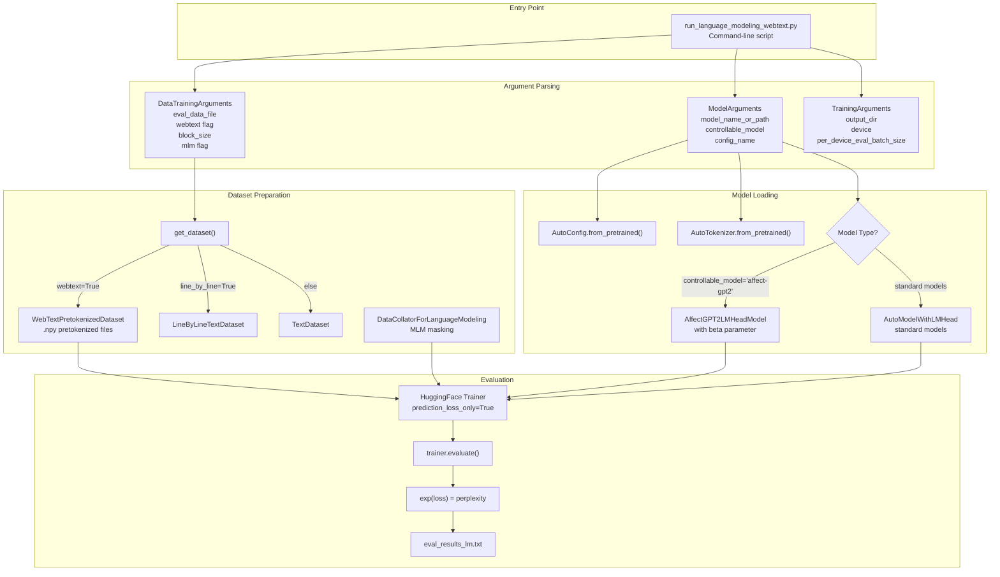
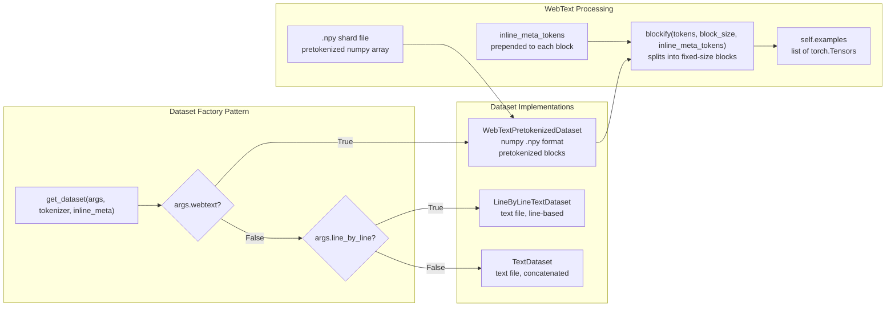
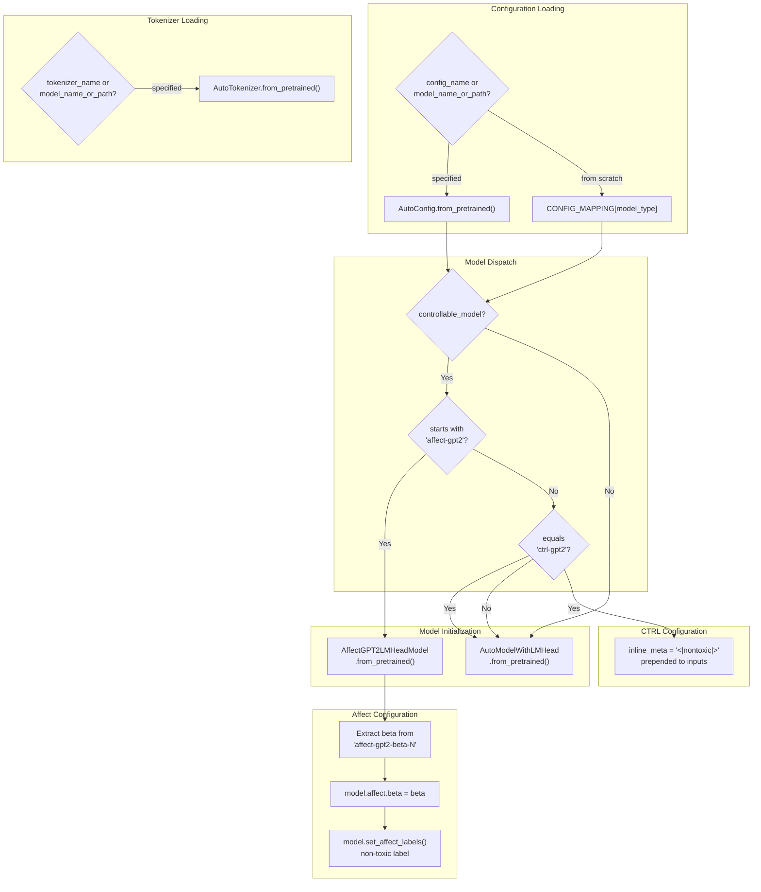
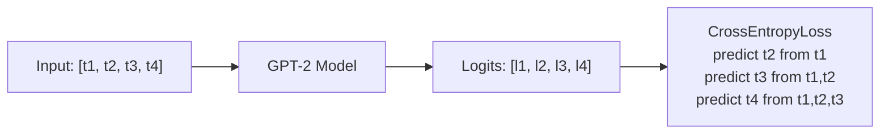
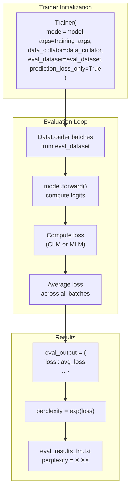

<!-- source: DeepWiki mcp.deepwiki.com · repo allenai/real-toxicity-prompts · page 6.2 Model Evaluation on WebText · fetched 2026-10-26 -->

# Model Evaluation on WebText

<details>
<summary>Relevant source files</summary>

The following files were used as context for generating this wiki page:

- [scripts/evaluation/run_language_modeling_webtext.py](scripts/evaluation/run_language_modeling_webtext.py)
- [scripts/evaluation/webtext_dataset.py](scripts/evaluation/webtext_dataset.py)

</details>


## Purpose and Scope

This document describes the evaluation framework for measuring language model quality on the WebText corpus. The system computes perplexity scores to assess model performance on a held-out test set, supporting both causal language modeling (CLM) and masked language modeling (MLM) objectives. This evaluation is distinct from the text generation experiments covered in [6.1](#6.1); while generation experiments produce and score toxic outputs, this evaluation measures intrinsic model quality.

The evaluation framework supports standard models (GPT-2, BERT, RoBERTa) as well as controllable variants (AffectGPT2, CTRL-GPT2) documented in [3.3](#3.3) and [3.2](#3.2).

---

## Evaluation System Architecture

The evaluation system consists of three main components: the evaluation script, dataset loaders for WebText, and integration with HuggingFace's Trainer API.



**Sources:** [scripts/evaluation/run_language_modeling_webtext.py:1-305]()

---

## Command-Line Interface

The evaluation script `run_language_modeling_webtext.py` is invoked with three groups of arguments defined using HuggingFace's `HfArgumentParser`:

### ModelArguments

| Argument | Type | Description |
|----------|------|-------------|
| `--model_name_or_path` | str | Path or identifier for pretrained model weights |
| `--model_type` | str | Model type from HuggingFace MODEL_TYPES (gpt2, bert, roberta, etc.) |
| `--controllable_model` | str | Controllable model variant: 'affect-gpt2-beta-N' or 'ctrl-gpt2' |
| `--config_name` | str | Config name if different from model_name_or_path |
| `--tokenizer_name` | str | Tokenizer name if different from model_name_or_path |
| `--cache_dir` | str | Directory for storing downloaded models |

### DataTrainingArguments

| Argument | Type | Default | Description |
|----------|------|---------|-------------|
| `--eval_data_file` | str | None | Path to evaluation data file (required) |
| `--webtext` | bool | False | Use WebTextPretokenizedDataset (.npy format) |
| `--line_by_line` | bool | False | Handle lines as distinct sequences |
| `--mlm` | bool | False | Use masked language modeling objective |
| `--mlm_probability` | float | 0.15 | Masking probability for MLM |
| `--block_size` | int | -1 | Sequence length (-1 = use tokenizer.max_len) |

### Example Usage

```bash
# Evaluate GPT-2 on WebText with CLM
python scripts/evaluation/run_language_modeling_webtext.py \
    --model_name_or_path gpt2-medium \
    --eval_data_file data/webtext_test.npy \
    --webtext \
    --output_dir results/gpt2-medium \
    --per_device_eval_batch_size 8

# Evaluate AffectGPT2 with beta=5
python scripts/evaluation/run_language_modeling_webtext.py \
    --model_name_or_path models/affect_gpt2 \
    --controllable_model affect-gpt2-beta-5 \
    --eval_data_file data/webtext_test.npy \
    --webtext \
    --output_dir results/affect-gpt2-beta5

# Evaluate BERT with MLM objective
python scripts/evaluation/run_language_modeling_webtext.py \
    --model_name_or_path bert-base-uncased \
    --eval_data_file data/webtext_test.txt \
    --mlm \
    --output_dir results/bert-base
```

**Sources:** [scripts/evaluation/run_language_modeling_webtext.py:64-135](), [scripts/evaluation/run_language_modeling_webtext.py:154-170]()

---

## WebText Dataset Loading

The system provides specialized dataset classes for efficient loading of the WebText evaluation corpus:



### WebTextPretokenizedDataset

The `WebTextPretokenizedDataset` class loads pretokenized WebText data from numpy `.npy` files:

```python
# Key implementation details from webtext_dataset.py

class WebTextPretokenizedDataset(Dataset):
    def __init__(self, tokenizer, file_path, block_size, inline_meta=None, local_rank=-1):
        # Load pretokenized shard
        shard = np.load(file_path)
        
        # Tokenize inline metadata (e.g., '<|nontoxic|>')
        inline_metadata_tokens = tokenizer.encode(inline_meta) if inline_meta else []
        
        # Split into fixed-size blocks
        self.examples = blockify(shard, block_size, inline_metadata_tokens)
        
    def __getitem__(self, i) -> torch.Tensor:
        return torch.tensor(self.examples[i], dtype=torch.long)
```

### Blockification Process

The `blockify` function segments the token array into fixed-size blocks:

1. **Adjust block size** for inline metadata: If metadata tokens are present, reduce effective block size by their length [scripts/evaluation/webtext_dataset.py:14-16]()
2. **Create block indices** at regular intervals: `np.arange(block_size, len(tokens), block_size)` [scripts/evaluation/webtext_dataset.py:18]()
3. **Split array** into blocks: `np.split(tokens, block_idxs)` [scripts/evaluation/webtext_dataset.py:19]()
4. **Discard incomplete final block** if it doesn't match block_size [scripts/evaluation/webtext_dataset.py:21-22]()
5. **Prepend inline metadata** to each block if specified [scripts/evaluation/webtext_dataset.py:24-25]()

| Block Component | Example | Length |
|----------------|---------|--------|
| Inline metadata | `[50256]` (control code token) | Variable |
| Content tokens | `[1212, 318, 257, ...]` | block_size - len(metadata) |
| Total | `[50256, 1212, 318, 257, ...]` | block_size |

**Sources:** [scripts/evaluation/webtext_dataset.py:1-77]()

---

## Model Loading and Configuration

The script supports loading both standard and controllable language models through a unified interface:



### Standard Model Loading

Standard models use HuggingFace's `AutoModelWithLMHead`:

```python
# From run_language_modeling_webtext.py:241-246
model = AutoModelWithLMHead.from_pretrained(
    model_args.model_name_or_path,
    from_tf=bool(".ckpt" in model_args.model_name_or_path),
    config=config,
    cache_dir=model_args.cache_dir,
)
```

### AffectGPT2 Loading and Configuration

For AffectGPT2 models, the script extracts the beta parameter from the model name and configures affect labels:

```python
# From run_language_modeling_webtext.py:224-239
if controllable_model and controllable_model.startswith('affect-gpt2'):
    model = AffectGPT2LMHeadModel.from_pretrained(
        model_args.model_name_or_path,
        from_tf=bool(".ckpt" in model_args.model_name_or_path),
        config=config,
        cache_dir=model_args.cache_dir,
    )
    
    # Extract beta from name like 'affect-gpt2-beta-5'
    beta = int(re.search(r'beta-([0-9]+)', controllable_model).group(1))
    model.affect.beta = beta
    
    # Set affect label to non-toxic (index 0)
    affect_label = F.one_hot(torch.LongTensor([AFFECT_LABEL_IDX]),
                             num_classes=AFFECT_NUM_LABELS).float().to(device)
    model.set_affect_labels(affect_label)
```

Constants defined at the top of the file:
- `AFFECT_LABEL_IDX = 0` (non-toxic label)
- `AFFECT_NUM_LABELS = 2` (binary: toxic/non-toxic)

### CTRL-GPT2 Configuration

CTRL-GPT2 models use inline control codes prepended to each input block:

```python
# From run_language_modeling_webtext.py:215-220
if model_args.controllable_model == 'ctrl-gpt2':
    inline_meta = TARGET_CTRL_CODE  # '<|nontoxic|>'
    assert inline_meta in tokenizer.get_vocab().keys()
```

The control code `<|nontoxic|>` is prepended to each block during dataset loading (see [WebText Dataset Loading](#webtext-dataset-loading)).

**Sources:** [scripts/evaluation/run_language_modeling_webtext.py:191-251](), [scripts/evaluation/run_language_modeling_webtext.py:56-61]()

---

## CLM vs MLM Evaluation Modes

The evaluation framework supports two language modeling objectives:

### Causal Language Modeling (CLM)

Used for autoregressive models like GPT-2:
- **Loss calculation:** Cross-entropy loss predicting token t from tokens 1..t-1
- **Model requirement:** Models with language modeling heads
- **Block processing:** Each block is a contiguous sequence
- **Perplexity:** Measures model's surprise at seeing the next token



### Masked Language Modeling (MLM)

Required for models like BERT and RoBERTa:
- **Loss calculation:** Cross-entropy loss predicting masked tokens from context
- **Masking:** `mlm_probability` (default 0.15) of tokens are masked
- **Model requirement:** Models with masked language modeling heads
- **Error prevention:** The script raises an error if BERT/RoBERTa models are evaluated without `--mlm` flag [scripts/evaluation/run_language_modeling_webtext.py:253-257]()

```python
# From run_language_modeling_webtext.py:253-257
if config.model_type in ["bert", "roberta", "distilbert", "camembert"] and not data_args.mlm:
    raise ValueError(
        "BERT and RoBERTa-like models do not have LM heads but masked LM heads. "
        "They must be run using the --mlm flag (masked language modeling)."
    )
```

The `DataCollatorForLanguageModeling` handles masking:

```python
# From run_language_modeling_webtext.py:269-271
data_collator = DataCollatorForLanguageModeling(
    tokenizer=tokenizer, mlm=data_args.mlm, mlm_probability=data_args.mlm_probability
)
```

**Sources:** [scripts/evaluation/run_language_modeling_webtext.py:117-122](), [scripts/evaluation/run_language_modeling_webtext.py:253-271]()

---

## Evaluation Process and Perplexity Calculation

The evaluation uses HuggingFace's `Trainer` class in evaluation-only mode:



### Trainer Configuration

```python
# From run_language_modeling_webtext.py:274-280
trainer = Trainer(
    model=model,
    args=training_args,
    data_collator=data_collator,
    eval_dataset=eval_dataset,
    prediction_loss_only=True,  # Only return loss, not logits
)
```

Key configuration:
- `prediction_loss_only=True`: Returns only loss values (not full logits), saving memory
- Training is explicitly disabled [scripts/evaluation/run_language_modeling_webtext.py:162-165]()

### Perplexity Computation

Perplexity is computed from the average loss:

```python
# From run_language_modeling_webtext.py:287-290
eval_output = trainer.evaluate()

perplexity = math.exp(eval_output["loss"])
result = {"perplexity": perplexity}
```

**Mathematical relationship:**
- Loss is cross-entropy: `loss = -log P(correct_token)`
- Perplexity: `PPL = exp(loss) = exp(-log P) = 1/P`
- Lower perplexity indicates better model (higher probability assigned to correct tokens)

### Output Format

Results are written to `eval_results_lm.txt` in the specified output directory:

```
perplexity = 23.45
```

Example interpretation:
- **PPL = 20**: Model is roughly as uncertain as choosing from 20 equally likely tokens
- **Lower is better**: PPL decreases as model quality improves
- **Typical values**: GPT-2 small ~30, GPT-2 medium ~25, GPT-2 large ~20 on WebText

**Sources:** [scripts/evaluation/run_language_modeling_webtext.py:273-301]()

---

## Evaluation Workflow Summary

The complete evaluation workflow follows this sequence:

| Stage | Component | Key Action | Output |
|-------|-----------|------------|--------|
| 1. Parse Arguments | `HfArgumentParser` | Parse model, data, training args | `ModelArguments`, `DataTrainingArguments`, `TrainingArguments` |
| 2. Load Config | `AutoConfig.from_pretrained()` | Load model configuration | `config` object |
| 3. Load Tokenizer | `AutoTokenizer.from_pretrained()` | Load tokenizer | `tokenizer` object |
| 4. Load Model | `AffectGPT2LMHeadModel` or `AutoModelWithLMHead` | Initialize model weights | `model` object |
| 5. Configure Controllability | `model.affect.beta`, `model.set_affect_labels()` | Set affect parameters (if applicable) | Configured model |
| 6. Prepare Dataset | `WebTextPretokenizedDataset` or alternatives | Load and blockify evaluation data | `eval_dataset` |
| 7. Initialize Trainer | `Trainer(...)` | Create evaluation harness | `trainer` object |
| 8. Evaluate | `trainer.evaluate()` | Compute average loss over dataset | `eval_output` dict |
| 9. Compute Perplexity | `math.exp(loss)` | Convert loss to perplexity | Numeric perplexity score |
| 10. Write Results | Write to file | Save results to disk | `eval_results_lm.txt` |

**Sources:** [scripts/evaluation/run_language_modeling_webtext.py:154-301]()

---

## Implementation Notes

### Training Disabled

The script explicitly prevents training:

```python
# From run_language_modeling_webtext.py:162-165
if training_args.do_train:
    raise ValueError("Training not supported with this script.")
```

### Block Size Handling

Block size defaults to the tokenizer's maximum length if not specified:

```python
# From run_language_modeling_webtext.py:259-263
if data_args.block_size <= 0:
    data_args.block_size = tokenizer.max_len
else:
    data_args.block_size = min(data_args.block_size, tokenizer.max_len)
```

### Token Embedding Resizing

The model's token embeddings are resized to match the tokenizer vocabulary (important when control tokens have been added):

```python
# From run_language_modeling_webtext.py:251
model.resize_token_embeddings(len(tokenizer))
```

### Distributed Training Support

The script supports distributed evaluation through PyTorch's distributed training utilities, checking `training_args.local_rank` to determine whether the process should write output [scripts/evaluation/run_language_modeling_webtext.py:284]().

**Sources:** [scripts/evaluation/run_language_modeling_webtext.py:162-165](), [scripts/evaluation/run_language_modeling_webtext.py:251](), [scripts/evaluation/run_language_modeling_webtext.py:259-263](), [scripts/evaluation/run_language_modeling_webtext.py:284]()

---

