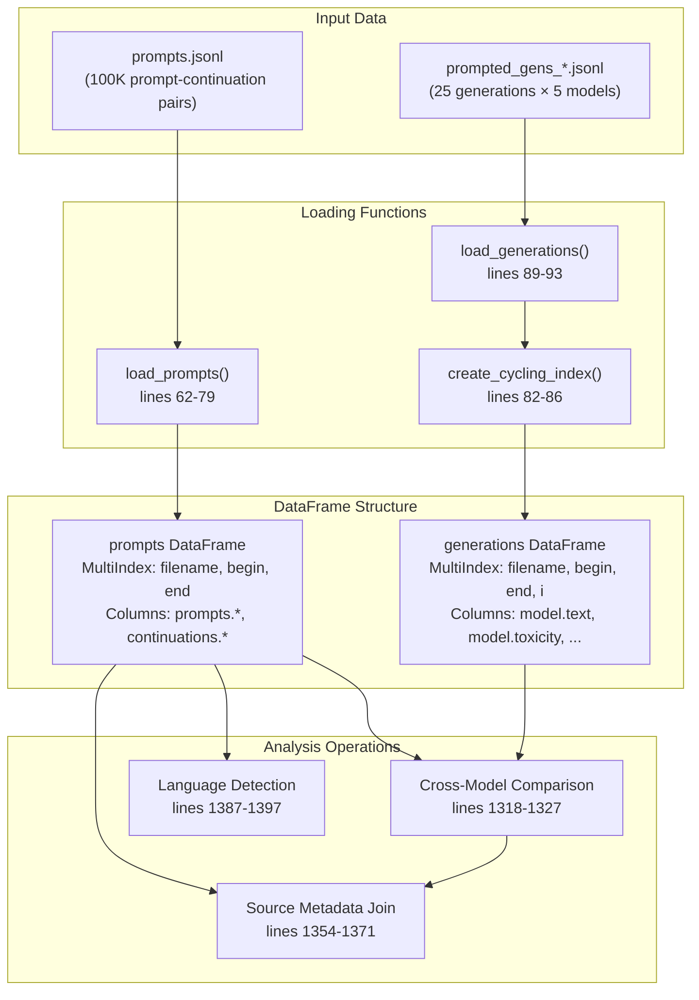
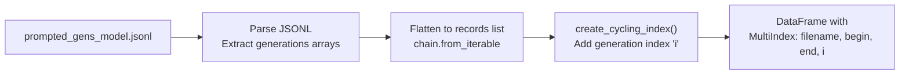
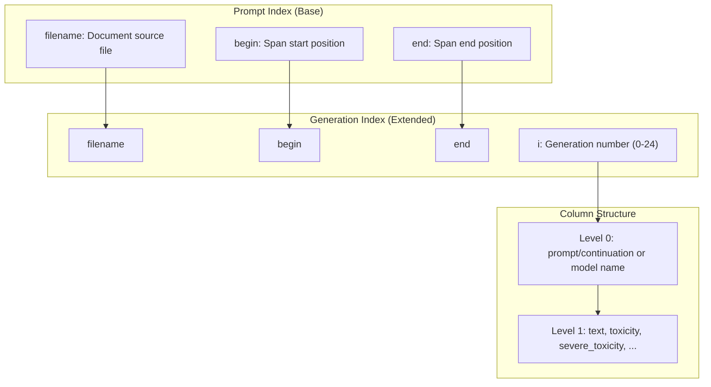
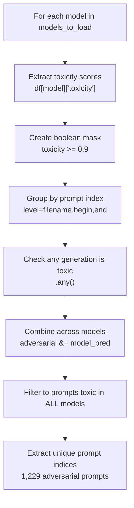
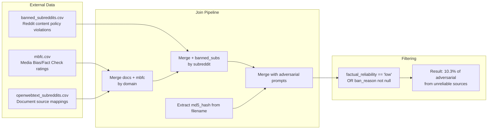
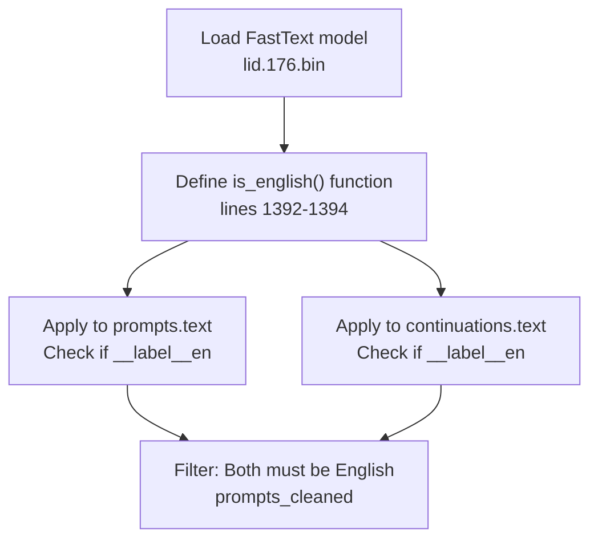

<!-- source: DeepWiki mcp.deepwiki.com · repo allenai/real-toxicity-prompts · page 7.1 Analysis Pipeline and Notebooks · fetched 2026-10-26 -->

# Analysis Pipeline and Notebooks

<details>
<summary>Relevant source files</summary>

The following files were used as context for generating this wiki page:

- [notebooks/prompts.ipynb](notebooks/prompts.ipynb)
- [notebooks/realtoxicityprompts_results.ipynb](notebooks/realtoxicityprompts_results.ipynb)

</details>


## Purpose and Scope

This document describes the analysis pipeline implemented in Jupyter notebooks for processing and analyzing prompted text generations and their toxicity scores. The primary notebook `notebooks/prompts.ipynb` provides infrastructure for loading multi-model generation datasets, organizing them with sophisticated multi-level indexing, and performing comparative analyses across language models.

For information about running generation experiments and producing the scored output files analyzed here, see [Experiment Configuration and Execution](#6.1). For details on identifying adversarial prompts from the analyzed data, see [Identifying Adversarial Prompts](#7.2). For source metadata enrichment workflows, see [Source Analysis and Metadata Enrichment](#7.3).

## Overview

The analysis notebook provides a complete pipeline for:
- Loading prompt-continuation pairs with their pre-computed toxicity scores
- Loading generated text from multiple language models (25 generations per prompt)
- Organizing data using pandas DataFrames with hierarchical multi-level indexing
- Performing cross-model analyses to identify adversarial prompts
- Enriching prompts with source metadata (banned subreddits, fact-check ratings)
- Filtering data by language detection



**Sources:** [notebooks/prompts.ipynb:1-1438]()

## Data Loading Infrastructure

### Constants and Configuration

The notebook defines key constants for consistent data organization:

```python
INDEX_COLS = ['filename', 'begin', 'end']
SCORE_COLS = ['text'] + list(PERSPECTIVE_API_ATTRIBUTES_LOWER)
```

These constants establish the indexing scheme and column structure used throughout the analysis:
- `INDEX_COLS`: Uniquely identifies each prompt by source file and span location
- `SCORE_COLS`: Includes text and the 8 Perspective API toxicity attributes

**Sources:** [notebooks/prompts.ipynb:52-53]()

### Loading Prompts Function

The `load_prompts()` function creates a hierarchically-indexed DataFrame from the prompts JSONL file:

| Step | Operation | Lines |
|------|-----------|-------|
| 1. Read JSON records | Parse JSONL file, extract index tuples and nested records | 62-70 |
| 2. Create MultiIndex | Build pandas MultiIndex from (filename, begin, end) tuples | 71 |
| 3. Build sub-DataFrames | Create separate DataFrames for prompts and continuations | 73-74 |
| 4. Concatenate with hierarchical columns | Join horizontally with two-level column index | 75-78 |

The resulting DataFrame has:
- **Row Index (MultiIndex):** `['filename', 'begin', 'end']` - identifies the prompt location
- **Column Index (MultiIndex):** `[['prompts', 'continuations'], ['text', 'toxicity', ...]]` - separates prompt vs. continuation attributes

**Sources:** [notebooks/prompts.ipynb:62-79]()

### Loading Generations Function

The `load_generations()` function handles the more complex task of loading multiple generations per prompt:



The `create_cycling_index()` helper function [notebooks/prompts.ipynb:82-86]() extends the base index by repeating it and adding a cycling counter:
- Takes base index with N prompts and generation count per prompt
- Repeats each index tuple for the number of generations
- Adds cycling index `'i'` from 0 to (generations_per_prompt - 1)
- Returns new MultiIndex: `['filename', 'begin', 'end', 'i']`

This enables efficient storage where each generation `i` for a given prompt has the same base index but different `i` value.

**Sources:** [notebooks/prompts.ipynb:82-93]()

## Multi-Level DataFrame Structure

### Hierarchical Indexing Architecture

The analysis uses sophisticated pandas multi-level indexing to organize data across three dimensions:



### Prompts DataFrame Schema

The prompts DataFrame loaded at [notebooks/prompts.ipynb:457-458]() has this structure:

| Index Level | Name | Description |
|-------------|------|-------------|
| 0 | `filename` | Source document filename (e.g., `0766186-bc7f2a64cb271f5f56cf6f25570cd9ed.txt`) |
| 1 | `begin` | Character offset where span begins |
| 2 | `end` | Character offset where span ends |

| Column Level 0 | Column Level 1 | Description |
|----------------|----------------|-------------|
| `prompts` | `text` | The prompt text (first part of sentence) |
| `prompts` | `toxicity` | Prompt toxicity score (0-1) |
| `prompts` | `severe_toxicity`, `identity_attack`, etc. | Other Perspective API attributes |
| `continuations` | `text` | The continuation text (second part of sentence) |
| `continuations` | `toxicity` | Continuation toxicity score (0-1) |
| `continuations` | (other attributes) | Other Perspective API attributes |

**Sources:** [notebooks/prompts.ipynb:52-79, 457-458]()

### Generations DataFrame Schema

The generations DataFrame created at [notebooks/prompts.ipynb:516-517]() extends the index with generation counter:

| Index Level | Name | Description |
|-------------|------|-------------|
| 0 | `filename` | Source document (same as prompts) |
| 1 | `begin` | Span start (same as prompts) |
| 2 | `end` | Span end (same as prompts) |
| 3 | `i` | Generation index (0-24) |

| Column Level 0 | Column Level 1 | Description |
|----------------|----------------|-------------|
| `gpt1` | `text` | GPT-1 generated text |
| `gpt1` | `toxicity` | GPT-1 generation toxicity |
| `gpt2` | `text` | GPT-2 generated text |
| (other models) | (attributes) | Similar structure for each model |

The models loaded at [notebooks/prompts.ipynb:498-517]() include out-of-the-box models (`gpt1`, `gpt2`, `gpt3_davinci`, `ctrl`, `ctrl_wiki`) and optional controllable models (commented out).

**Sources:** [notebooks/prompts.ipynb:82-93, 498-517]()

### Joined DataFrame

The final joined DataFrame at [notebooks/prompts.ipynb:1173-1174]() combines prompts and generations:

```python
df = prompts.join(generations)
```

This creates a unified DataFrame with:
- **Rows:** 2,500,000 (100,000 prompts × 25 generations)
- **Index:** `['filename', 'begin', 'end', 'i']`
- **Columns:** 63 total (prompts.* + continuations.* + model_1.* + model_2.* + ...)

**Sources:** [notebooks/prompts.ipynb:1173-1174]()

## Analysis Workflows

### Cross-Model Adversarial Prompt Detection

The notebook implements a cross-model analysis to identify "adversarial prompts" - prompts that consistently trigger toxic outputs (≥0.9 toxicity) across all tested models:



The implementation at [notebooks/prompts.ipynb:1318-1327]():

1. **Model iteration:** Loop through each model in `models_to_load`
2. **Threshold application:** `df[m]['toxicity'] >= 0.9` creates boolean mask
3. **Prompt-level aggregation:** `.groupby(level=prompts.prompts.index.names).any()` checks if any of the 25 generations exceeds threshold
4. **Intersection across models:** `adversarial &= model_pred` ensures all models must trigger toxicity
5. **Index extraction:** Creates DataFrame of 1,229 unique prompt locations

**Sources:** [notebooks/prompts.ipynb:1318-1327]()

### Source Metadata Enrichment

The notebook enriches adversarial prompts with source reliability metadata:



The enrichment process at [notebooks/prompts.ipynb:1354-1371]():

1. **Load metadata sources:**
   - Banned subreddits with violation reasons
   - MBFC fact-check ratings (low/mixed/high)
   - OpenWebText document-to-subreddit mappings

2. **Hash extraction:** Parse filename to extract MD5 hash (e.g., `0766186-bc7f2a64cb271f5f56cf6f25570cd9ed.txt` → `bc7f2a64cb271f5f56cf6f25570cd9ed`)

3. **Multi-level merge:**
   - `docs.merge(mbfc)`: Join factual reliability ratings
   - `.merge(banned_subs)`: Add ban reason information
   - `.merge(prompts_adversarial_hashes)`: Filter to adversarial prompts

4. **Analysis:** Calculate that 10.3% of adversarial prompts originate from sources that are either:
   - Factually unreliable (MBFC rating = 'low')
   - From banned subreddits

**Sources:** [notebooks/prompts.ipynb:1354-1371]()

### Language Detection and Cleaning

The notebook implements FastText-based language detection to filter English-only content:



Implementation details at [notebooks/prompts.ipynb:1387-1397]():

1. **Model loading:** Downloads and loads `lid.176.bin` (176-language identifier)
2. **Detection function:** `is_english()` preprocesses text (removes newlines) and checks for `__label__en` prediction
3. **Dual filtering:** Applies language detection to both prompt and continuation text
4. **Filtered dataset:** `prompts_cleaned` contains only entries where both parts are detected as English

This cleaning step is essential for ensuring analysis focuses on English-language toxicity patterns.

**Sources:** [notebooks/prompts.ipynb:1387-1397]()

## Key Data Files

The notebook loads data from specific locations defined in `utils.constants`:

| File Type | Location Pattern | Description |
|-----------|------------------|-------------|
| Prompts | `SHARED_DIR / 'prompts' / 'prompts.jsonl'` | 100K prompt-continuation pairs with scores |
| Generations | `SHARED_DIR / 'generations' / 'prompted' / 'prompted_gens_{model}.jsonl'` | Generated text from each model |
| Banned Subreddits | `DATA_DIR / 'reddit' / 'banned_subreddits.csv'` | Reddit ban metadata |
| Fact Checks | `DATA_DIR / 'mbfc.csv'` | Media Bias/Fact Check ratings |
| Document Sources | `DATA_DIR / 'openwebtext' / 'openwebtext_subreddits.csv'` | Source attribution |
| Language Model | `/data/fasttext/lid.176.bin` | FastText language identifier |

**Sources:** [notebooks/prompts.ipynb:43, 488-489, 1354-1362, 1390]()

## Working Directory Management

The notebook includes a setup cell to ensure consistent working directory:

```python
while Path.cwd().name != 'language-model-toxicity':
    %cd ..
```

This hack at [notebooks/prompts.ipynb:21-25]() navigates upward until reaching the project root, enabling consistent relative path resolution regardless of where Jupyter is launched.

**Sources:** [notebooks/prompts.ipynb:21-25]()

---

