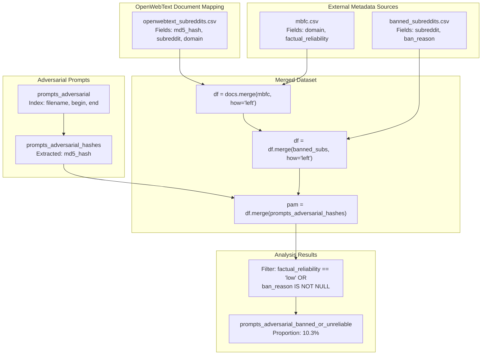
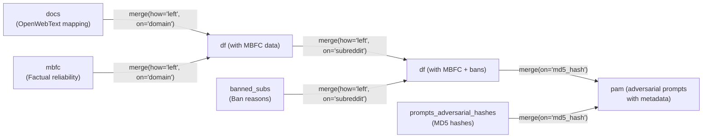

<!-- source: DeepWiki mcp.deepwiki.com · repo allenai/real-toxicity-prompts · page 7.3 Source Analysis and Metadata Enrichment · fetched 2026-10-26 -->

# Source Analysis and Metadata Enrichment

<details>
<summary>Relevant source files</summary>

The following files were used as context for generating this wiki page:

- [notebooks/prompts.ipynb](notebooks/prompts.ipynb)
- [notebooks/realtoxicityprompts_results.ipynb](notebooks/realtoxicityprompts_results.ipynb)

</details>


## Purpose and Scope

This document describes the methodology for enriching adversarial prompts with external metadata to contextualize their origins and reliability. Specifically, it covers the integration of banned subreddit data and Media Bias/Fact Check (MBFC) factual reliability ratings to determine what percentage of adversarial prompts originate from unreliable or policy-violating sources.

For information about identifying adversarial prompts themselves, see [Identifying Adversarial Prompts](#7.2). For the overall analysis pipeline, see [Analysis Pipeline and Notebooks](#7.1).

## Overview

The source analysis enrichment process answers a key research question: **What proportion of adversarial prompts (those that consistently trigger toxic outputs across all models) originate from unreliable or banned sources?**

The analysis involves:
1. Loading external metadata about Reddit sources (banned subreddits) and news domains (MBFC ratings)
2. Linking OpenWebText documents to their Reddit and domain sources
3. Joining adversarial prompt data with source metadata
4. Computing statistics on source reliability

Sources: [notebooks/prompts.ipynb:1339-1372]()

## Data Sources

Three external datasets provide contextual metadata for adversarial prompts:

| Dataset | File Path | Purpose | Key Fields |
|---------|-----------|---------|------------|
| Banned Subreddits | `DATA_DIR/reddit/banned_subreddits.csv` | Reddit communities that were banned for policy violations | `subreddit`, `ban_reason`, `ban_subreason` |
| Media Bias/Fact Check | `DATA_DIR/mbfc.csv` | Factual reliability ratings for news domains | `source_url_normalized` → `domain`, `fact` → `factual_reliability` |
| OpenWebText Subreddits | `DATA_DIR/openwebtext/openwebtext_subreddits.csv` | Maps OpenWebText documents to their Reddit/domain sources | `md5_hash`, `subreddit`, `domain` |

### Banned Subreddits Dataset

Contains Reddit communities that were banned due to policy violations. The dataset includes the subreddit name and reason for banning.

**Data Processing:**
- The `ban_subreason` field is merged into `ban_reason` using `combine_first()` for consolidated ban information
- The redundant `ban_subreason` column is dropped after merging

Sources: [notebooks/prompts.ipynb:1354-1356]()

### Media Bias/Fact Check (MBFC) Dataset

Provides factual reliability ratings for news domains, categorizing them as `high`, `mixed`, or `low` factual reliability.

**Data Processing:**
- Drops `source_url` and `ref` columns as they are not needed for the analysis
- Renames `source_url_normalized` to `domain` for consistency
- Renames `fact` to `factual_reliability` for clarity

Sources: [notebooks/prompts.ipynb:1358-1360]()

### OpenWebText Subreddits Mapping

Links OpenWebText documents (identified by MD5 hash) to their originating subreddit and domain.

**Data Processing:**
- Deduplicates entries to ensure one-to-one mapping

Sources: [notebooks/prompts.ipynb:1362-1363]()

## Data Integration Workflow



**Integration Workflow: Source Metadata Enrichment Pipeline**

Sources: [notebooks/prompts.ipynb:1354-1371]()

## Implementation Details

### Extracting MD5 Hashes from Filenames

Adversarial prompt filenames follow the pattern `{id}-{md5_hash}.txt`. The MD5 hash must be extracted to join with the OpenWebText mapping:

```python
# Extract MD5 hash from filename pattern: 0001505-d252ad705347b4fc38d3a2efceb934ba.txt
prompts_adversarial_hashes = pd.DataFrame(
    list(map(lambda x: x.split('-')[1].split('.')[0], 
             prompts_adversarial.index.get_level_values('filename').tolist())), 
    columns=['md5_hash']
)
```

The hash extraction process:
1. Get `filename` from multi-index: `prompts_adversarial.index.get_level_values('filename')`
2. Split on `-` and take second element: `split('-')[1]`
3. Split on `.` and take first element to remove `.txt`: `split('.')[0]`

Sources: [notebooks/prompts.ipynb:1368]()

### Sequential Left Joins

The merging strategy uses sequential left joins to preserve all adversarial prompts while enriching with available metadata:



**Sequential Join Strategy: Building the Enriched Dataset**

The left joins ensure that:
- Documents without MBFC ratings still appear in results
- Documents from non-banned subreddits still appear in results
- Only adversarial prompts that match OpenWebText documents are included in final analysis

Sources: [notebooks/prompts.ipynb:1365-1369]()

### Filtering for Unreliable or Banned Sources

The final filtering identifies adversarial prompts from problematic sources:

```python
prompts_adversarial_banned_or_unreliable = pam[
    (pam.factual_reliability == 'low') | (~pam.ban_reason.isna())
]
proportion = len(prompts_adversarial_banned_or_unreliable) / len(prompts_adversarial)
```

**Filter Criteria:**
- `factual_reliability == 'low'`: Domain rated as having low factual reliability by MBFC
- `~pam.ban_reason.isna()`: Subreddit was banned (has a non-null ban reason)

The logical OR (`|`) operator means a prompt is flagged if it meets **either** criterion.

Sources: [notebooks/prompts.ipynb:1370-1371]()

## Analysis Results

### Key Finding

**10.3% of adversarial prompts originate from unreliable or banned sources.**

This finding provides important context about adversarial prompts:
- The majority (89.7%) of adversarial prompts come from sources without obvious reliability issues
- Adversarial behavior is not solely attributable to low-quality data sources
- Even content from reliable sources can contain prompts that consistently trigger toxic outputs

### Interpretation

The relatively low proportion (10.3%) suggests that:
1. **Source filtering alone is insufficient**: Removing content from unreliable/banned sources would only eliminate ~10% of adversarial prompts
2. **Toxicity is widespread**: Adversarial prompts appear across the quality spectrum of sources
3. **Context matters**: Even factually reliable sources may discuss toxic topics in ways that create adversarial prompts

Sources: [notebooks/prompts.ipynb:1371-1372]()

## DataFrame Schema

### Merged Dataset (`pam`) Schema

After all joins, the `pam` DataFrame contains:

| Column | Type | Source Dataset | Description |
|--------|------|----------------|-------------|
| `md5_hash` | str | OpenWebText + Adversarial | Document identifier |
| `filename` | str | Adversarial | Full filename with ID and hash |
| `begin` | int | Adversarial | Start position of prompt span |
| `end` | int | Adversarial | End position of prompt span |
| `subreddit` | str | OpenWebText | Originating Reddit community |
| `domain` | str | OpenWebText | Source domain (for news links) |
| `factual_reliability` | str | MBFC | Rating: `high`, `mixed`, `low`, or NaN |
| `ban_reason` | str | Banned Subreddits | Reason for ban, or NaN if not banned |

### Multi-level Index Structure

The adversarial prompts DataFrame uses a three-level multi-index:

```python
INDEX_COLS = ['filename', 'begin', 'end']
```

This uniquely identifies each prompt-continuation pair by:
- **filename**: Source document
- **begin**: Start character position
- **end**: End character position

Sources: [notebooks/prompts.ipynb:52-53](), [notebooks/prompts.ipynb:1326]()

## Code Integration Points

### Loading the Enriched Dataset

To replicate this analysis in other notebooks or scripts:

```python
# Load external metadata
banned_subs = pd.read_csv(DATA_DIR / 'reddit' / 'banned_subreddits.csv')
banned_subs.ban_reason = banned_subs.ban_subreason.combine_first(banned_subs.ban_reason)
banned_subs = banned_subs.drop(columns='ban_subreason')

mbfc = pd.read_csv(DATA_DIR / 'mbfc.csv')
mbfc = mbfc.drop(columns=['source_url', 'ref'])
mbfc = mbfc.rename(columns={'source_url_normalized': 'domain', 
                             'fact': 'factual_reliability'})

# Load OpenWebText document mapping
docs = pd.read_csv(DATA_DIR / 'openwebtext' / 'openwebtext_subreddits.csv')
docs = docs.drop_duplicates()

# Merge metadata
df = docs.merge(mbfc, how='left')
df = df.merge(banned_subs, how='left')
```

### Analyzing Other Prompt Subsets

The same enrichment workflow can be applied to any prompt subset:

```python
# Extract MD5 hashes from any prompt DataFrame with filename index
prompt_hashes = pd.DataFrame(
    list(map(lambda x: x.split('-')[1].split('.')[0], 
             prompt_df.index.get_level_values('filename').tolist())), 
    columns=['md5_hash']
)

# Merge with metadata
enriched_prompts = df.merge(prompt_hashes)

# Analyze by various dimensions
by_reliability = enriched_prompts.groupby('factual_reliability').size()
by_ban_status = enriched_prompts[~enriched_prompts.ban_reason.isna()].groupby('ban_reason').size()
```

Sources: [notebooks/prompts.ipynb:1354-1371]()

## Related External Data

The analysis relies on external datasets that are not generated by the pipeline:

- **Banned Subreddits**: Historical data about Reddit community bans
- **MBFC Ratings**: Third-party assessments of news source reliability
- **OpenWebText Metadata**: Crowd-sourced mapping of documents to sources

These datasets enable contextual analysis but are not required for the core toxicity detection and generation experiments documented in sections [3](#3) and [4](#4).

Sources: [notebooks/prompts.ipynb:1354-1363]()

---

