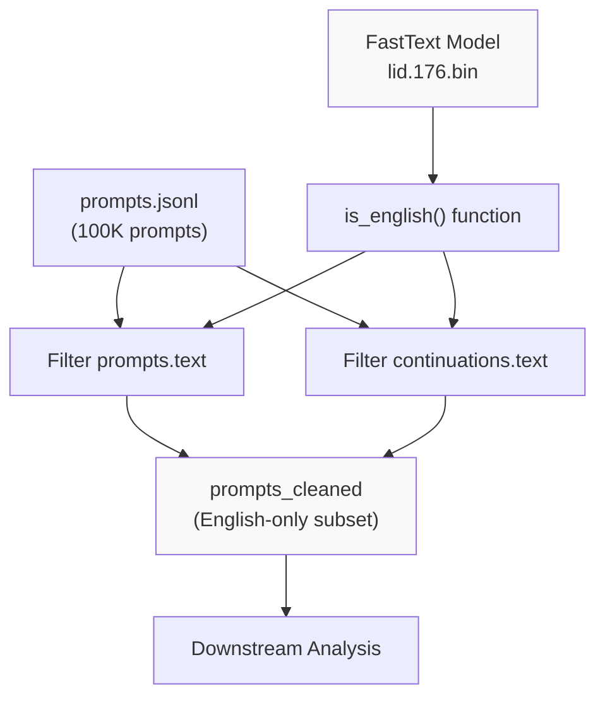
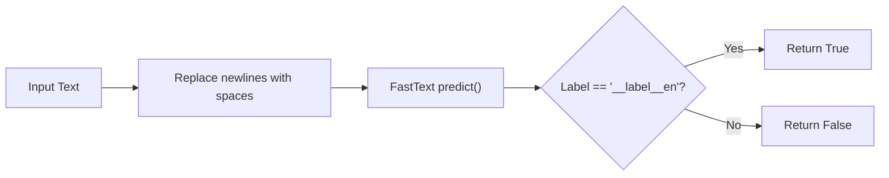
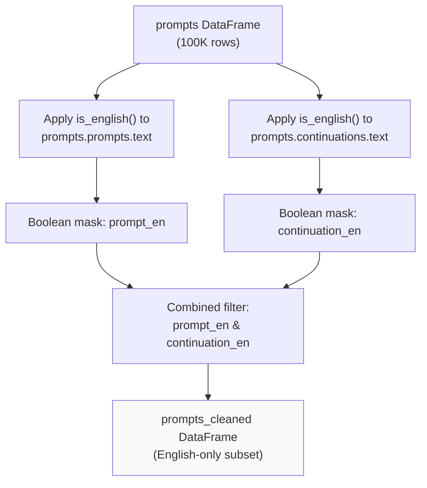
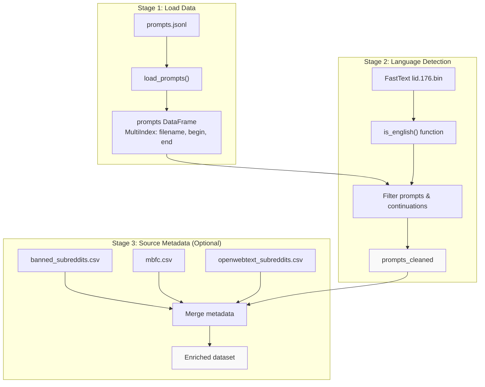
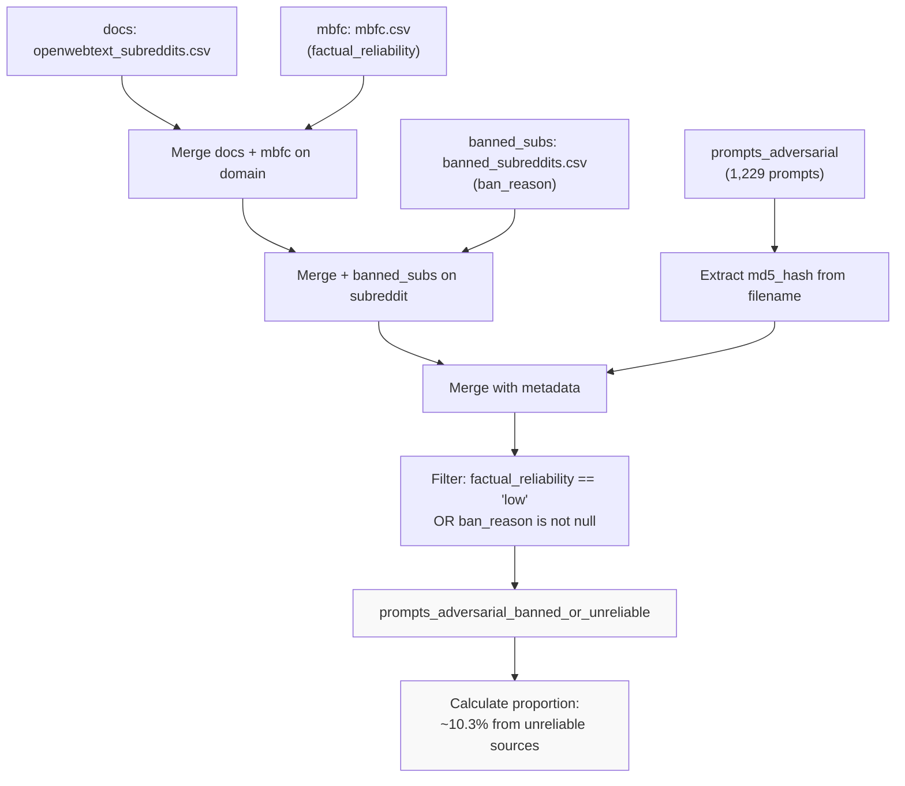
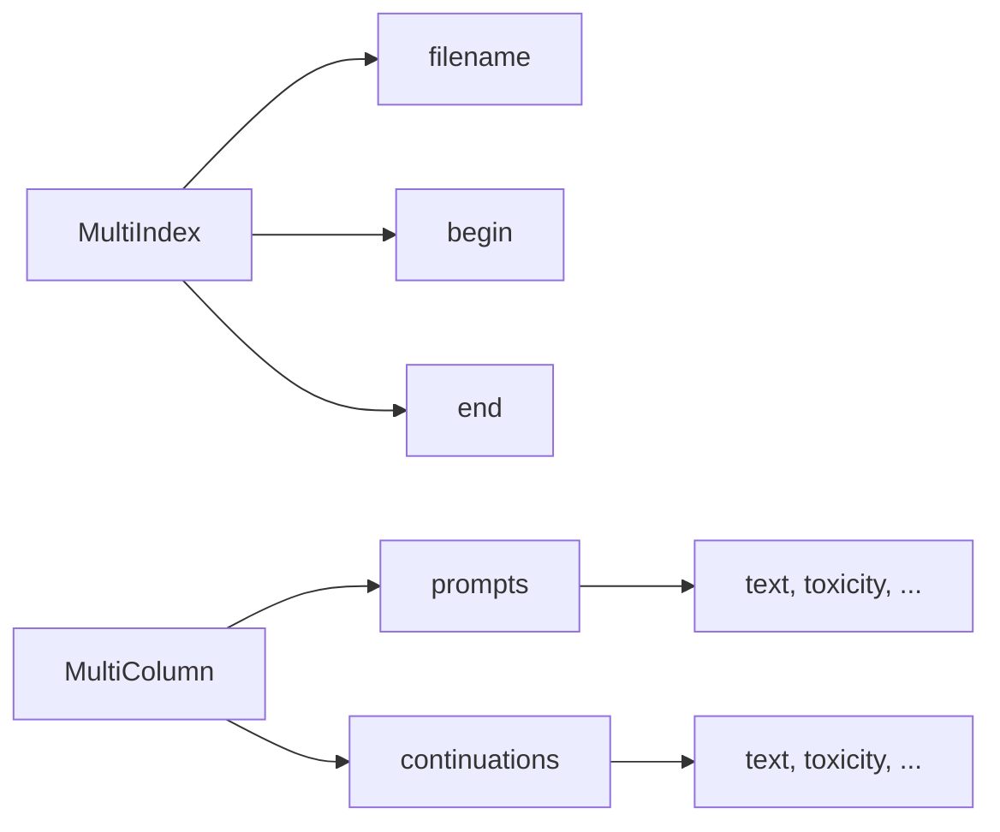

<!-- source: DeepWiki mcp.deepwiki.com · repo allenai/real-toxicity-prompts · page 7.4 Language Detection and Data Cleaning · fetched 2026-10-26 -->

# Language Detection and Data Cleaning

<details>
<summary>Relevant source files</summary>

The following files were used as context for generating this wiki page:

- [notebooks/prompts.ipynb](notebooks/prompts.ipynb)
- [notebooks/realtoxicityprompts_results.ipynb](notebooks/realtoxicityprompts_results.ipynb)

</details>


## Purpose and Scope

This document explains the language detection and data cleaning pipeline used to filter the prompt dataset for English-only content in the analysis phase. The system uses FastText-based language identification to ensure all analyzed prompts and continuations are in English, removing non-English content that could skew toxicity analysis results.

For information about the broader analysis pipeline that uses this cleaned data, see [Analysis Pipeline and Notebooks](#7.1). For details about how source reliability metadata is used in identifying adversarial prompts, see [Source Analysis and Metadata Enrichment](#7.3).

## Overview

The language detection and data cleaning system performs two primary functions:

1. **Language Filtering**: Identifies and removes non-English prompts using FastText language identification
2. **Source-Based Analysis**: Enriches prompts with metadata about their source reliability (banned subreddits, fact-check ratings)

This cleaning step is critical because the toxicity analysis requires English text, and the Perspective API's toxicity detection is optimized for English content. The cleaned dataset (`prompts_cleaned`) is used in downstream analysis to ensure consistent, reliable results.



**Sources:** [notebooks/prompts.ipynb:1383-1398]()

## Language Detection System

### FastText Language Identification Model

The system uses Facebook's FastText supervised language identification model (`lid.176.bin`) which can detect 176 languages. This pre-trained model provides fast, accurate language detection suitable for filtering large datasets.

The model is loaded at the beginning of the cleaning process:

```python
# Model loading
lid = fasttext.load_model('/data/fasttext/lid.176.bin')
```

The model file (`lid.176.bin`) must be downloaded separately from Facebook's public FastText repository and placed in the data directory.

**Model Characteristics:**

| Property | Value |
|----------|-------|
| Model Type | FastText supervised classifier |
| Languages Supported | 176 |
| Primary Output | Language label (e.g., `__label__en`) |
| Secondary Output | Confidence score |

**Sources:** [notebooks/prompts.ipynb:1387-1390]()

### English Detection Function

The `is_english()` function provides a simple interface for language detection. It preprocesses text by removing newlines (which can interfere with FastText predictions) and returns a boolean indicating whether the text is English.



**Function Logic:**
- **Input**: Text string (prompt or continuation)
- **Preprocessing**: Replace `\n` with space to avoid prediction errors
- **Prediction**: Call `lid.predict(text)` which returns `(labels, confidences)`
- **Output**: Boolean - `True` if first label is `__label__en`, `False` otherwise

**Sources:** [notebooks/prompts.ipynb:1392-1394]()

### Application to Prompts Dataset

The language filter is applied to both prompt and continuation text using pandas DataFrame filtering. Only prompt-continuation pairs where **both** components are English are retained in the cleaned dataset.



**Implementation:**
```python
prompts_cleaned = prompts[
    prompts.prompts.text.apply(is_english) & 
    prompts.continuations.text.apply(is_english)
]
```

This creates a filtered DataFrame maintaining the same multi-level index structure (`filename`, `begin`, `end`) but containing only English-language content.

**Sources:** [notebooks/prompts.ipynb:1396-1397]()

## Data Cleaning Pipeline

The complete data cleaning pipeline involves several stages of filtering and enrichment:



**Pipeline Stages:**

1. **Load Prompts**: Read `prompts.jsonl` using the `load_prompts()` function which creates a DataFrame with hierarchical columns for prompts and continuations
2. **Language Detection**: Apply `is_english()` to both prompt and continuation text, filtering to English-only pairs
3. **Source Enrichment** (Optional): Merge with metadata about source domains and subreddits for additional analysis

**Sources:** [notebooks/prompts.ipynb:62-79](), [notebooks/prompts.ipynb:1383-1398]()

## Integration with Source Metadata

While the primary cleaning function focuses on language detection, the notebook also demonstrates how to enrich cleaned data with source reliability metadata for deeper analysis of adversarial prompts.

### Metadata Sources

The system integrates three metadata sources:

| Dataset | File | Purpose | Key Fields |
|---------|------|---------|------------|
| Banned Subreddits | `banned_subreddits.csv` | Identify content from banned sources | `subreddit`, `ban_reason`, `ban_subreason` |
| MBFC Ratings | `mbfc.csv` | Source factual reliability ratings | `domain`, `factual_reliability` (high/medium/low) |
| OpenWebText Metadata | `openwebtext_subreddits.csv` | Link documents to sources | `md5_hash`, `subreddit`, `domain` |

**Sources:** [notebooks/prompts.ipynb:1354-1366]()

### Source-Based Filtering Analysis

The notebook demonstrates analyzing what proportion of adversarial prompts come from unreliable or banned sources:



**Key Operations:**

1. **Load Metadata**: Read banned subreddits, MBFC ratings, and OpenWebText document metadata
2. **Merge Operations**:
   - Merge documents with MBFC ratings on `domain` field
   - Merge with banned subreddits on `subreddit` field
3. **Extract Hashes**: Parse MD5 hash from prompt filenames (format: `{id}-{hash}.txt`)
4. **Filter by Reliability**: Identify prompts from sources with `factual_reliability == 'low'` or non-null `ban_reason`

**Result**: Approximately 10.3% of the 1,229 adversarial prompts originate from unreliable or banned sources.

**Sources:** [notebooks/prompts.ipynb:1339-1372]()

## Implementation Details

### DataFrame Structure

The prompts dataset uses a hierarchical structure that is preserved through the cleaning process:

**Index Levels:**
- `filename`: Source document identifier (format: `{id}-{hash}.txt`)
- `begin`: Character offset of span start in source document
- `end`: Character offset of span end in source document

**Column Levels:**
- Level 0: `prompts` or `continuations`
- Level 1: `text`, toxicity attributes (`toxicity`, `severe_toxicity`, `identity_attack`, etc.)



**Sources:** [notebooks/prompts.ipynb:52-53](), [notebooks/prompts.ipynb:62-79]()

### Constants and Configuration

The language detection system relies on several configuration elements:

```python
# Index column names
INDEX_COLS = ['filename', 'begin', 'end']

# Score column names (text + 8 toxicity attributes)
SCORE_COLS = ['text'] + list(PERSPECTIVE_API_ATTRIBUTES_LOWER)
```

The `PERSPECTIVE_API_ATTRIBUTES_LOWER` constant is imported from `utils.constants` and includes:
- `toxicity`
- `severe_toxicity`
- `identity_attack`
- `insult`
- `threat`
- `profanity`
- `sexually_explicit`
- `flirtation`

**Sources:** [notebooks/prompts.ipynb:34-43](), [notebooks/prompts.ipynb:52-53]()

### Performance Considerations

The language detection pipeline processes the entire prompt dataset (100,000 prompts). Key performance characteristics:

| Aspect | Details |
|--------|---------|
| Model Loading | One-time operation at notebook initialization |
| Detection Speed | FastText is optimized for speed; processes text in milliseconds |
| Memory Usage | Entire prompts DataFrame loaded into memory (~100K rows × 18 columns) |
| Filtering Method | Pandas boolean indexing for efficient filtering |

The `apply()` function is called twice (once for prompts, once for continuations), making 200,000 language detection calls total. FastText's efficiency makes this tractable on standard hardware.

**Sources:** [notebooks/prompts.ipynb:1396-1397]()

### Output Format

The cleaned dataset (`prompts_cleaned`) maintains the same structure as the input `prompts` DataFrame:
- Same MultiIndex structure (filename, begin, end)
- Same hierarchical columns (prompts/continuations with text and scores)
- Reduced row count (only English-language pairs retained)

This consistency allows `prompts_cleaned` to be used interchangeably with the original `prompts` DataFrame in downstream analysis code.

**Sources:** [notebooks/prompts.ipynb:1396-1398]()

---

