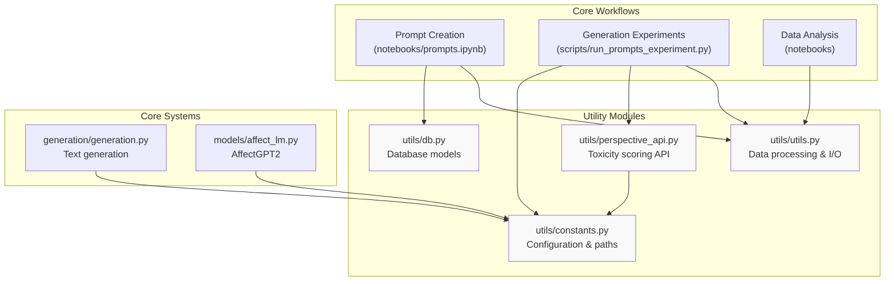
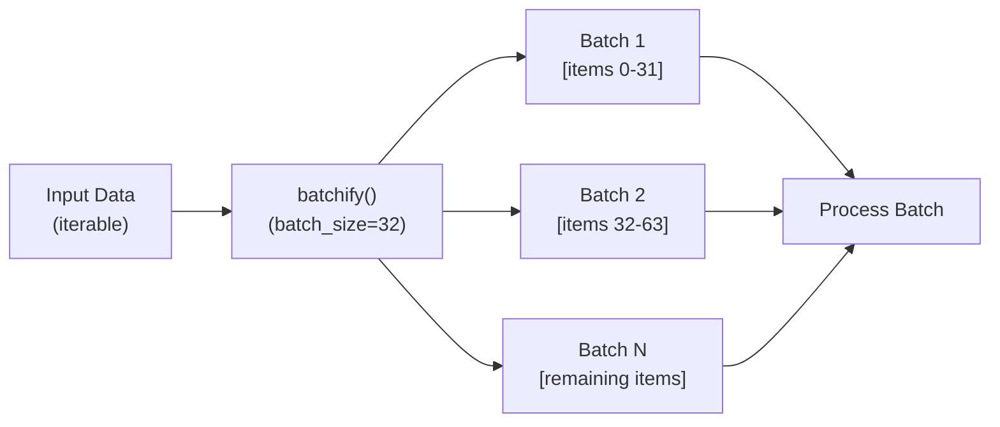
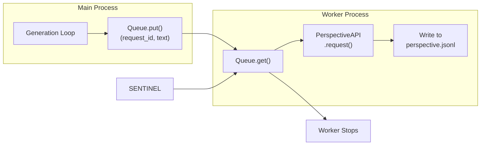
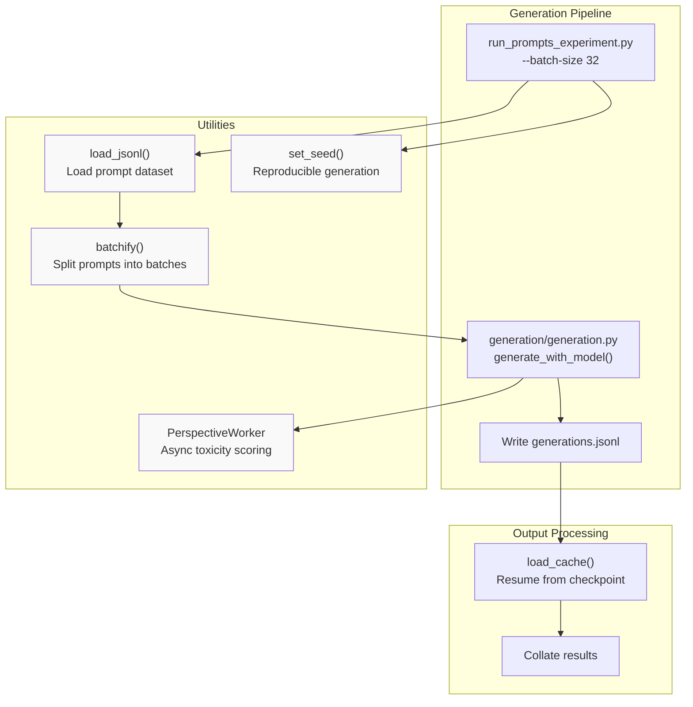
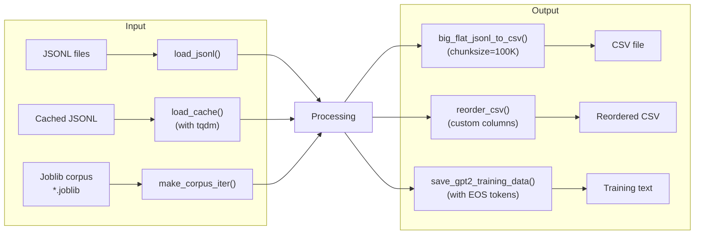
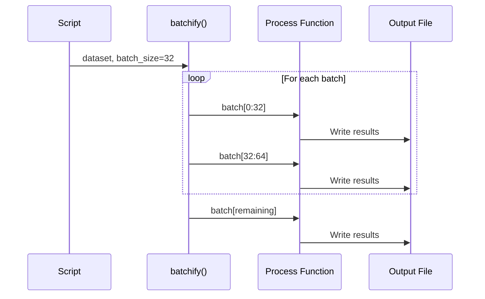
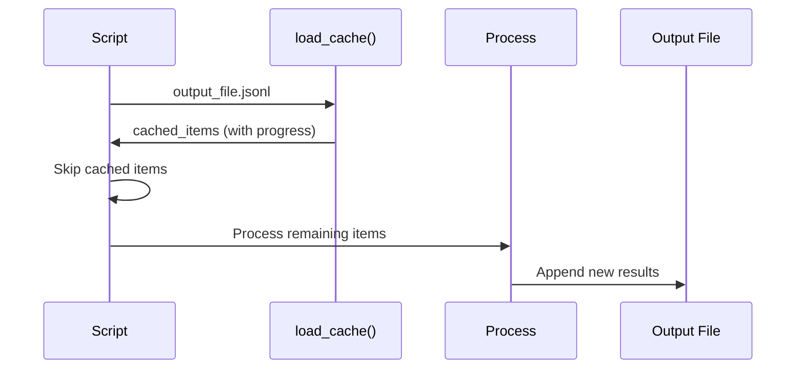
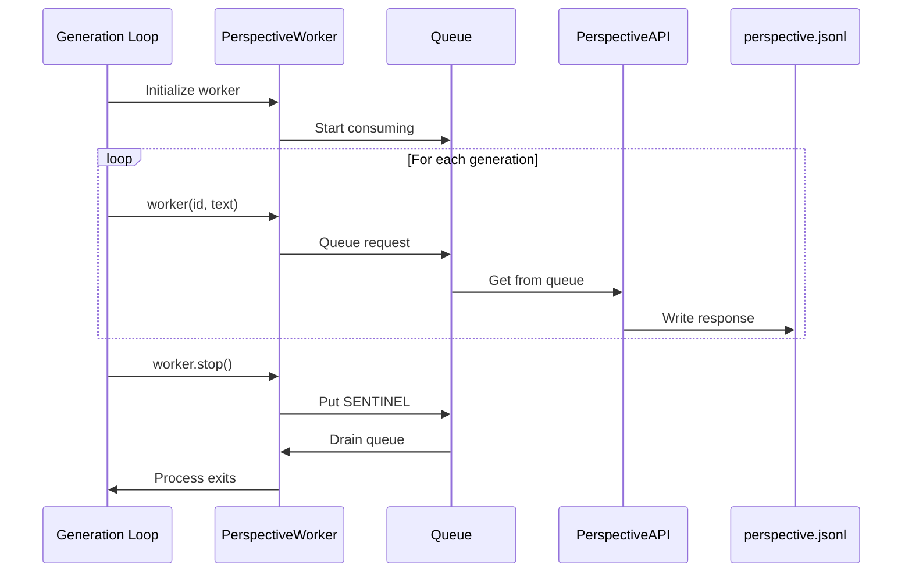

<!-- source: DeepWiki mcp.deepwiki.com · repo allenai/real-toxicity-prompts · page 8 Utilities and Helper Modules · fetched 2026-10-26 -->

# Utilities and Helper Modules

<details>
<summary>Relevant source files</summary>

The following files were used as context for generating this wiki page:

- [utils/perspective_api.py](utils/perspective_api.py)
- [utils/utils.py](utils/utils.py)

</details>


## Purpose and Scope

This document provides an overview of the utility functions and helper modules that form the foundational support layer for the Real Toxicity Prompts system. These utilities handle cross-cutting concerns including data processing, file I/O operations, batch processing, API integration, and system configuration.

The utilities layer is organized into focused modules, each serving specific purposes:
- **Data processing utilities** for batching, iteration, and transformation ([see page 8.1](#8.1))
- **Constants and configuration** for system-wide settings and API keys ([see page 8.2](#8.2))
- **Perspective API integration** for toxicity scoring (covered below)
- **Database utilities** for SQLAlchemy models and queries ([see page 5.1](#5.1))

This page focuses on the architecture and integration of these utilities within the larger system. For detailed documentation of specific utility functions, refer to the sub-pages listed above.

## Utilities Architecture

The utilities layer serves as a foundation for all three major workflows in the Real Toxicity Prompts system. The following diagram illustrates how utility modules support different components:

**Diagram: Utilities Layer Architecture and Dependencies**



Sources: [utils/utils.py:1-100](), [utils/perspective_api.py:1-188](), Diagram 5 from high-level architecture

The utilities are designed to be:
- **Stateless**: Functions operate on inputs without maintaining internal state
- **Reusable**: Used across multiple workflows and components
- **Modular**: Each module has a focused responsibility
- **Type-annotated**: Functions use Python type hints for clarity

## Module Overview

### utils.py: Data Processing Utilities

The `utils/utils.py` module provides general-purpose utilities for data processing, file I/O, and system operations. Key functionalities include:

| Function | Purpose |
|----------|---------|
| `batchify()` | Split iterables into fixed-size batches |
| `load_jsonl()` | Load JSONL files line-by-line |
| `load_cache()` | Resume from cached JSONL with progress tracking |
| `set_seed()` | Set random seeds for reproducibility |
| `make_corpus_iter()` | Iterate over joblib-serialized corpus files |
| `big_flat_jsonl_to_csv()` | Convert large JSONL files to CSV in chunks |

**Common Usage Pattern: Batch Processing**



Sources: [utils/utils.py:14-28]()

The `batchify()` function is extensively used throughout the generation pipeline to process prompts in batches of 32, enabling efficient GPU utilization and memory management. See [page 8.1](#8.1) for detailed documentation.

Sources: [utils/utils.py:1-100]()

### perspective_api.py: Toxicity Scoring Integration

The `utils/perspective_api.py` module provides integration with Google's Perspective API for scoring text toxicity. It includes two main classes:

**PerspectiveAPI Class**

The `PerspectiveAPI` class [utils/perspective_api.py:40-127]() provides a synchronous client for making API requests with built-in rate limiting:

| Feature | Implementation |
|---------|----------------|
| Rate limiting | 25 requests per second (configurable) |
| Batch requests | Up to 25 texts per request |
| Error handling | Returns tuple of (response, exception) |
| Span annotations | Scores text at both document and span levels |

**PerspectiveWorker Class**

The `PerspectiveWorker` class [utils/perspective_api.py:129-171]() provides asynchronous processing for large-scale toxicity scoring:



Sources: [utils/perspective_api.py:129-171]()

The worker operates in a separate process, consuming requests from a queue and writing results incrementally to disk. This allows text generation to proceed without blocking on API calls. The worker automatically resumes from cached results if the output file exists.

**Usage Example Pattern:**

1. Initialize worker: `worker = PerspectiveWorker(out_file, total, rate_limit=25)`
2. Queue requests: `worker(request_id='gen_0', text='...')`
3. Stop worker: `worker.stop()`

Sources: [utils/perspective_api.py:1-188]()

For detailed documentation of the Perspective API integration, including response parsing and the eight toxicity attributes, see [page 4.1](#4.1) and [page 4.2](#4.2).

### constants.py: Configuration Management

The `utils/constants.py` module (not provided in files, but referenced in architecture) provides system-wide configuration including:

- **API Keys**: `PERSPECTIVE_API_KEY` for toxicity scoring
- **Paths**: Default directories for data, models, and outputs
- **Perspective Attributes**: List of toxicity attributes to score
- **Model Configurations**: Default parameters for generation

This module serves as a single source of truth for configuration, preventing hardcoded values throughout the codebase. See [page 8.2](#8.2) for complete documentation.

### db.py: Database Models

The `utils/db.py` module (not provided in files, but referenced in architecture) defines SQLAlchemy ORM models for the database schema:

- `Doc`: Document table
- `DocScore`: Document-level toxicity scores  
- `SpanScore`: Span-level toxicity scores

These models are used in the prompt creation workflow to query the database for documents with specific toxicity characteristics. See [page 5.1](#5.1) for schema details.

## Cross-Component Integration

The following diagram shows how utilities integrate across the major system components:

**Diagram: Utility Function Usage Across Components**



Sources: [utils/utils.py:14-28](), [utils/utils.py:50-61](), [utils/utils.py:43-47](), [utils/perspective_api.py:129-171]()

This integration pattern demonstrates how utilities enable:
- **Reproducibility**: `set_seed()` ensures consistent results across runs
- **Efficient processing**: `batchify()` enables batch inference
- **Fault tolerance**: `load_cache()` allows resuming from interruptions
- **Asynchronous operations**: `PerspectiveWorker` decouples generation from scoring

## File I/O Utilities

The utilities module provides specialized file I/O functions optimized for the data formats used throughout the system:

**Diagram: File I/O Utility Functions**



Sources: [utils/utils.py:50-53](), [utils/utils.py:56-60](), [utils/utils.py:80-100](), [utils/utils.py:63-68](), [utils/utils.py:71-77](), [utils/utils.py:35-40]()

Key features:
- **Memory efficiency**: JSONL loading is lazy (generators), CSV conversion uses chunking
- **Progress tracking**: `load_cache()` uses tqdm for progress bars
- **Corpus iteration**: `make_corpus_iter()` handles directory structure and optional filename mapping
- **Format conversion**: Utilities for JSONL→CSV conversion with chunk processing

## Utility Design Patterns

### Pattern 1: Generator-Based Lazy Loading

Most file I/O utilities use Python generators to enable memory-efficient processing of large files:

```python
# From utils/utils.py:50-53
def load_jsonl(file: Union[str, Path]) -> Iterable[Any]:
    with open(file) as f:
        for line in f:
            yield json.loads(line)
```

This pattern allows processing millions of records without loading the entire dataset into memory.

Sources: [utils/utils.py:50-53]()

### Pattern 2: Batch Iterator with Last Batch Handling

The `batchify()` function ensures all items are processed, including partial final batches:

```python
# From utils/utils.py:14-28
def batchify(data: Iterable[T], batch_size: int) -> Iterable[List[T]]:
    batch = []
    for item in data:
        if len(batch) == batch_size:
            yield batch
            batch = []
        batch.append(item)
    # Yield last un-filled batch
    if len(batch) != 0:
        yield batch
```

This pattern is critical for ensuring no data is lost during batch processing.

Sources: [utils/utils.py:14-28]()

### Pattern 3: Multiprocessing Queue with Sentinel

The `PerspectiveWorker` uses a sentinel value to signal worker termination:

```python
# From utils/perspective_api.py:130, 157-163
class PerspectiveWorker:
    SENTINEL = 'STOP'
    
    def stop(self):
        self.task_queue.put(self.SENTINEL)
        self.process.join()
```

This pattern enables clean shutdown of background workers without force-terminating processes.

Sources: [utils/perspective_api.py:130](), [utils/perspective_api.py:157-163]()

## Common Usage Scenarios

### Scenario 1: Processing a Large Dataset in Batches



Sources: [utils/utils.py:14-28]()

### Scenario 2: Resuming from Checkpoint



Sources: [utils/utils.py:56-60]()

### Scenario 3: Async Toxicity Scoring



Sources: [utils/perspective_api.py:129-171]()

## Related Documentation

- [Page 8.1: Data Processing Utilities](#8.1) - Detailed documentation of utility functions in `utils/utils.py`
- [Page 8.2: Constants and Configuration](#8.2) - Documentation of `utils/constants.py` module
- [Page 4.1: Perspective API Integration](#4.1) - Deep dive into Perspective API client architecture
- [Page 5.1: Database Schema and Models](#5.1) - Documentation of `utils/db.py` SQLAlchemy models

Sources: [utils/utils.py:1-100](), [utils/perspective_api.py:1-188]()

---

