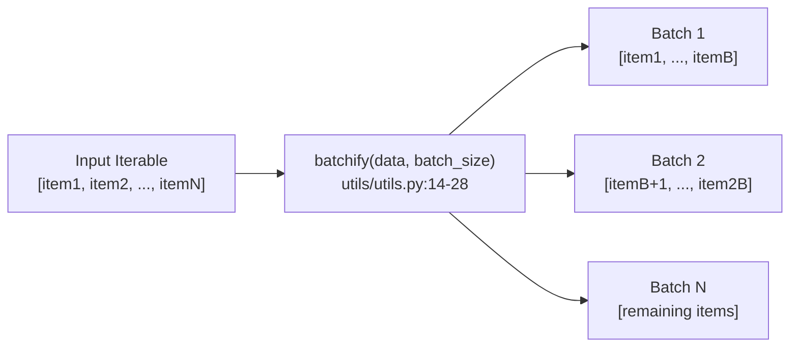
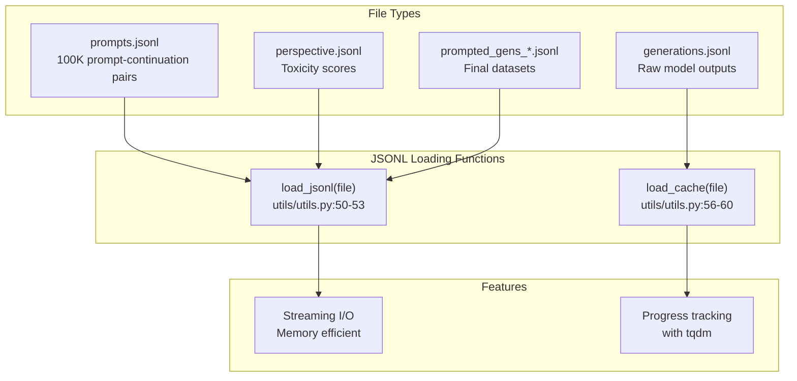
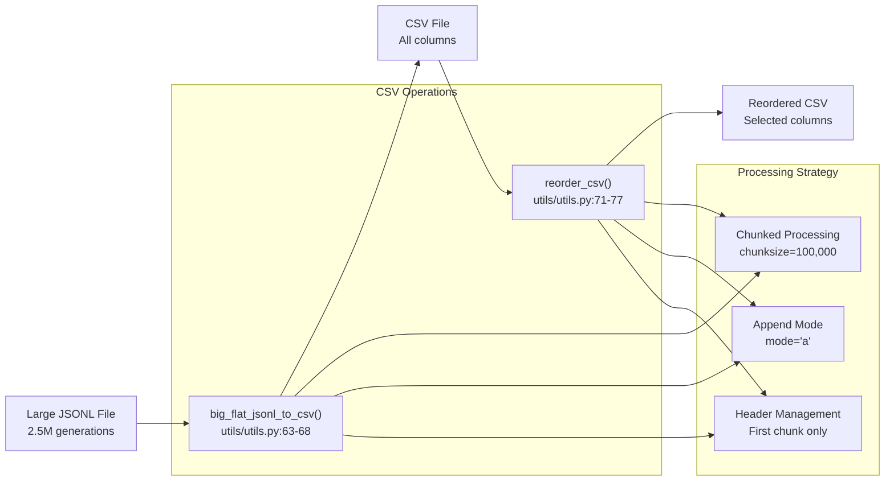
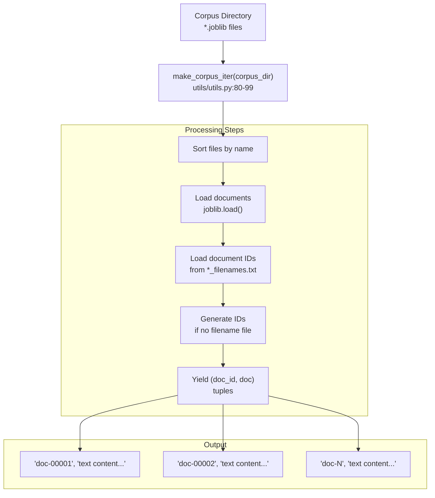
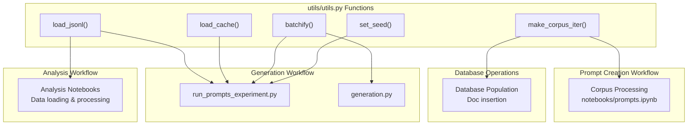

<!-- source: DeepWiki mcp.deepwiki.com · repo allenai/real-toxicity-prompts · page 8.1 Data Processing Utilities · fetched 2026-10-26 -->

# Data Processing Utilities

<details>
<summary>Relevant source files</summary>

The following files were used as context for generating this wiki page:

- [utils/utils.py](utils/utils.py)

</details>


## Purpose and Scope

This page documents the core utility functions and helper methods defined in [`utils/utils.py`](). These utilities provide cross-cutting functionality for data processing, file I/O operations, batch processing, corpus iteration, and reproducibility management. The utilities are used throughout the Real Toxicity Prompts codebase to support prompt creation, text generation experiments, and data analysis workflows.

For database-specific utilities and SQLAlchemy models, see [Database Schema and Models](#5.1). For Perspective API client utilities, see [Perspective API Integration](#4.1). For system-wide constants and configuration, see [Constants and Configuration](#8.2).

**Sources:** [`utils/utils.py:1-100`]()

## Overview

The `utils/utils.py` module provides a collection of utility functions organized into five main categories:

| Category | Functions | Primary Use Cases |
|----------|-----------|-------------------|
| **Batch Processing** | `batchify()` | Splitting data into batches for generation and API calls |
| **JSONL Operations** | `load_jsonl()`, `load_cache()` | Loading prompts, generations, and cached results |
| **CSV Operations** | `big_flat_jsonl_to_csv()`, `reorder_csv()` | Converting large datasets for analysis |
| **Corpus Iteration** | `make_corpus_iter()` | Processing OpenWebText and WebText corpora |
| **Reproducibility** | `set_seed()` | Ensuring deterministic model behavior |
| **GPT-2 Data Prep** | `save_gpt2_training_data()` | Preparing training data for model fine-tuning |

The module is designed to handle large-scale data processing efficiently, with support for streaming operations, chunked processing, and progress tracking via `tqdm`.

**Sources:** [`utils/utils.py:1-100`]()

## Batch Processing

### batchify()

The `batchify()` function splits an iterable into fixed-size batches, which is essential for efficient processing of large datasets during text generation and API calls.



**Function Signature:**
```python
def batchify(data: Iterable[T], batch_size: int) -> Iterable[List[T]]
```

**Key Characteristics:**
- **Lazy evaluation**: Returns an iterator, not a list, for memory efficiency
- **Partial batches**: Yields the last batch even if it contains fewer than `batch_size` items
- **Type-safe**: Uses `TypeVar` for generic typing support
- **Input validation**: Asserts `batch_size > 0` to prevent invalid configurations

**Usage Examples in Codebase:**
- Generation pipeline: Batching prompts for model inference (batch_size=32)
- Perspective API: Batching texts for toxicity scoring to respect rate limits
- Corpus processing: Batching documents for database insertion

**Sources:** [`utils/utils.py:14-28`]()

### first()

A simple utility to safely extract the first element from an iterable, returning `None` if the iterable is empty.

```python
def first(iterable):
    return next(iter(iterable), None)
```

This function is used for quick existence checks and optional value extraction without raising exceptions.

**Sources:** [`utils/utils.py:31-32`]()

## File I/O Operations

### JSONL Loading

The module provides two functions for loading JSONL (JSON Lines) files, which is the primary data format used throughout the codebase for prompts, generations, and scores.



#### load_jsonl()

**Function Signature:**
```python
def load_jsonl(file: Union[str, Path]) -> Iterable[Any]
```

**Characteristics:**
- **Streaming**: Yields one JSON object at a time without loading entire file into memory
- **Lazy**: Returns an iterator for memory-efficient processing
- **Flexible input**: Accepts both string paths and `Path` objects
- **No progress tracking**: Use for files where size is unknown or progress isn't needed

**Usage Pattern:**
```python
# Load prompts for generation
for prompt_data in load_jsonl('data/prompts.jsonl'):
    prompt_text = prompt_data['prompt']['text']
    # Process prompt...
```

**Sources:** [`utils/utils.py:50-53`]()

#### load_cache()

**Function Signature:**
```python
def load_cache(file: Path):
    if file.exists():
        # yields JSON objects with progress bar
```

**Characteristics:**
- **Conditional loading**: Checks file existence before loading, yields nothing if missing
- **Progress tracking**: Uses `tqdm` to display loading progress
- **Resume support**: Used in experiment runners to resume from cached generations
- **Cache validation**: Implicit validation by checking file existence

**Usage Pattern:**
```python
# Resume from cached generations
cache_file = Path('generations.jsonl')
for cached_gen in load_cache(cache_file):
    # Skip already processed prompts
```

**Sources:** [`utils/utils.py:56-60`]()

### CSV Conversion Operations

The module provides utilities for converting large JSONL files to CSV format, which is useful for data analysis in tools like pandas, Excel, or R.



#### big_flat_jsonl_to_csv()

**Function Signature:**
```python
def big_flat_jsonl_to_csv(jsonl_file, csv_file, chunksize=100_000, header=True)
```

**Characteristics:**
- **Chunked processing**: Reads JSONL in chunks to avoid memory overflow
- **Append mode**: Writes CSV incrementally using `mode='a'`
- **Header management**: Writes header only for first chunk, then disables it
- **Configurable chunk size**: Default 100,000 rows per chunk
- **Flat structure assumption**: Expects JSONL objects to be flat (no nested structures)

**Processing Flow:**
1. Read JSONL in chunks using `pd.read_json(lines=True, chunksize=...)`
2. Write first chunk with header
3. Write subsequent chunks without header
4. Append all chunks to same CSV file

**Sources:** [`utils/utils.py:63-68`]()

#### reorder_csv()

**Function Signature:**
```python
def reorder_csv(csv_file_in, csv_file_out, columns, chunksize=100_000)
```

**Characteristics:**
- **Column selection**: Outputs only specified columns in specified order
- **Chunked processing**: Same memory-efficient approach as `big_flat_jsonl_to_csv()`
- **Column reordering**: Useful for creating analysis-ready datasets with relevant columns first
- **Append mode**: Builds output file incrementally

**Usage Pattern:**
```python
# Reorder CSV to put important columns first
reorder_csv(
    'data/all_generations.csv',
    'data/generations_reordered.csv',
    columns=['prompt', 'continuation', 'toxicity', 'model_type']
)
```

**Sources:** [`utils/utils.py:71-77`]()

## Corpus Iteration

### make_corpus_iter()

The `make_corpus_iter()` function provides an iterator over corpus files stored in joblib format, which is used for processing OpenWebText and WebText datasets during prompt creation.



**Function Signature:**
```python
def make_corpus_iter(corpus_dir: Path)
```

**Characteristics:**
- **Sorted processing**: Processes `.joblib` files in sorted order for deterministic iteration
- **Document ID tracking**: Loads document IDs from companion `*_filenames.txt` files
- **Fallback ID generation**: Generates IDs like `{file.stem}-{idx}` if no filename file exists
- **Streaming**: Yields one document at a time for memory efficiency
- **Progress indication**: Prints each file being loaded

**File Structure Expected:**
```
corpus_dir/
├── batch_00000.joblib          # Documents
├── batch_00000_filenames.txt   # Document IDs (optional)
├── batch_00001.joblib
├── batch_00001_filenames.txt
└── ...
```

**Usage in Pipeline:**
This function is used during corpus ingestion to populate the database with documents from OpenWebText:

```python
# Iterate over corpus for database population
for doc_id, doc_text in make_corpus_iter(Path('data/openwebtext')):
    # Insert into database
    # Score with Perspective API
    # Extract prompts
```

**Sources:** [`utils/utils.py:80-99`]()

## Reproducibility Management

### set_seed()

The `set_seed()` function ensures reproducible results across experiments by setting random seeds for NumPy, PyTorch CPU, and PyTorch CUDA operations.

```python
def set_seed(seed, n_gpu):
    np.random.seed(seed)
    torch.manual_seed(seed)
    if n_gpu > 0:
        torch.cuda.manual_seed_all(seed)
```

**Parameters:**
- `seed`: Integer seed value (typically 0, 42, or other conventional values)
- `n_gpu`: Number of GPUs available; if > 0, sets CUDA seeds

**Scope of Reproducibility:**
- **NumPy operations**: Random sampling, shuffling, etc.
- **PyTorch CPU**: Model weight initialization, dropout, sampling
- **PyTorch CUDA**: GPU-specific random operations

**Usage in Codebase:**
Called at the start of generation experiments to ensure identical outputs across runs with the same seed:

```python
# In run_prompts_experiment.py
set_seed(args.seed, n_gpu=torch.cuda.device_count())
```

**Limitations:**
- Does not control randomness in external APIs (GPT-3, Perspective API)
- Does not guarantee bit-exact reproducibility across different PyTorch versions or hardware
- Multi-threaded operations may introduce non-determinism

**Sources:** [`utils/utils.py:43-47`]()

## GPT-2 Training Data Preparation

### save_gpt2_training_data()

This function formats a corpus for GPT-2 fine-tuning by concatenating documents with the GPT-2 end-of-text token.

```python
def save_gpt2_training_data(corpus: Sequence[str], out_file: Union[str, Path], 
                           eos_token='<|endoftext|>')
```

**Characteristics:**
- **Token-separated concatenation**: Joins documents with `<|endoftext|>` tokens
- **Append mode**: Opens file in append mode for incremental writing
- **Progress tracking**: Uses `tqdm` to show writing progress
- **No final EOS**: Omits EOS token after the last document
- **Configurable token**: Allows custom EOS token (though GPT-2 default is typical)

**Output Format:**
```
document1<|endoftext|>document2<|endoftext|>document3
```

**Usage Context:**
This function would be used when fine-tuning models like AffectGPT2 on custom corpora. The format matches GPT-2's expected training data structure where documents are concatenated with EOS tokens serving as document boundaries.

**Sources:** [`utils/utils.py:35-40`]()

## Integration with System Architecture

The utilities in this module are used extensively throughout the Real Toxicity Prompts system:



**Cross-Module Dependencies:**

| Utility Function | Used By | Purpose |
|------------------|---------|---------|
| `batchify()` | `generation.py`, `perspective_api.py` | Batch processing for models and API |
| `load_jsonl()` | `run_prompts_experiment.py`, notebooks | Load prompts and results |
| `load_cache()` | `run_prompts_experiment.py` | Resume interrupted experiments |
| `make_corpus_iter()` | Database population scripts | Iterate OpenWebText corpus |
| `set_seed()` | `run_prompts_experiment.py` | Reproducible generation |
| `big_flat_jsonl_to_csv()` | Data preparation scripts | Convert for analysis |

**Sources:** [`utils/utils.py:1-100`]()

## Type System and Dependencies

The module uses Python's type hinting system for better code documentation and IDE support:

```python
from typing import TypeVar, Iterable, List, Sequence, Union, Any

T = TypeVar('T')  # Generic type variable for batchify()
```

**External Dependencies:**
- `json`: JSONL parsing
- `pathlib.Path`: Cross-platform path handling
- `joblib`: Efficient serialization for corpus files
- `numpy`: Random seed setting
- `pandas`: CSV operations with chunking
- `torch`: PyTorch seed setting
- `tqdm.auto`: Progress bars with automatic environment detection

**Design Patterns:**
- **Streaming/Iterator Pattern**: Used in `batchify()`, `load_jsonl()`, `load_cache()`, `make_corpus_iter()`
- **Chunked Processing**: Used in `big_flat_jsonl_to_csv()`, `reorder_csv()`
- **Type Generics**: Used in `batchify()` for type safety

**Sources:** [`utils/utils.py:1-11`]()

---

