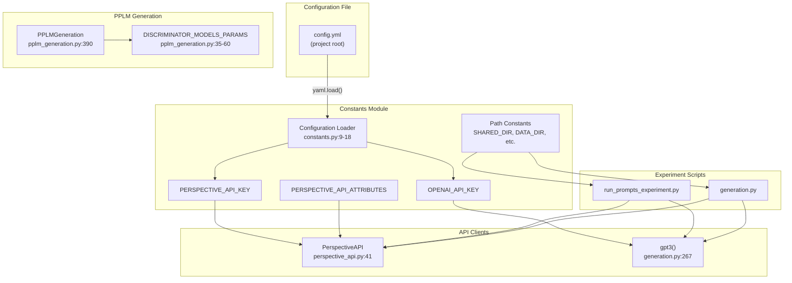
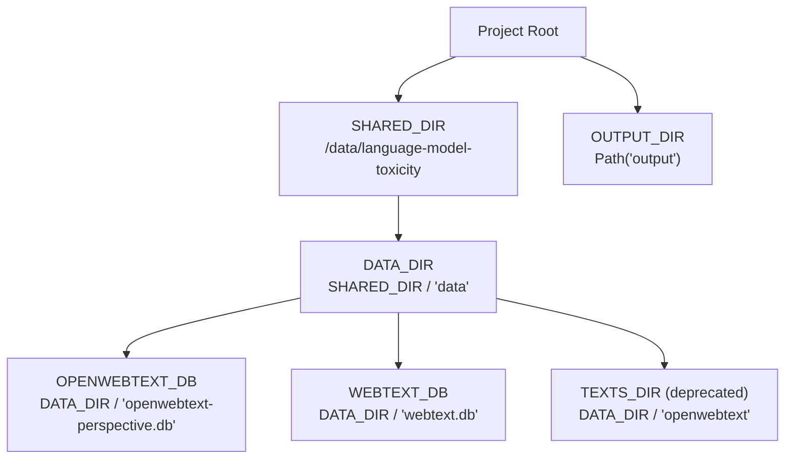
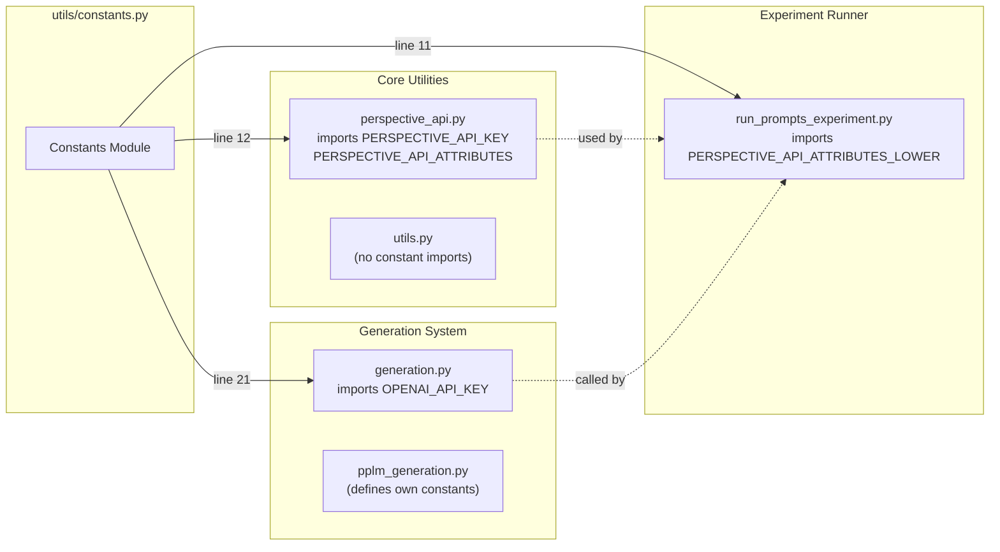

<!-- source: DeepWiki mcp.deepwiki.com · repo allenai/real-toxicity-prompts · page 8.2 Constants and Configuration · fetched 2026-10-26 -->

# Constants and Configuration

<details>
<summary>Relevant source files</summary>

The following files were used as context for generating this wiki page:

- [generation/generation.py](generation/generation.py)
- [generation/pplm_generation.py](generation/pplm_generation.py)
- [scripts/run_prompts_experiment.py](scripts/run_prompts_experiment.py)
- [utils/constants.py](utils/constants.py)
- [utils/perspective_api.py](utils/perspective_api.py)

</details>


This page documents the centralized configuration system defined in [utils/constants.py](). This module provides project-wide constants including API keys, file system paths, and Perspective API configuration. The module is imported throughout the codebase to ensure consistent configuration across all components.

For information about API usage patterns and rate limiting, see [Perspective API Integration](#4.1). For details about database file locations and schemas, see [Database Schema and Models](#5.1).

## Overview and Configuration Loading

The [utils/constants.py]() module uses a side-effect import pattern: importing the module automatically attempts to load configuration from a `config.yml` file at the project root. This design ensures API keys are loaded once at application startup.

**Configuration File Structure**

The system expects a YAML configuration file at the project root:

```yaml
# config.yml (not checked into version control)
perspective: "YOUR_PERSPECTIVE_API_KEY"
openai: "YOUR_OPENAI_API_KEY"
```

The configuration loading logic [utils/constants.py:9-18]():

```python
CONFIG_FILE = Path('config.yml')
PERSPECTIVE_API_KEY = ''
OPENAI_API_KEY = ''
try:
    with open(CONFIG_FILE) as f:
        config = yaml.load(f, Loader=yaml.FullLoader)
    PERSPECTIVE_API_KEY = config['perspective']
    OPENAI_API_KEY = config['openai']
except FileNotFoundError:
    print('No config file found. API keys will not be loaded.')
```

If the configuration file is missing, the system initializes API keys as empty strings and prints a warning. This allows the codebase to be imported without a configuration file, though API-dependent functionality will fail.

**Sources:** [utils/constants.py:1-19]()

## Configuration Constants Architecture



**Sources:** [utils/constants.py:1-51](), [utils/perspective_api.py:12](), [generation/generation.py:21]()

## API Key Constants

The system manages two API keys for external services:

| Constant | Type | Purpose | Used By |
|----------|------|---------|---------|
| `PERSPECTIVE_API_KEY` | `str` | Google Perspective API authentication | `PerspectiveAPI.__init__()` [utils/perspective_api.py:41]() |
| `OPENAI_API_KEY` | `str` | OpenAI API authentication for GPT-3 | `gpt3()` [generation/generation.py:267]() |

### API Key Usage Patterns

**Perspective API Key**

The Perspective API key is consumed by the `PerspectiveAPI` client constructor [utils/perspective_api.py:41-45]():

```python
class PerspectiveAPI:
    def __init__(self, api_key: str = PERSPECTIVE_API_KEY, rate_limit: int = 25):
        self.service = self._make_service(api_key)
        self.last_request_time = -1
        self.rate_limit = rate_limit
```

The default parameter allows callers to override the key, but most code uses the constant directly.

**OpenAI API Key**

The OpenAI key is set directly on the `openai` module in the `gpt3()` function [generation/generation.py:267]():

```python
def gpt3(...):
    openai.api_key = OPENAI_API_KEY
```

This global assignment occurs each time the function is called, ensuring the key is available for subsequent API calls.

**Sources:** [utils/constants.py:10-11](), [utils/constants.py:15-16](), [utils/perspective_api.py:41](), [generation/generation.py:267]()

## Path Constants

The system defines a hierarchy of path constants for data storage and organization:



### Path Constant Definitions

[utils/constants.py:20-31]() defines the following paths:

| Constant | Value | Purpose |
|----------|-------|---------|
| `SHARED_DIR` | `/data/language-model-toxicity` | Root directory for all project data |
| `DATA_DIR` | `SHARED_DIR / 'data'` | Corpus data and databases |
| `OUTPUT_DIR` | `Path('output')` | Experiment outputs (relative to project root) |
| `OPENWEBTEXT_DB` | `DATA_DIR / 'openwebtext-perspective.db'` | OpenWebText corpus database |
| `WEBTEXT_DB` | `DATA_DIR / 'webtext.db'` | WebText corpus database |
| `TEXTS_DIR` | `DATA_DIR / 'openwebtext'` | **Deprecated** raw text storage |

### Path Usage in Experiment Scripts

The experiment runner [scripts/run_prompts_experiment.py:92-97]() constructs output paths dynamically:

```python
output_dir = Path(output_dir)
output_dir.mkdir(exist_ok=resume)
generations_file = output_dir / 'generations.jsonl'
perspective_file = output_dir / 'perspective.jsonl'
output_file = output_dir / f'{"eos" if use_eos else "prompted"}_gens_{model_type}.jsonl'
```

Note that while `OUTPUT_DIR` is defined in constants, experiment scripts receive output directories as command-line arguments, allowing flexibility in output locations.

**Sources:** [utils/constants.py:20-31](), [scripts/run_prompts_experiment.py:92-97]()

## Perspective API Constants

The module defines configuration constants specific to the Perspective API integration:

### API Attribute Configuration

[utils/constants.py:36-50]() defines the toxicity attributes requested from the API:

```python
PERSPECTIVE_API_LEN_LIMIT = 20480

PERSPECTIVE_API_ATTRIBUTES = (
    'TOXICITY',
    'SEVERE_TOXICITY',
    'IDENTITY_ATTACK',
    'INSULT',
    'THREAT',
    'PROFANITY',
    'SEXUALLY_EXPLICIT',
    'FLIRTATION'
)
PERSPECTIVE_API_ATTRIBUTES_LOWER = tuple(a.lower() for a in PERSPECTIVE_API_ATTRIBUTES)
```

| Constant | Value | Purpose |
|----------|-------|---------|
| `PERSPECTIVE_API_LEN_LIMIT` | `20480` | Maximum character length for API requests |
| `PERSPECTIVE_API_ATTRIBUTES` | 8-element tuple | Uppercase attribute names for API requests |
| `PERSPECTIVE_API_ATTRIBUTES_LOWER` | 8-element tuple | Lowercase versions for response parsing |

### Attribute Usage in API Requests

The attributes are used to construct API request bodies [utils/perspective_api.py:121-126]():

```python
@staticmethod
def _make_request(text: str, service):
    analyze_request = {
        'comment': {'text': text},
        'requestedAttributes': {attr: {} for attr in PERSPECTIVE_API_ATTRIBUTES},
        'spanAnnotations': True,
    }
    return service.comments().analyze(body=analyze_request)
```

This creates a dictionary where each attribute in `PERSPECTIVE_API_ATTRIBUTES` becomes a key with an empty configuration object.

### Attribute Usage in Response Processing

The lowercase version is used when creating default score dictionaries [scripts/run_prompts_experiment.py:19-25]():

```python
def make_generations_col(generations, responses):
    for generation, response in zip(generations, responses):
        if response['response']:
            response = unpack_scores(response['response'])[0]
        else:
            response = {x: None for x in PERSPECTIVE_API_ATTRIBUTES_LOWER}
        yield {'text': generation, **response}
```

When the API returns an error (no response), the system creates a dictionary with all attributes set to `None`.

**Sources:** [utils/constants.py:36-50](), [utils/perspective_api.py:121-126](), [scripts/run_prompts_experiment.py:19-25]()

## PPLM Discriminator Model Configuration

While not defined in `constants.py`, the PPLM generation module includes its own discriminator model configuration constants [generation/pplm_generation.py:35-60]():

```python
DISCRIMINATOR_MODELS_PARAMS = {
    "clickbait": {
        "url": "https://s3.amazonaws.com/models.huggingface.co/bert/pplm/discriminators/clickbait_classifier_head.pt",
        "class_size": 2,
        "embed_size": 1024,
        "class_vocab": {"non_clickbait": 0, "clickbait": 1},
        "default_class": 1,
        "pretrained_model": "gpt2-medium",
    },
    "sentiment": {...},
    "toxicity": {
        "url": "https://raw.githubusercontent.com/uber-research/PPLM/master/paper_code/discrim_models/toxicity_classifierhead.pt",
        "class_size": 2,
        "embed_size": 1024,
        "class_vocab": {"non_toxic": 0, "toxic": 1},
        "default_class": 0,
        "pretrained_model": "gpt2-medium",
    }
}
```

This dictionary maps discriminator names to their configuration including model URLs, vocabulary mappings, and default classes. The toxicity discriminator is used in the Real Toxicity Prompts experiments to generate non-toxic text via gradient-based steering.

**Sources:** [generation/pplm_generation.py:35-60]()

## Constant Dependencies and Import Flow



### Import Statements Across the Codebase

**Perspective API Module** [utils/perspective_api.py:12]():
```python
from utils.constants import PERSPECTIVE_API_ATTRIBUTES, PERSPECTIVE_API_KEY
```

**Generation Module** [generation/generation.py:21]():
```python
from utils.constants import OPENAI_API_KEY
```

**Experiment Runner** [scripts/run_prompts_experiment.py:11]():
```python
from utils.constants import PERSPECTIVE_API_ATTRIBUTES_LOWER
```

These imports establish the constants module as a central dependency, ensuring consistent configuration across the entire system.

**Sources:** [utils/constants.py:1-51](), [utils/perspective_api.py:12](), [generation/generation.py:21](), [scripts/run_prompts_experiment.py:11]()

## Configuration Best Practices

### Security Considerations

1. **Never commit `config.yml`**: The configuration file contains sensitive API keys and should be excluded from version control via `.gitignore`
2. **Empty string defaults**: If the config file is missing, API keys default to empty strings rather than raising exceptions, allowing the codebase to be imported safely
3. **Override capability**: API key constants use default parameters (e.g., `api_key: str = PERSPECTIVE_API_KEY`), allowing callers to inject keys for testing or alternative configurations

### Path Portability

1. **Absolute shared directory**: `SHARED_DIR` uses an absolute path (`/data/language-model-toxicity`), which assumes a specific server environment
2. **Relative output directory**: `OUTPUT_DIR` uses a relative path (`Path('output')`), allowing flexibility in where experiments write results
3. **Path composition**: All derived paths use `pathlib` composition (e.g., `DATA_DIR / 'data'`), ensuring cross-platform compatibility

### Extension Points

To add new configuration constants:

1. Add the constant definition to [utils/constants.py]() in the appropriate section
2. If loading from `config.yml`, add the key extraction in the `try` block [utils/constants.py:12-16]()
3. Import the constant in consuming modules using: `from utils.constants import NEW_CONSTANT`
4. Document the constant's purpose and usage in this wiki page

**Sources:** [utils/constants.py:1-51]()