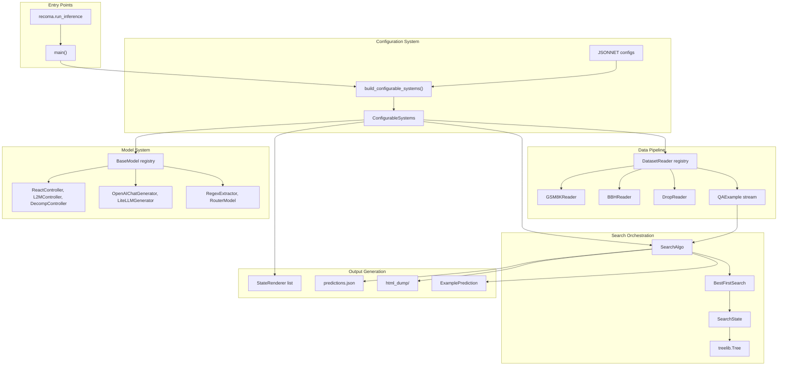
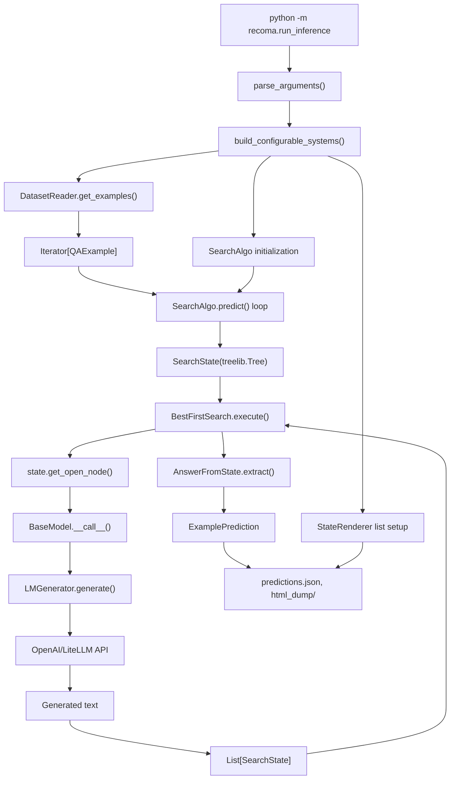

<!-- source: DeepWiki mcp.deepwiki.com · repo allenai/recoma · page 1 Overview · fetched 2026-10-26 -->

# Overview

<details>
<summary>Relevant source files</summary>

The following files were used as context for generating this wiki page:

- [.gitignore](.gitignore)
- [README.md](README.md)
- [recoma/models/README.md](recoma/models/README.md)
- [recoma/models/core/README.md](recoma/models/core/README.md)
- [recoma/models/core/utility_models.py](recoma/models/core/utility_models.py)
- [requirements.txt](requirements.txt)
- [setup.cfg](setup.cfg)
- [setup.py](setup.py)

</details>


## Purpose and Scope

ReComA (Reasoning via Communicating Agents) is a Python framework for solving complex reasoning tasks through orchestrated language model agents. The system coordinates multiple specialized models using tree-based search algorithms to explore different reasoning paths and synthesize solutions.

This document provides a high-level overview of ReComA's architecture, core components, and data flow. For detailed installation instructions, see [Installation and Setup](#1.1). For hands-on usage examples, see [Quick Start Guide](#1.2). For deep dives into specific subsystems, see [Core Architecture](#2) and its subsections.

*Sources: [README.md:1-17](), [setup.py:29-29]()*

## System Architecture

ReComA implements a search-based reasoning framework where language models are orchestrated through a tree search algorithm. The system reads examples from datasets, applies reasoning strategies through model controllers, and produces structured outputs with full execution traces.



*Sources: [recoma/run_inference.py](), [recoma/models/core/base_model.py](), [recoma/search/](), [recoma/datasets/](), [setup.py:53-56]()*

## Core Components

### Model Registry and Execution

The system centers around a `BaseModel` registry that manages different types of reasoning agents. Each model implements a `__call__` method that takes a `SearchState` and returns new states to explore. The key model types include:

| Model Type | Purpose | Key Classes |
|------------|---------|-------------|
| **Reasoning Controllers** | Implement multi-step reasoning patterns | `ReactController`, `LeastToMostController`, `DecompController` |
| **Language Model Generators** | Interface with LLM APIs | `OpenAIChatGenerator`, `LiteLLMGenerator` |
| **Utility Models** | Text processing and routing | `RegexExtractor`, `RouterModel`, `PromptedLMModel` |

*Sources: [recoma/models/core/base_model.py](), [recoma/models/core/README.md:3-7](), [recoma/models/core/utility_models.py]()*

### Search System

The search system manages exploration of reasoning paths through a tree structure. `BestFirstSearch` maintains a priority queue of open nodes and delegates execution to target models. Each `SearchState` contains a `treelib.Tree` representing the current reasoning trace.

*Sources: [recoma/search/](), [requirements.txt:1-1]()*

### Dataset Integration

Dataset readers implement a standardized interface for different reasoning benchmarks. Each reader produces a stream of `QAExample` objects with consistent field access patterns.

*Sources: [recoma/datasets/](), [recoma/models/core/README.md:15-15]()*

## Data Flow and Orchestration

The following diagram shows how data flows through the system during inference, mapping natural language concepts to specific code entities:



*Sources: [recoma/run_inference.py](), [recoma/search/search_algo.py](), [recoma/models/core/base_model.py](), [recoma/models/core/generator.py]()*

## Key Abstractions

### BaseModel Registration System

All models in ReComA inherit from `BaseModel` and use a registration decorator pattern. This enables dynamic model loading and configuration-driven composition:

```python
@BaseModel.register("my_model")
class MyModel(BaseModel):
    def __call__(self, state: SearchState) -> List[SearchState]:
        # Implementation
```

*Sources: [recoma/models/core/base_model.py](), [recoma/models/core/README.md:3-7](), [requirements.txt:8-8]()*

### Generator Abstraction

The `Generator` class provides a unified interface for different LLM providers. It handles caching, retry logic, and cost tracking transparently:

- `OpenAIChatGenerator`: Direct OpenAI API integration
- `LiteLLMGenerator`: Multi-provider support via LiteLLM library

*Sources: [recoma/models/core/generator.py](), [recoma/models/core/README.md:9-10](), [requirements.txt:4-5]()*

### Prompted Models

`PromptedLMModel` combines Jinja2 templates with generators to create configurable prompted agents. Templates can access context variables like `question`, `input_str`, and `paras`.

*Sources: [recoma/models/core/prompted_lm_model.py](), [recoma/models/core/README.md:13-17](), [requirements.txt:3-3]()*

## Configuration and Extensibility

ReComA uses JSONNET configuration files to define complete reasoning pipelines without code changes. The configuration system supports:

- Model composition and parameter specification
- Dataset selection and preprocessing
- Search algorithm configuration
- Output formatting and visualization

For detailed configuration guidance, see [Configuration System](#6). For extending ReComA with new models or datasets, see [Extending the Framework](#7.3).

*Sources: [README.md:17-17](), [requirements.txt:2-2](), [setup.py:48-48]()*

## Getting Started

ReComA provides multiple entry points for different use cases:

- **Interactive exploration**: `--gradio_demo` flag launches a web interface for single-example debugging
- **Batch inference**: Process datasets and generate structured outputs
- **Library integration**: Import ReComA components into existing codebases

The primary entry point is the `recoma.run_inference` command-line interface, which orchestrates the entire pipeline from configuration loading to result generation.

*Sources: [README.md:49-84](), [setup.py:53-56](), [requirements.txt:10-10]()*

---

