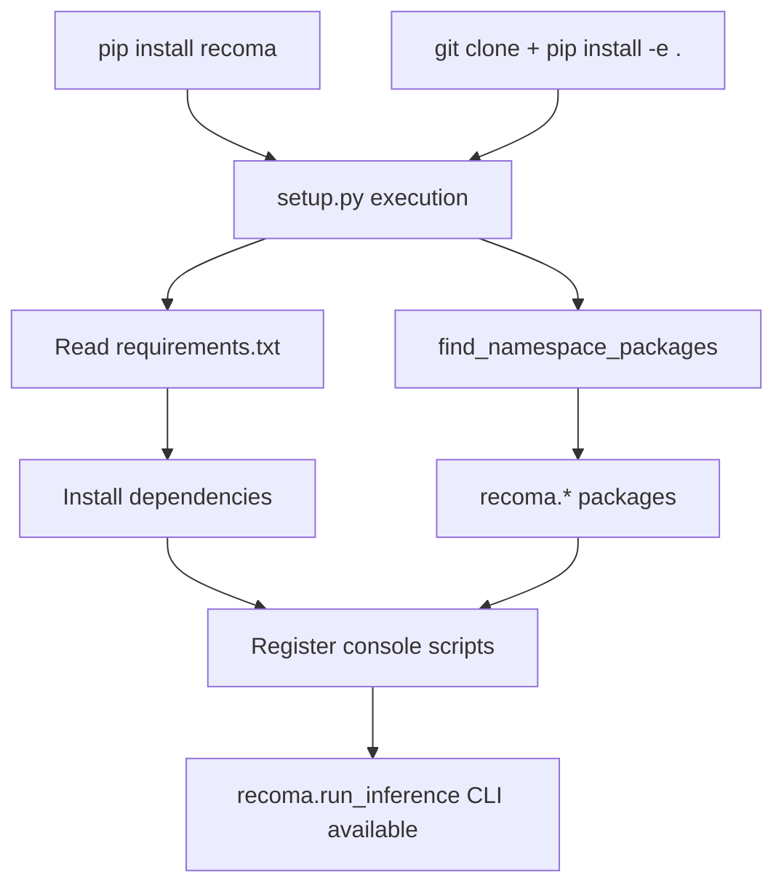
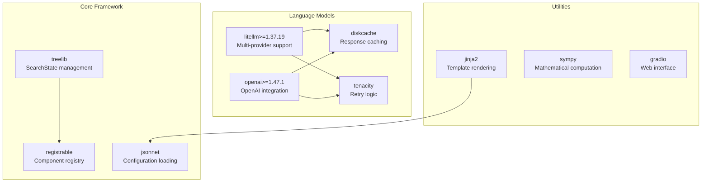
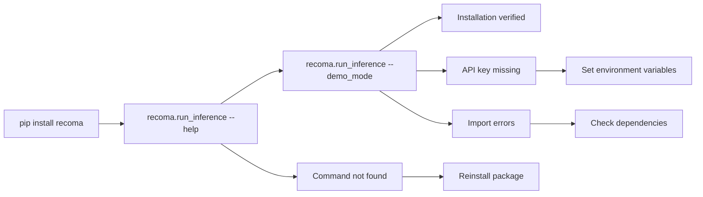

<!-- source: DeepWiki mcp.deepwiki.com · repo allenai/recoma · page 1.1 Installation and Setup · fetched 2026-10-26 -->

# Installation and Setup

<details>
<summary>Relevant source files</summary>

The following files were used as context for generating this wiki page:

- [.gitignore](.gitignore)
- [requirements.txt](requirements.txt)
- [setup.cfg](setup.cfg)
- [setup.py](setup.py)

</details>


This document provides comprehensive instructions for installing ReComA and configuring the required dependencies and environment variables. This covers the initial setup process to get the reasoning framework operational on your system.

For information about running inference after installation, see [Quick Start Guide](#1.2). For advanced configuration of language models and reasoning tasks, see [Configuration System](#6).

## System Requirements

ReComA requires Python 3.9 or higher to operate. The framework has been tested on Python 3.9, 3.10, and 3.11 as specified in the package classifiers.

**Supported Python Versions:**
- Python 3.9
- Python 3.10  
- Python 3.11

Sources: [setup.py:43-46](), [setup.py:50]()

## Installation Options

### Install from PyPI (Recommended)

```bash
pip install recoma
```

This installs the latest stable version from the Python Package Index along with all required dependencies.

### Install from Source

For development or to get the latest features:

```bash
git clone https://github.com/allenai/recoma.git
cd recoma
pip install -e .
```

The `-e` flag installs the package in editable mode, allowing you to modify the source code and see changes immediately.

**Installation Flow Diagram**



Sources: [setup.py:26-57](), [setup.py:49](), [setup.py:52-56]()

## Dependencies Overview

ReComA has several key dependencies that enable different aspects of the reasoning framework:

| Dependency | Purpose | Version Requirement |
|------------|---------|-------------------|
| `treelib` | Search state tree management | Any |
| `jsonnet` | Configuration file processing | Any |
| `jinja2` | Prompt template rendering | Any |
| `litellm` | Multi-provider LLM integration | ≥1.37.19 |
| `openai` | OpenAI API integration | ≥1.47.1 |
| `diskcache` | Response caching | Any |
| `tenacity` | Retry logic for API calls | Any |
| `registrable` | Component registration system | Any |
| `sympy` | Mathematical computation | Any |
| `gradio` | Web interface for demos | Any |

**Dependency Architecture**



Sources: [requirements.txt:1-10](), [setup.py:51]()

## Environment Configuration

### Required Environment Variables

ReComA requires API keys for language model providers. Set these environment variables based on which models you plan to use:

**OpenAI Models:**
```bash
export OPENAI_API_KEY="your-openai-api-key"
```

**Other LLM Providers (via LiteLLM):**
```bash
# For Anthropic Claude
export ANTHROPIC_API_KEY="your-anthropic-key"

# For Google Gemini
export GEMINI_API_KEY="your-gemini-key"

# For Azure OpenAI
export AZURE_API_KEY="your-azure-key"
export AZURE_API_BASE="your-azure-endpoint"
```

### Optional Configuration

**Cache Directory:**
By default, ReComA uses disk caching for LLM responses. You can customize the cache location:
```bash
export RECOMA_CACHE_DIR="/path/to/cache"
```

**Configuration Directory:**
To use custom configuration files:
```bash
export RECOMA_CONFIG_DIR="/path/to/configs"
```

Sources: Based on LLM integration patterns from system architecture diagrams

## Verification

### Test CLI Installation

After installation, verify the command-line interface is available:

```bash
recoma.run_inference --help
```

This should display the help text for the inference command, confirming that the console script entry point was properly registered.

### Test Demo Mode

Run a simple demo to verify the system is working:

```bash
recoma.run_inference --demo_mode
```

This launches an interactive demo that doesn't require dataset files or complex configuration.

**Verification Flow**



Sources: [setup.py:54](), based on CLI entry point configuration

## Troubleshooting

### Common Issues

**1. Command Not Found**
```bash
recoma.run_inference: command not found
```
- Ensure the package is installed: `pip list | grep recoma`
- Check that the installation directory is in your PATH
- Try reinstalling: `pip uninstall recoma && pip install recoma`

**2. Import Errors**
```bash
ModuleNotFoundError: No module named 'openai'
```
- Install missing dependencies: `pip install -r requirements.txt`
- Verify Python version compatibility: `python --version`

**3. API Key Errors**
```bash
openai.AuthenticationError: Incorrect API key provided
```
- Verify environment variables are set: `echo $OPENAI_API_KEY`
- Check API key validity with the provider
- Restart terminal session after setting environment variables

**4. Version Conflicts**
```bash
ERROR: pip's dependency resolver does not currently consider all constraints
```
- Use a virtual environment: `python -m venv recoma_env && source recoma_env/bin/activate`
- Update pip: `pip install --upgrade pip`
- Install with `--force-reinstall` flag if needed

### Development Setup

For contributors or advanced users modifying the framework:

```bash
# Create development environment
python -m venv recoma_dev
source recoma_dev/bin/activate  # On Windows: recoma_dev\Scripts\activate

# Install in development mode
git clone https://github.com/allenai/recoma.git
cd recoma
pip install -e .

# Install additional development dependencies if needed
pip install pytest black flake8
```

Sources: [setup.py:49-57](), [requirements.txt:4-5](), [.gitignore:7-11]()

---

