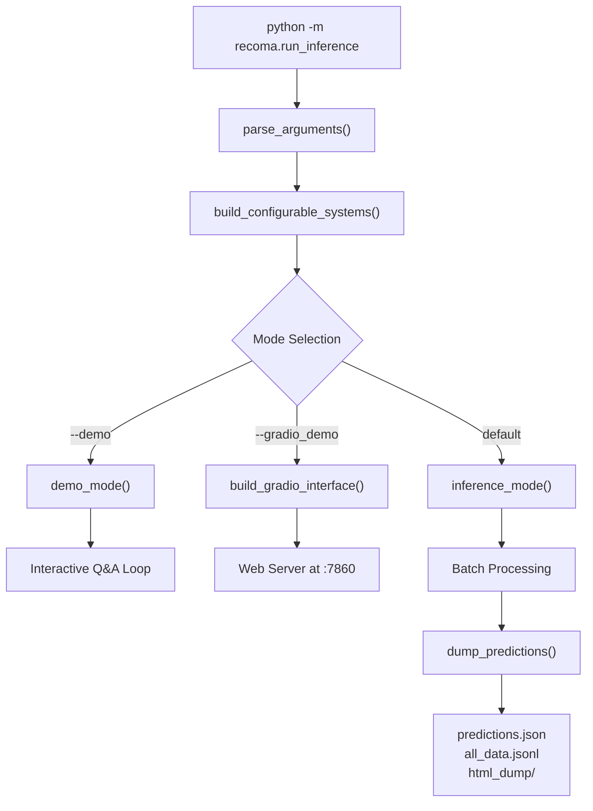
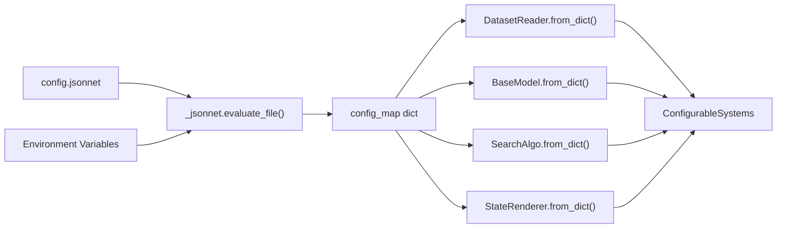
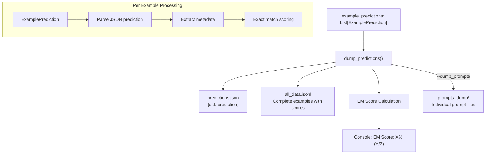
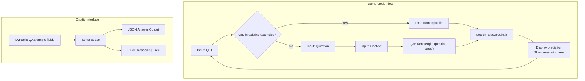

<!-- source: DeepWiki mcp.deepwiki.com · repo allenai/recoma · page 1.2 Quick Start Guide · fetched 2026-10-26 -->

# Quick Start Guide

<details>
<summary>Relevant source files</summary>

The following files were used as context for generating this wiki page:

- [README.md](README.md)
- [recoma/models/README.md](recoma/models/README.md)
- [recoma/models/core/README.md](recoma/models/core/README.md)
- [recoma/models/core/utility_models.py](recoma/models/core/utility_models.py)
- [recoma/run_inference.py](recoma/run_inference.py)

</details>


This page provides basic usage patterns to get you started with ReComA quickly, including interactive demo mode and batch inference. It covers the essential command-line interface and configuration concepts needed to run reasoning tasks.

For detailed installation instructions, see [Installation and Setup](#1.1). For comprehensive configuration options, see [Configuration System](#6).

## Core Usage Patterns

ReComA provides three primary modes of operation through the `recoma.run_inference` module. All modes require a configuration file and output directory.

### Interactive Demo Mode

The simplest way to explore ReComA is through the interactive web interface:

```bash
python -m recoma.run_inference \
  --config configs/inference/letter_cat/decomp.jsonnet \
  --output_dir output/letter_cat_decomp/ \
  --gradio_demo
```

This starts a web server at `http://localhost:7860` with an interactive interface where you can:
- Enter questions directly
- View real-time reasoning traces
- Explore the search tree with expandable nodes
- See all underlying prompts and model interactions

**Command-Line Demo Mode**

For command-line interaction:

```bash
python -m recoma.run_inference \
  --config configs/inference/letter_cat/decomp.jsonnet \
  --output_dir output/letter_cat_decomp/ \
  --demo
```

This provides a text-based interface where you can enter questions and see the reasoning process.

### Batch Inference Mode

For processing datasets in batch:

```bash
python -m recoma.run_inference \
  --config configs/inference/letter_cat/decomp.jsonnet \
  --output_dir output/letter_cat_decomp/ \
  --input datasets/letter_cat/n4_eg100_pos2_space.json
```

This processes all examples in the input file and generates comprehensive output files.

Sources: [recoma/run_inference.py:229-250](), [README.md:49-84]()

## Command-Line Interface

### CLI Flow Diagram



### Essential Command-Line Arguments

| Argument | Required | Description |
|----------|----------|-------------|
| `--config` | Yes | Path to JSONNET configuration file |
| `--output_dir` | Yes | Directory for output files |
| `--input` | No | Input dataset file (for batch mode) |
| `--demo` | No | Enable command-line demo mode |
| `--gradio_demo` | No | Enable web interface demo mode |
| `--debug` | No | Enable debug logging |
| `--dump_prompts` | No | Save all prompts to files |

Sources: [recoma/run_inference.py:31-46]()

## Configuration System Overview

### Configuration Loading Process



### Core Configuration Structure

Every ReComA configuration file contains these essential sections:

```jsonnet
{
  "reader": {
    "type": "dataset_reader_type",
    // dataset-specific parameters
  },
  "models": {
    "model_name": {
      "type": "model_type",
      // model-specific parameters
    }
  },
  "search": {
    "type": "search_algorithm_type",
    // search-specific parameters
  },
  "renderers": [
    {
      "type": "renderer_type",
      // renderer-specific parameters
    }
  ]
}
```

The `ConfigurableSystems` dataclass combines all components:
- `reader`: Processes input datasets
- `search`: Orchestrates the reasoning process
- `renderers`: Format output for visualization

Sources: [recoma/run_inference.py:49-77](), [recoma/run_inference.py:24-29]()

## Output Files and Structure

### Batch Inference Outputs

When running in batch mode, ReComA generates several output files:

| File | Description |
|------|-------------|
| `predictions.json` | QID-to-prediction mapping |
| `all_data.jsonl` | Complete dataset with predictions and correctness scores |
| `html_dump/` | HTML visualization of reasoning traces |
| `source_config.json` | Configuration used for reproducibility |
| `prompts_dump/` | Individual prompt files (if `--dump_prompts` used) |

### Output Generation Process



The exact match scoring compares predictions against gold labels, providing immediate feedback on model performance.

Sources: [recoma/run_inference.py:123-169]()

## Interactive Features

### Demo Mode Components



The demo modes provide immediate feedback and visualization, making it easy to understand how ReComA processes reasoning tasks.

Sources: [recoma/run_inference.py:80-107](), [recoma/run_inference.py:171-203](), [recoma/run_inference.py:206-226]()

## Next Steps

After completing this quick start:

1. **Explore Configurations**: Review example configs in the `configs/` directory
2. **Understand Models**: See [Model System Architecture](#2.3) for model types
3. **Custom Datasets**: Learn about [Dataset Reading Pipeline](#2.4)
4. **Advanced Features**: Explore [Search Control and Early Stopping](#7.2)

The ReComA framework provides extensive customization through configuration files, allowing you to adapt it to various reasoning tasks without code modifications.

Sources: [README.md:86-104]()

---

