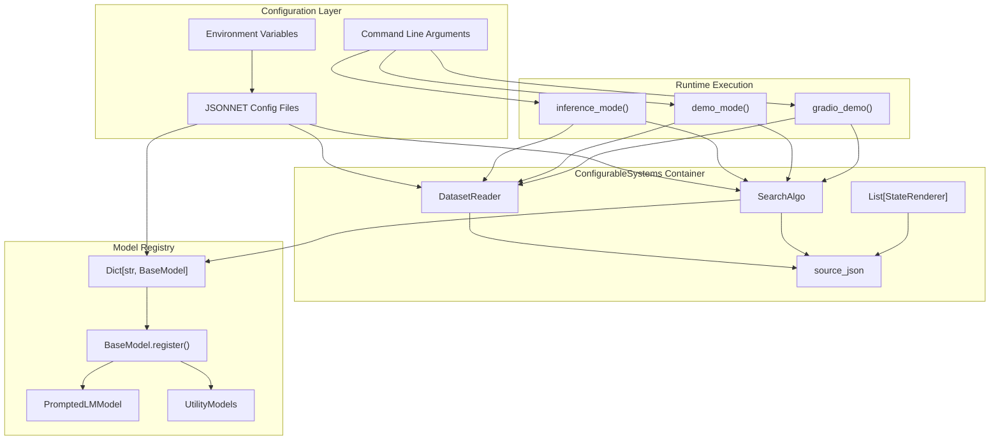
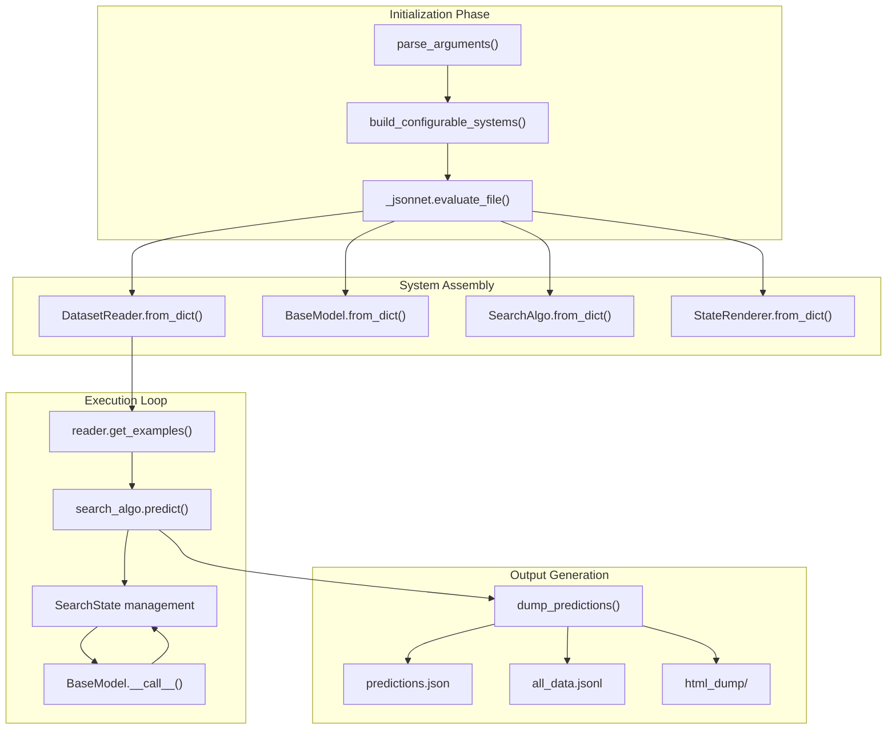
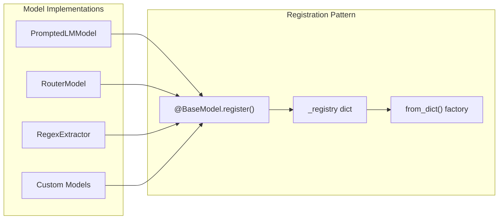
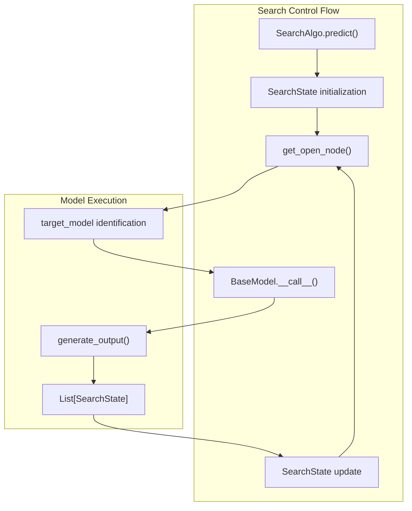

<!-- source: DeepWiki mcp.deepwiki.com · repo allenai/recoma · page 2 Core Architecture · fetched 2026-10-26 -->

# Core Architecture

Relevant source files

The following files were used as context for generating this wiki page:

- [README.md](README.md)
- [recoma/models/README.md](recoma/models/README.md)
- [recoma/models/core/README.md](recoma/models/core/README.md)
- [recoma/models/core/utility_models.py](recoma/models/core/utility_models.py)
- [recoma/run_inference.py](recoma/run_inference.py)

This document provides an overview of ReComA's fundamental architecture, explaining the main components and their interactions within the reasoning framework. ReComA orchestrates multiple language models through a search-based approach to solve complex reasoning tasks.

For detailed information about specific subsystems, see [Inference Orchestration](#2.1), [Search System](#2.2), [Model System Architecture](#2.3), and [Dataset Reading Pipeline](#2.4).

## System Overview

ReComA's architecture is built around four core components that work together to enable multi-agent reasoning:

1. **Configuration System** - JSONNET-based declarative configuration loading
2. **Model System** - Pluggable language model abstractions with registration
3. **Search System** - Tree-based exploration of reasoning paths
4. **Data Pipeline** - Standardized dataset reading and output generation

## Primary System Components

ReComA's core architecture centers around the `ConfigurableSystems` dataclass, which serves as the primary container for all system components during runtime.

**Configuration to Runtime System Mapping**

Sources: [recoma/run_inference.py:24-30](), [recoma/run_inference.py:59-77]()

## Core Data Flow

The system follows a clear data flow from configuration through execution to output generation:

**System Data Flow from Configuration to Output**

Sources: [recoma/run_inference.py:49-77](), [recoma/run_inference.py:109-121](), [recoma/run_inference.py:123-169]()

## Component Interactions

### Configuration System

The configuration system uses JSONNET files to declaratively specify system behavior. The `build_configurable_systems()` function processes these configurations and instantiates the required components.

| Configuration Section | Purpose | Component Created |
|----------------------|---------|-------------------|
| `reader` | Dataset specification | `DatasetReader` |
| `models` | Model definitions | `Dict[str, BaseModel]` |
| `search` | Search algorithm config | `SearchAlgo` |
| `renderers` | Output formatting | `List[StateRenderer]` |

Sources: [recoma/run_inference.py:59-77]()

### Model Registration System

ReComA uses a registration-based pattern for models, allowing runtime discovery and instantiation of different model types:

**Model Registration and Discovery System**

Sources: [recoma/models/core/base_model.py](), [recoma/models/core/utility_models.py:12-13](), [recoma/models/core/utility_models.py:41-42]()

### Search Coordination

The search system coordinates model execution through a tree-based state management approach. The `SearchAlgo` receives a model dictionary and orchestrates their execution based on the current search state.

**Search Algorithm Coordination Flow**

Sources: [recoma/search/search.py](), [recoma/models/core/base_model.py]()

## Runtime Modes

ReComA supports three primary runtime modes, each serving different use cases:

### Inference Mode
Batch processing mode for evaluating datasets. Processes all examples from an input file and generates comprehensive outputs including predictions, correctness scores, and execution traces.

### Demo Mode
Interactive command-line mode for testing individual examples. Allows real-time input of questions and provides immediate feedback with full reasoning traces.

### Gradio Demo Mode
Web-based interface mode that provides a GUI for interactive reasoning. Combines the accessibility of a web interface with the detailed output of demo mode.

Each mode uses the same underlying `ConfigurableSystems` but provides different interaction patterns for different use cases.

Sources: [recoma/run_inference.py:109-121](), [recoma/run_inference.py:80-107](), [recoma/run_inference.py:171-204]()

## Extension Points

The architecture provides several extension points for customization:

1. **Model Extensions** - New reasoning patterns via `BaseModel` inheritance
2. **Dataset Extensions** - New data formats via `DatasetReader` inheritance  
3. **Search Extensions** - New search strategies via `SearchAlgo` inheritance
4. **Rendering Extensions** - New output formats via `StateRenderer` inheritance

Each extension point uses the same registration pattern, allowing runtime discovery without code modification.

Sources: [recoma/models/core/README.md:1-22](), [recoma/run_inference.py:236-238]()

---

