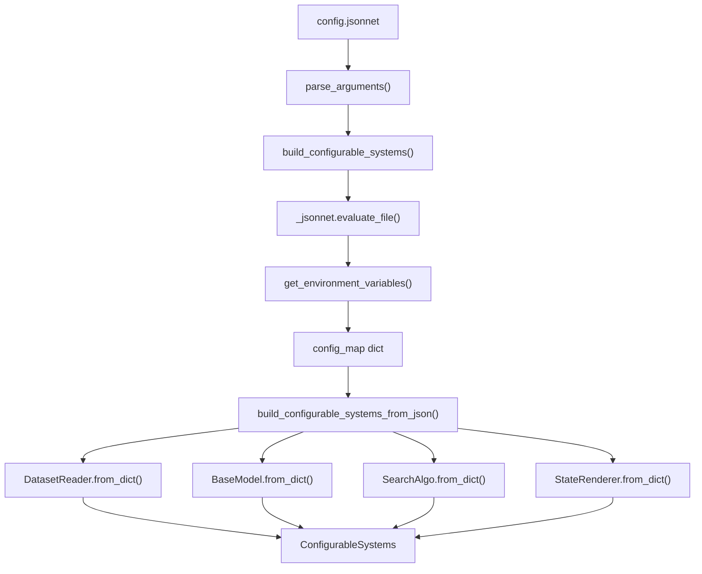
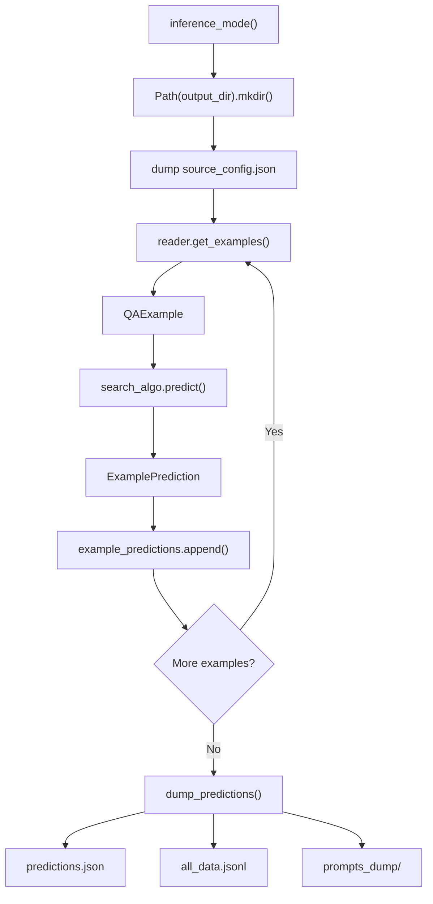
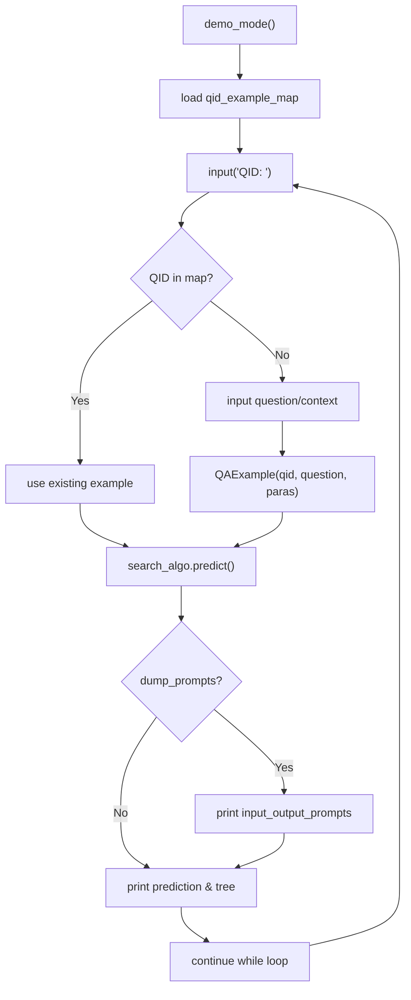
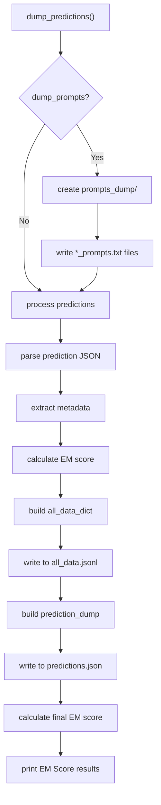
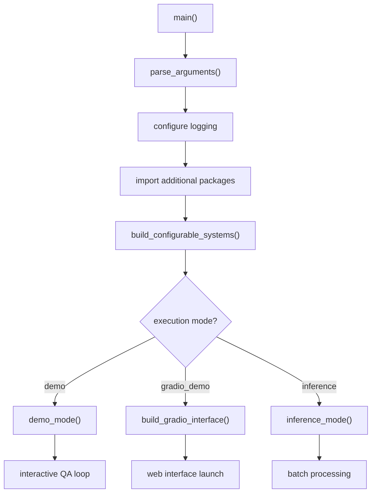

<!-- source: DeepWiki mcp.deepwiki.com · repo allenai/recoma · page 2.1 Inference Orchestration · fetched 2026-10-26 -->

# Inference Orchestration

<details>
<summary>Relevant source files</summary>

The following files were used as context for generating this wiki page:

- [recoma/run_inference.py](recoma/run_inference.py)

</details>


## Purpose and Scope

This document covers the core inference orchestration system in ReComA, which serves as the main entry point for running reasoning tasks. The orchestration system handles configuration loading, example processing, and output generation across different execution modes. It coordinates the interaction between dataset readers, search algorithms, and model systems to produce structured predictions.

For details about the search algorithms themselves, see [Search System](#2.2). For information about model system architecture, see [Model System Architecture](#2.3). Dataset processing specifics are covered in [Dataset Reading Pipeline](#2.4).

## System Overview

The inference orchestration system is primarily implemented in `recoma/run_inference.py` and provides three main execution modes:

| Mode | Purpose | Entry Function |
|------|---------|----------------|
| Inference | Batch processing of dataset examples | `inference_mode` |
| Demo | Interactive single-example processing | `demo_mode` |
| Gradio Demo | Web-based interactive interface | `gradio_demo_fn` |

## Core Data Structures

### ConfigurableSystems

The `ConfigurableSystems` dataclass serves as the central container for all configured system components:

```python
@dataclass
class ConfigurableSystems:
    source_json: dict
    reader: DatasetReader
    search: SearchAlgo
    renderers: List[StateRenderer]
```

This structure encapsulates the four main components needed for inference orchestration:

- **source_json**: Original configuration for reproducibility
- **reader**: Dataset reading and example generation
- **search**: Search algorithm for reasoning coordination
- **renderers**: Output formatting and visualization

**Sources**: [recoma/run_inference.py:24-29]()

## Configuration Loading and System Building

### Configuration Processing Flow



The configuration system supports both JSONNET and JSON formats, with JSONNET enabling dynamic configuration through environment variables.

**Sources**: [recoma/run_inference.py:49-77]()

### Model Registration and Initialization

```mermaid
flowchart LR
    CONFIG_MODELS["config_map['models']"] --> MODEL_LOOP["for k, v in models.items()"]
    MODEL_LOOP --> BASE_MODEL["BaseModel.from_dict(v)"]
    BASE_MODEL --> MODEL_MAP["model_map[k]"]
    
    MODEL_MAP --> SEARCH_DICT["search dictionary"]
    SEARCH_DICT --> SEARCH_ALGO["SearchAlgo.from_dict()"]
    
    SEARCH_ALGO --> OUTPUT_DIR["output_dir + '/files/'"]
    OUTPUT_DIR --> FINAL_SEARCH["configured SearchAlgo"]
```



The system builds a `model_map` dictionary where each key corresponds to a model name and the value is an initialized `BaseModel` instance. This map is then passed to the search algorithm for coordination.

**Sources**: [recoma/run_inference.py:68-75]()

## Execution Modes

### Inference Mode Architecture



The inference mode processes examples in sequence, collecting predictions and generating multiple output formats for analysis.

**Sources**: [recoma/run_inference.py:109-121]()

### Demo Mode Architecture



Demo mode provides an interactive interface for testing individual examples, with optional prompt debugging output.

**Sources**: [recoma/run_inference.py:80-107]()

## Output Generation and Prediction Processing

### Prediction Dumping Flow



The output generation system produces three main artifacts:

1. **predictions.json**: Clean prediction results keyed by example ID
2. **all_data.jsonl**: Complete example data with predictions and metadata
3. **prompts_dump/**: Individual prompt files for debugging (optional)

**Sources**: [recoma/run_inference.py:123-169]()

### Prediction Processing Logic

The system handles complex prediction parsing and scoring:

```python
# Parse JSON predictions with fallback
try:
    pred_json = json.loads(x.prediction)
    if isinstance(pred_json, dict) and "answer" in pred_json:
        pred_json = pred_json["answer"]
except Exception:
    pred_json = x.prediction

# Calculate exact match score
score = 1 if (x.prediction == gold_answer) else 0
```

**Sources**: [recoma/run_inference.py:140-159]()

## Main Orchestration Flow

### Entry Point and Execution Path



The main function coordinates argument parsing, system configuration, and mode-specific execution based on command-line flags.

**Sources**: [recoma/run_inference.py:229-250]()

### Command Line Interface

The system accepts several key arguments:

| Argument | Purpose | Required |
|----------|---------|----------|
| `--config` | Configuration file path (JSONNET/JSON) | Yes |
| `--output_dir` | Output directory for results | Yes |
| `--input` | Input dataset file | No |
| `--demo` | Enable interactive demo mode | No |
| `--gradio_demo` | Enable web-based demo | No |
| `--dump_prompts` | Enable prompt debugging output | No |

**Sources**: [recoma/run_inference.py:31-46]()

## Integration Points

The inference orchestration system integrates with several core ReComA components:

- **DatasetReader**: Provides `get_examples()` method for batch processing
- **SearchAlgo**: Executes `predict()` method for reasoning coordination  
- **StateRenderer**: Formats output through `output()` method
- **ExamplePrediction**: Encapsulates prediction results and metadata

These integration points enable the orchestration system to coordinate complex reasoning workflows while maintaining clean separation of concerns between configuration, data processing, and output generation.

**Sources**: [recoma/run_inference.py:12-17]()

---

