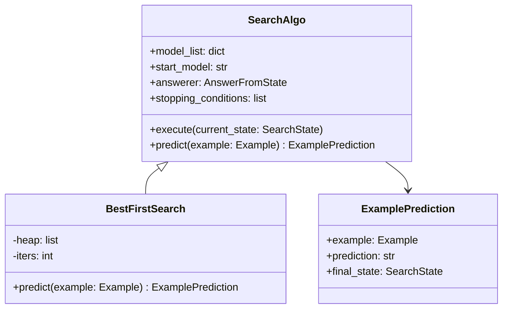
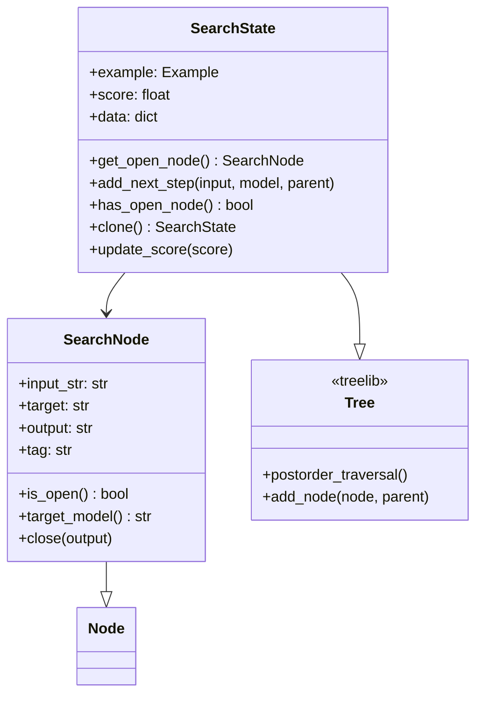
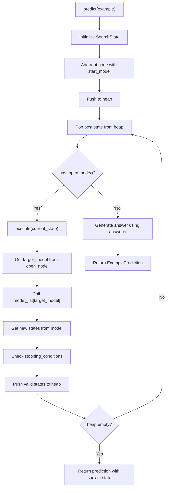
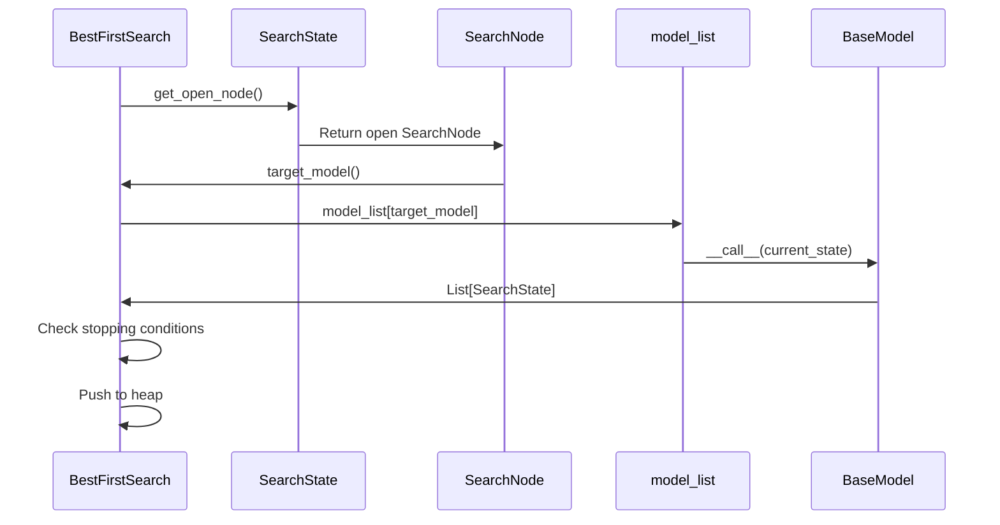
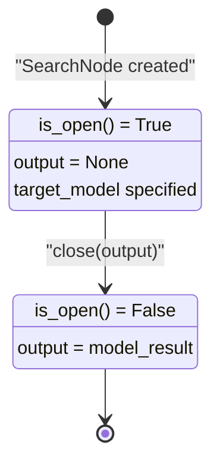
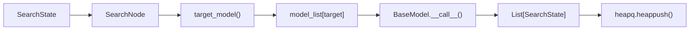
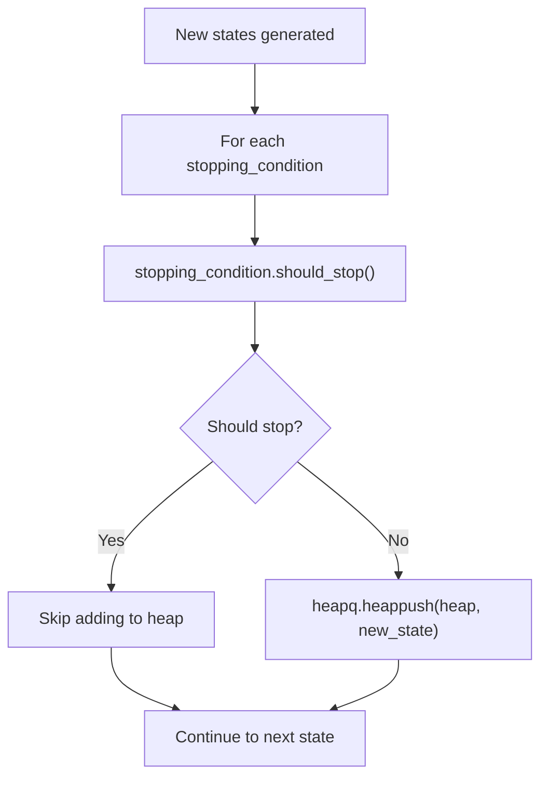
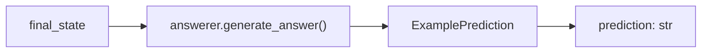

<!-- source: DeepWiki mcp.deepwiki.com · repo allenai/recoma · page 2.2 Search System · fetched 2026-10-26 -->

# Search System

Relevant source files

The following files were used as context for generating this wiki page:

- [recoma/search/search.py](recoma/search/search.py)
- [recoma/search/state.py](recoma/search/state.py)

The Search System is the core orchestration layer of ReComA that coordinates model execution through tree-based search algorithms. This system manages the reasoning process by maintaining a tree of intermediate steps, selecting which nodes to expand next, and controlling the search termination conditions.

For information about the models that the search system coordinates, see [Model System Architecture](#2.3). For details about early stopping and search control mechanisms, see [Search Control and Early Stopping](#7.2).

## Core Components

The search system consists of several key components that work together to manage the reasoning process:

### SearchAlgo Hierarchy

The `SearchAlgo` class serves as the abstract base for all search algorithms, with `BestFirstSearch` as the primary concrete implementation.

**Sources:** [recoma/search/search.py:20-59](), [recoma/search/search.py:65-127]()

### SearchState and SearchNode Architecture

The search maintains a tree structure where each `SearchState` contains a tree of `SearchNode` objects representing individual reasoning steps.

**Sources:** [recoma/search/state.py:80-204](), [recoma/search/state.py:11-78]()

## Search Execution Flow

The search execution follows a best-first strategy using a heap-based priority queue to explore the most promising states first.

### BestFirstSearch Algorithm

**Sources:** [recoma/search/search.py:68-127]()

### Model Execution Integration

The search system integrates with the model system through the `execute` method, which delegates to the appropriate model based on the target model specified in open nodes.

**Sources:** [recoma/search/search.py:42-56](), [recoma/search/search.py:104-114]()

## State Management

The search system maintains complex state through the `SearchState` class, which extends `treelib.Tree` to provide specialized tree operations for reasoning.

### Tree Structure Operations

| Operation | Method | Purpose |
|-----------|---------|---------|
| Node Selection | `get_open_node()` | Returns the next node to expand using depth-first traversal |
| State Expansion | `add_next_step()` | Adds new reasoning steps to the tree |
| State Cloning | `clone()` | Creates deep copies for parallel exploration |
| Traversal | `postorder_traversal()` | Custom traversal for finding open nodes |

**Sources:** [recoma/search/state.py:102-198]()

### Node Lifecycle Management

**Sources:** [recoma/search/state.py:29-37]()

## Integration Points

The search system integrates with several other components in the ReComA architecture:

### Model System Integration

The search system coordinates with the model system through the `model_list` dictionary, where each key corresponds to a registered model name and the value is a callable `BaseModel` instance.

**Sources:** [recoma/search/search.py:42-56]()

### Early Stopping Integration

The search process is controlled by configurable stopping conditions that are checked after each model execution.

**Sources:** [recoma/search/search.py:106-114]()

### Answer Generation Integration

The search system uses the `AnswerFromState` abstraction to extract final answers from completed search states.

**Sources:** [recoma/search/search.py:95-99](), [recoma/search/search.py:118-120]()

---

