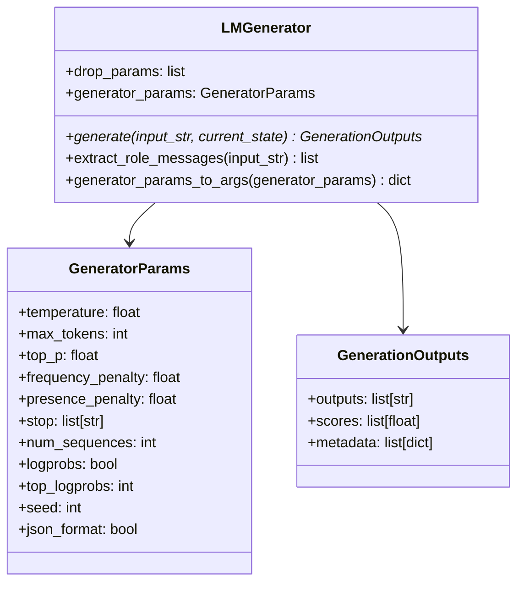
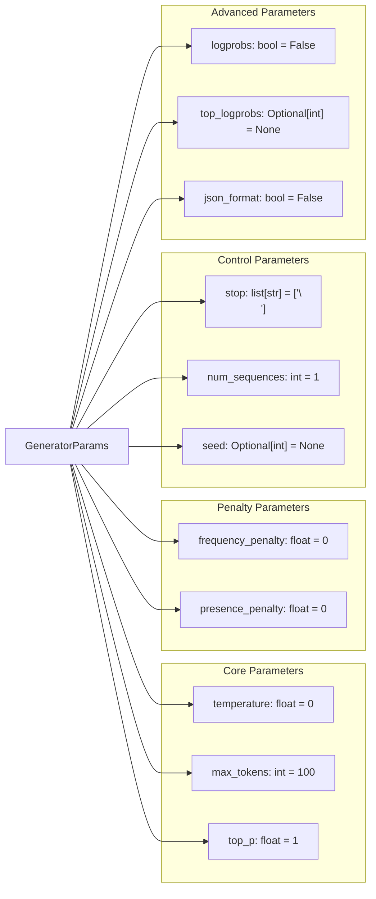

<!-- source: DeepWiki mcp.deepwiki.com · repo allenai/recoma · page 2.3 Model System Architecture · fetched 2026-10-26 -->

# Model System Architecture

Relevant source files

The following files were used as context for generating this wiki page:

- [recoma/models/__init__.py](recoma/models/__init__.py)
- [recoma/models/core/generator.py](recoma/models/core/generator.py)

## Purpose and Scope

This document covers the foundational model system architecture in ReComA, including the model hierarchy, registration system, and base abstractions that enable pluggable language model integrations. The system provides a unified interface for different types of models while maintaining flexibility for specialized reasoning patterns.

For specific language model API integrations, see [Language Model Integrations](#3). For reasoning-specific controller implementations, see [Reasoning Controllers](#4). For utility models and tools, see [Utility Models and Tools](#5).

## Model Hierarchy Overview

The ReComA model system is built around a hierarchical architecture with base classes that provide common functionality and concrete implementations for specific use cases.

### Core Model Architecture

```mermaid
graph TB
    subgraph "Base Classes"
        RegistrableFromDict["RegistrableFromDict<br/>Base registration system"]
        BaseModel["BaseModel<br/>Core model interface"]
        LMGenerator["LMGenerator<br/>Text generation base"]
    end
    
    subgraph "Parameter Classes"
        GeneratorParams["GeneratorParams<br/>LLM configuration"]
        GenerationOutputs["GenerationOutputs<br/>Output structure"]
    end
    
    subgraph "Concrete Generators"
        OpenAIChatGenerator["OpenAIChatGenerator<br/>@register('openai_chat')"]
        LiteLLMGenerator["LiteLLMGenerator<br/>@register('lite_llm')"]
    end
    
    subgraph "Reasoning Controllers"
        ReactController["ReactController<br/>Thought-Action-Observation"]
        LeastToMostController["LeastToMostController<br/>Problem decomposition"]
        DecompController["DecompController<br/>Q&A orchestration"]
    end
    
    subgraph "Utility Models"
        PromptedLMModel["PromptedLMModel<br/>Jinja2 templates"]
        RegexExtractor["RegexExtractor<br/>Pattern matching"]
        RouterModel["RouterModel<br/>Dynamic routing"]
        MathProgramExecuter["MathProgramExecuter<br/>Code execution"]
    end
    
    RegistrableFromDict --> BaseModel
    RegistrableFromDict --> LMGenerator
    
    LMGenerator --> GeneratorParams
    LMGenerator --> GenerationOutputs
    
    LMGenerator --> OpenAIChatGenerator
    LMGenerator --> LiteLLMGenerator
    
    BaseModel --> ReactController
    BaseModel --> LeastToMostController
    BaseModel --> DecompController
    BaseModel --> PromptedLMModel
    BaseModel --> RegexExtractor
    BaseModel --> RouterModel
    BaseModel --> MathProgramExecuter
```

Sources: [recoma/models/core/generator.py:35-51]()

## Registration System

The model system uses a registration pattern through `RegistrableFromDict` that allows models to be instantiated from configuration dictionaries. This enables flexible configuration-driven model selection.

### Registration Pattern

| Component | Registration Key | Purpose |
|-----------|------------------|---------|
| `OpenAIChatGenerator` | `'openai_chat'` | OpenAI API integration |
| `LiteLLMGenerator` | `'lite_llm'` | Multi-provider LLM access |
| `ReactController` | `'react'` | Thought-Action-Observation reasoning |
| `LeastToMostController` | `'least_to_most'` | Problem decomposition |
| `PromptedLMModel` | `'prompted_lm'` | Template-based prompting |

The registration system allows models to be referenced by string keys in configuration files, enabling dynamic model instantiation without hardcoded dependencies.

Sources: [recoma/models/core/generator.py:35]()

## Base Generator Classes

### LMGenerator Abstract Base

The `LMGenerator` class provides the core interface for all text generation models:

### Key Methods

- **`generate(input_str, current_state)`**: Abstract method that all generators must implement
- **`extract_role_messages(input_str)`**: Parses role-based message formats (USER/ASSISTANT/SYSTEM)
- **`generator_params_to_args(generator_params)`**: Converts parameter objects to API-compatible dictionaries

Sources: [recoma/models/core/generator.py:35-98]()

## Parameter Configuration System

### GeneratorParams Structure

The `GeneratorParams` class standardizes language model configuration across different providers:

### Parameter Conversion

The `generator_params_to_args` method converts `GeneratorParams` objects into API-compatible dictionaries, handling:
- Parameter name mapping
- Response format specification (JSON vs text)
- Provider-specific parameter filtering via `drop_params`

Sources: [recoma/models/core/generator.py:12-26](), [recoma/models/core/generator.py:78-98]()

## Message Format Handling

### Role-Based Message Extraction

The `extract_role_messages` method supports multiple input formats:

1. **JSON Format**: Direct JSON with role/content structure
2. **Text Format**: `USER:`, `ASSISTANT:`, `SYSTEM:` prefixed sections
3. **Plain Text**: Automatic wrapping in user role

This flexibility allows the same generator to handle different prompt formats without requiring format-specific implementations.

Sources: [recoma/models/core/generator.py:53-76]()

## Integration with Search System

### SearchState Integration

Generators receive the current `SearchState` as a parameter to the `generate` method, enabling:
- Context-aware generation based on search history
- State-dependent parameter adjustment
- Access to previous model outputs and reasoning traces

### GenerationOutputs Structure

The `GenerationOutputs` class provides structured output containing:
- **`outputs`**: List of generated text strings
- **`scores`**: Optional confidence scores for each output
- **`metadata`**: Provider-specific metadata (tokens used, latency, etc.)

This structure enables the search system to make informed decisions about which generations to pursue further.

Sources: [recoma/models/core/generator.py:28-33](), [recoma/models/core/generator.py:46-51]()

## Model Categories

The model system supports several categories of models:

### Text Generators
- **OpenAI Integration**: Direct API access with caching and retry logic
- **LiteLLM Integration**: Multi-provider support through unified interface

### Reasoning Controllers
- **Structured Reasoning**: Controllers that implement specific reasoning patterns
- **Multi-step Processing**: Models that break down complex problems

### Utility Models
- **Template-based Models**: Using Jinja2 for dynamic prompt generation
- **Pattern Extraction**: Regex and rule-based text processing
- **Program Execution**: Mathematical computation and code execution

Sources: [recoma/models/__init__.py:1-3]()

---

