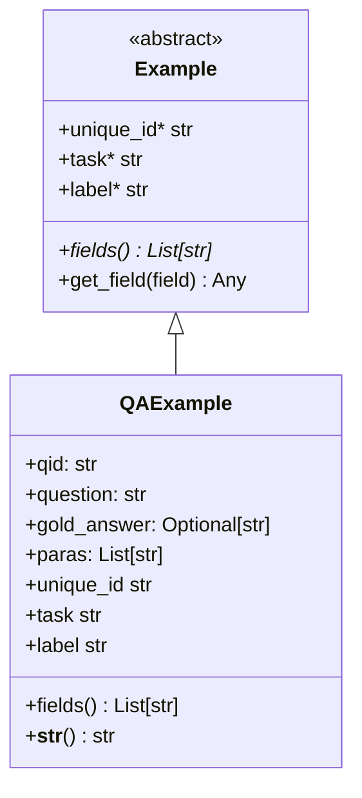
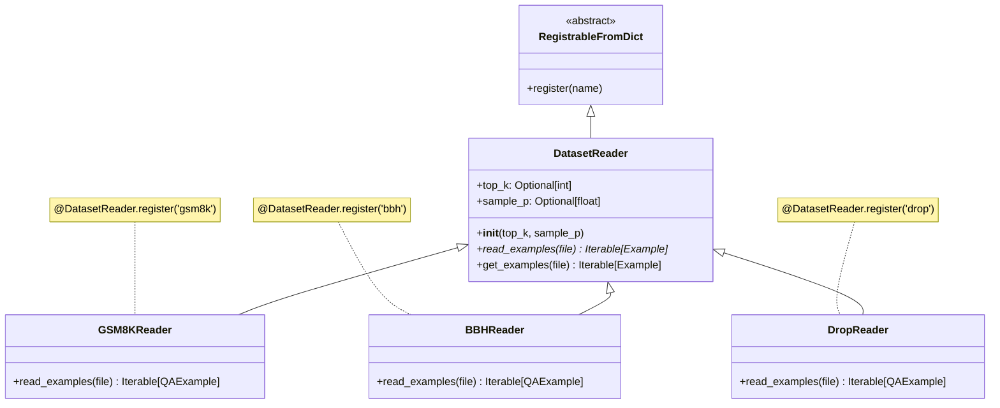
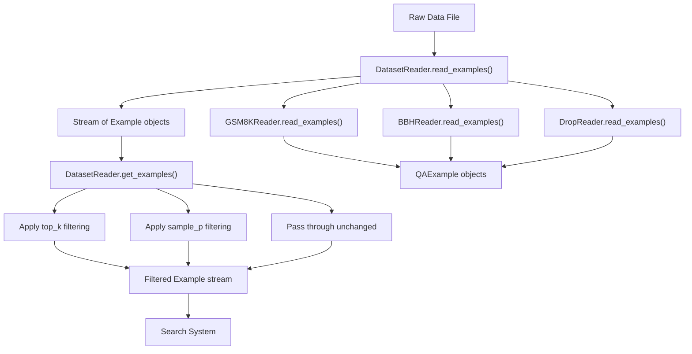
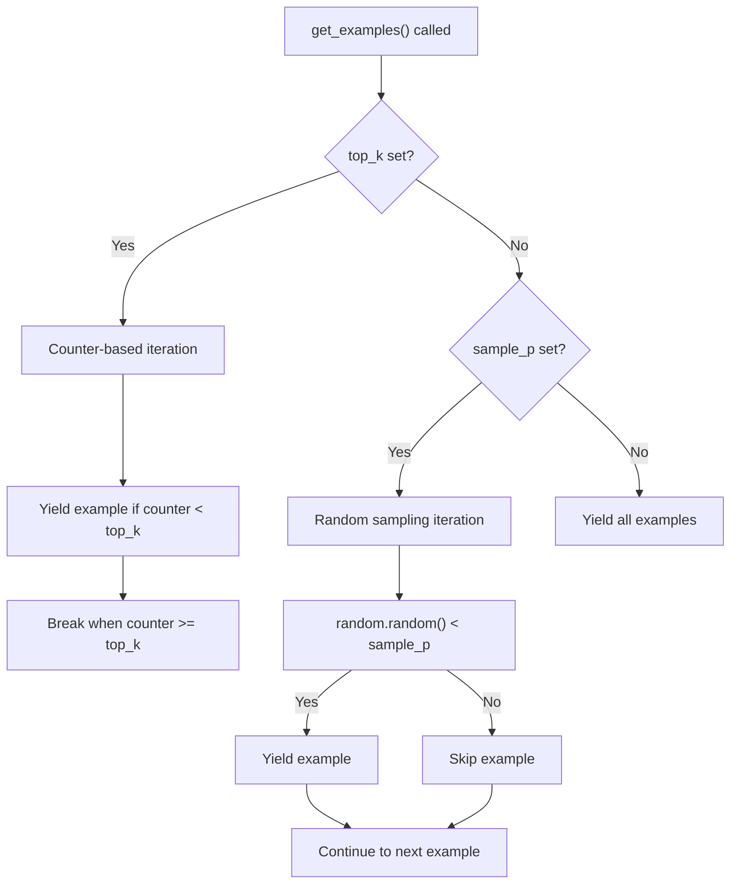
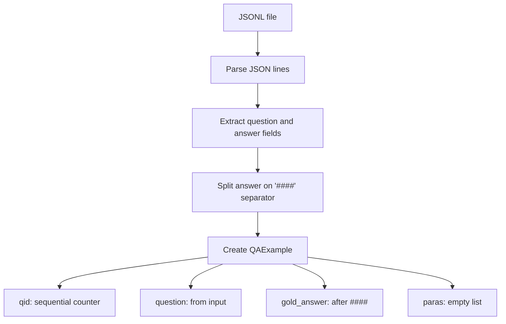
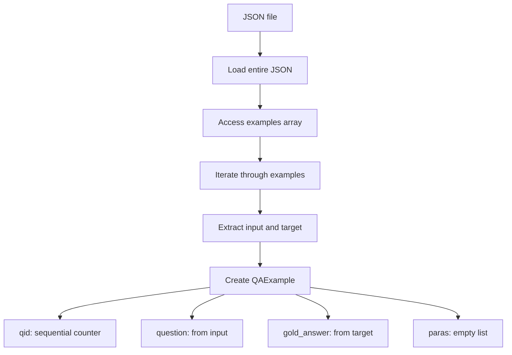
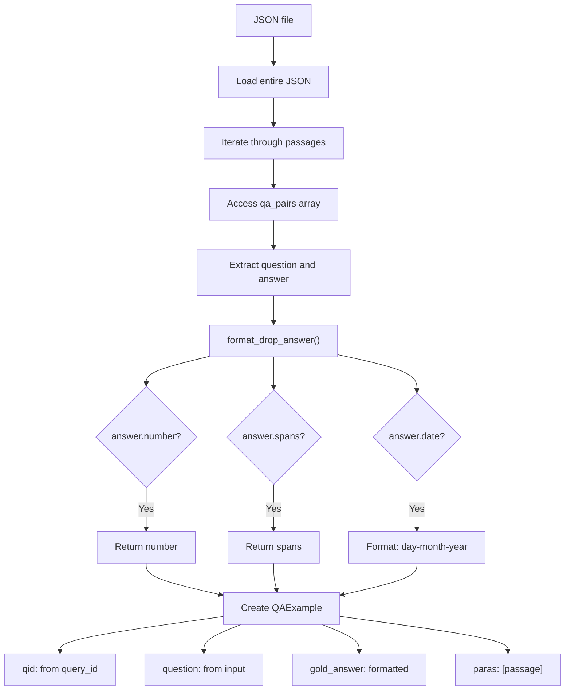
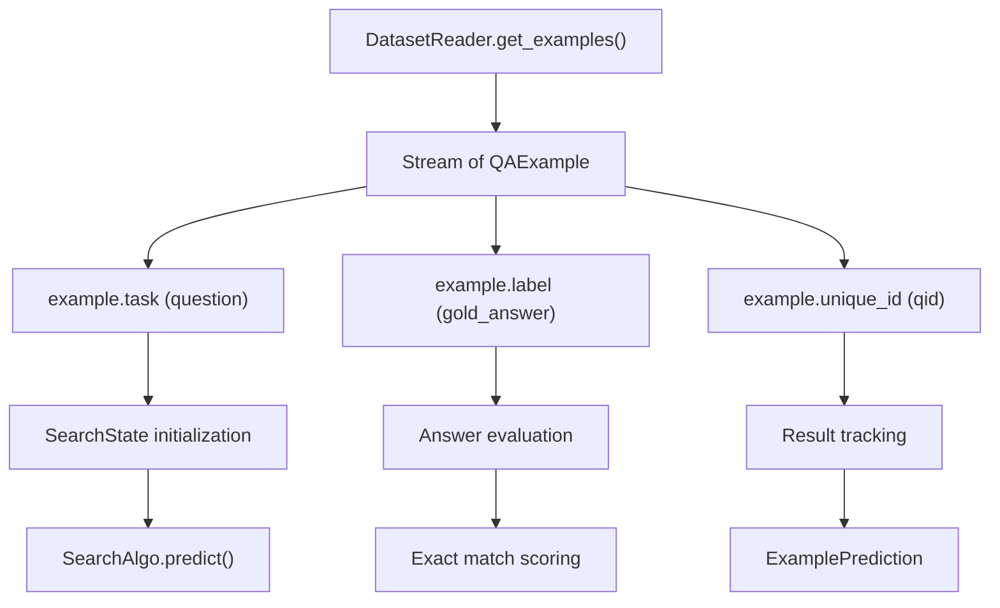

<!-- source: DeepWiki mcp.deepwiki.com · repo allenai/recoma · page 2.4 Dataset Reading Pipeline · fetched 2026-10-26 -->

# Dataset Reading Pipeline

Relevant source files

The following files were used as context for generating this wiki page:

- [recoma/datasets/bbh_reader.py](recoma/datasets/bbh_reader.py)
- [recoma/datasets/drop_reader.py](recoma/datasets/drop_reader.py)
- [recoma/datasets/gsm8k_reader.py](recoma/datasets/gsm8k_reader.py)
- [recoma/datasets/reader.py](recoma/datasets/reader.py)
- [recoma/search/README.md](recoma/search/README.md)

## Purpose and Scope

The Dataset Reading Pipeline is responsible for converting various dataset formats into standardized `Example` objects that can be consumed by ReComA's search system. This pipeline provides a unified interface for reading datasets while maintaining support for different data formats and filtering options.

For information about how these standardized examples are processed by the search system, see [Search System](#2.2). For details about the overall inference orchestration that coordinates dataset reading with model execution, see [Inference Orchestration](#2.1).

## Core Architecture

The dataset reading pipeline is built around two main abstractions: the `Example` base class that defines the structure of individual data points, and the `DatasetReader` base class that handles the conversion from raw data files to standardized examples.

### Example Base Class and QAExample

The `Example` abstract base class defines the contract that all data points must implement, providing methods for field access and key properties. The `QAExample` class is the concrete implementation used throughout ReComA for question-answering tasks.

Sources: [recoma/datasets/reader.py:11-65]()

### DatasetReader Registry System

The `DatasetReader` class extends `RegistrableFromDict` to provide a registry system where different readers can be registered with string identifiers. This allows configuration-driven instantiation of the appropriate reader for different datasets.

Sources: [recoma/datasets/reader.py:67-111](), [recoma/datasets/gsm8k_reader.py:6](), [recoma/datasets/bbh_reader.py:6](), [recoma/datasets/drop_reader.py:20]()

## Data Processing Flow

The dataset reading pipeline follows a consistent flow from raw data files to standardized examples:

The `read_examples` method handles the dataset-specific parsing logic, while `get_examples` applies common filtering operations across all dataset types.

Sources: [recoma/datasets/reader.py:82-111]()

## Data Filtering and Sampling

The `DatasetReader` base class provides two filtering mechanisms:

| Parameter | Purpose | Behavior |
|-----------|---------|----------|
| `top_k` | Limit dataset size | Returns only the first `k` examples |
| `sample_p` | Random sampling | Returns each example with probability `p` |

The filtering logic ensures that `top_k` takes precedence over `sample_p` when both are specified.

Sources: [recoma/datasets/reader.py:97-110]()

## Concrete Dataset Readers

### GSM8K Reader

The `GSM8KReader` processes the GSM8K mathematical reasoning dataset format:

The GSM8K format stores rationales and answers together, separated by `####`. The reader extracts only the final answer portion.

Sources: [recoma/datasets/gsm8k_reader.py:12-21]()

### BBH Reader

The `BBHReader` handles the Big-Bench Hard dataset format:

The BBH format uses `input` and `target` fields within an `examples` array structure.

Sources: [recoma/datasets/bbh_reader.py:22-30]()

### DROP Reader

The `DropReader` processes the DROP reading comprehension dataset with its complex answer format:

The DROP format supports multiple answer types (numbers, spans, dates) and includes passage text, requiring special formatting logic.

Sources: [recoma/datasets/drop_reader.py:7-34]()

## Integration with Search System

The dataset reading pipeline integrates with ReComA's search system through the standardized `Example` interface:

The `task` property provides the input for search initialization, while `label` and `unique_id` support evaluation and result tracking.

Sources: [recoma/datasets/reader.py:48-58]()

---

