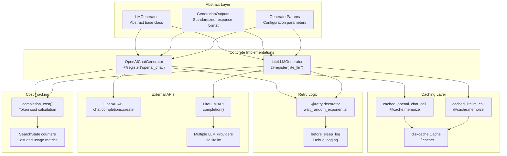
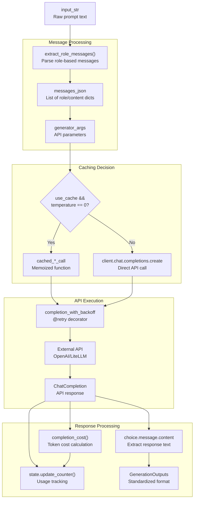

<!-- source: DeepWiki mcp.deepwiki.com · repo allenai/recoma · page 3 Language Model Integrations · fetched 2026-10-26 -->

# Language Model Integrations

<details>
<summary>Relevant source files</summary>

The following files were used as context for generating this wiki page:

- [recoma/models/impl/lite_llm_generator.py](recoma/models/impl/lite_llm_generator.py)
- [recoma/models/impl/openai_generators.py](recoma/models/impl/openai_generators.py)

</details>


This document covers ReComA's integration with various language model APIs and services. ReComA provides a unified abstraction layer for interacting with different language model providers, including OpenAI's API and multiple providers through LiteLLM. This page focuses on the core generator implementations, caching mechanisms, and API communication patterns.

For information about the base generator abstractions and registration system, see [Generator Base Classes](#3.3). For details on configuring specific models, see [Language Model Configurations](#6.1).

## Architecture Overview

ReComA's language model integration follows a layered architecture with abstract base classes, concrete implementations, and external API connections. The system provides caching, retry logic, cost tracking, and unified interfaces across different providers.

### Language Model Integration Architecture



Sources: [recoma/models/impl/openai_generators.py:1-99](), [recoma/models/impl/lite_llm_generator.py:1-107]()

## Core Components

### OpenAI Integration

The `OpenAIChatGenerator` class provides direct integration with OpenAI's chat completions API. It handles authentication, request formatting, response parsing, and includes specialized logic for different model types.

| Component | Purpose | Key Features |
|-----------|---------|--------------|
| `OpenAIChatGenerator` | Primary OpenAI API interface | Chat completions, caching, retry logic |
| `cached_openai_chat_call` | Caching wrapper | Memoization with parameter-based cache keys |
| `completion_with_backoff` | Retry mechanism | Exponential backoff with configurable attempts |

The implementation includes special handling for OpenAI's o1 models, which require different parameter names and constraints:

```python
if "o1" in self.model:
    generator_args["max_completion_tokens"] = generator_args.pop("max_tokens")
    generator_args["temperature"] = 1.0
    generator_args.pop("stop")
```

Sources: [recoma/models/impl/openai_generators.py:40-98]()

### LiteLLM Integration

The `LiteLLMGenerator` class provides access to multiple language model providers through the LiteLLM library. This enables ReComA to work with models from Anthropic, Google, local models, and other providers using a unified interface.

| Component | Purpose | Key Features |
|-----------|---------|--------------|
| `LiteLLMGenerator` | Multi-provider interface | Unified API across providers |
| `cached_litellm_call` | Caching wrapper | Provider-agnostic caching |
| `litellm.drop_params` | Parameter handling | Automatic parameter filtering |

The LiteLLM integration includes additional response processing to handle stop tokens that may not be properly enforced by all providers:

```python
for stop_t in self.generator_params.stop:
    if stop_t in text_response:
        stop_idx = text_response.index(stop_t)
        text_response = text_response[:stop_idx]
```

Sources: [recoma/models/impl/lite_llm_generator.py:43-106]()

## Request Processing Flow

The following diagram illustrates how requests flow through the language model integration system:

### Request Processing Pipeline



Sources: [recoma/models/impl/openai_generators.py:55-98](), [recoma/models/impl/lite_llm_generator.py:56-106]()

## Caching and Performance

Both integrations implement disk-based caching to reduce API calls and costs during development and repeated experiments. The caching system uses parameter-based keys to ensure cache validity.

### Caching Implementation

| Feature | OpenAI | LiteLLM | Purpose |
|---------|---------|---------|---------|
| Cache location | `~/.cache/gpt3calls` | `~/.cache/litellmcalls` | Separate cache directories |
| Cache condition | `temperature == 0` and not o1 models | `temperature == 0` | Deterministic responses only |
| Cache key | All generation parameters | All generation parameters | Parameter-based invalidation |
| Cache hits tracking | `cache_hit` global variable | `cache_hit` global variable | Performance monitoring |

The cache memoization decorators ignore specific parameters to ensure proper cache key generation:

```python
@cache.memoize(ignore=("client"))  # OpenAI
@cache.memoize()                   # LiteLLM
```

Sources: [recoma/models/impl/openai_generators.py:19-37](), [recoma/models/impl/lite_llm_generator.py:22-40]()

## Error Handling and Retry Logic

Both integrations use the `tenacity` library for robust error handling with exponential backoff. This ensures reliable operation despite network issues or rate limiting.

### Retry Configuration

| Parameter | Value | Purpose |
|-----------|--------|---------|
| `wait` | `wait_random_exponential(min=1, max=60)` | Exponential backoff with jitter |
| `stop` | `stop_after_attempt(10)` | Maximum retry attempts |
| `before_sleep` | `before_sleep_log(logger, logging.DEBUG)` | Debug logging between retries |

The retry mechanism is applied to wrapper functions that delegate to the appropriate API call:

```python
@retry(wait=wait_random_exponential(min=1, max=60), stop=stop_after_attempt(10),
       before_sleep=before_sleep_log(logger, logging.DEBUG))
def completion_with_backoff(self, function, **kwargs):
    return function(**kwargs)
```

Sources: [recoma/models/impl/openai_generators.py:50-53](), [recoma/models/impl/lite_llm_generator.py:51-54]()

## Usage Tracking and Cost Management

Both integrations provide comprehensive usage tracking through the `SearchState` counter system. This enables monitoring of costs, token usage, and cache performance across reasoning sessions.

### Tracked Metrics

| Metric Category | Examples | Purpose |
|-----------------|----------|---------|
| Cost tracking | `openai.gpt-4.cost`, `litellm.claude-3.cost` | Budget monitoring |
| Token usage | `prompt_tokens`, `completion_tokens`, `total_tokens` | Usage analysis |
| API calls | `openai.gpt-4.calls`, `litellm.gemini.calls` | Request counting |
| Cache performance | `openai.gpt-4.cache_hit`, `litellm.claude.cache_hit` | Cache efficiency |

The cost calculation uses the `completion_cost` function from LiteLLM, which provides pricing information for various model providers:

```python
try:
    cost = completion_cost(response)
    state.update_counter("openai.{}.cost".format(self.model), cost)
except:
    # Unknown model - cost tracking not available
    pass
```

Sources: [recoma/models/impl/openai_generators.py:78-92](), [recoma/models/impl/lite_llm_generator.py:73-86]()

---

