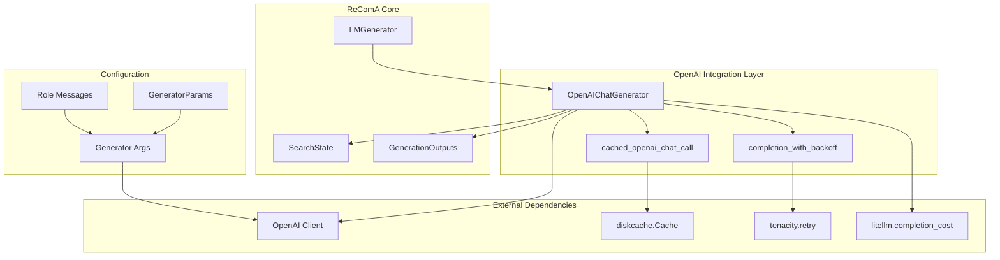
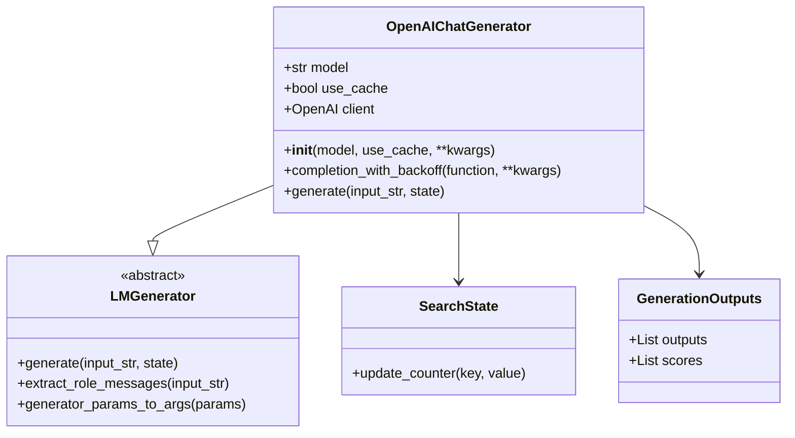
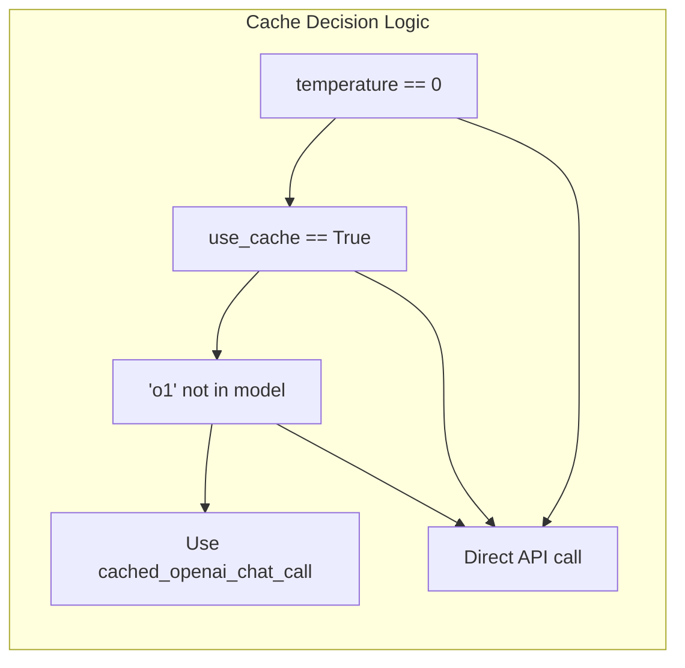
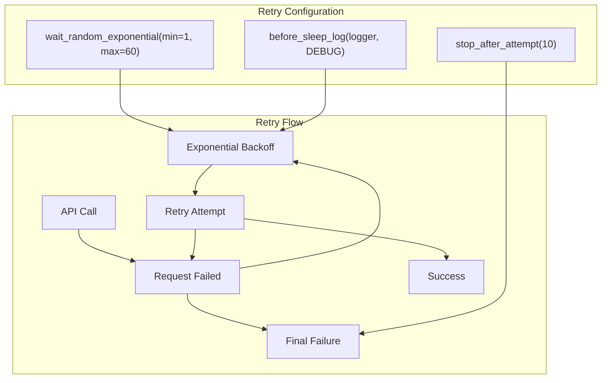
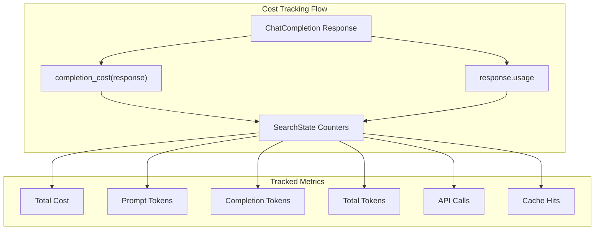
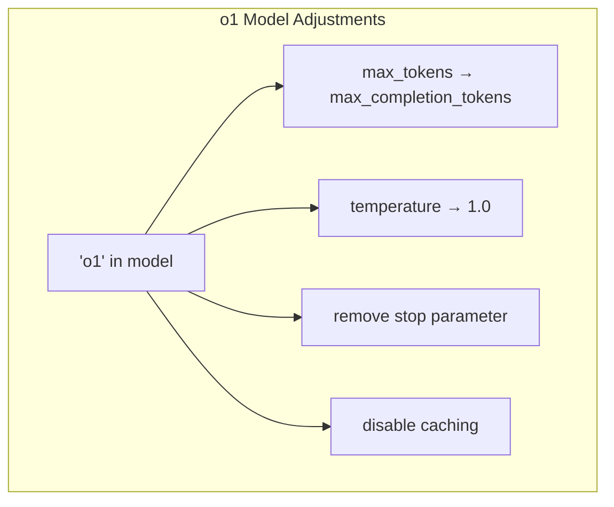
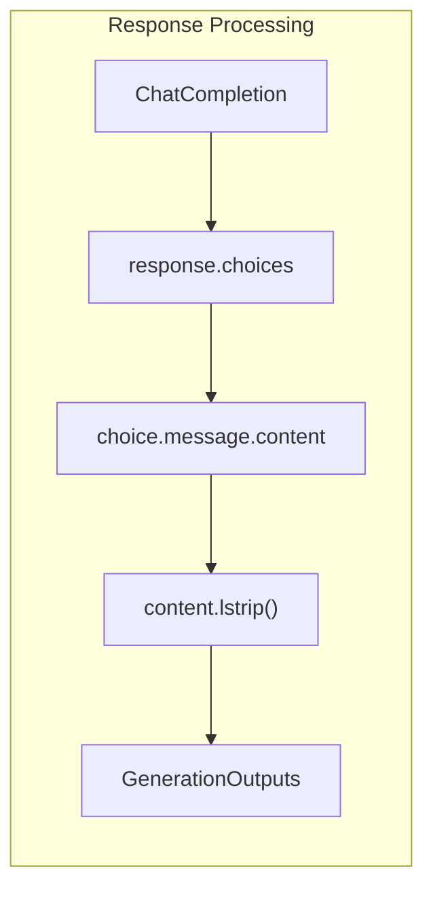

<!-- source: DeepWiki mcp.deepwiki.com · repo allenai/recoma · page 3.1 OpenAI Integration · fetched 2026-10-26 -->

# OpenAI Integration

Relevant source files

The following files were used as context for generating this wiki page:

- [recoma/models/impl/openai_generators.py](recoma/models/impl/openai_generators.py)

This page documents ReComA's integration with OpenAI's chat completion API, including the `OpenAIChatGenerator` class, caching mechanisms, retry logic, and cost tracking features. The OpenAI integration is one of the core language model providers in ReComA's model system.

For information about other language model integrations, see [LiteLLM Integration](#3.2). For the underlying generator abstractions, see [Generator Base Classes](#3.3).

## Overview

The OpenAI integration provides a production-ready interface to OpenAI's chat completion API with built-in caching, retry logic, and comprehensive cost tracking. The `OpenAIChatGenerator` class implements the `LMGenerator` interface and is registered as `"openai_chat"` in the model registry.

### Key Features

| Feature | Description |
|---------|-------------|
| **Caching** | Disk-based caching for deterministic calls using `diskcache` |
| **Retry Logic** | Exponential backoff with configurable attempts using `tenacity` |
| **Cost Tracking** | Real-time cost calculation and token usage monitoring |
| **Model Support** | Full OpenAI model support including special handling for o1 models |
| **State Integration** | Automatic metrics collection in `SearchState` |

Sources: [recoma/models/impl/openai_generators.py:1-99]()

## Architecture Overview

Sources: [recoma/models/impl/openai_generators.py:40-98]()

## Class Implementation

### OpenAIChatGenerator

The `OpenAIChatGenerator` class is the main implementation of the OpenAI integration:

The class constructor initializes the OpenAI client and stores configuration parameters [recoma/models/impl/openai_generators.py:43-48](). The `generate` method handles the complete request lifecycle including message formatting, caching, retry logic, and response processing.

Sources: [recoma/models/impl/openai_generators.py:40-98]()

## Caching System

### Cache Implementation

The caching system uses `diskcache` to store responses for deterministic calls:

The cache is initialized with a user-specific directory path [recoma/models/impl/openai_generators.py:16]() and uses the `@cache.memoize` decorator to automatically cache function calls based on input parameters [recoma/models/impl/openai_generators.py:19-37]().

Cache hits are tracked using a global variable and recorded in the search state for monitoring purposes [recoma/models/impl/openai_generators.py:84-85]().

Sources: [recoma/models/impl/openai_generators.py:16-37](), [recoma/models/impl/openai_generators.py:62-69]()

## Retry Logic and Error Handling

### Exponential Backoff

The retry mechanism uses `tenacity` with exponential backoff:

The `completion_with_backoff` method wraps the OpenAI API call with retry logic [recoma/models/impl/openai_generators.py:50-53](), providing resilience against transient API failures.

Sources: [recoma/models/impl/openai_generators.py:50-53]()

## Cost and Usage Tracking

### Metrics Collection

The OpenAI integration automatically tracks various metrics in the `SearchState`:

| Metric Type | Counter Key | Description |
|-------------|-------------|-------------|
| **Cost** | `openai.{model}.cost` | Total API cost in USD |
| **Calls** | `openai.{model}.calls` | Number of API calls made |
| **Cache Hits** | `openai.{model}.cache_hit` | Number of cache hits |
| **Token Usage** | `openai.{model}.{usage_key}` | Token counts by type |

The cost calculation uses the `litellm.completion_cost` function [recoma/models/impl/openai_generators.py:79-83](), and usage statistics are extracted from the response object [recoma/models/impl/openai_generators.py:88-92]().

Sources: [recoma/models/impl/openai_generators.py:79-92]()

## Special Model Handling

### o1 Model Support

The OpenAI integration includes special handling for o1 models, which have different parameter requirements:

The special handling includes:
- Renaming `max_tokens` to `max_completion_tokens` [recoma/models/impl/openai_generators.py:73]()
- Setting temperature to 1.0 [recoma/models/impl/openai_generators.py:74]()
- Removing the `stop` parameter [recoma/models/impl/openai_generators.py:75]()
- Disabling caching for o1 models [recoma/models/impl/openai_generators.py:63]()

Sources: [recoma/models/impl/openai_generators.py:71-76]()

## Response Processing

### Output Generation

The response processing converts OpenAI's `ChatCompletion` objects into `GenerationOutputs`:

The processing handles multiple choices in the response and strips leading whitespace from the content [recoma/models/impl/openai_generators.py:93-97]().

Sources: [recoma/models/impl/openai_generators.py:93-97]()

## Configuration and Registration

The `OpenAIChatGenerator` is registered with the model registry using the `@LMGenerator.register("openai_chat")` decorator [recoma/models/impl/openai_generators.py:40](), making it available for use in configuration files and programmatic instantiation.

The class accepts standard generator parameters through the `**kwargs` mechanism and inherits parameter processing from the base `LMGenerator` class.

Sources: [recoma/models/impl/openai_generators.py:40-48]()

---

