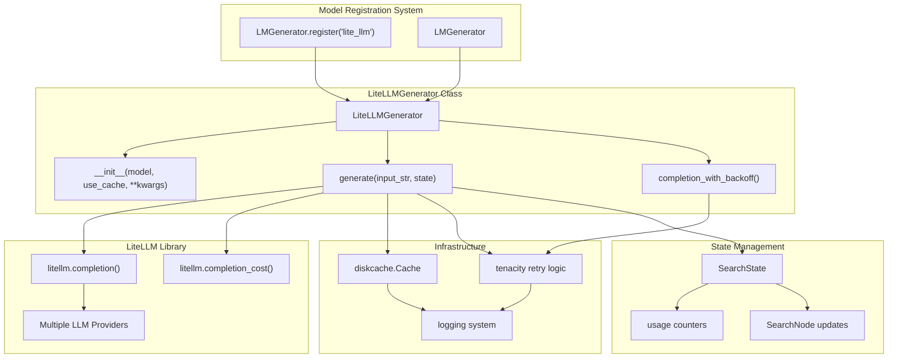
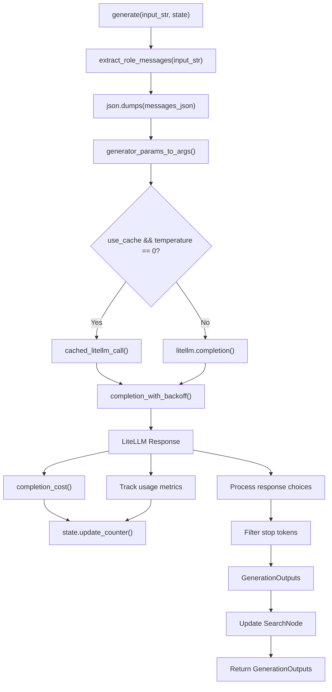
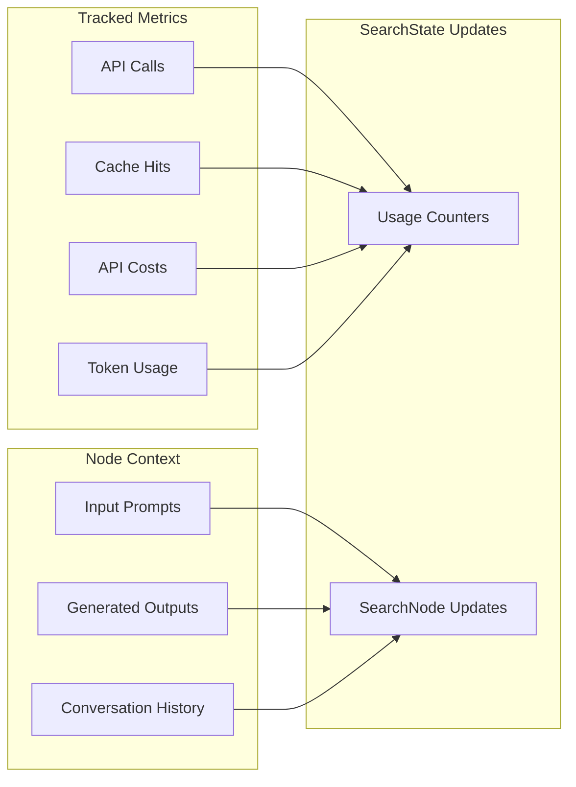

<!-- source: DeepWiki mcp.deepwiki.com · repo allenai/recoma · page 3.2 LiteLLM Integration · fetched 2026-10-26 -->

# LiteLLM Integration

<details>
<summary>Relevant source files</summary>

The following files were used as context for generating this wiki page:

- [recoma/models/impl/lite_llm_generator.py](recoma/models/impl/lite_llm_generator.py)

</details>


This document covers how ReComA integrates with LiteLLM to provide a unified interface for multiple language model providers. The LiteLLM integration enables ReComA to work with various LLM APIs through a single consistent interface, including OpenAI, Anthropic, Google, and many others supported by the LiteLLM library.

For information about the OpenAI-specific integration, see [OpenAI Integration](#3.1). For details about the base generator abstractions, see [Generator Base Classes](#3.3).

## Architecture Overview

The LiteLLM integration is implemented through the `LiteLLMGenerator` class, which extends the base `LMGenerator` abstraction to provide access to multiple LLM providers through LiteLLM's unified API.

### LiteLLM Generator Architecture



Sources: [recoma/models/impl/lite_llm_generator.py:1-107]()

## Key Features

### Multi-Provider Support

The `LiteLLMGenerator` leverages LiteLLM's ability to provide a unified interface across multiple language model providers. The specific provider is determined by the `model` parameter passed during initialization.

### Caching System

The integration includes a sophisticated caching mechanism:

- **Disk Cache**: Uses `diskcache.Cache` to store responses locally at `~/.cache/litellmcalls`
- **Conditional Caching**: Only caches responses when `use_cache=True` and `temperature=0`
- **Cache Hit Tracking**: Tracks cache hits vs. API calls for monitoring

### Retry Logic

Robust retry handling is implemented using the `tenacity` library:

- **Exponential Backoff**: Waits between 1-60 seconds with exponential backoff
- **Maximum Attempts**: Retries up to 10 times before failing
- **Debug Logging**: Logs retry attempts for debugging

### Cost and Usage Tracking

The system tracks detailed usage metrics:

| Metric Type | Description | Counter Key |
|-------------|-------------|-------------|
| API Calls | Number of API requests | `litellm.{model}.calls` |
| Cache Hits | Number of cache hits | `litellm.{model}.cache_hit` |
| Cost | Total cost in dollars | `litellm.{model}.cost` |
| Tokens | Completion, prompt, and total tokens | `litellm.{model}.{token_type}` |

## Generation Process Flow



Sources: [recoma/models/impl/lite_llm_generator.py:56-106]()

## Configuration and Usage

### Basic Configuration

The `LiteLLMGenerator` is registered with the identifier `"lite_llm"` and can be configured in JSONNET files:

```jsonnet
{
  model: {
    type: "lite_llm",
    model: "gpt-3.5-turbo",  // or any LiteLLM-supported model
    use_cache: true,
    // other LMGenerator parameters...
  }
}
```

### Supported Parameters

| Parameter | Type | Description |
|-----------|------|-------------|
| `model` | string | LiteLLM model identifier |
| `use_cache` | boolean | Enable/disable caching |
| `**kwargs` | various | Additional LMGenerator parameters |

### Model Identifiers

The `model` parameter accepts any model identifier supported by LiteLLM, including:

- OpenAI: `gpt-4`, `gpt-3.5-turbo`, etc.
- Anthropic: `claude-3-opus`, `claude-3-sonnet`, etc.
- Google: `gemini-pro`, `gemini-1.5-pro`, etc.
- Local models: `ollama/llama2`, `huggingface/model-name`, etc.

## Implementation Details

### Message Processing

The generator processes input through several steps:

1. **Message Extraction**: Converts input string to role-based messages using `extract_role_messages()`
2. **Parameter Mapping**: Maps generator parameters to LiteLLM arguments via `generator_params_to_args()`
3. **API Call**: Makes cached or direct API calls based on configuration

### Error Handling

The implementation includes robust error handling:

- **Unknown Models**: Gracefully handles cost calculation failures for unsupported models
- **Stop Token Processing**: Manually filters stop tokens from responses when LiteLLM doesn't handle them properly
- **Retry Logic**: Automatically retries failed requests with exponential backoff

### State Integration



Sources: [recoma/models/impl/lite_llm_generator.py:73-105]()

## Integration with Search System

The `LiteLLMGenerator` integrates seamlessly with ReComA's search system by:

1. **State Updates**: Automatically updates search state counters for monitoring
2. **Node Enhancement**: Adds input/output prompts to search nodes for visualization
3. **Cost Tracking**: Enables cost-based early stopping conditions
4. **Usage Monitoring**: Provides detailed metrics for search optimization

The integration maintains consistency with other generators in the system while providing access to the broader ecosystem of language models available through LiteLLM.

Sources: [recoma/models/impl/lite_llm_generator.py:1-107]()

---

