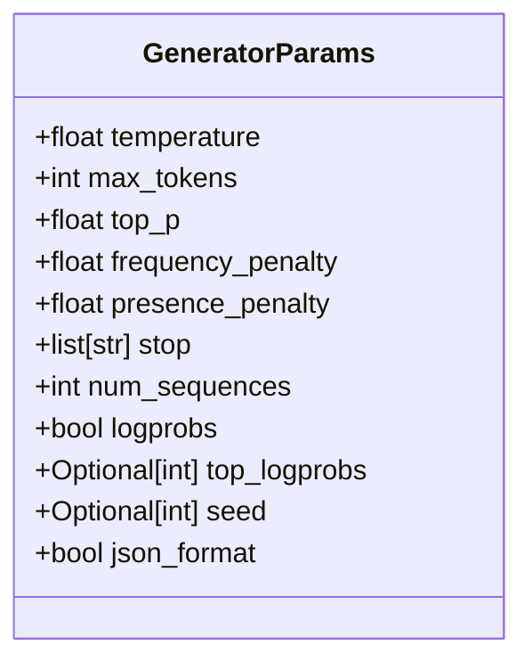
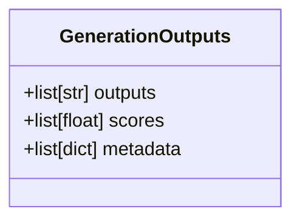
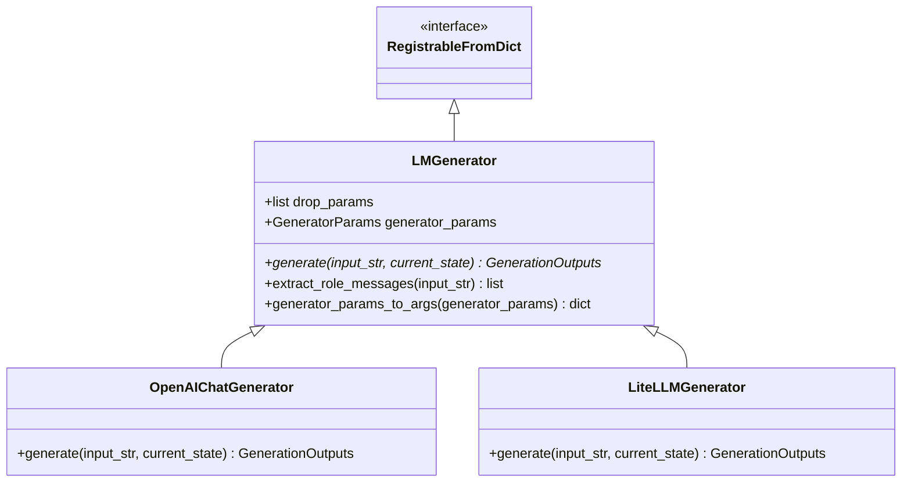
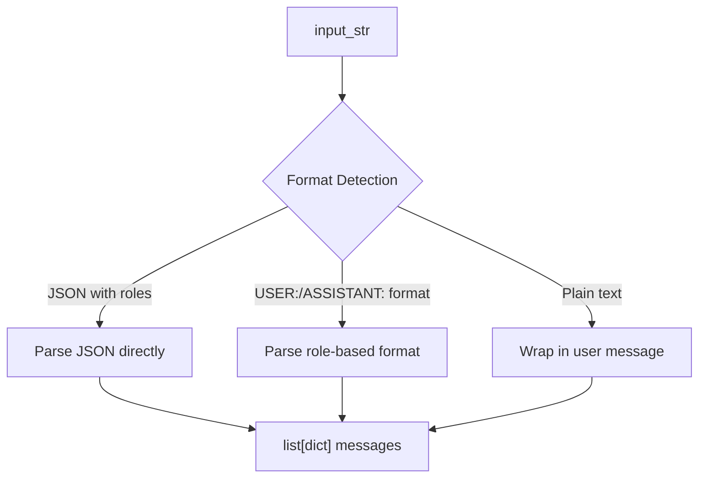
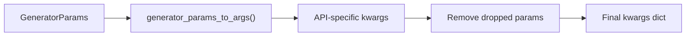
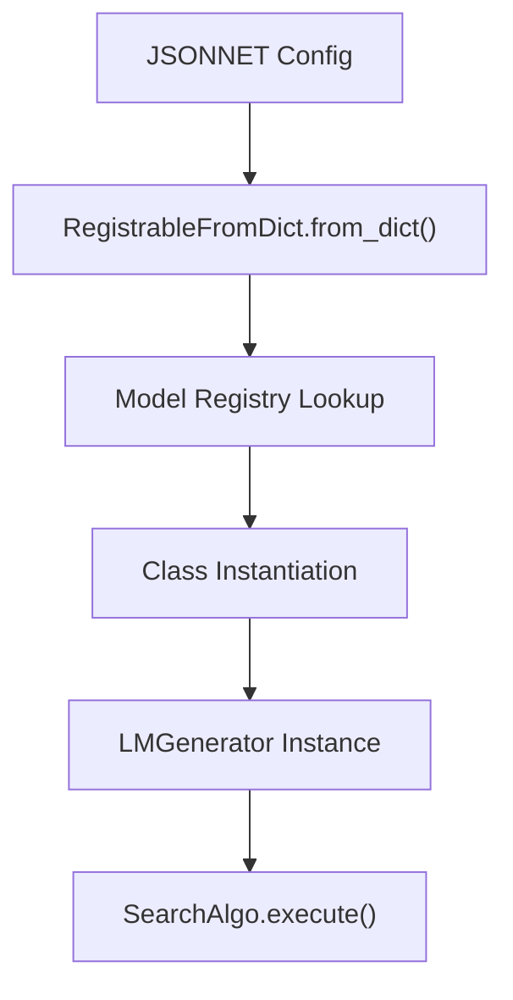

<!-- source: DeepWiki mcp.deepwiki.com · repo allenai/recoma · page 3.3 Generator Base Classes · fetched 2026-10-26 -->

# Generator Base Classes

<details>
<summary>Relevant source files</summary>

The following files were used as context for generating this wiki page:

- [recoma/models/core/generator.py](recoma/models/core/generator.py)

</details>


This page covers the foundational abstractions that enable ReComA to integrate with various language model APIs and services. The generator base classes define the common interface and data structures that all language model integrations must implement.

For specific language model implementations, see [OpenAI Integration](#3.1) and [LiteLLM Integration](#3.2). For higher-level reasoning patterns that use these generators, see [Reasoning Controllers](#4).

## Core Data Structures

ReComA defines two primary data structures for managing language model generation parameters and outputs.

### GeneratorParams

The `GeneratorParams` dataclass standardizes configuration parameters across different language model providers:



| Parameter | Type | Default | Purpose |
|-----------|------|---------|---------|
| `temperature` | float | 0 | Controls randomness in generation |
| `max_tokens` | int | 100 | Maximum tokens to generate |
| `top_p` | float | 1 | Nucleus sampling parameter |
| `frequency_penalty` | float | 0 | Reduces repetition of frequent tokens |
| `presence_penalty` | float | 0 | Reduces repetition of any tokens |
| `stop` | list[str] | ["\n"] | Stop sequences to end generation |
| `num_sequences` | int | 1 | Number of completions to generate |
| `logprobs` | bool | False | Whether to return log probabilities |
| `top_logprobs` | Optional[int] | None | Number of top logprobs to return |
| `seed` | Optional[int] | None | Random seed for reproducibility |
| `json_format` | bool | False | Whether to enforce JSON output format |

Sources: [recoma/models/core/generator.py:12-26]()

### GenerationOutputs

The `GenerationOutputs` dataclass provides a consistent structure for language model responses:



- `outputs`: List of generated text completions
- `scores`: Optional confidence scores for each output
- `metadata`: Additional provider-specific information

Sources: [recoma/models/core/generator.py:28-33]()

## LMGenerator Abstract Base Class

The `LMGenerator` class serves as the foundation for all language model integrations in ReComA. It extends `RegistrableFromDict` to enable automatic registration and configuration from dictionaries.



### Core Methods

#### generate()

The abstract `generate()` method must be implemented by all subclasses:

```python
def generate(self, input_str: str, current_state: SearchState) -> GenerationOutputs
```

This method takes an input string and the current search state, returning structured generation outputs. The search state provides context for tracking generation costs, managing caching, and maintaining conversation history.

Sources: [recoma/models/core/generator.py:45-51]()

#### extract_role_messages()

The `extract_role_messages()` method parses various input formats into standardized message structures:



The method handles three input formats:
1. JSON strings with explicit role-based messages
2. Text with `USER:`, `ASSISTANT:`, and `SYSTEM:` prefixes
3. Plain text (wrapped as a user message)

Sources: [recoma/models/core/generator.py:53-76]()

#### generator_params_to_args()

The `generator_params_to_args()` method converts the standardized `GeneratorParams` into API-specific keyword arguments:



This method:
- Maps standard parameter names to API-specific names
- Handles JSON format requests by setting `response_format`
- Removes parameters specified in `drop_params` for API compatibility
- Ensures consistent parameter handling across different providers

Sources: [recoma/models/core/generator.py:78-98]()

## Registration System Integration

The generator base classes integrate with ReComA's registration system to enable dynamic model loading from configuration files. The `LMGenerator` class inherits from `RegistrableFromDict`, allowing models to be registered with string identifiers and instantiated from JSONNET configurations.



This pattern enables the search system to dynamically instantiate and coordinate different language model implementations based on configuration, supporting the flexible multi-model reasoning capabilities of ReComA.

Sources: [recoma/models/core/generator.py:35-44]()

## Integration with Search System

The generator base classes are designed to work seamlessly with ReComA's search-based reasoning system. The `generate()` method receives a `SearchState` parameter that provides:

- Access to conversation history and context
- Cost tracking for budget management
- Caching mechanisms for efficiency
- State-specific metadata for debugging

This integration allows language model generators to participate in the broader search process while maintaining clean abstractions between the search logic and model implementations.

Sources: [recoma/models/core/generator.py:8](), [recoma/models/core/generator.py:46]()

---

