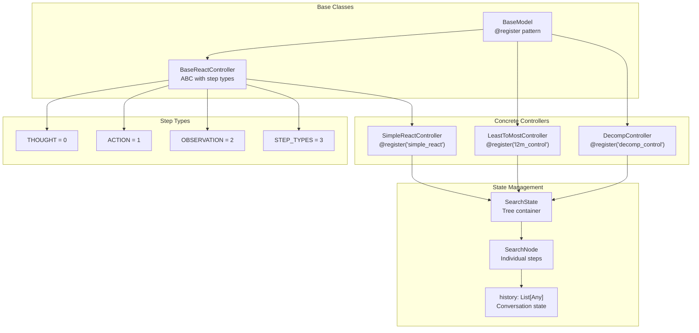
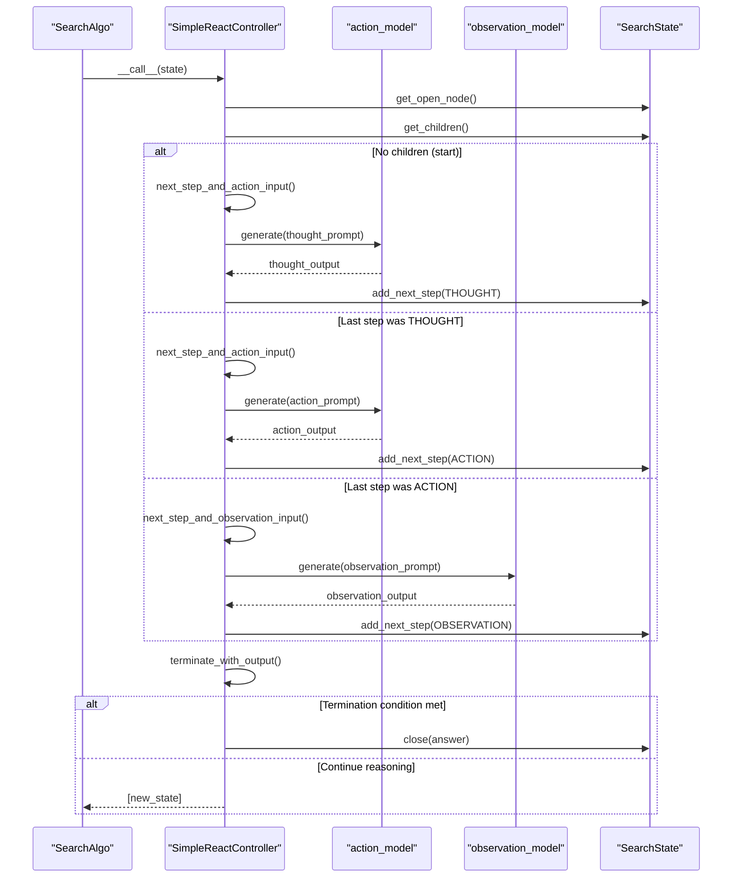
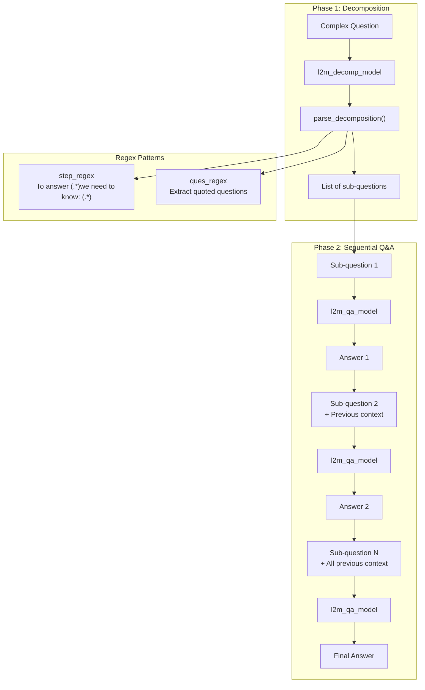
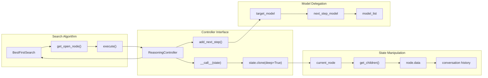

<!-- source: DeepWiki mcp.deepwiki.com · repo allenai/recoma · page 4 Reasoning Controllers · fetched 2026-10-26 -->

# Reasoning Controllers

<details>
<summary>Relevant source files</summary>

The following files were used as context for generating this wiki page:

- [configs/inference/drop/react.jsonnet](configs/inference/drop/react.jsonnet)
- [configs/prompts/gsm8k/l2m_qa.txt](configs/prompts/gsm8k/l2m_qa.txt)
- [configs/prompts/letter_cat/l2m_qa.txt](configs/prompts/letter_cat/l2m_qa.txt)
- [recoma/models/core/__init__.py](recoma/models/core/__init__.py)
- [recoma/models/core/base_react_controller.py](recoma/models/core/base_react_controller.py)
- [recoma/models/impl/__init__.py](recoma/models/impl/__init__.py)
- [recoma/models/impl/l2m_controller.py](recoma/models/impl/l2m_controller.py)
- [recoma/models/impl/react_controller.py](recoma/models/impl/react_controller.py)

</details>


Reasoning controllers are specialized models that implement structured reasoning patterns within the ReComA framework. They coordinate multiple language model calls through systematic approaches like thought-action-observation loops, problem decomposition, and question-answer synthesis. Unlike simple language model generators, reasoning controllers maintain state across multiple inference steps and orchestrate complex multi-step reasoning workflows.

For information about the base model system and registration, see [Model System Architecture](#2.3). For details on language model generators, see [Language Model Integrations](#3).

## Controller Architecture

Reasoning controllers in ReComA extend the `BaseModel` class and implement specialized logic for multi-step reasoning patterns. They integrate with the search system to create branching reasoning paths and maintain conversation state across multiple model invocations.



**Controller Types Overview**

| Controller | Registration Key | Primary Pattern | Use Case |
|------------|------------------|-----------------|----------|
| `SimpleReactController` | `simple_react` | Thought-Action-Observation | Interactive reasoning with tool usage |
| `LeastToMostController` | `l2m_control` | Problem decomposition | Breaking complex questions into sub-questions |
| `DecompController` | `decomp_control` | Question decomposition | General Q&A orchestration |

Sources: [recoma/models/core/base_react_controller.py:8-12](), [recoma/models/impl/react_controller.py:19-20](), [recoma/models/impl/l2m_controller.py:7-8](), [recoma/models/impl/__init__.py:1-6]()

## React Controller Pattern

The React (Reasoning-Action) pattern implements a structured dialogue between thinking, acting, and observing. The `SimpleReactController` maintains conversation history and alternates between generating thoughts, actions, and observations.



The controller uses configurable prefixes and regex patterns to structure the conversation:

- `thought_prefix`: Prefix for thought statements (default: "Thought:")
- `action_prefix`: Prefix for action statements (default: "Action:")
- `obs_prefix`: Prefix for observation statements (default: "Observation:")
- `eoq_re`: Regex pattern for termination (default: "Finish\\[(.*)\\]")

Sources: [recoma/models/impl/react_controller.py:25-31](), [recoma/models/core/base_react_controller.py:111-135](), [recoma/models/impl/react_controller.py:33-57]()

## Least-to-Most Controller Pattern

The `LeastToMostController` implements problem decomposition by breaking complex questions into simpler sequential sub-questions. It operates in two phases: decomposition and question-answering.



The controller maintains the decomposition state in the node data and builds contextual prompts for each sub-question by accumulating previous question-answer pairs.

**Key Implementation Details:**

- **Decomposition Parsing**: Uses `step_regex` to extract the main question and sub-questions from the decomposition model output
- **Context Building**: Accumulates previous Q&A pairs to provide context for subsequent questions
- **State Management**: Stores parsed questions in `current_node.data["questions"]` for persistence across calls

Sources: [recoma/models/impl/l2m_controller.py:20-32](), [recoma/models/impl/l2m_controller.py:34-77](), [recoma/models/impl/l2m_controller.py:10-18]()

## Integration with Search System

Reasoning controllers integrate seamlessly with the search system by implementing the `BaseModel.__call__` interface. They receive a `SearchState`, manipulate it to add new reasoning steps, and return updated states for the search algorithm to process.



**State Management Operations:**

- `state.get_open_node()`: Retrieves the current node being processed
- `state.get_children()`: Gets child nodes for history reconstruction
- `state.add_next_step()`: Creates new reasoning steps with specified models
- `node.data`: Persistent storage for controller-specific state (history, questions, etc.)
- `node.close()`: Marks a node as complete with final output

Sources: [recoma/models/core/base_react_controller.py:60-78](), [recoma/models/impl/l2m_controller.py:34-77](), [recoma/search/state.py]()

## Configuration and Usage

Reasoning controllers are configured through JSONNET files that specify the controller type, associated models, and parameters. They integrate with the search system's model registry and can be chained with other models.

**React Controller Configuration Example:**

```json
{
  "models": {
    "drop_react": {
      "type": "simple_react",
      "action_model": "react_lm",
      "observation_model": "qa"
    },
    "react_lm": {
      "type": "prompted_lm",
      "prompt_file": "configs/prompts/drop/react.txt"
    }
  },
  "search": {
    "type": "best_first",
    "start_model": "drop_react"
  }
}
```

**Least-to-Most Controller Configuration:**

The L2M controller requires two specialized models for decomposition and question-answering phases, typically configured with task-specific prompts that demonstrate the expected input/output format.

Sources: [configs/inference/drop/react.jsonnet:1-38](), [configs/prompts/gsm8k/l2m_qa.txt:1-24](), [configs/prompts/letter_cat/l2m_qa.txt:1-19]()

---

