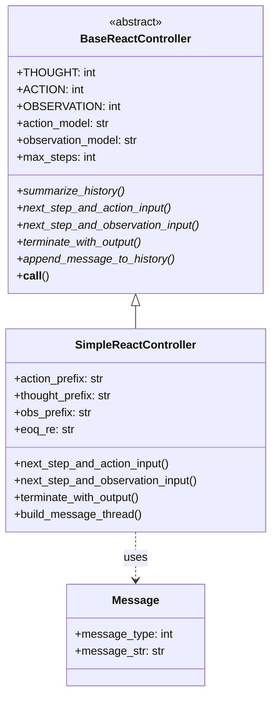
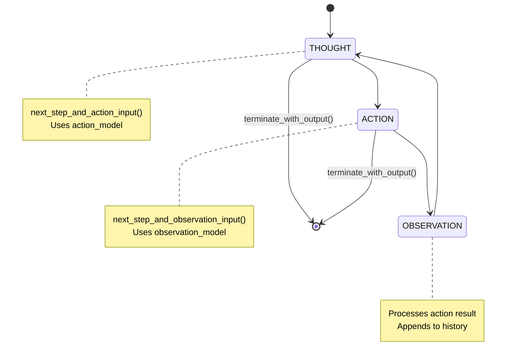
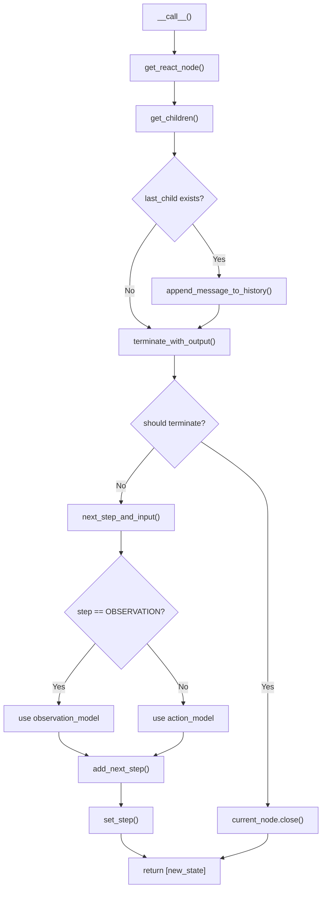

<!-- source: DeepWiki mcp.deepwiki.com · repo allenai/recoma · page 4.1 React Controller · fetched 2026-10-26 -->

# React Controller

<details>
<summary>Relevant source files</summary>

The following files were used as context for generating this wiki page:

- [configs/inference/drop/react.jsonnet](configs/inference/drop/react.jsonnet)
- [recoma/models/core/__init__.py](recoma/models/core/__init__.py)
- [recoma/models/core/base_react_controller.py](recoma/models/core/base_react_controller.py)
- [recoma/models/impl/__init__.py](recoma/models/impl/__init__.py)
- [recoma/models/impl/react_controller.py](recoma/models/impl/react_controller.py)

</details>


## Purpose and Scope

The React Controller implements the Thought-Action-Observation reasoning pattern within the ReComA framework. This controller orchestrates a multi-step reasoning process where a language model alternates between thinking about a problem, taking actions, and observing the results of those actions. The React Controller is one of several reasoning controllers available in ReComA; for problem decomposition approaches, see [Least-to-Most Controller](#4.2) and [Decomposition Controller](#4.3).

## Overview

The React Controller implements the ReAct (Reasoning and Acting) paradigm, which structures language model reasoning as a cyclical process:

1. **Thought**: The model reasons about the current state and decides what to do next
2. **Action**: The model takes a specific action (like querying a tool or making a calculation)  
3. **Observation**: The model observes the result of the action and incorporates it into its reasoning

This pattern enables language models to interact with external tools and maintain longer reasoning chains while staying grounded in observable results.

## Architecture and Components

### Class Hierarchy



**Sources**: [recoma/models/core/base_react_controller.py:1-136](), [recoma/models/impl/react_controller.py:1-102]()

### Step Flow and State Management



**Sources**: [recoma/models/core/base_react_controller.py:100-135](), [recoma/models/impl/react_controller.py:33-57]()

## Implementation Details

### Base React Controller

The `BaseReactController` class provides the foundational abstract interface and shared functionality:

| Component | Purpose | Key Methods |
|-----------|---------|-------------|
| **Step Constants** | Define reasoning stages | `THOUGHT`, `ACTION`, `OBSERVATION` |
| **Model References** | Connect to action/observation models | `action_model`, `observation_model` |
| **History Management** | Track conversation state | `get_history()`, `append_message_to_history()` |
| **Step Coordination** | Orchestrate reasoning flow | `next_step_and_input()`, `__call__()` |
| **Termination Logic** | Determine when to stop | `terminate_with_output()` |

The controller maintains conversation history in the search node's data structure and coordinates between different models based on the current step type.

**Sources**: [recoma/models/core/base_react_controller.py:8-136]()

### Simple React Controller

The `SimpleReactController` provides a concrete implementation with structured message formatting:



**Sources**: [recoma/models/core/base_react_controller.py:111-135](), [recoma/models/impl/react_controller.py:33-101]()

### Message Structure and Formatting

The `SimpleReactController` uses a structured `Message` class to track conversation history:

| Field | Type | Purpose |
|-------|------|---------|
| `message_type` | `int` | One of `THOUGHT`, `ACTION`, `OBSERVATION` |
| `message_str` | `str` | The actual message content |

The controller formats messages with configurable prefixes and can optionally add role markers for chat-based models. The `build_message_thread()` method [recoma/models/impl/react_controller.py:70-87]() constructs the conversation string by iterating through the message history and applying appropriate formatting.

**Sources**: [recoma/models/impl/react_controller.py:13-17](), [recoma/models/impl/react_controller.py:70-87]()

## Configuration and Usage

### Model Configuration

The React Controller requires configuration of two key models:

```json
{
  "drop_react": {
    "type": "simple_react",
    "action_model": "react_lm",
    "observation_model": "qa"
  },
  "react_lm": {
    "type": "prompted_lm",
    "prompt_file": "configs/prompts/drop/react.txt"
  }
}
```

| Parameter | Purpose | Example |
|-----------|---------|---------|
| `action_model` | Handles thought and action steps | `"react_lm"` |
| `observation_model` | Processes observations | `"qa"` |
| `max_steps` | Limits reasoning depth | `100` |
| `action_prefix` | Formats action messages | `"Action:"` |
| `thought_prefix` | Formats thought messages | `"Thought:"` |
| `obs_prefix` | Formats observation messages | `"Observation:"` |
| `eoq_re` | Regex for termination detection | `"Finish\\[(.*)\\]"` |

**Sources**: [configs/inference/drop/react.jsonnet:1-38](), [recoma/models/impl/react_controller.py:25-31]()

### Registration and Integration

The React Controller integrates with ReComA's model registry system:

```python
@BaseModel.register("simple_react")
class SimpleReactController(BaseReactController):
```

This registration allows the controller to be instantiated through configuration files and integrated into the search system. The controller returns new search states that continue the reasoning process until termination conditions are met.

**Sources**: [recoma/models/impl/react_controller.py:19-20](), [recoma/models/impl/__init__.py:5]()

## Integration with Search System

### Search State Management

The React Controller operates within ReComA's search framework by:

1. **Receiving Search States**: The `__call__()` method receives a `SearchState` containing the current reasoning context
2. **Managing Node Hierarchy**: Uses `get_react_node()` and `get_children()` to navigate the search tree
3. **Creating New States**: Returns new `SearchState` objects that continue the reasoning process
4. **Storing History**: Maintains conversation history in node data structures

### Termination and Output

The controller implements termination logic through `terminate_with_output()` [recoma/models/impl/react_controller.py:89-101](), which:

- Checks for completion patterns using regex matching
- Enforces maximum step limits
- Extracts final answers from the reasoning trace
- Closes nodes when reasoning is complete

**Sources**: [recoma/models/core/base_react_controller.py:111-135](), [recoma/models/impl/react_controller.py:89-101]()

---

