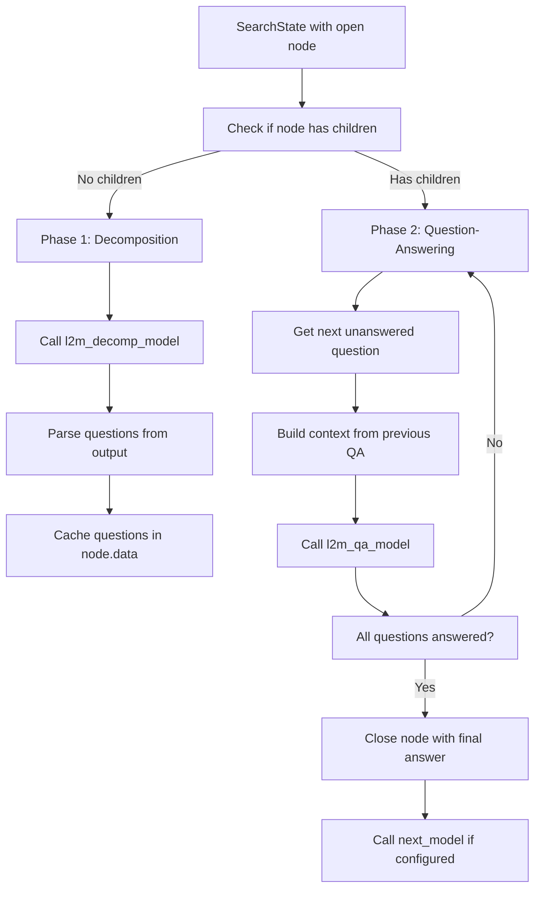
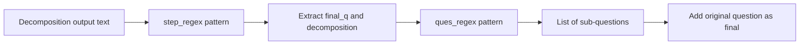
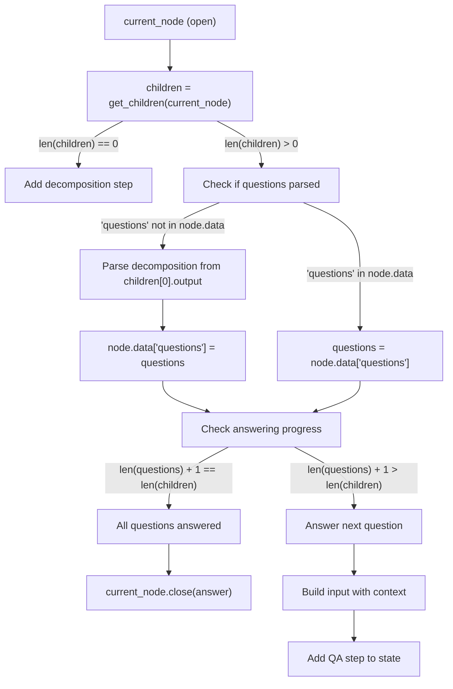
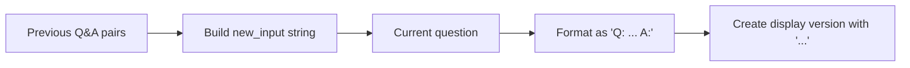

<!-- source: DeepWiki mcp.deepwiki.com · repo allenai/recoma · page 4.2 Least-to-Most Controller · fetched 2026-10-26 -->

# Least-to-Most Controller

<details>
<summary>Relevant source files</summary>

The following files were used as context for generating this wiki page:

- [configs/prompts/gsm8k/l2m_qa.txt](configs/prompts/gsm8k/l2m_qa.txt)
- [configs/prompts/letter_cat/l2m_qa.txt](configs/prompts/letter_cat/l2m_qa.txt)
- [recoma/models/impl/l2m_controller.py](recoma/models/impl/l2m_controller.py)

</details>


This document covers the `LeastToMostController` implementation, which provides a problem decomposition approach that breaks complex questions into simpler sequential sub-questions. The controller orchestrates a two-phase process: first decomposing problems into sub-questions, then answering each sub-question in sequence to build up to the final answer.

For information about other reasoning patterns, see [React Controller](#4.1) and [Decomposition Controller](#4.3). For general model architecture concepts, see [Model System Architecture](#2.3).

## Algorithm Overview

The Least-to-Most approach follows a structured decomposition strategy where complex problems are broken down into simpler, sequential sub-problems. Each sub-problem is solved in order, with the solution to each feeding into the next until the original question is answered.

### Two-Phase Execution Model



Sources: [recoma/models/impl/l2m_controller.py:34-77]()

## Implementation Details

### Core Class Structure

The `LeastToMostController` class is registered as `"l2m_control"` and extends `BaseModel`. It requires two sub-models to function:

| Component | Purpose | Configuration Key |
|-----------|---------|------------------|
| `l2m_decomp_model` | Decomposes complex questions into sub-questions | `l2m_decomp_model` |
| `l2m_qa_model` | Answers individual sub-questions sequentially | `l2m_qa_model` |

Sources: [recoma/models/impl/l2m_controller.py:7-18]()

### Question Parsing and Regex Configuration

The controller uses configurable regex patterns to parse decomposition outputs:



Default regex patterns:
- `step_regex`: `"To answer the question \"(.*)\", we need to know: (.*)"`
- `ques_regex`: `"\"(.*?)\"(?:,|\\.|$)"`

Sources: [recoma/models/impl/l2m_controller.py:10-16](), [recoma/models/impl/l2m_controller.py:20-32]()

### State Management and Node Tracking

The controller maintains state through the `SearchState` tree structure, tracking progress through node children and cached question lists:



Sources: [recoma/models/impl/l2m_controller.py:34-77]()

### Context Building for Sequential QA

When answering sub-questions, the controller builds context by accumulating previous question-answer pairs:



The input format follows the pattern:
- Accumulated context from previous QA pairs
- Current question formatted as `"Q: {question}\nA:"`
- Display version truncated with `"..."` prefix

Sources: [recoma/models/impl/l2m_controller.py:62-75]()

## Configuration and Usage

### Model Registration and Initialization

```python
@BaseModel.register("l2m_control")
class LeastToMostController(BaseModel):
    def __init__(self, l2m_decomp_model: str, l2m_qa_model: str, **kwargs):
```

The controller requires configuration of two sub-models that handle the decomposition and QA phases respectively.

Sources: [recoma/models/impl/l2m_controller.py:7-18]()

### Prompt Template Examples

#### GSM8K Math Problems
The GSM8K prompt template demonstrates the sequential QA approach for math word problems:

```
Q: How old was Mohamed four years ago?
A: We were told that Mohamed is currently twice 30 years old, so he is currently 30 * 2 = 60 years old. That means that four years ago he must have been 60 - 4 = 56 years old. The answer is 56.

Q: How old is Kody?
A: Four years ago, Kody was half as old as Mohamed, so Kody must have been 56 / 2 = 28 years old then. Since Kody was 28 years old four years ago, she must now be 28 + 4 = 32 years old. The answer is 32.
```

Sources: [configs/prompts/gsm8k/l2m_qa.txt:1-23]()

#### Letter Concatenation Tasks
The letter concatenation prompt template shows how to build solutions incrementally:

```
Q: Take the last letters of the words in "Augusta Ada" and concatenate them using a space.
A: The words in "Augusta Ada" are "Augusta" and "Ada". The letters and their positions in "Augusta" are "[(A, 1), (u, 2), (g, 3), (u, 4), (s, 5), (t, 6), (a, 7)]". The last letter in this sequence is "a". The letters and their positions in "Ada" are "[(A, 1), (d, 2), (a, 3)]". The last letter in this sequence is "a". Concatenating "a", "a" using a space leads to "a a". So, "Augusta Ada" outputs "a a".

Q: Take the last letters of the words in "Augusta Ada King" and concatenate them using a space.
A: "Augusta Ada" outputs "a a". The letters and their positions in "King" are "[(K, 1), (i, 2), (n, 3), (g, 4)]". The last letter in this sequence is "g". Concatenating "a a", "g" using a space leads to "a a g". So, "Augusta Ada King" outputs "a a g".
```

Sources: [configs/prompts/letter_cat/l2m_qa.txt:1-19]()

## Error Handling and Validation

The controller includes validation for proper decomposition parsing and state management:

- **Missing decomposition questions**: Raises `ValueError` when regex patterns fail to extract questions
- **Missing open nodes**: Raises `ValueError` when called without an open node in the state
- **Invalid decomposition format**: Raises `ValueError` when generated decomposition doesn't match expected format

Sources: [recoma/models/impl/l2m_controller.py:20-32](), [recoma/models/impl/l2m_controller.py:37-38]()

---

