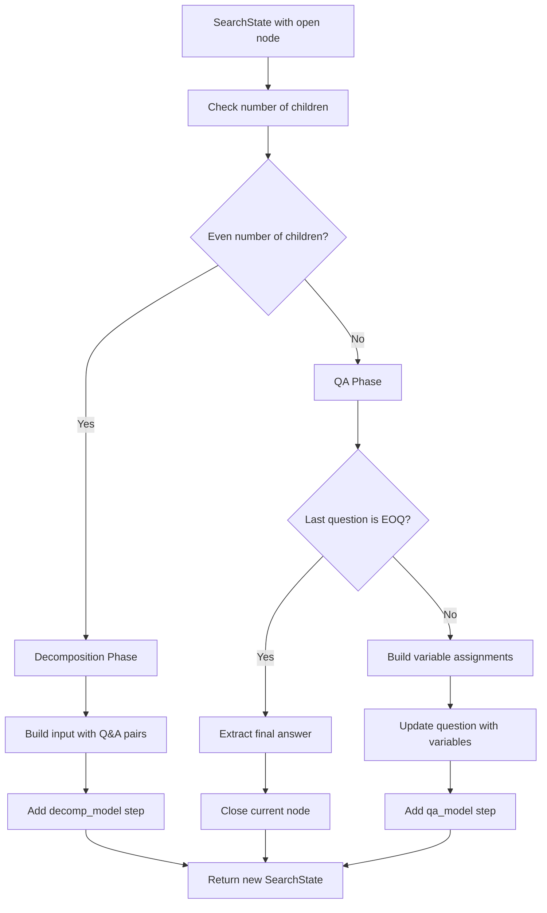
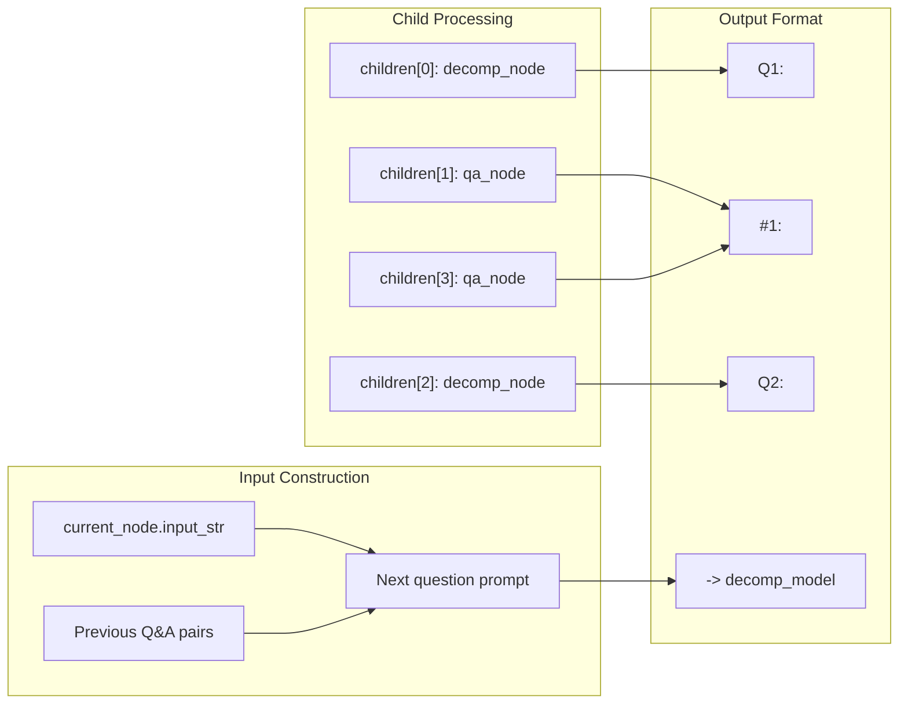
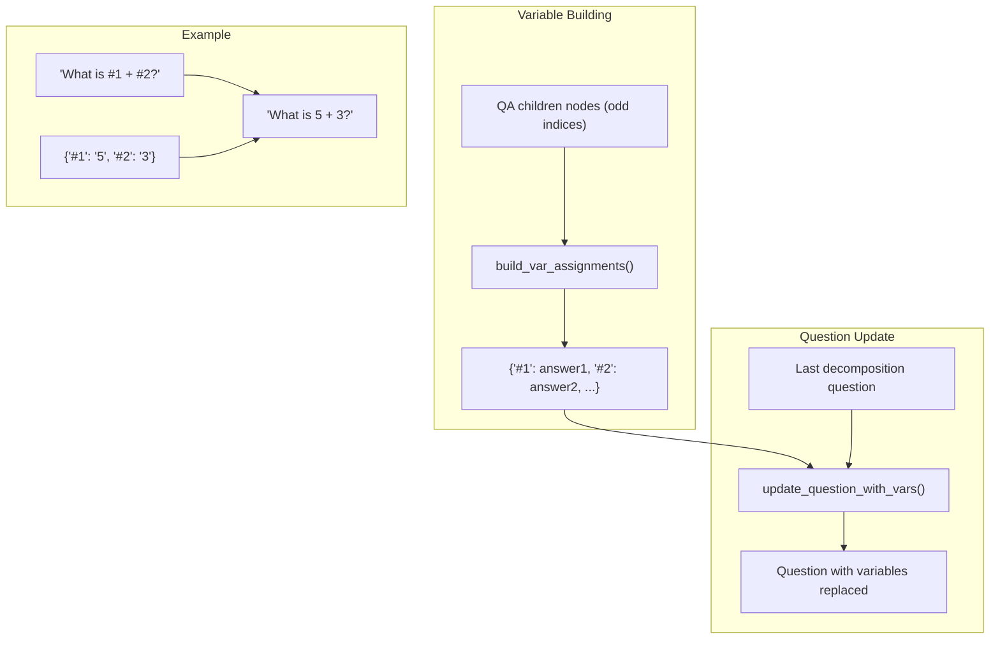
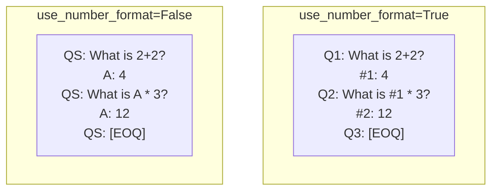
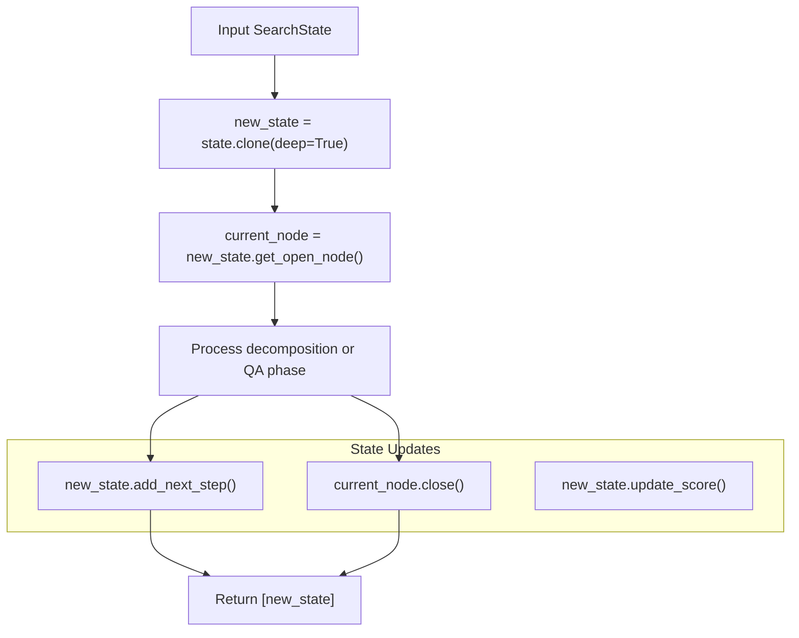

<!-- source: DeepWiki mcp.deepwiki.com · repo allenai/recoma · page 4.3 Decomposition Controller · fetched 2026-10-26 -->

# Decomposition Controller

Relevant source files

The following files were used as context for generating this wiki page:

- [recoma/models/core/base_model.py](recoma/models/core/base_model.py)
- [recoma/models/impl/decomp_controller.py](recoma/models/impl/decomp_controller.py)
- [recoma/models/impl/math_executer.py](recoma/models/impl/math_executer.py)

The Decomposition Controller (`DecompController`) is a reasoning controller that implements a general-purpose question decomposition and answer synthesis pattern. It orchestrates the breakdown of complex questions into simpler sub-questions and then synthesizes the final answer from the sub-answers.

This controller differs from other reasoning patterns in the framework: for the ReAct controller's thought-action-observation pattern, see [ReAct Controller](#4.1), and for the sequential problem decomposition approach, see [Least-to-Most Controller](#4.2).

## Core Architecture

The `DecompController` class is registered as `"decomp_control"` and extends the `BaseModel` base class. It coordinates between two specialized models: a decomposition model that generates sub-questions, and a question-answering model that answers those sub-questions.

### Controller Flow Diagram

Sources: [recoma/models/impl/decomp_controller.py:16-56]()

## Decomposition and QA Phases

The controller alternates between two distinct phases based on the number of child nodes in the search state:

### Decomposition Phase (Even Children)

When there are an even number of children, the controller enters decomposition mode. It constructs a prompt containing all previous question-answer pairs and requests the next sub-question.

Sources: [recoma/models/impl/decomp_controller.py:22-38]()

### QA Phase (Odd Children)

When there are an odd number of children, the controller enters QA mode. It checks if the last question is the end-of-questions marker. If not, it processes the question with variable substitution and sends it to the QA model.

| Condition | Action |
|-----------|---------|
| Last question is `eoq_string` | Extract final answer and close node |
| Last question is not `eoq_string` | Build variable assignments and update question |

Sources: [recoma/models/impl/decomp_controller.py:39-55]()

## Variable Assignment System

The controller maintains a variable assignment system that allows sub-questions to reference previous answers using numbered placeholders.

### Variable Assignment Process

Sources: [recoma/models/impl/decomp_controller.py:58-70]()

## Configuration Options

The `DecompController` accepts several configuration parameters:

| Parameter | Type | Default | Description |
|-----------|------|---------|-------------|
| `decomp_model` | str | Required | Model name for generating sub-questions |
| `qa_model` | str | Required | Model name for answering sub-questions |
| `use_number_format` | bool | `False` | Use numbered format (Q1, Q2) vs generic format (QS) |
| `eoq_string` | str | `"[EOQ]"` | End-of-questions marker |
| `next_model` | str | Optional | Next model to call after completion |

### Number Format Examples

Sources: [recoma/models/impl/decomp_controller.py:8-14](), [recoma/models/impl/decomp_controller.py:28-35]()

## Integration with Search System

The controller integrates with the ReComA search system by extending `BaseModel` and implementing the standard search state manipulation pattern.

### Search State Manipulation

The controller always returns a single new search state, maintaining the tree structure while progressing through the decomposition and synthesis process.

Sources: [recoma/models/impl/decomp_controller.py:16-56](), [recoma/models/core/base_model.py:19-29]()

---

