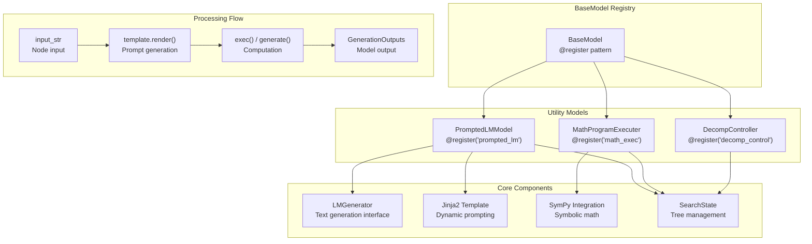
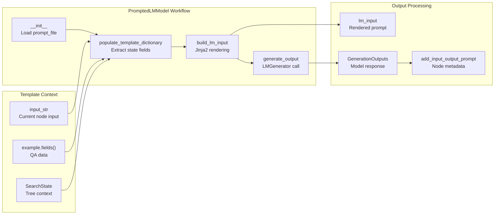
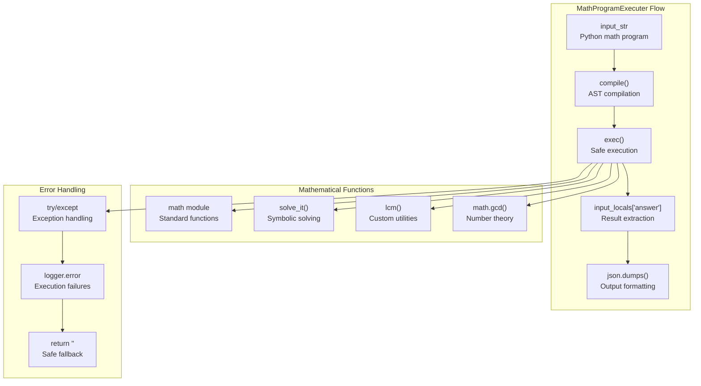
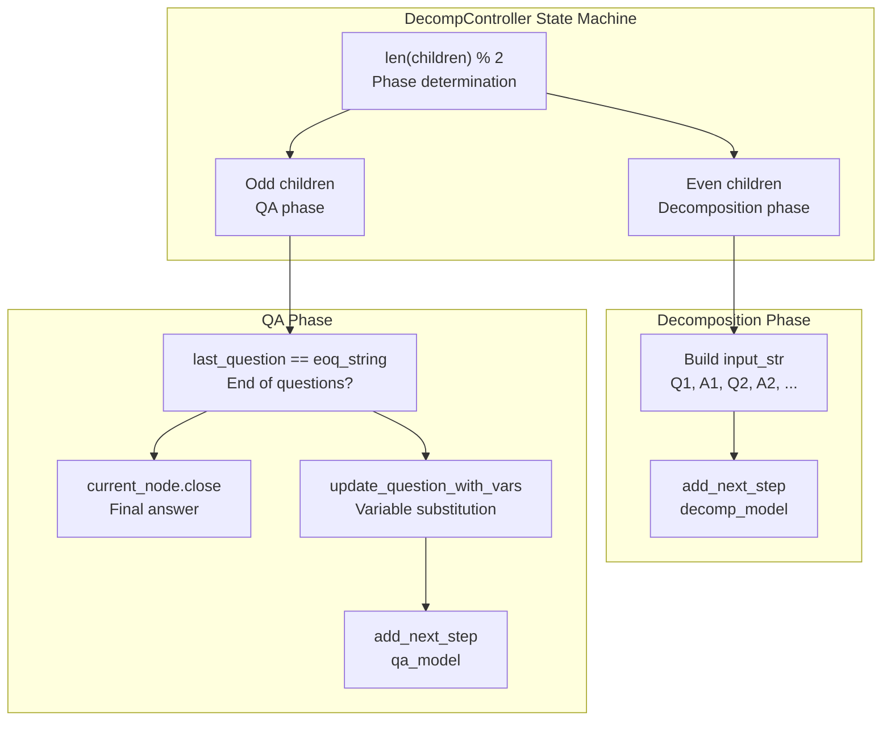
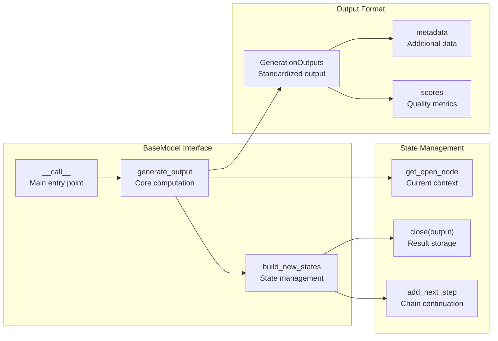

<!-- source: DeepWiki mcp.deepwiki.com · repo allenai/recoma · page 5 Utility Models and Tools · fetched 2026-10-26 -->

# Utility Models and Tools

<details>
<summary>Relevant source files</summary>

The following files were used as context for generating this wiki page:

- [recoma/models/core/base_model.py](recoma/models/core/base_model.py)
- [recoma/models/core/prompted_lm_model.py](recoma/models/core/prompted_lm_model.py)
- [recoma/models/impl/decomp_controller.py](recoma/models/impl/decomp_controller.py)
- [recoma/models/impl/math_executer.py](recoma/models/impl/math_executer.py)

</details>


This page documents the utility models and specialized tools in ReComA that provide essential text processing, mathematical computation, and routing capabilities. These models complement the main reasoning controllers by handling specific computational tasks and text manipulation operations.

For information about core reasoning patterns like ReAct and Least-to-Most, see [Reasoning Controllers](#4). For language model integrations, see [Language Model Integrations](#3).

## Architecture Overview

The utility models in ReComA extend the `BaseModel` class and provide specialized functionality that supports the main reasoning workflows. These models handle template-based text generation, mathematical computation, and orchestration of multi-step reasoning processes.



**Sources:** [recoma/models/core/base_model.py:8-72](), [recoma/models/core/prompted_lm_model.py:13-71](), [recoma/models/impl/math_executer.py:31-53](), [recoma/models/impl/decomp_controller.py:5-71]()

## Prompted Language Models

The `PromptedLMModel` class provides a template-based approach to language model prompting using Jinja2 templates. This model reads prompt templates from files and dynamically populates them with context from the search state.

### Core Implementation



**Sources:** [recoma/models/core/prompted_lm_model.py:32-71]()

### Template Population

The `populate_template_dictionary` method creates a context dictionary for Jinja2 templates:

| Context Variable | Source | Purpose |
|------------------|---------|---------|
| `input_str` | Current node input | Direct input to the model |
| Dynamic fields | `state.example.fields()` | Question, answer, context data |
| State context | `SearchState` | Tree traversal information |

The template rendering process in `build_lm_input` uses these variables to create contextual prompts that adapt to the current reasoning state.

**Sources:** [recoma/models/core/prompted_lm_model.py:41-54]()

## Mathematical Program Execution

The `MathProgramExecuter` class provides safe execution of mathematical programs with symbolic computation capabilities through SymPy integration.

### Execution Architecture



**Sources:** [recoma/models/impl/math_executer.py:43-53](), [recoma/models/impl/math_executer.py:14-29]()

### Symbolic Computation Integration

The `solve_it` function wraps SymPy's `solve` method to handle equation solving:

```python
def solve_it(equation, variable):
    solution = solve(equation, variable, dict=True)
    if not solution:
        if isinstance(variable, list):
            solution = {v: None for v in variable}
        else:
            solution = {variable: None}
        return solution
    else:
        solution = solution[0]
        return solution
```

This provides robust symbolic computation for mathematical reasoning tasks while handling edge cases gracefully.

**Sources:** [recoma/models/impl/math_executer.py:18-28]()

## Decomposition Controller

The `DecompController` orchestrates multi-step reasoning by alternating between question decomposition and question-answering phases.

### Control Flow Logic



**Sources:** [recoma/models/impl/decomp_controller.py:16-56]()

### Variable Substitution Mechanism

The controller maintains variable assignments from previous QA pairs and substitutes them into new questions:

| Component | Function | Purpose |
|-----------|----------|---------|
| `build_var_assignments` | Extract answers from QA children | Create variable mappings |
| `update_question_with_vars` | Replace variables in questions | Substitute computed values |
| `eoq_string` | End-of-questions marker | Terminate decomposition |

This enables complex reasoning chains where later questions depend on answers from earlier sub-questions.

**Sources:** [recoma/models/impl/decomp_controller.py:58-71]()

## Model Integration Pattern

All utility models follow the standard `BaseModel` pattern for integration with the search system:

### Common Interface



**Sources:** [recoma/models/core/base_model.py:19-71]()

### Registration System

Each utility model registers with the `BaseModel` registry using decorators:

- `@BaseModel.register("prompted_lm")` - Template-based prompting
- `@BaseModel.register("math_exec")` - Mathematical computation  
- `@BaseModel.register("decomp_control")` - Multi-step orchestration

This registration system enables dynamic model loading and configuration through the JSONNET configuration system.

**Sources:** [recoma/models/core/prompted_lm_model.py:13](), [recoma/models/impl/math_executer.py:31](), [recoma/models/impl/decomp_controller.py:5]()

---

