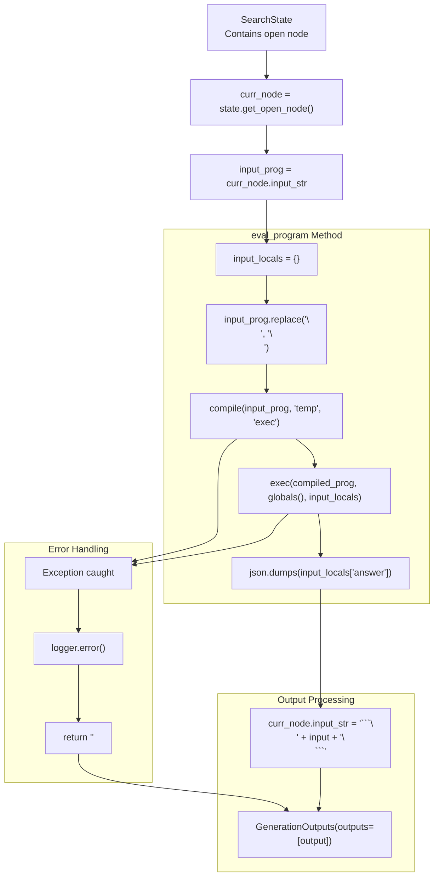
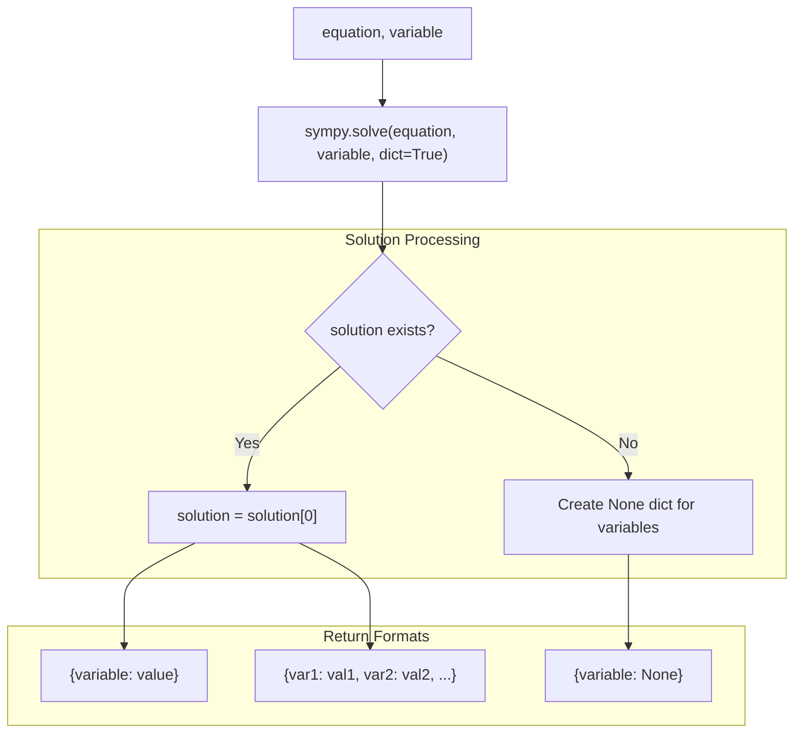
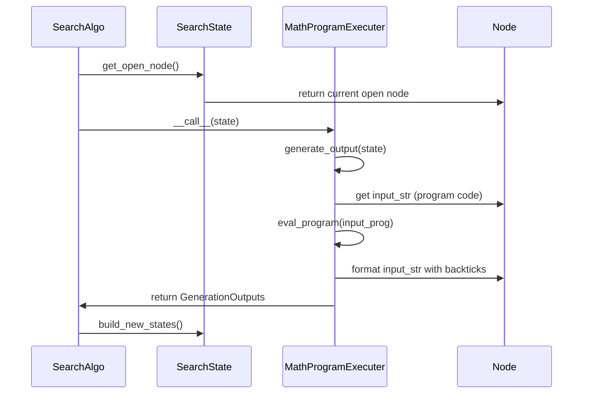

<!-- source: DeepWiki mcp.deepwiki.com · repo allenai/recoma · page 5.1 Mathematical Program Execution · fetched 2026-10-26 -->

# Mathematical Program Execution

<details>
<summary>Relevant source files</summary>

The following files were used as context for generating this wiki page:

- [recoma/models/core/base_model.py](recoma/models/core/base_model.py)
- [recoma/models/impl/decomp_controller.py](recoma/models/impl/decomp_controller.py)
- [recoma/models/impl/math_executer.py](recoma/models/impl/math_executer.py)

</details>


This document covers ReComA's mathematical program execution system, which enables the execution of Python programs containing mathematical computations and symbolic algebra. The `MathProgramExecuter` model serves as a specialized tool for evaluating mathematical expressions, solving equations, and performing symbolic computations within the reasoning framework.

For information about other utility models like prompted language models, see [Prompted Language Models](#5.2). For general text processing and answer extraction, see [Answer Extraction and Formatting](#5.3).

## Architecture Overview

The mathematical program execution system is built on ReComA's `BaseModel` architecture, implementing a specialized model that can execute Python code and perform symbolic mathematics.

### MathProgramExecuter Class Structure

```mermaid
graph TB
    BaseModel["BaseModel<br/>Abstract base class"]
    MathProgramExecuter["MathProgramExecuter<br/>@register('math_exec')"]
    SearchState["SearchState<br/>Container for execution context"]
    GenerationOutputs["GenerationOutputs<br/>Execution results"]
    
    subgraph "Core Methods"
        generate_output["generate_output(state)"]
        eval_program["eval_program(input_prog)"]
        __call__["__call__(state)"]
    end
    
    subgraph "Utility Functions"
        lcm_func["lcm(a, b)"]
        solve_it["solve_it(equation, variable)"]
    end
    
    subgraph "External Dependencies"
        sympy["sympy.solve"]
        python_exec["Python exec()"]
        json_mod["json.dumps()"]
    end
    
    BaseModel --> MathProgramExecuter
    MathProgramExecuter --> generate_output
    MathProgramExecuter --> eval_program
    BaseModel --> __call__
    
    generate_output --> SearchState
    generate_output --> GenerationOutputs
    eval_program --> python_exec
    eval_program --> json_mod
    
    solve_it --> sympy
    lcm_func --> "math.gcd"
    
    MathProgramExecuter --> lcm_func
    MathProgramExecuter --> solve_it
```

**Sources:** [recoma/models/impl/math_executer.py:1-53](), [recoma/models/core/base_model.py:8-72]()

## Code Execution Mechanism

The `MathProgramExecuter` processes mathematical programs through a secure execution pipeline that compiles and runs Python code while capturing results.

### Program Execution Flow



**Sources:** [recoma/models/impl/math_executer.py:34-53]()

The execution process follows these steps:

1. **Input Extraction**: Retrieves the program code from the current open node's `input_str`
2. **Code Compilation**: Compiles the Python code using `compile()` with 'exec' mode
3. **Execution**: Runs the compiled code with isolated local scope in `input_locals`
4. **Answer Extraction**: Expects the program to set an `answer` variable and serializes it as JSON
5. **Error Handling**: Catches exceptions and logs errors, returning empty string on failure

## Symbolic Computation Features

The system integrates SymPy for symbolic mathematics, providing equation solving and mathematical utilities.

### Mathematical Utilities

| Function | Purpose | Implementation |
|----------|---------|----------------|
| `lcm(a, b)` | Least Common Multiple | `(a * b) // math.gcd(a, b)` |
| `solve_it(equation, variable)` | Equation solving with fallback | Uses `sympy.solve()` with dict output |

### Equation Solving Process



**Sources:** [recoma/models/impl/math_executer.py:18-29]()

The `solve_it` function provides robust equation solving:
- Returns first solution from SymPy's `solve()` function
- Handles multiple variables by returning a dictionary
- Provides fallback behavior when no solution exists
- Maintains consistent return format as dictionary

## Integration with Search System

The `MathProgramExecuter` integrates with ReComA's search system through the standard `BaseModel` interface.

### Search State Integration



**Sources:** [recoma/models/impl/math_executer.py:34-42](), [recoma/models/core/base_model.py:19-29]()

## Usage Patterns

The mathematical program executor is typically used in reasoning chains where:

1. **Problem Decomposition**: Earlier models generate Python code to solve mathematical problems
2. **Symbolic Computation**: The executor runs the code and performs calculations
3. **Answer Extraction**: Results are formatted and passed to subsequent models

### Expected Program Structure

Mathematical programs executed by this model should:
- Be valid Python code
- Set an `answer` variable containing the final result
- Use available mathematical functions and imports
- Handle edge cases appropriately

Example program structure:
```python
# Mathematical computation
result = some_calculation()
answer = result
```

The system provides access to mathematical utilities like `lcm()` and `solve_it()` through the global namespace during execution.

**Sources:** [recoma/models/impl/math_executer.py:43-53]()

---

