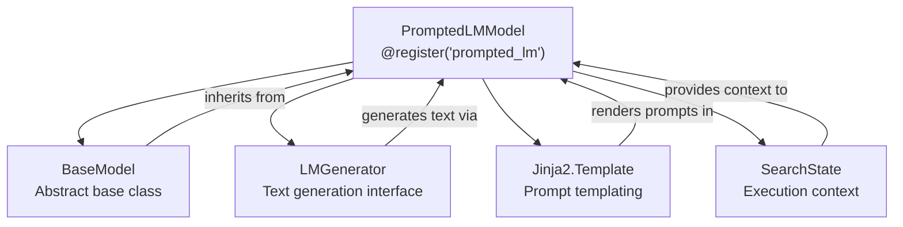
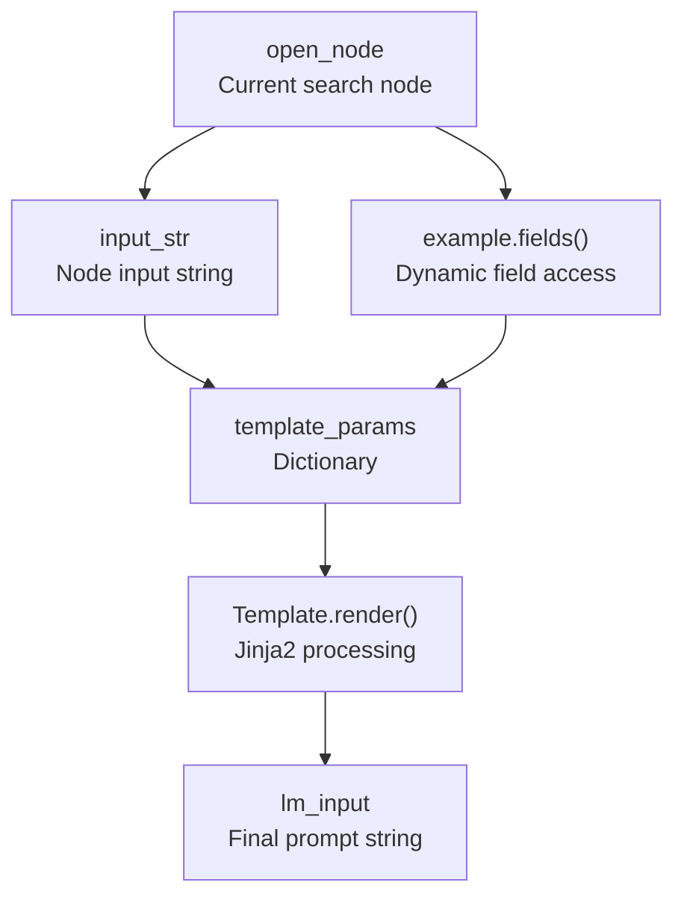
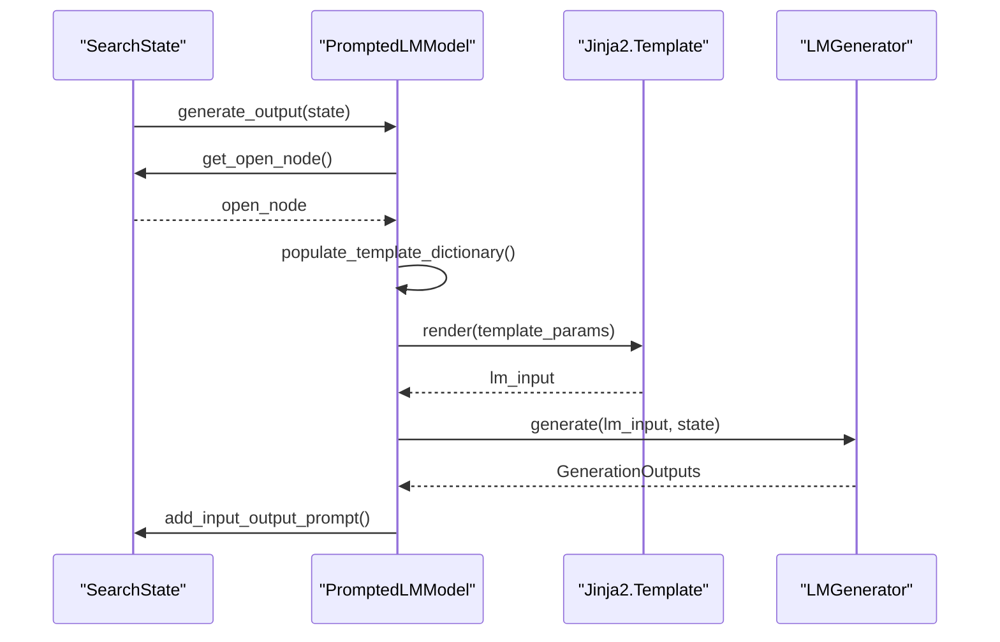

<!-- source: DeepWiki mcp.deepwiki.com · repo allenai/recoma · page 5.2 Prompted Language Models · fetched 2026-10-26 -->

# Prompted Language Models

<details>
<summary>Relevant source files</summary>

The following files were used as context for generating this wiki page:

- [recoma/models/core/prompted_lm_model.py](recoma/models/core/prompted_lm_model.py)

</details>


This document covers the `PromptedLMModel` class, which provides a simple wrapper around language model generators that uses Jinja2 templates for dynamic prompt generation. This utility model allows users to create reusable prompt templates that can be populated with data from search states and examples.

For information about the underlying language model generators, see [Generator Base Classes](#3.3). For complex reasoning patterns that build upon prompted models, see [Reasoning Controllers](#4).

## Purpose and Architecture

The `PromptedLMModel` serves as a bridge between static prompt templates and dynamic language model execution within ReComA's search framework. It combines Jinja2 templating with the `LMGenerator` abstraction to create flexible, reusable prompt-based models.

### Core Components



Sources: [recoma/models/core/prompted_lm_model.py:13-71]()

## Template System

The `PromptedLMModel` uses Jinja2 templates to create dynamic prompts that can access data from the current search state and example fields. Templates are loaded from files during initialization and rendered at runtime with contextual data.

### Template Parameter Population

The model automatically populates template parameters from two main sources:

| Parameter Source | Description | Access Method |
|------------------|-------------|---------------|
| `input_str` | Input string from the current open node | Direct parameter |
| Example fields | All fields from the current example | `state.example.get_field(field)` |

### Template Rendering Process



Sources: [recoma/models/core/prompted_lm_model.py:32-54]()

## Implementation Details

### Initialization

The `PromptedLMModel` constructor accepts a `prompt_file` path and `generator_params` dictionary:

```python
def __init__(self, prompt_file: str, generator_params, **kwargs)
```

The prompt file is read entirely into memory and stored as a string, while the generator is instantiated using `LMGenerator.from_dict()`.

Sources: [recoma/models/core/prompted_lm_model.py:23-30]()

### Output Generation Pipeline

The main execution flow follows this sequence:



Sources: [recoma/models/core/prompted_lm_model.py:56-71]()

## Integration with Search System

The `PromptedLMModel` integrates seamlessly with ReComA's search framework through the `BaseModel` interface. When called during search execution, it:

1. Retrieves the current open node from the search state
2. Populates template parameters with contextual data
3. Renders the Jinja2 template to create the final prompt
4. Calls the underlying `LMGenerator` to produce outputs
5. Stores the input/output pair in the search node

### Error Handling

The model includes validation to ensure it's called with a valid open node:

```python
if open_node is None:
    raise ValueError("Model called without any open node!!")
```

Sources: [recoma/models/core/prompted_lm_model.py:62-64]()

## Usage Patterns

The `PromptedLMModel` is typically used for:

- **Simple question-answering tasks** where a single prompt template suffices
- **Preprocessing steps** that require dynamic prompt generation
- **Baseline models** for comparison with more complex reasoning controllers
- **Template-based reasoning** where the logic is embedded in the prompt rather than the controller

The model's simplicity makes it ideal for straightforward language model interactions where the complexity lies in the prompt design rather than the execution flow.

Sources: [recoma/models/core/prompted_lm_model.py:15-21]()

---

