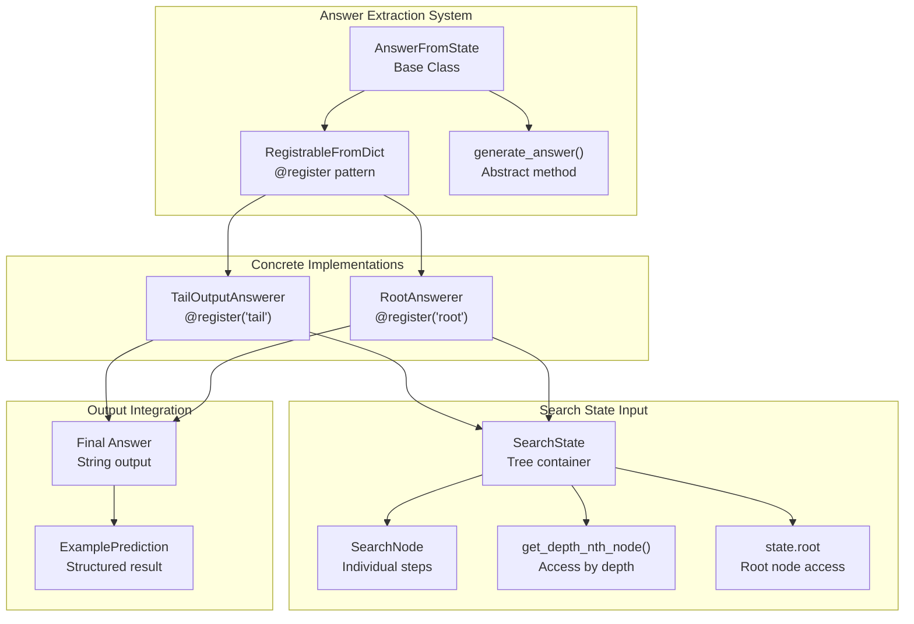
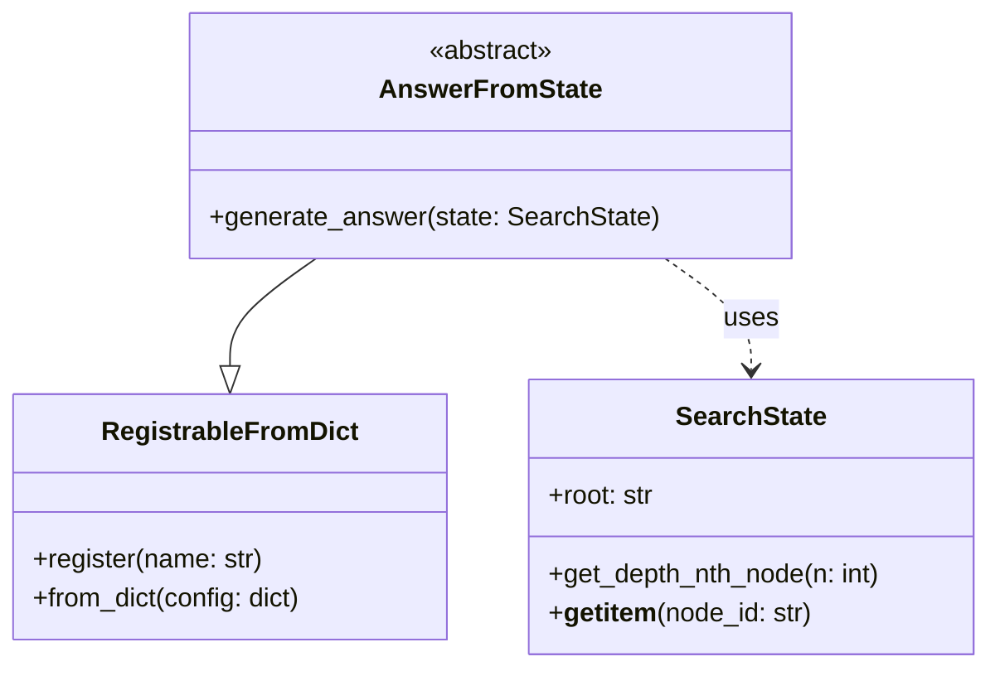
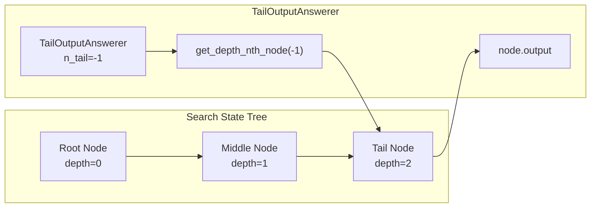
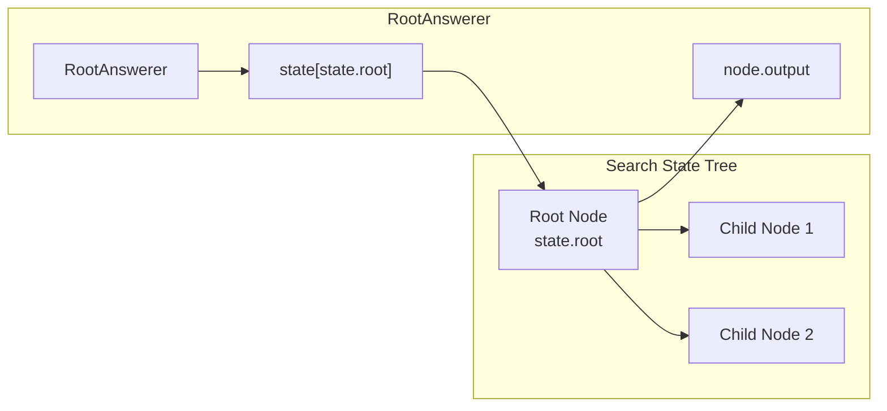
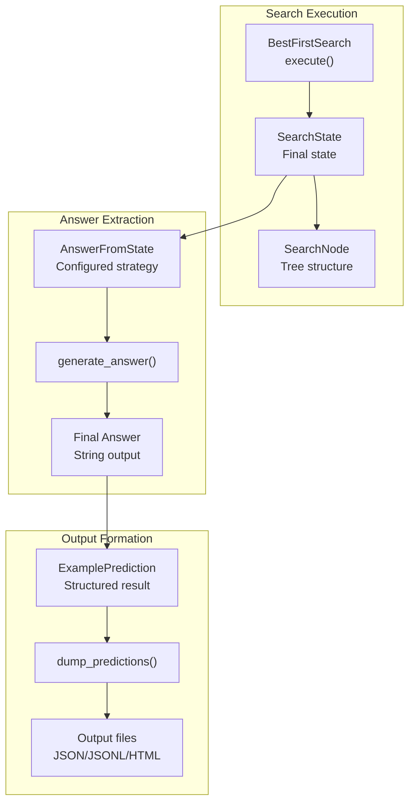

<!-- source: DeepWiki mcp.deepwiki.com · repo allenai/recoma · page 5.3 Answer Extraction and Formatting · fetched 2026-10-26 -->

# Answer Extraction and Formatting

Relevant source files

The following files were used as context for generating this wiki page:

- [recoma/search/answerfromstate.py](recoma/search/answerfromstate.py)

This document covers how ReComA extracts final answers from search states and formats them into structured outputs. The answer extraction system determines how to retrieve the final answer from the complex reasoning traces generated during search-based inference.

For information about the search system that generates these states, see [Search System](#2.2). For details about how outputs are integrated into the broader inference pipeline, see [Inference Orchestration](#2.1).

## Purpose and Scope

The answer extraction system in ReComA serves as the bridge between the complex search states containing reasoning traces and the final answers needed for evaluation and output. This system handles the extraction of meaningful answers from tree-structured search states and their formatting into standardized prediction objects.

## Answer Extraction Architecture

The answer extraction system is built around a registry-based architecture that allows different strategies for extracting answers from search states:

Sources: [recoma/search/answerfromstate.py:1-32]()

## Base Answer Extraction Class

The `AnswerFromState` class provides the foundation for all answer extraction strategies:

The base class defines the interface that all answer extraction strategies must implement. The `generate_answer` method takes a `SearchState` and returns the extracted answer as a string.

Sources: [recoma/search/answerfromstate.py:5-10]()

## Tail Output Answerer

The `TailOutputAnswerer` extracts answers from the deepest node in the search state, representing the final step in the reasoning process:

| Parameter | Type | Default | Description |
|-----------|------|---------|-------------|
| `n_tail` | `int` | `-1` | Depth index for node selection (negative values count from end) |

This approach is useful when the reasoning process builds up to a final answer, and the last step contains the most relevant output.

Sources: [recoma/search/answerfromstate.py:13-21]()

## Root Answerer

The `RootAnswerer` extracts answers from the root node of the search state, representing the initial or summary-level output:

This approach is useful when the root node contains a summary or the primary answer, while child nodes contain supporting reasoning steps.

Sources: [recoma/search/answerfromstate.py:24-31]()

## Integration with Search System

The answer extraction system integrates with the broader search architecture to produce final predictions:

The answer extraction occurs after search completion but before final output formatting, ensuring that the reasoning trace is fully developed before answer extraction.

Sources: [recoma/search/answerfromstate.py:1-32]()

## Configuration and Usage

Answer extraction strategies are configured through the registry system and can be specified in configuration files:

| Strategy | Registration Key | Use Case |
|----------|------------------|----------|
| `TailOutputAnswerer` | `"tail"` | Extract from deepest reasoning step |
| `RootAnswerer` | `"root"` | Extract from initial/summary node |

The answer extraction strategy is typically configured as part of the broader search algorithm configuration, allowing different tasks to use different extraction approaches based on their reasoning patterns.

Sources: [recoma/search/answerfromstate.py:13-31]()

---

