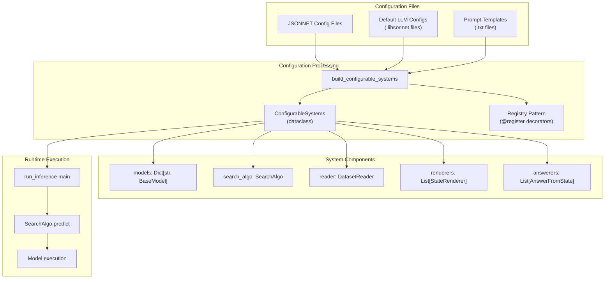
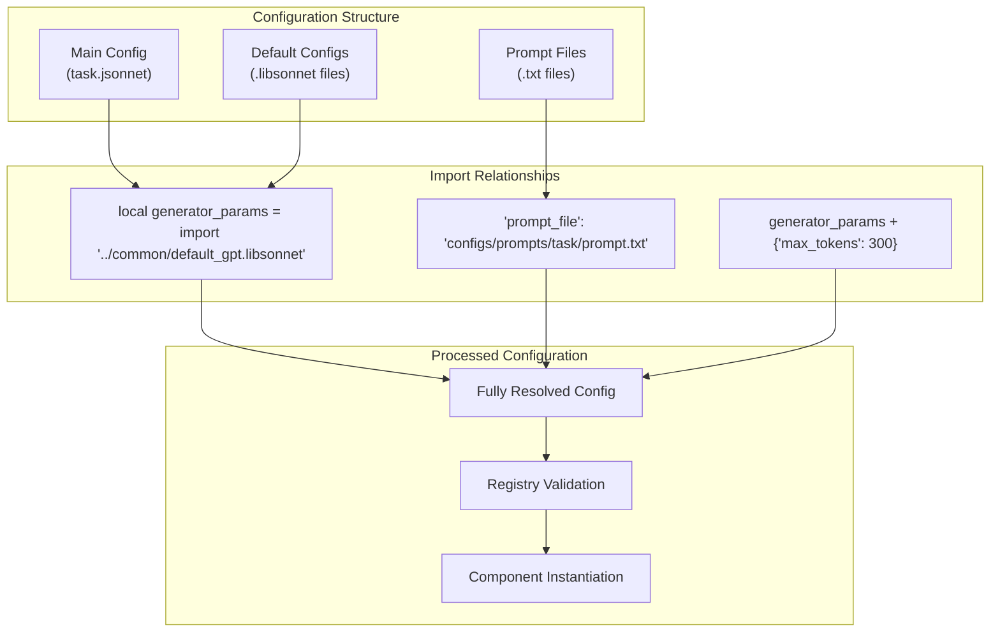
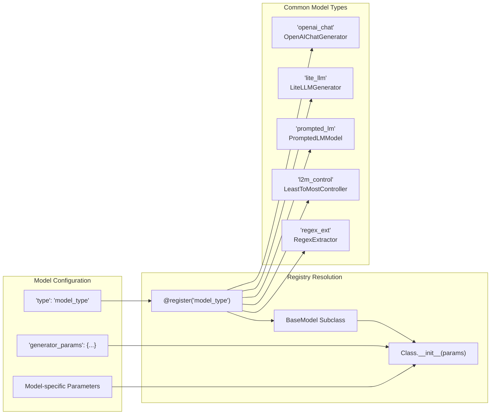
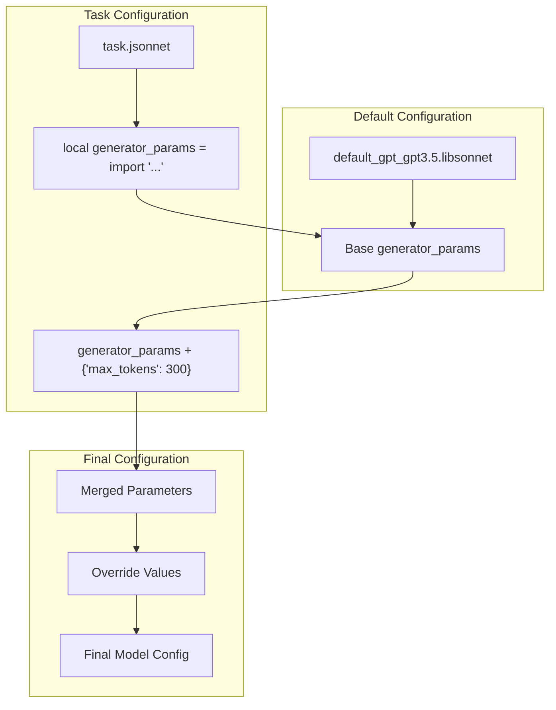
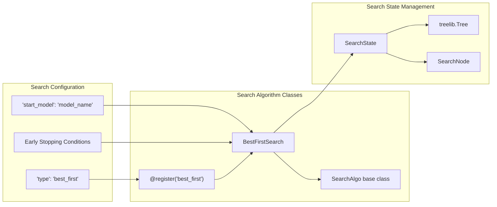
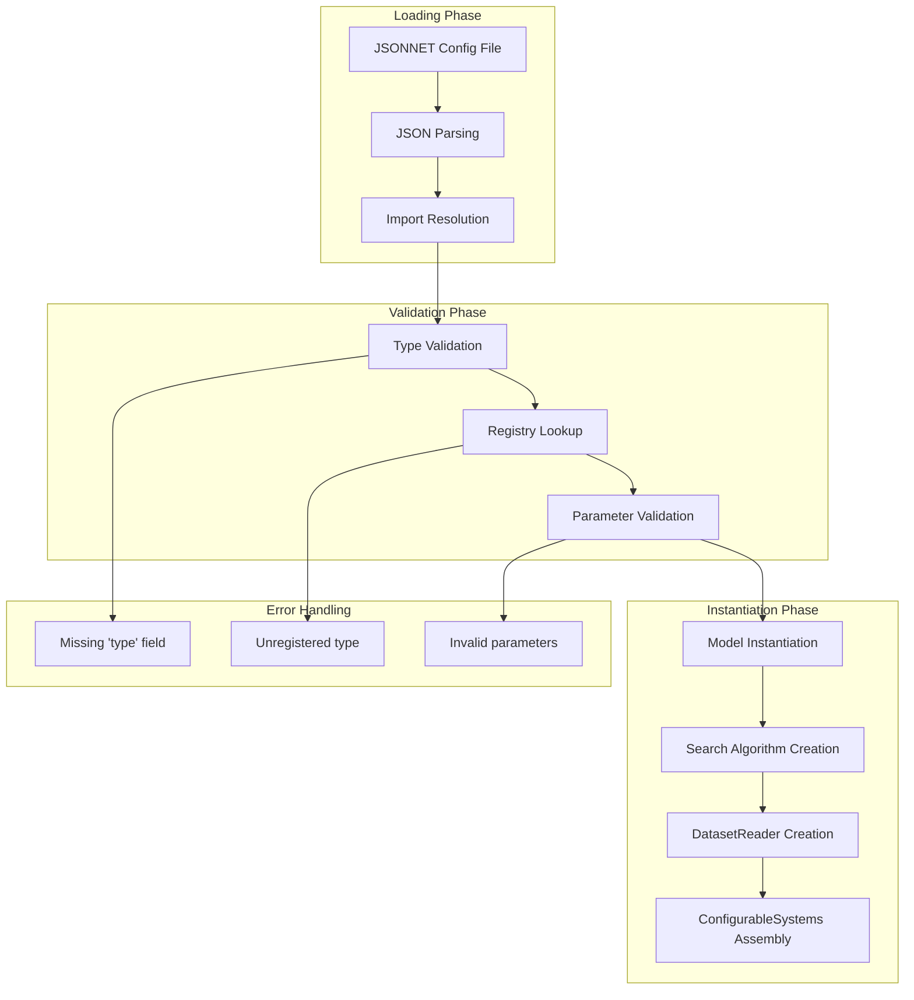

<!-- source: DeepWiki mcp.deepwiki.com · repo allenai/recoma · page 6 Configuration System · fetched 2026-10-26 -->

# Configuration System

Relevant source files

The following files were used as context for generating this wiki page:

- [configs/inference/common/default_gemini_pro.libsonnet](configs/inference/common/default_gemini_pro.libsonnet)
- [configs/inference/common/default_gpt_gpt3.5.libsonnet](configs/inference/common/default_gpt_gpt3.5.libsonnet)
- [configs/inference/common/default_togetherai_llama3_70B.libsonnet](configs/inference/common/default_togetherai_llama3_70B.libsonnet)
- [configs/inference/letter_cat/l2m.jsonnet](configs/inference/letter_cat/l2m.jsonnet)

## Purpose and Scope

The Configuration System in ReComA provides a declarative approach to defining and managing inference setups through JSONNET configuration files. This system orchestrates the entire inference pipeline by specifying models, search algorithms, datasets, and their interconnections. For specific model configurations, see [Language Model Configurations](#6.1). For task-specific examples, see [Task-Specific Configurations](#6.2). For prompt template management, see [Prompt Templates](#6.3).

## Configuration Architecture Overview

The configuration system uses JSONNET files to define inference setups, which are processed by the `build_configurable_systems` function to create a `ConfigurableSystems` dataclass containing all necessary components.

### Configuration Flow Diagram

Sources: [configs/inference/letter_cat/l2m.jsonnet:1-32](), [configs/inference/common/default_gpt_gpt3.5.libsonnet:1-9]()

## Configuration File Structure

ReComA configurations are structured as JSONNET files that define four main sections: `models`, `search`, `reader`, and optional components like `renderers` and `answerers`.

### Core Configuration Schema

| Section | Purpose | Required | Example |
|---------|---------|----------|---------|
| `models` | Dictionary of model definitions | Yes | `{"model_name": {"type": "openai_chat", ...}}` |
| `search` | Search algorithm configuration | Yes | `{"type": "best_first", "start_model": "model_name"}` |
| `reader` | Dataset reader configuration | Yes | `{"type": "drop"}` |
| `renderers` | State visualization components | No | `[{"type": "html_renderer"}]` |
| `answerers` | Answer extraction components | No | `[{"type": "tail_output"}]` |

### Configuration Hierarchy and Imports

Sources: [configs/inference/letter_cat/l2m.jsonnet:1-2](), [configs/inference/letter_cat/l2m.jsonnet:12-13]()

## Model Configuration Patterns

The configuration system supports multiple model types through a registry pattern, where each model type corresponds to a registered class.

### Model Definition Structure

Sources: [configs/inference/letter_cat/l2m.jsonnet:4-23](), [configs/inference/common/default_gpt_gpt3.5.libsonnet:2]()

## Generator Parameters and Defaults

Default configurations for language models are stored in `.libsonnet` files and can be imported and extended in task-specific configurations.

### Default Configuration Parameters

| Parameter | Purpose | Common Values |
|-----------|---------|---------------|
| `type` | Model implementation class | `"openai_chat"`, `"lite_llm"` |
| `model` | Model identifier | `"gpt-3.5-turbo-0613"`, `"gemini/gemini-1.5-pro-latest"` |
| `max_tokens` | Maximum output tokens | `100`, `300`, `500` |
| `temperature` | Sampling temperature | `0`, `0.7`, `1.0` |
| `top_p` | Nucleus sampling parameter | `1` |
| `use_cache` | Enable response caching | `true`, `false` |
| `stop` | Stop sequences | `["\n"]`, `["<|endoftext|>"]` |

### Configuration Extension Pattern

Sources: [configs/inference/letter_cat/l2m.jsonnet:1](), [configs/inference/letter_cat/l2m.jsonnet:18]()

## Search Algorithm Configuration

The search configuration defines how the reasoning process explores the search space through model execution.

### Search Configuration Schema

Sources: [configs/inference/letter_cat/l2m.jsonnet:25-28]()

## Configuration Loading and Validation

The configuration system processes JSONNET files through a validation and instantiation pipeline that ensures all components are properly registered and configured.

### Configuration Processing Pipeline

Sources: [configs/inference/letter_cat/l2m.jsonnet:1-32](), [configs/inference/common/default_gpt_gpt3.5.libsonnet:1-9]()

---

