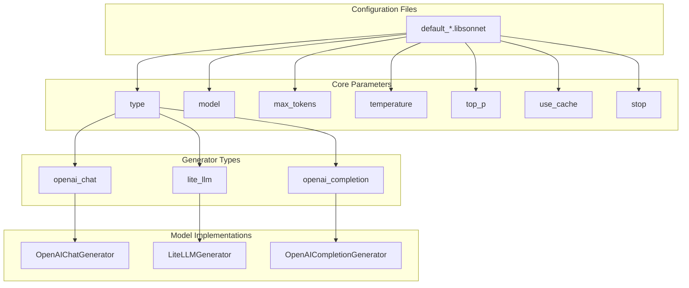
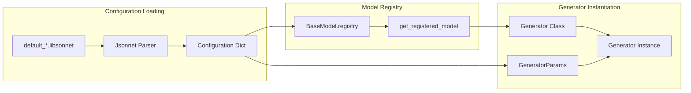

<!-- source: DeepWiki mcp.deepwiki.com · repo allenai/recoma · page 6.1 Language Model Configurations · fetched 2026-10-26 -->

# Language Model Configurations

<details>
<summary>Relevant source files</summary>

The following files were used as context for generating this wiki page:

- [configs/inference/common/default_api_chat_model.libsonnet](configs/inference/common/default_api_chat_model.libsonnet)
- [configs/inference/common/default_api_model.libsonnet](configs/inference/common/default_api_model.libsonnet)
- [configs/inference/common/default_gemini_pro.libsonnet](configs/inference/common/default_gemini_pro.libsonnet)
- [configs/inference/common/default_gpt_davinci003.libsonnet](configs/inference/common/default_gpt_davinci003.libsonnet)
- [configs/inference/common/default_gpt_gpt3.5.libsonnet](configs/inference/common/default_gpt_gpt3.5.libsonnet)
- [configs/inference/common/default_togetherai_llama3_70B.libsonnet](configs/inference/common/default_togetherai_llama3_70B.libsonnet)

</details>


This document covers the default language model configurations provided in ReComA, including parameter settings for OpenAI models, Gemini, and various other language models accessible through different API providers. These configurations define the baseline behavior and settings for language model generators used throughout the reasoning framework.

For information about specific API integrations and how these configurations are used, see [OpenAI Integration](#3.1) and [LiteLLM Integration](#3.2). For task-specific configuration examples, see [Task-Specific Configurations](#6.2).

## Configuration File Structure

ReComA uses Jsonnet configuration files to define default parameters for different language models. These configurations are located in the `configs/inference/common/` directory and follow a standardized structure that maps to the generator parameters expected by the model system.

### Configuration Parameter Mapping



**Sources:** [configs/inference/common/default_gpt_gpt3.5.libsonnet:1-9](), [configs/inference/common/default_gemini_pro.libsonnet:1-9](), [configs/inference/common/default_togetherai_llama3_70B.libsonnet:1-9]()

## OpenAI Model Configurations

### GPT-3.5 Turbo Configuration

The `default_gpt_gpt3.5.libsonnet` configuration provides settings for OpenAI's GPT-3.5 Turbo model using the chat completion API:

| Parameter | Value | Purpose |
|-----------|-------|---------|
| `type` | `"openai_chat"` | Uses `OpenAIChatGenerator` |
| `model` | `"gpt-3.5-turbo-0613"` | Specific model version |
| `max_tokens` | `100` | Response length limit |
| `temperature` | `0` | Deterministic responses |
| `top_p` | `1` | Full probability distribution |
| `use_cache` | `true` | Enable response caching |
| `stop` | `["\n"]` | Stop at newline |

### GPT-3 Davinci Configuration

The `default_gpt_davinci003.libsonnet` configuration uses the completion API for the older GPT-3 model:

| Parameter | Value | Purpose |
|-----------|-------|---------|
| `type` | `"openai_completion"` | Uses completion API |
| `model` | `"text-davinci-003"` | GPT-3 model variant |
| `max_tokens` | `100` | Response length limit |
| `temperature` | `0` | Deterministic responses |
| `top_p` | `1` | Full probability distribution |
| `stop` | `["\n"]` | Stop at newline |

**Sources:** [configs/inference/common/default_gpt_gpt3.5.libsonnet:1-9](), [configs/inference/common/default_gpt_davinci003.libsonnet:1-7]()

## LiteLLM Model Configurations

### Gemini Pro Configuration

The `default_gemini_pro.libsonnet` configuration accesses Google's Gemini model through the LiteLLM interface:

```json
{
    "type": "lite_llm",
    "model": "gemini/gemini-1.5-pro-latest",
    "max_tokens": 100,
    "temperature": 0,
    "top_p": 1,
    "use_cache": true,
    "stop": ["\n"]
}
```

### TogetherAI Llama Configuration

The `default_togetherai_llama3_70B.libsonnet` configuration provides access to Meta's Llama 3 70B model through TogetherAI:

```json
{
    "type": "lite_llm",
    "model": "together_ai/meta-llama/Llama-3-70b-chat-hf",
    "max_tokens": 100,
    "temperature": 0,
    "top_p": 1,
    "use_cache": false,
    "stop": ["<|endoftext|>", "<|start_header_id|>", "\n"]
}
```

Note the more comprehensive stop sequences for Llama models and disabled caching.

**Sources:** [configs/inference/common/default_gemini_pro.libsonnet:1-9](), [configs/inference/common/default_togetherai_llama3_70B.libsonnet:1-9]()

## Custom API Configurations

### Chat Model Configuration

The `default_api_chat_model.libsonnet` provides a template for custom chat-based models:

| Parameter | Value | Purpose |
|-----------|-------|---------|
| `type` | `"openai_chat"` | Uses chat completion format |
| `model` | `"TheBloke/Llama-2-70b-Chat-AWQ"` | Custom model identifier |
| `presence_penalty` | `null` | Disabled penalty |
| `frequency_penalty` | `null` | Disabled penalty |
| `best_of` | `null` | Disabled best-of sampling |

### Completion Model Configuration

The `default_api_model.libsonnet` provides a template for custom completion models with similar parameters but using the completion API type.

**Sources:** [configs/inference/common/default_api_chat_model.libsonnet:1-11](), [configs/inference/common/default_api_model.libsonnet:1-11]()

## Configuration Usage Pattern



**Sources:** [configs/inference/common/default_gpt_gpt3.5.libsonnet:1-9](), [configs/inference/common/default_gemini_pro.libsonnet:1-9]()

## Parameter Guidelines

### Common Parameters

All configurations share these standard parameters:

- **`type`**: Maps to registered generator class names
- **`model`**: Provider-specific model identifier
- **`max_tokens`**: Response length limit (typically 100 for reasoning steps)
- **`temperature`**: Set to 0 for deterministic reasoning
- **`top_p`**: Usually 1 for full distribution access
- **`stop`**: Critical for controlling response boundaries

### Provider-Specific Considerations

- **OpenAI models**: Support additional parameters like `presence_penalty` and `frequency_penalty`
- **LiteLLM models**: May require provider-specific model paths (e.g., `"gemini/gemini-1.5-pro-latest"`)
- **Custom APIs**: Can use OpenAI-compatible endpoints with custom model identifiers

### Caching Strategy

- **`use_cache: true`**: Recommended for expensive models (GPT-4, Gemini Pro)
- **`use_cache: false`**: May be used for cheaper models or when response variance is desired

**Sources:** [configs/inference/common/default_gpt_gpt3.5.libsonnet:1-9](), [configs/inference/common/default_gemini_pro.libsonnet:1-9](), [configs/inference/common/default_togetherai_llama3_70B.libsonnet:1-9]()

---

