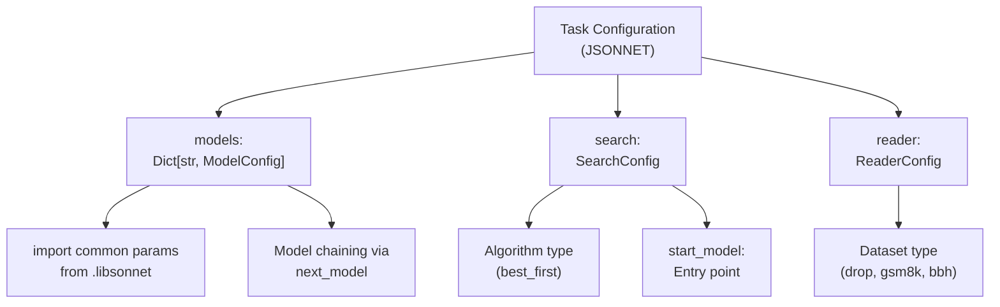
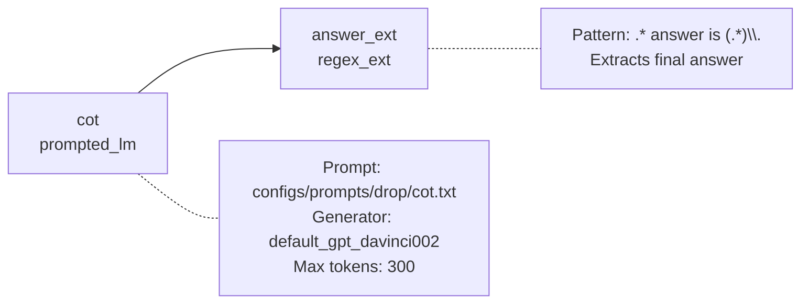
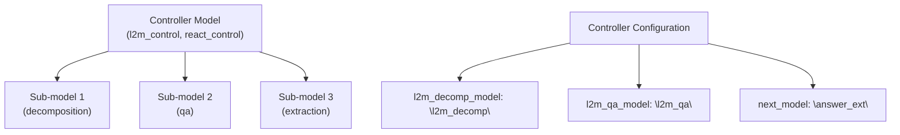

<!-- source: DeepWiki mcp.deepwiki.com · repo allenai/recoma · page 6.2 Task-Specific Configurations · fetched 2026-10-26 -->

# Task-Specific Configurations

<details>
<summary>Relevant source files</summary>

The following files were used as context for generating this wiki page:

- [configs/inference/common/default_gpt_davinci002.libsonnet](configs/inference/common/default_gpt_davinci002.libsonnet)
- [configs/inference/drop/answer_only.jsonnet](configs/inference/drop/answer_only.jsonnet)
- [configs/inference/drop/cot.jsonnet](configs/inference/drop/cot.jsonnet)
- [configs/inference/gsm8k/faithful_cot_nl_sl.jsonnet](configs/inference/gsm8k/faithful_cot_nl_sl.jsonnet)
- [configs/inference/letter_cat/l2m.jsonnet](configs/inference/letter_cat/l2m.jsonnet)

</details>


This page documents how to configure ReComA for different reasoning tasks and datasets. Task-specific configurations define the complete pipeline for a particular reasoning problem, including model orchestration, search parameters, and dataset integration.

For language model parameters and generator configurations, see [Language Model Configurations](#6.1). For prompt template creation and formatting, see [Prompt Templates](#6.3).

## Configuration Structure

ReComA uses JSONNET configuration files to define task-specific setups. Each configuration file specifies three main components:

| Component | Purpose | Required |
|-----------|---------|----------|
| `models` | Dictionary of model definitions and their chaining | Yes |
| `search` | Search algorithm configuration | Yes |
| `reader` | Dataset reader specification | Yes |

### Configuration File Pattern



Sources: [configs/inference/drop/cot.jsonnet:1-22](), [configs/inference/letter_cat/l2m.jsonnet:1-32]()

## Task-Specific Examples

### DROP Dataset Configuration

The DROP (Discrete Reasoning Over Paragraphs) dataset requires reading comprehension with numerical reasoning. Configurations typically use chain-of-thought or answer extraction patterns.

#### Chain-of-Thought Configuration



The basic structure chains a prompted language model with regex extraction:
- `cot` model uses [configs/prompts/drop/cot.txt]() for chain-of-thought reasoning
- `answer_ext` model extracts answers using regex pattern `".* answer is (.*)\\."` [configs/inference/drop/cot.jsonnet:12]()
- Uses `"drop"` reader for dataset loading [configs/inference/drop/cot.jsonnet:20]()

#### Answer-Only Configuration

For simpler cases, direct answer generation without intermediate reasoning:
- Single `answer_only` model with [configs/prompts/drop/answer_only.txt]() [configs/inference/drop/answer_only.jsonnet:6]()
- No model chaining or answer extraction step

Sources: [configs/inference/drop/cot.jsonnet:1-22](), [configs/inference/drop/answer_only.jsonnet:1-17]()

### GSM8K Mathematical Reasoning

GSM8K requires mathematical problem solving with program execution capabilities.

```mermaid
graph LR
    PROGRAM["program_cot<br/>prompted_lm"] --> EXEC["program_exec<br/>math_exec"]
    
    PROG_DETAILS["Prompt: faithful_cot_nl_sl.txt<br/>Generator: default_gpt_gpt3.5<br/>Max tokens: 500<br/>Stop: [\"\\n\\n\"]"]
    EXEC_DETAILS["Mathematical program<br/>execution engine"]
    
    PROGRAM -.- PROG_DETAILS
    EXEC -.- EXEC_DETAILS
```

Key configuration elements:
- `program_cot` generates mathematical programs using [configs/prompts/gsm8k/faithful_cot_nl_sl.txt]()
- `program_exec` executes the generated programs using `"math_exec"` type [configs/inference/gsm8k/faithful_cot_nl_sl.jsonnet:10-12]()
- Uses `"gsm8k"` reader for dataset loading [configs/inference/gsm8k/faithful_cot_nl_sl.jsonnet:19]()

Sources: [configs/inference/gsm8k/faithful_cot_nl_sl.jsonnet:1-21]()

### Least-to-Most Reasoning

The L2M (Least-to-Most) pattern decomposes complex problems into simpler sub-problems.

```mermaid
graph TD
    L2M["l2m_letter_cat<br/>l2m_control"] --> DECOMP["l2m_decomp<br/>prompted_lm"]
    L2M --> QA["l2m_qa<br/>prompted_lm"]
    L2M --> ANSWER["answer_ext<br/>regex_ext"]
    
    DECOMP_DETAILS["Prompt: l2m_decomp.txt<br/>Problem decomposition"]
    QA_DETAILS["Prompt: l2m_qa.txt<br/>Max tokens: 300<br/>Sub-question answering"]
    ANSWER_DETAILS["Pattern: .* outputs \"(.*)\"\\.<br/>Final answer extraction"]
    
    DECOMP -.- DECOMP_DETAILS
    QA -.- QA_DETAILS
    ANSWER -.- ANSWER_DETAILS
```

The L2M configuration uses three coordinated models:
- `l2m_letter_cat` as the main controller with type `"l2m_control"` [configs/inference/letter_cat/l2m.jsonnet:4-9]()
- `l2m_decomp` for problem decomposition [configs/inference/letter_cat/l2m.jsonnet:10-14]()
- `l2m_qa` for answering sub-questions [configs/inference/letter_cat/l2m.jsonnet:15-19]()
- `answer_ext` for final answer extraction [configs/inference/letter_cat/l2m.jsonnet:20-23]()

Sources: [configs/inference/letter_cat/l2m.jsonnet:1-32]()

## Model Chaining Patterns

### Linear Chaining

Most configurations use linear model chaining through the `next_model` parameter:

| Pattern | Description | Example |
|---------|-------------|---------|
| Reasoning → Extraction | Language model generates reasoning, regex extracts answer | `cot` → `answer_ext` |
| Generation → Execution | Language model generates program, executor runs it | `program_cot` → `program_exec` |
| Single Model | Direct answer generation without chaining | `answer_only` (no next_model) |

### Controller-Based Orchestration

Advanced reasoning patterns use controller models that orchestrate multiple sub-models:



Controllers reference other models by name rather than using simple chaining:
- `l2m_decomp_model` references the decomposition model [configs/inference/letter_cat/l2m.jsonnet:6]()
- `l2m_qa_model` references the QA model [configs/inference/letter_cat/l2m.jsonnet:7]()
- `next_model` defines the final processing step [configs/inference/letter_cat/l2m.jsonnet:8]()

Sources: [configs/inference/letter_cat/l2m.jsonnet:4-9]()

## Common Configuration Parameters

### Generator Parameter Inheritance

Task configurations inherit base generator parameters and can override specific values:

```mermaid
graph LR
    BASE["default_gpt_davinci002.libsonnet<br/>Base parameters"] --> TASK["Task Configuration<br/>Parameter overrides"]
    
    BASE_PARAMS["type: \"openai_completion\"<br/>model: \"text-davinci-002\"<br/>max_tokens: 100<br/>temperature: 0"]
    OVERRIDE["generator_params +<br/>{ \"max_tokens\": 300 }"]
    
    BASE -.- BASE_PARAMS
    TASK -.- OVERRIDE
```

Common parameter overrides:
- `max_tokens` for longer generation [configs/inference/drop/cot.jsonnet:7]()
- `stop` sequences for specific termination [configs/inference/gsm8k/faithful_cot_nl_sl.jsonnet:7]()
- `temperature` for deterministic vs. creative generation

### Search Configuration

All task configurations specify search parameters:
- `type`: Always `"best_first"` for BestFirstSearch algorithm
- `start_model`: Entry point model name that begins the reasoning process

### Reader Configuration

Dataset readers are specified by type:
- `"drop"`: For DROP dataset reading
- `"gsm8k"`: For GSM8K mathematical problems  
- `"bbh"`: For BigBench Hard tasks

Sources: [configs/inference/common/default_gpt_davinci002.libsonnet:1-8](), [configs/inference/drop/cot.jsonnet:15-21]()

---

