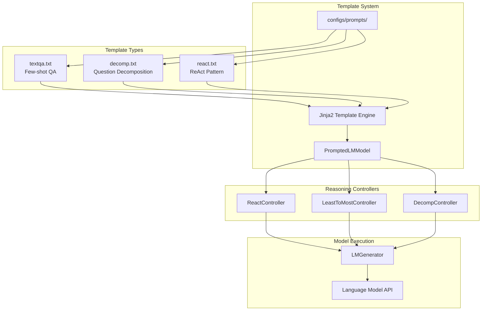
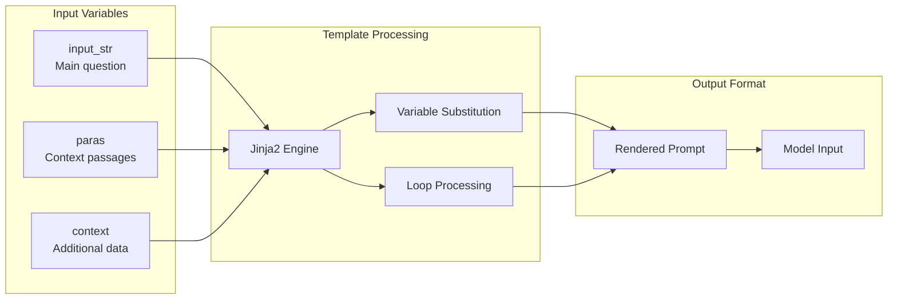
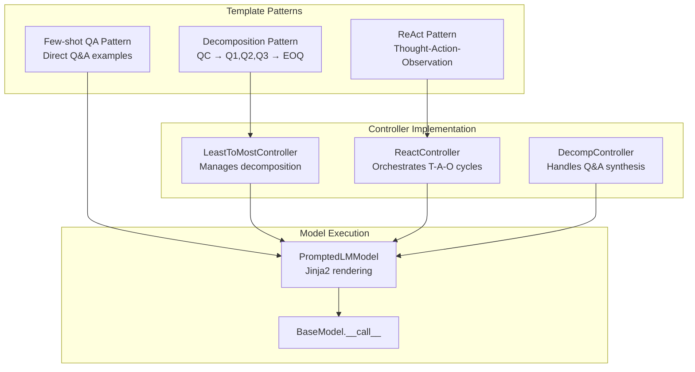

<!-- source: DeepWiki mcp.deepwiki.com · repo allenai/recoma · page 6.3 Prompt Templates · fetched 2026-10-26 -->

# Prompt Templates

<details>
<summary>Relevant source files</summary>

The following files were used as context for generating this wiki page:

- [configs/prompts/drop/decomp.txt](configs/prompts/drop/decomp.txt)
- [configs/prompts/drop/react.txt](configs/prompts/drop/react.txt)
- [configs/prompts/drop/textqa.txt](configs/prompts/drop/textqa.txt)

</details>


This document covers the structure, format, and usage of prompt templates in ReComA. Prompt templates define the few-shot examples and formatting patterns that guide language model behavior for specific reasoning tasks. These templates use Jinja2 templating syntax to create dynamic prompts that integrate with ReComA's reasoning controllers.

For implementation details of how these templates are rendered and used, see [Prompted Language Models](#5.2). For configuration of specific reasoning controllers that use these templates, see [React Controller](#4.1) and [Least-to-Most Controller](#4.2).

## Template Architecture

ReComA's prompt templates are organized in a hierarchical structure under the `configs/prompts/` directory, typically grouped by dataset and reasoning pattern. The templates integrate with the model execution pipeline through the `PromptedLMModel` class and various reasoning controllers.



Sources: [configs/prompts/drop/textqa.txt:1-35](), [configs/prompts/drop/decomp.txt:1-71](), [configs/prompts/drop/react.txt:1-94]()

## Template Structure and Format

### Basic Template Components

ReComA prompt templates consist of several key components:

| Component | Purpose | Example |
|-----------|---------|---------|
| Few-shot Examples | Demonstrate the expected input-output format | Question-answer pairs with context |
| Jinja2 Variables | Dynamic content insertion | `{{ input_str }}`, `{{ paras }}` |
| Control Flow | Template logic for loops and conditionals | `` |
| Formatting Patterns | Consistent structure for model understanding | Q:/A: prefixes, numbered steps |

### Template Variable Types



Sources: [configs/prompts/drop/textqa.txt:31-35]()

## Template Types

### Few-Shot QA Templates

The `textqa.txt` template demonstrates basic question-answering with context passages. It provides multiple examples of reading comprehension followed by the target question.

**Structure:**
- Multiple context paragraphs with associated questions and answers
- Jinja2 loop to render context passages: ``
- Template variable for the target question: `{{ input_str }}`

**Example Pattern:**
```
[Context paragraph]

Q: [Question]
A: [Answer]

[Next context paragraph]
...
```

Sources: [configs/prompts/drop/textqa.txt:1-35]()

### Decomposition Templates

The `decomp.txt` template implements question decomposition where complex questions (`QC`) are broken down into simpler sub-questions (`Q1`, `Q2`, etc.). Each sub-question can be routed to different tools.

**Structure:**
- `QC:` prefix for complex questions
- Sequential sub-questions (`Q1:`, `Q2:`, etc.)
- Tool routing with brackets: `[textqa]`, `[basic_math]`
- Answer references: `#1`, `#2`, etc.
- End-of-question marker: `[EOQ]`

**Tool Routing:**
- `[textqa]`: Route to text-based QA
- `[basic_math]`: Route to mathematical computation
- `[EOQ]`: End of question sequence

Sources: [configs/prompts/drop/decomp.txt:1-71]()

### ReAct Templates

The `react.txt` template implements the ReAct (Reasoning and Acting) pattern with explicit thought-action-observation cycles.

**Structure:**
- `Thought:` reasoning steps
- `Action:` tool calls with routing syntax
- `Observation:` tool responses
- `Finish[]` termination with final answer

**Reasoning Pattern:**
```
Thought: [Reasoning step]
Action: [tool] [Query]
Observation: [Tool response]
Thought: [Next reasoning step]
...
Thought: Finish[Final Answer]
```

Sources: [configs/prompts/drop/react.txt:1-94]()

## Template Integration with Controllers

### Controller-Template Mapping

Different reasoning controllers utilize specific template patterns:



Sources: [configs/prompts/drop/textqa.txt:1-35](), [configs/prompts/drop/decomp.txt:1-71](), [configs/prompts/drop/react.txt:1-94]()

## Jinja2 Template Features

### Variable Substitution

Templates use standard Jinja2 variable syntax:
- `{{ input_str }}`: Main question or input
- `{{ paras }}`: Context paragraphs or passages
- `{{ context }}`: Additional contextual information

### Control Flow

Templates support Jinja2 control structures:
- ``: Iterate over context passages
- ``: End loop
- ``: Conditional rendering
- ``: End conditional

### Template Inheritance

Templates can extend base templates and override specific blocks, though the provided examples use self-contained templates.

Sources: [configs/prompts/drop/textqa.txt:31-35]()

## Answer Format Patterns

### Structured Answer Types

Templates demonstrate different answer formats based on question complexity:

| Answer Type | Format | Example |
|-------------|--------|---------|
| Simple Value | Direct answer | `7.70%` |
| List Format | JSON-like array | `["1997", "2000"]` |
| Descriptive | Natural language | `41-yard touchdown run` |
| Unknown | Explicit unknown | `Unknown` |

### Tool-Specific Formatting

Different tools expect specific input/output formats:
- `[textqa]`: Natural language questions
- `[basic_math]`: Mathematical expressions
- `[EOQ]`: Termination marker

Sources: [configs/prompts/drop/textqa.txt:1-30](), [configs/prompts/drop/decomp.txt:1-71]()

## Creating Custom Templates

### Template Development Guidelines

1. **Consistent Format**: Follow established patterns for question-answer structure
2. **Clear Examples**: Provide diverse, representative few-shot examples
3. **Tool Integration**: Use proper routing syntax for multi-tool scenarios
4. **Variable Naming**: Use descriptive Jinja2 variable names
5. **Error Handling**: Include examples of edge cases and unknown answers

### Template Testing

Templates should be tested with:
- Various question types and complexities
- Different context lengths
- Edge cases (missing information, ambiguous questions)
- Tool routing accuracy

### Integration Points

New templates integrate with the system through:
- Configuration files specifying template paths
- `PromptedLMModel` class for rendering
- Reasoning controllers for execution flow
- Model registry for tool routing

Sources: [configs/prompts/drop/textqa.txt:1-35](), [configs/prompts/drop/decomp.txt:1-71](), [configs/prompts/drop/react.txt:1-94]()

---

