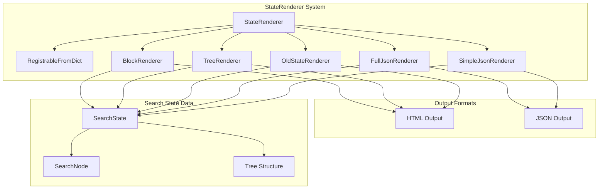
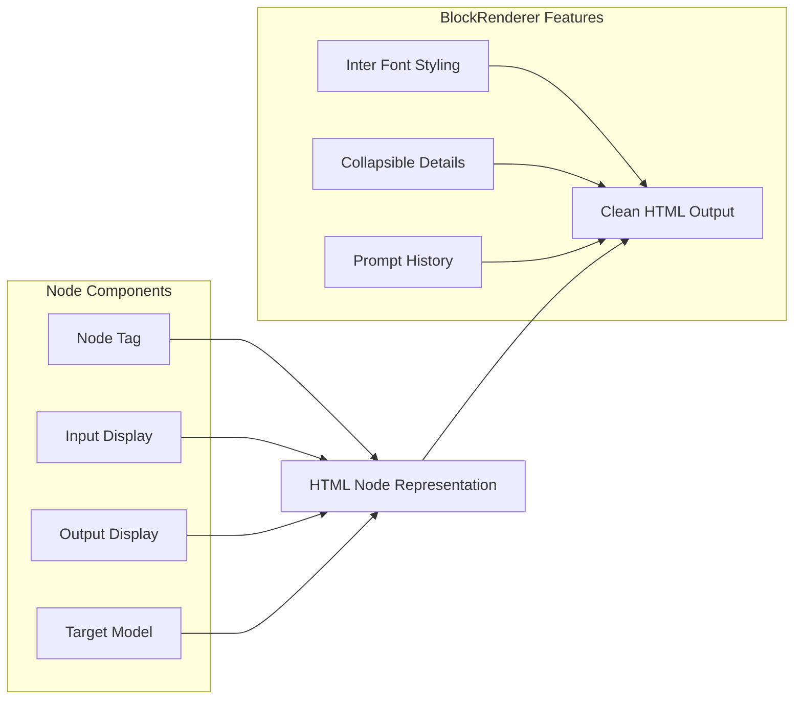
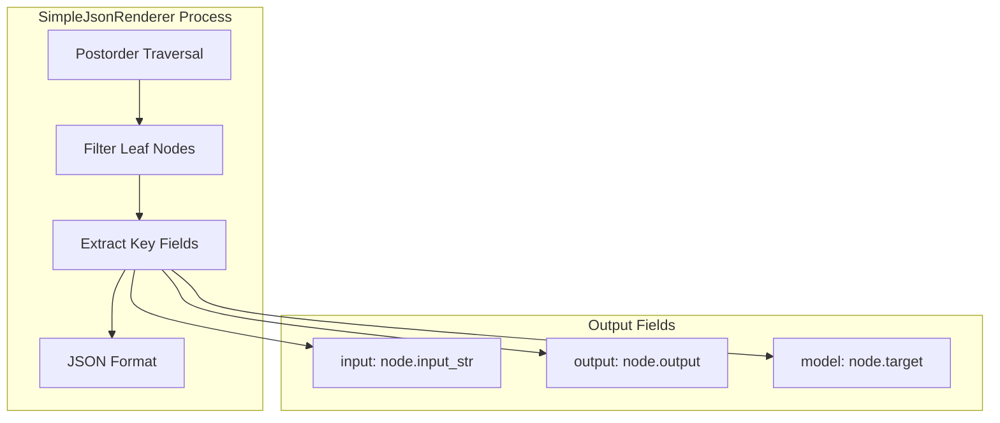
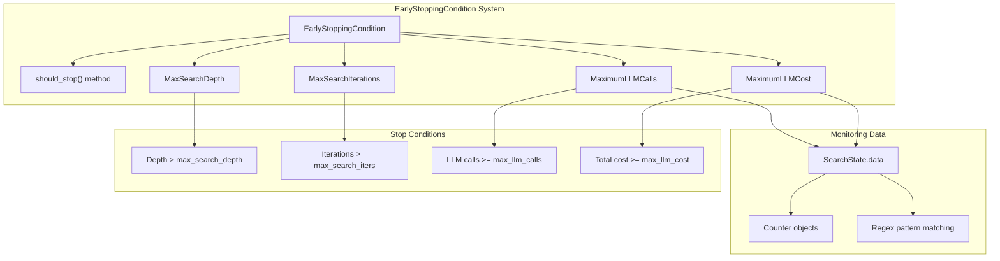
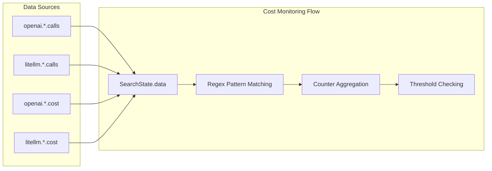
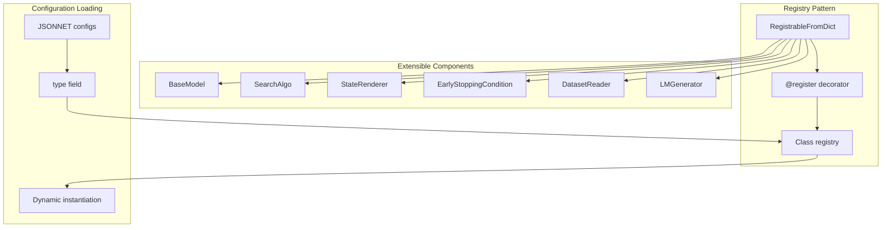
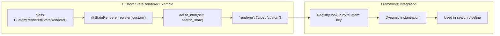

<!-- source: DeepWiki mcp.deepwiki.com · repo allenai/recoma · page 7 Advanced Features · fetched 2026-10-26 -->

# Advanced Features

Relevant source files

The following files were used as context for generating this wiki page:

- [configs/inference/drop/decomp.jsonnet](configs/inference/drop/decomp.jsonnet)
- [recoma/search/early_stopping.py](recoma/search/early_stopping.py)
- [recoma/utils/state_renderer.py](recoma/utils/state_renderer.py)

This document covers advanced functionality for monitoring, debugging, and extending ReComA beyond basic inference operations. These features enable developers to visualize search processes, control resource usage, and extend the framework with custom components.

For basic usage patterns, see [Quick Start Guide](#1.2). For core system architecture, see [Core Architecture](#2).

## State Visualization and Debugging

ReComA provides comprehensive visualization tools for debugging search processes and understanding model interactions through the `StateRenderer` system.

### StateRenderer Architecture

The state rendering system uses a registry pattern to support multiple output formats for search state visualization:

**Sources:** [recoma/utils/state_renderer.py:1-419]()

### HTML Visualization Renderers

ReComA includes several HTML renderers for different visualization needs:

| Renderer | Registration Key | Purpose | Features |
|----------|------------------|---------|----------|
| `BlockRenderer` | `"block"` | Modern collapsible interface | Inter font, clean styling, expandable details |
| `TreeRenderer` | `"tree"` | Tree-like hierarchical view | CSS tree lines, nested structure |
| `OldStateRenderer` | `"old"` | Legacy styling | Simple details/summary format |

The `BlockRenderer` provides the most polished visualization with modern CSS styling:

**Sources:** [recoma/utils/state_renderer.py:31-207]()

### JSON Export Renderers

For programmatic access to search state data, ReComA provides JSON renderers:

- **`FullJsonRenderer`**: Exports complete search state with all metadata via `SearchState.to_json()`
- **`SimpleJsonRenderer`**: Exports only leaf nodes with essential fields (input, output, model)

The `SimpleJsonRenderer` creates a simplified view focusing on final outputs:

**Sources:** [recoma/utils/state_renderer.py:401-419]()

## Search Control and Early Stopping

ReComA provides multiple mechanisms to control search execution and prevent excessive resource consumption through the `EarlyStoppingCondition` system.

### Early Stopping Architecture

The early stopping system uses a registry pattern with pluggable conditions:

**Sources:** [recoma/search/early_stopping.py:1-87]()

### Resource Monitoring

The LLM call and cost monitoring systems track usage through regex pattern matching on `SearchState.data` keys:

| Pattern | Purpose | Example Keys |
|---------|---------|--------------|
| `openai.(.*).calls` | Track OpenAI API calls | `openai.gpt-3.5-turbo.calls` |
| `litellm.(.*).calls` | Track LiteLLM API calls | `litellm.gemini-pro.calls` |
| `openai.(.*).cost` | Track OpenAI costs | `openai.gpt-4.cost` |
| `litellm.(.*).cost` | Track LiteLLM costs | `litellm.claude-3.cost` |

The monitoring system aggregates these values across all models:

**Sources:** [recoma/search/early_stopping.py:46-87]()

## Extending the Framework

ReComA uses a consistent registry pattern throughout the codebase that enables easy extension with custom components.

### Registration System

All extensible components inherit from `RegistrableFromDict` and use the `@register` decorator:

### Adding Custom Components

To extend ReComA with custom components:

1. **Inherit from appropriate base class**: Use `BaseModel`, `StateRenderer`, `EarlyStoppingCondition`, etc.
2. **Register with decorator**: Use `@YourBaseClass.register("your_key")`
3. **Implement required methods**: Follow the abstract method signatures
4. **Configure in JSONNET**: Reference by registration key in configuration files

Example registration pattern from the codebase:

**Sources:** [recoma/utils/state_renderer.py:8-419](), [recoma/search/early_stopping.py:12-87]()

### Configuration Integration

The framework automatically discovers and instantiates registered components based on JSONNET configuration files. The `type` field in configuration objects corresponds to registration keys, enabling declarative component composition.

**Sources:** [configs/inference/drop/decomp.jsonnet:1-39]()

---

