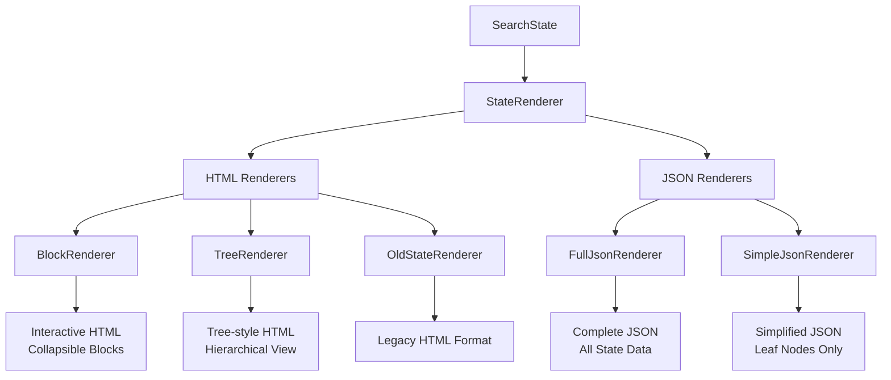
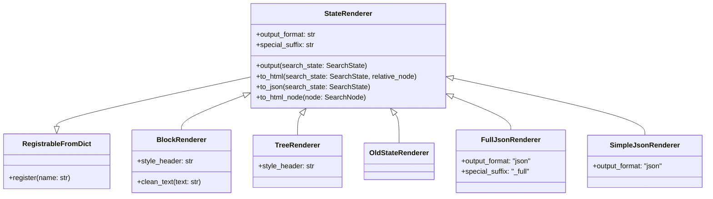
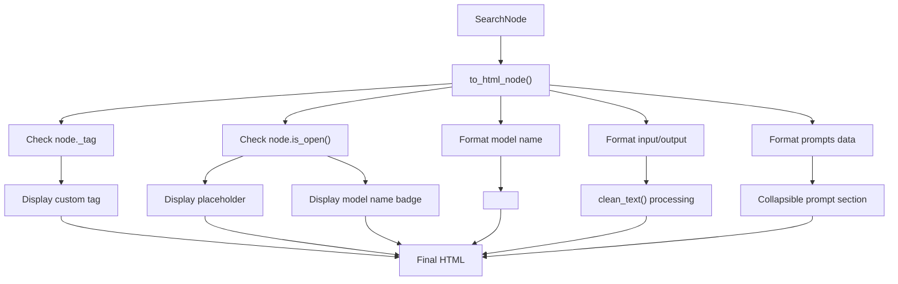
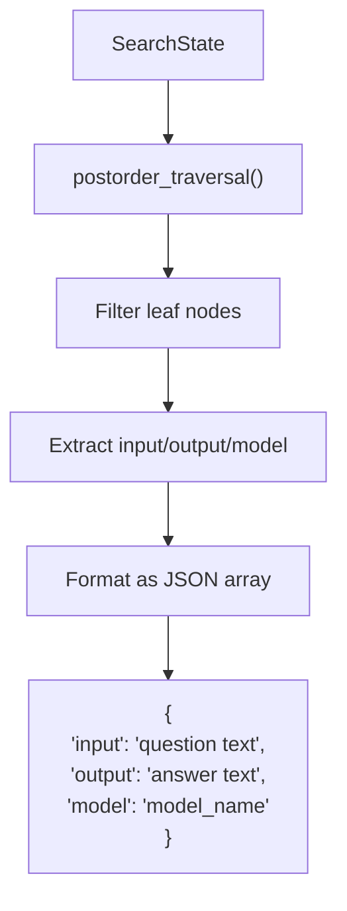
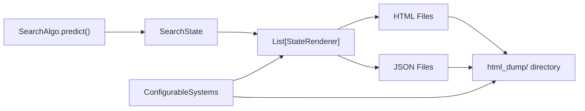

<!-- source: DeepWiki mcp.deepwiki.com · repo allenai/recoma · page 7.1 State Visualization and Debugging · fetched 2026-10-26 -->

# State Visualization and Debugging

Relevant source files

The following files were used as context for generating this wiki page:

- [recoma/utils/state_renderer.py](recoma/utils/state_renderer.py)

This document covers ReComA's state visualization and debugging capabilities, which provide tools for inspecting and understanding the reasoning process during search-based inference. The system allows users to visualize search trees, examine model inputs and outputs, and debug complex reasoning chains through multiple rendering formats.

For information about search control and resource management, see [Search Control and Early Stopping](#7.2). For details about the core search algorithms, see [Search System](#2.2).

## Overview

ReComA's state visualization system centers around the `StateRenderer` abstraction, which converts `SearchState` objects into human-readable formats for debugging and analysis. The system supports multiple visualization formats including interactive HTML views and structured JSON outputs.

Sources: [recoma/utils/state_renderer.py:1-419]()

## StateRenderer Base Class and Registration

The `StateRenderer` class serves as the foundation for all visualization implementations, using ReComA's registration system to enable dynamic renderer selection through configuration.

The base class defines the interface for rendering search states and provides format selection logic through the `output` method [recoma/utils/state_renderer.py:14-20](). Concrete renderers register themselves using decorators like `@StateRenderer.register("block")` [recoma/utils/state_renderer.py:31]().

Sources: [recoma/utils/state_renderer.py:8-30]()

## HTML Renderers

### BlockRenderer

The `BlockRenderer` creates interactive HTML visualizations using collapsible details elements. It provides the most user-friendly interface for exploring search trees with embedded CSS styling.

Key features:
- Collapsible blocks for each search node
- Separate sections for input, output, and prompts
- Clean text formatting with code block support
- Interactive expansion/collapse of tree branches

The renderer includes comprehensive CSS styling [recoma/utils/state_renderer.py:36-153]() and implements recursive tree traversal [recoma/utils/state_renderer.py:156-170]() to create nested HTML structures.

### TreeRenderer

The `TreeRenderer` displays search states as hierarchical tree structures using CSS-based visual connectors. It provides a more compact view compared to the block renderer.

Features:
- Tree-style visual connectors between nodes
- Hierarchical indentation
- Hover effects on model names
- Integrated prompt details

The renderer uses specialized CSS for tree visualization [recoma/utils/state_renderer.py:214-262]() and generates `<li>` elements with proper nesting [recoma/utils/state_renderer.py:265-278]().

### Node Rendering Details

All HTML renderers share common node rendering logic that handles:
- Model name display with special formatting
- Input/output text cleaning and HTML escaping
- Prompt history expansion
- Open vs. closed node state visualization

Sources: [recoma/utils/state_renderer.py:177-207](), [recoma/utils/state_renderer.py:280-305]()

## JSON Renderers

### FullJsonRenderer

The `FullJsonRenderer` outputs complete JSON representations of search states by calling the `SearchState.to_json()` method. This provides comprehensive debugging information including all internal state data.

Configuration:
- `output_format`: "json"
- `special_suffix`: "_full"

### SimpleJsonRenderer

The `SimpleJsonRenderer` creates simplified JSON outputs containing only leaf nodes (final results) from the search tree. It extracts:
- Input text
- Output text  
- Model name

The renderer uses `postorder_traversal()` to identify leaf nodes and formats them as a clean JSON array [recoma/utils/state_renderer.py:408-418]().

Sources: [recoma/utils/state_renderer.py:401-419]()

## Integration with Search System

State renderers integrate with ReComA's search system through the inference pipeline, where they process `SearchState` objects after search completion.

The renderers are configured through the main configuration system and applied to each prediction result during batch inference. They enable comprehensive debugging of the reasoning process by preserving the complete search tree structure and all intermediate model interactions.

Sources: [recoma/utils/state_renderer.py:8-419]()

## Debugging Workflows

The visualization system supports several debugging workflows:

| Renderer Type | Use Case | Output Format |
|---------------|----------|---------------|
| `BlockRenderer` | Interactive exploration of reasoning chains | HTML with collapsible sections |
| `TreeRenderer` | Hierarchical visualization of search structure | HTML with tree-style layout |
| `SimpleJsonRenderer` | Programmatic analysis of final results | JSON array of leaf nodes |
| `FullJsonRenderer` | Complete state inspection and replay | Full JSON representation |

The HTML renderers are particularly valuable for understanding complex reasoning patterns, as they allow users to expand and collapse different branches of the search tree while examining the detailed input/output interactions at each step.

Sources: [recoma/utils/state_renderer.py:1-419]()

---

