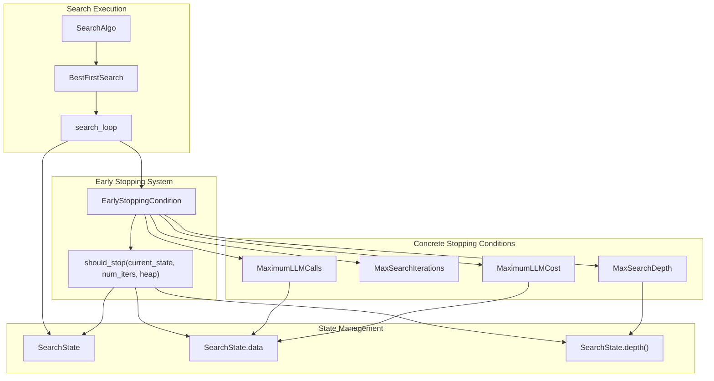
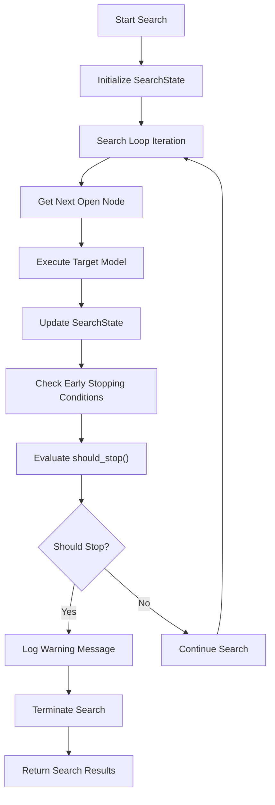

<!-- source: DeepWiki mcp.deepwiki.com · repo allenai/recoma · page 7.2 Search Control and Early Stopping · fetched 2026-10-26 -->

# Search Control and Early Stopping

<details>
<summary>Relevant source files</summary>

The following files were used as context for generating this wiki page:

- [configs/inference/drop/decomp.jsonnet](configs/inference/drop/decomp.jsonnet)
- [recoma/search/early_stopping.py](recoma/search/early_stopping.py)

</details>


This document covers the mechanisms for controlling and terminating search operations in ReComA. The search control system provides configurable conditions to automatically stop the search process based on various criteria such as depth limits, iteration counts, resource usage, and cost thresholds.

For information about the broader search system architecture, see [Search System](#2.2). For details about search state management, see [State Visualization and Debugging](#7.1).

## Overview

ReComA's search control system prevents runaway search processes by implementing early stopping conditions that monitor various aspects of the search execution. These conditions are evaluated at each search iteration to determine whether the search should continue or terminate early.

The system is built around the `EarlyStoppingCondition` abstract base class, which provides a registry pattern for different stopping criteria. Multiple conditions can be combined to create sophisticated stopping logic.

## Early Stopping Architecture

The following diagram shows how early stopping conditions integrate with the search system:



Sources: [recoma/search/early_stopping.py:1-87]()

## Early Stopping Conditions

### Base Class: EarlyStoppingCondition

The `EarlyStoppingCondition` class provides the foundation for all stopping conditions. It uses the `RegistrableFromDict` pattern to enable configuration-based instantiation.

```python
@abstractmethod
def should_stop(self, current_state: SearchState, num_iters: int, heap: list[SearchState]):
    raise NotImplementedError
```

The `should_stop` method receives three parameters:
- `current_state`: The current search state being evaluated
- `num_iters`: The number of search iterations completed
- `heap`: The priority queue of remaining search states

### Search Depth Control

The `MaxSearchDepth` condition terminates search when the tree depth exceeds a specified limit:

| Parameter | Default Value | Purpose |
|-----------|---------------|---------|
| `max_search_depth` | 100 | Maximum allowed depth in the search tree |

This condition prevents infinite recursion and controls the complexity of reasoning chains.

### Iteration Limits

The `MaxSearchIterations` condition limits the total number of search iterations:

| Parameter | Default Value | Purpose |
|-----------|---------------|---------|
| `max_search_iters` | 100 | Maximum number of search loop iterations |

This provides a simple upper bound on computation time regardless of tree structure.

### Resource Usage Control

#### LLM Call Limits

The `MaximumLLMCalls` condition tracks and limits the total number of language model API calls:

| Parameter | Default Value | Purpose |
|-----------|---------------|---------|
| `max_llm_calls` | 200 | Maximum total LLM API calls |

The condition examines `SearchState.data` for keys matching patterns like `openai.*.calls` and `litellm.*.calls` to count total API usage.

#### Cost Control

The `MaximumLLMCost` condition monitors the total monetary cost of LLM usage:

| Parameter | Default Value | Purpose |
|-----------|---------------|---------|
| `max_llm_cost` | 2.00 | Maximum total cost in dollars |

Similar to call tracking, this examines `SearchState.data` for keys matching `openai.*.cost` and `litellm.*.cost` patterns.

Sources: [recoma/search/early_stopping.py:19-86]()

## Integration with Search System

Early stopping conditions are evaluated during the search loop execution. The following diagram shows the control flow:



Sources: [recoma/search/early_stopping.py:25-86]()

## Configuration Usage

Early stopping conditions are configured through the search configuration. Here's an example configuration pattern:

```json
{
  "search": {
    "type": "best_first",
    "start_model": "decomp_control",
    "early_stopping": [
      {
        "type": "max_search_depth",
        "max_search_depth": 50
      },
      {
        "type": "max_llm_cost", 
        "max_llm_cost": 1.00
      }
    ]
  }
}
```

Multiple conditions can be specified, and the search will stop when any condition is met.

### Registered Condition Types

| Registration Key | Class Name | Purpose |
|------------------|------------|---------|
| `max_search_depth` | `MaxSearchDepth` | Limit tree depth |
| `max_search_iters` | `MaxSearchIterations` | Limit iterations |
| `max_llm_calls` | `MaximumLLMCalls` | Limit API calls |
| `max_llm_cost` | `MaximumLLMCost` | Limit monetary cost |

Sources: [recoma/search/early_stopping.py:19-68](), [configs/inference/drop/decomp.jsonnet:29-35]()

## Implementation Details

### State Data Tracking

The resource-based stopping conditions (`MaximumLLMCalls` and `MaximumLLMCost`) rely on metadata stored in `SearchState.data`. This data is populated by language model generators during API calls.

The conditions use regular expressions to identify relevant keys:
- API call counts: `openai.*.calls`, `litellm.*.calls`  
- API costs: `openai.*.cost`, `litellm.*.cost`

### Logging and Monitoring

All stopping conditions emit warning-level log messages when triggered, providing visibility into why searches terminate:

```python
logger.warning("Hit max search depth: {} >= {}".format(current_state.depth(), self.max_search_depth))
logger.warning("Hit max calls: {} >= {}".format(num_calls, self.max_llm_calls))
logger.warning("Hit max cost: {} >= {}".format(total_cost, self.max_llm_cost))
```

These logs are essential for debugging and monitoring search behavior in production systems.

Sources: [recoma/search/early_stopping.py:27-84]()

---

