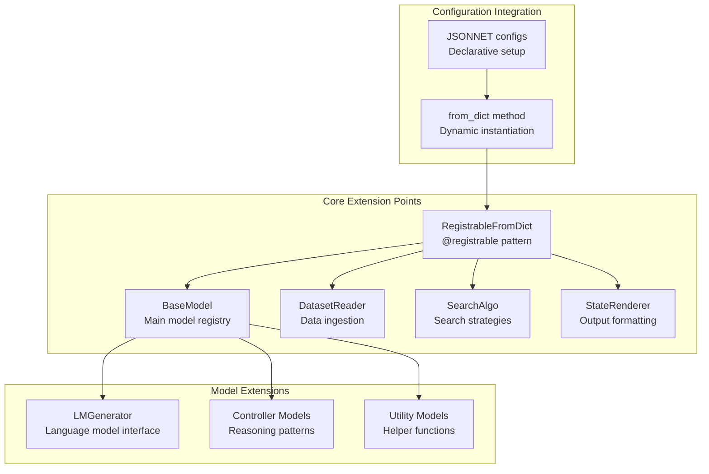
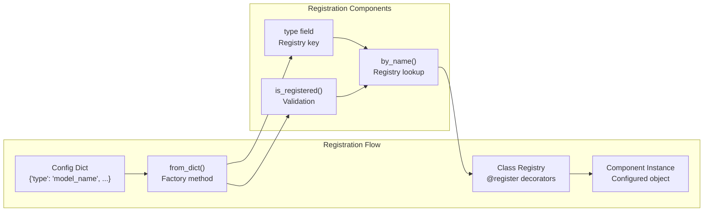
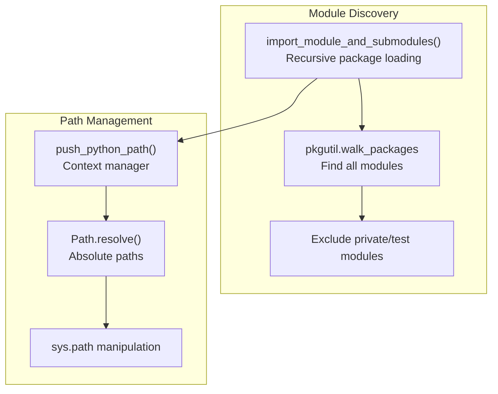
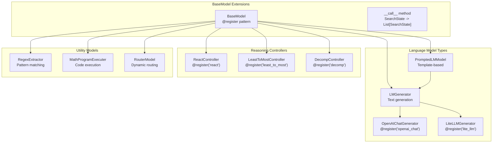
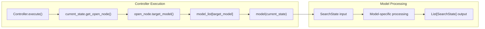
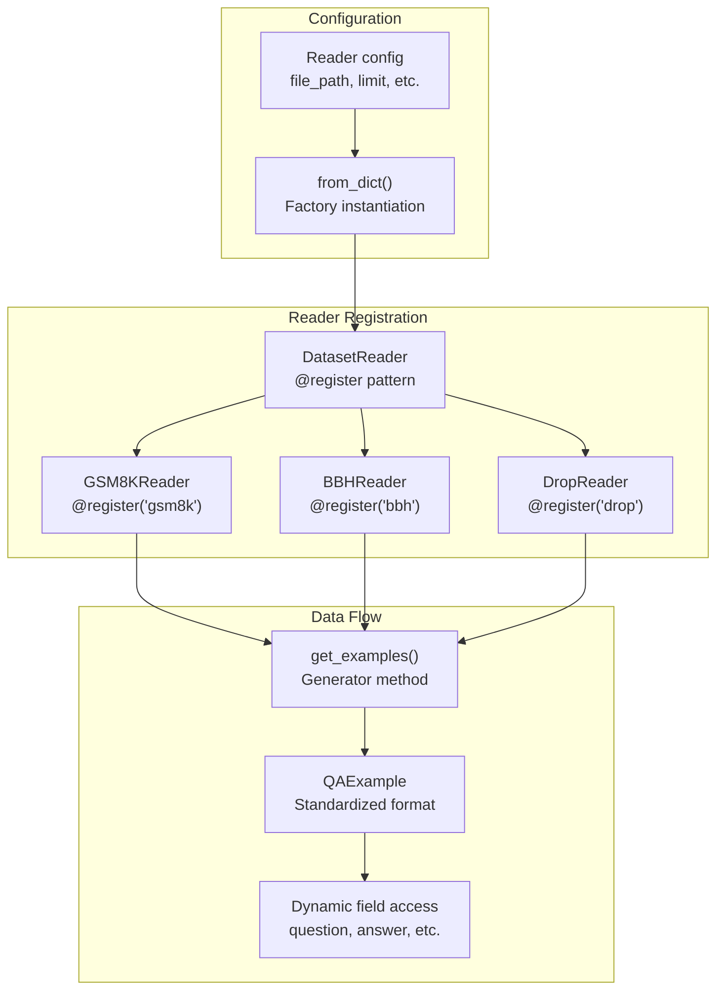
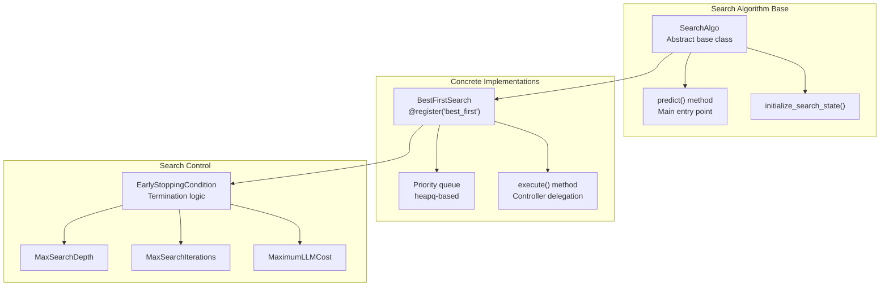
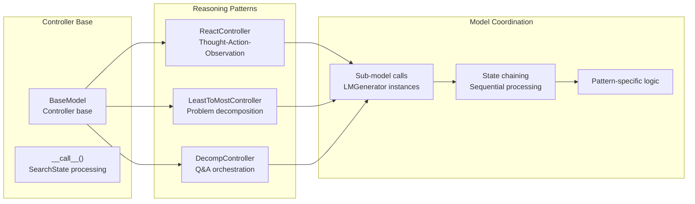
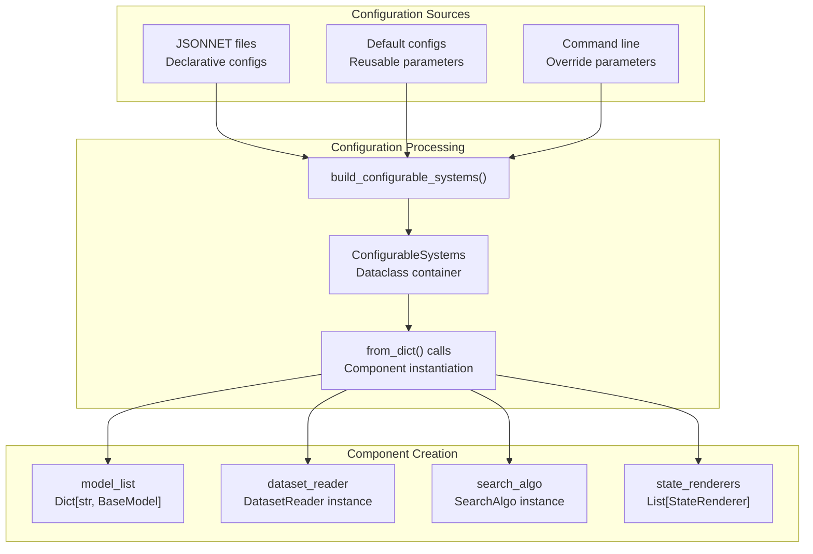

<!-- source: DeepWiki mcp.deepwiki.com · repo allenai/recoma · page 7.3 Extending the Framework · fetched 2026-10-26 -->

# Extending the Framework

<details>
<summary>Relevant source files</summary>

The following files were used as context for generating this wiki page:

- [recoma/search/controller.py](recoma/search/controller.py)
- [recoma/utils/class_utils.py](recoma/utils/class_utils.py)

</details>


This document provides a comprehensive guide for developers who want to extend the ReComA framework by adding new components such as models, dataset readers, search algorithms, and reasoning controllers. The framework is designed with extensibility in mind, using a registration system that allows new components to be added without modifying core framework code.

For basic usage patterns, see [Quick Start Guide](#1.2). For understanding the core architecture before extending it, see [Core Architecture](#2).

## Overview of Extension Points

The ReComA framework provides several key extension points through its registration system. All major components inherit from `RegistrableFromDict`, enabling them to be dynamically loaded from configuration files.



**Sources:** [recoma/utils/class_utils.py:13-33]()

## Registration System

The framework uses a sophisticated registration system based on the `registrable` library. The `RegistrableFromDict` class extends the basic `Registrable` pattern to support configuration-driven instantiation.

### Core Registration Pattern



The registration system works through these key methods:

| Method | Purpose | Location |
|--------|---------|----------|
| `from_dict()` | Creates instances from configuration dictionaries | [recoma/utils/class_utils.py:20-32]() |
| `is_registered()` | Checks if a type is registered | [recoma/utils/class_utils.py:27-29]() |
| `by_name()` | Retrieves registered class by name | [recoma/utils/class_utils.py:30]() |

**Sources:** [recoma/utils/class_utils.py:13-33]()

### Module Loading System

The framework automatically discovers and loads modules containing registered classes:



**Sources:** [recoma/utils/class_utils.py:59-96](), [recoma/utils/class_utils.py:40-57]()

## Extending Models

The model system is the primary extension point for adding new language model integrations and reasoning capabilities.

### BaseModel Hierarchy



### Creating New Model Types

To add a new model type, follow this pattern:

1. **Inherit from appropriate base class** - Choose `BaseModel`, `LMGenerator`, or a reasoning controller
2. **Add registration decorator** - Use `@register('your_model_name')`
3. **Implement required methods** - Typically `__call__` for `BaseModel` or `generate` for `LMGenerator`
4. **Handle SearchState** - Transform input states to output states

### Model Execution Flow



**Sources:** [recoma/search/controller.py:14-27]()

## Extending Dataset Readers

Dataset readers enable the framework to process different data formats and sources.

### DatasetReader Pattern



### Creating New Dataset Readers

To add support for a new dataset format:

1. **Inherit from DatasetReader** - Base class provides registration
2. **Implement get_examples()** - Return generator of `QAExample` objects
3. **Handle file formats** - Parse JSON, JSONL, CSV, or custom formats
4. **Register with decorator** - Use `@register('dataset_name')`

**Sources:** Based on architecture diagrams showing GSM8K, BBH, and DROP readers

## Extending Search Algorithms

Search algorithms coordinate the execution of models and manage the search state.

### SearchAlgo Extension Points



### Search Algorithm Components

| Component | Purpose | Extension Point |
|-----------|---------|----------------|
| `SearchAlgo` | Base algorithm interface | Inherit and implement `predict()` |
| `EarlyStoppingCondition` | Termination logic | Add new stopping criteria |
| `SearchState` | State management | Custom state representations |
| `SearchNode` | Individual search steps | Custom node types |

**Sources:** Based on search system architecture diagrams

## Extending Reasoning Controllers

Reasoning controllers implement specific reasoning patterns that coordinate multiple model calls.

### Controller Architecture



### Creating New Reasoning Patterns

To implement a new reasoning controller:

1. **Inherit from BaseModel** - Use the standard model interface
2. **Implement coordination logic** - Orchestrate multiple model calls
3. **Handle state transitions** - Transform input states through reasoning steps
4. **Register with framework** - Use `@register('controller_name')`

**Sources:** Based on reasoning controller architecture from system diagrams

## Configuration Integration

All extensions must integrate with the configuration system to be usable in practice.

### Configuration Flow



### Making Extensions Configurable

To make your extensions configurable:

1. **Accept configuration parameters** - Add parameters to `__init__`
2. **Provide sensible defaults** - Make extensions easy to use
3. **Document parameters** - Clear documentation for configuration options
4. **Create example configs** - Provide JSONNET configuration examples

**Sources:** Based on configuration system architecture from diagrams

## Best Practices for Extensions

### Error Handling

Extensions should handle errors gracefully and provide meaningful error messages. The `Controller.execute()` method shows proper error handling patterns:

```python
# Handle missing models
if target_model not in self.model_list:
    logger.error("Can not handle next state: " + str(target_model))
    return []

# Handle runtime errors
try:
    output_states = self.model_list[target_model](current_state)
    return output_states
except RecursionError:
    return []
```

### Testing Extensions

- **Unit tests** - Test individual component functionality
- **Integration tests** - Test configuration loading and execution
- **End-to-end tests** - Test complete workflows with your extensions

### Documentation

- **Registration names** - Document the string names used for registration
- **Configuration parameters** - Document all configurable parameters
- **Usage examples** - Provide configuration file examples

**Sources:** [recoma/search/controller.py:18-25]()