# Page: Overview

# Overview

<details>
<summary>Relevant source files</summary>

The following files were used as context for generating this wiki page:

- [.gitignore](.gitignore)
- [README.md](README.md)
- [recoma/models/README.md](recoma/models/README.md)
- [recoma/models/core/README.md](recoma/models/core/README.md)
- [recoma/models/core/utility_models.py](recoma/models/core/utility_models.py)
- [requirements.txt](requirements.txt)
- [setup.cfg](setup.cfg)
- [setup.py](setup.py)

</details>


## Purpose and Scope

ReComA (Reasoning via Communicating Agents) is a Python framework for solving complex reasoning tasks through orchestrated language model agents. The system coordinates multiple specialized models using tree-based search algorithms to explore different reasoning paths and synthesize solutions.

This document provides a high-level overview of ReComA's architecture, core components, and data flow. For detailed installation instructions, see [Installation and Setup](#1.1). For hands-on usage examples, see [Quick Start Guide](#1.2). For deep dives into specific subsystems, see [Core Architecture](#2) and its subsections.

*Sources: [README.md:1-17](), [setup.py:29-29]()*

## System Architecture

ReComA implements a search-based reasoning framework where language models are orchestrated through a tree search algorithm. The system reads examples from datasets, applies reasoning strategies through model controllers, and produces structured outputs with full execution traces.

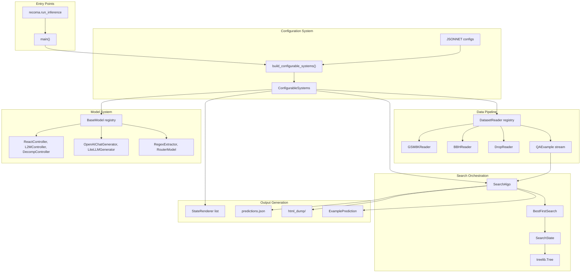

*Sources: [recoma/run_inference.py](), [recoma/models/core/base_model.py](), [recoma/search/](), [recoma/datasets/](), [setup.py:53-56]()*

## Core Components

### Model Registry and Execution

The system centers around a `BaseModel` registry that manages different types of reasoning agents. Each model implements a `__call__` method that takes a `SearchState` and returns new states to explore. The key model types include:

| Model Type | Purpose | Key Classes |
|------------|---------|-------------|
| **Reasoning Controllers** | Implement multi-step reasoning patterns | `ReactController`, `LeastToMostController`, `DecompController` |
| **Language Model Generators** | Interface with LLM APIs | `OpenAIChatGenerator`, `LiteLLMGenerator` |
| **Utility Models** | Text processing and routing | `RegexExtractor`, `RouterModel`, `PromptedLMModel` |

*Sources: [recoma/models/core/base_model.py](), [recoma/models/core/README.md:3-7](), [recoma/models/core/utility_models.py]()*

### Search System

The search system manages exploration of reasoning paths through a tree structure. `BestFirstSearch` maintains a priority queue of open nodes and delegates execution to target models. Each `SearchState` contains a `treelib.Tree` representing the current reasoning trace.

*Sources: [recoma/search/](), [requirements.txt:1-1]()*

### Dataset Integration

Dataset readers implement a standardized interface for different reasoning benchmarks. Each reader produces a stream of `QAExample` objects with consistent field access patterns.

*Sources: [recoma/datasets/](), [recoma/models/core/README.md:15-15]()*

## Data Flow and Orchestration

The following diagram shows how data flows through the system during inference, mapping natural language concepts to specific code entities:

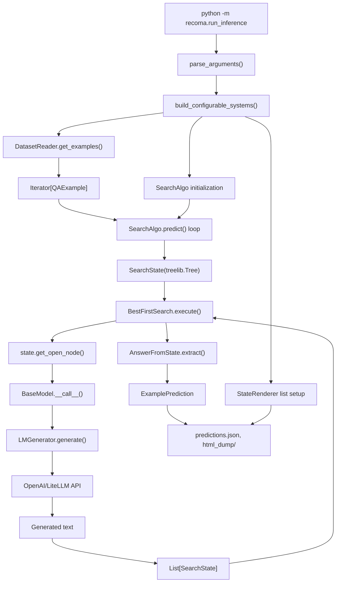

*Sources: [recoma/run_inference.py](), [recoma/search/search_algo.py](), [recoma/models/core/base_model.py](), [recoma/models/core/generator.py]()*

## Key Abstractions

### BaseModel Registration System

All models in ReComA inherit from `BaseModel` and use a registration decorator pattern. This enables dynamic model loading and configuration-driven composition:

```python
@BaseModel.register("my_model")
class MyModel(BaseModel):
    def __call__(self, state: SearchState) -> List[SearchState]:
        # Implementation
```

*Sources: [recoma/models/core/base_model.py](), [recoma/models/core/README.md:3-7](), [requirements.txt:8-8]()*

### Generator Abstraction

The `Generator` class provides a unified interface for different LLM providers. It handles caching, retry logic, and cost tracking transparently:

- `OpenAIChatGenerator`: Direct OpenAI API integration
- `LiteLLMGenerator`: Multi-provider support via LiteLLM library

*Sources: [recoma/models/core/generator.py](), [recoma/models/core/README.md:9-10](), [requirements.txt:4-5]()*

### Prompted Models

`PromptedLMModel` combines Jinja2 templates with generators to create configurable prompted agents. Templates can access context variables like `question`, `input_str`, and `paras`.

*Sources: [recoma/models/core/prompted_lm_model.py](), [recoma/models/core/README.md:13-17](), [requirements.txt:3-3]()*

## Configuration and Extensibility

ReComA uses JSONNET configuration files to define complete reasoning pipelines without code changes. The configuration system supports:

- Model composition and parameter specification
- Dataset selection and preprocessing
- Search algorithm configuration
- Output formatting and visualization

For detailed configuration guidance, see [Configuration System](#6). For extending ReComA with new models or datasets, see [Extending the Framework](#7.3).

*Sources: [README.md:17-17](), [requirements.txt:2-2](), [setup.py:48-48]()*

## Getting Started

ReComA provides multiple entry points for different use cases:

- **Interactive exploration**: `--gradio_demo` flag launches a web interface for single-example debugging
- **Batch inference**: Process datasets and generate structured outputs
- **Library integration**: Import ReComA components into existing codebases

The primary entry point is the `recoma.run_inference` command-line interface, which orchestrates the entire pipeline from configuration loading to result generation.

*Sources: [README.md:49-84](), [setup.py:53-56](), [requirements.txt:10-10]()*

---

# Page: Installation and Setup

# Installation and Setup

<details>
<summary>Relevant source files</summary>

The following files were used as context for generating this wiki page:

- [.gitignore](.gitignore)
- [requirements.txt](requirements.txt)
- [setup.cfg](setup.cfg)
- [setup.py](setup.py)

</details>


This document provides comprehensive instructions for installing ReComA and configuring the required dependencies and environment variables. This covers the initial setup process to get the reasoning framework operational on your system.

For information about running inference after installation, see [Quick Start Guide](#1.2). For advanced configuration of language models and reasoning tasks, see [Configuration System](#6).

## System Requirements

ReComA requires Python 3.9 or higher to operate. The framework has been tested on Python 3.9, 3.10, and 3.11 as specified in the package classifiers.

**Supported Python Versions:**
- Python 3.9
- Python 3.10  
- Python 3.11

Sources: [setup.py:43-46](), [setup.py:50]()

## Installation Options

### Install from PyPI (Recommended)

```bash
pip install recoma
```

This installs the latest stable version from the Python Package Index along with all required dependencies.

### Install from Source

For development or to get the latest features:

```bash
git clone https://github.com/allenai/recoma.git
cd recoma
pip install -e .
```

The `-e` flag installs the package in editable mode, allowing you to modify the source code and see changes immediately.

**Installation Flow Diagram**

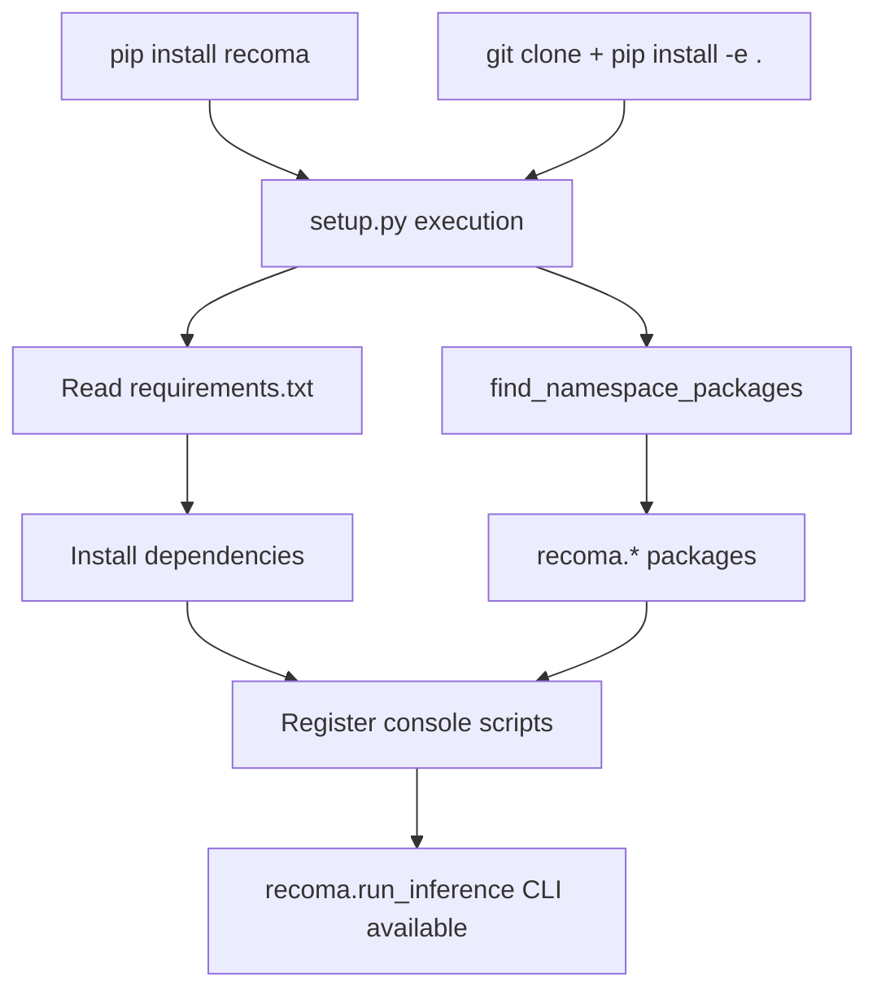

Sources: [setup.py:26-57](), [setup.py:49](), [setup.py:52-56]()

## Dependencies Overview

ReComA has several key dependencies that enable different aspects of the reasoning framework:

| Dependency | Purpose | Version Requirement |
|------------|---------|-------------------|
| `treelib` | Search state tree management | Any |
| `jsonnet` | Configuration file processing | Any |
| `jinja2` | Prompt template rendering | Any |
| `litellm` | Multi-provider LLM integration | ≥1.37.19 |
| `openai` | OpenAI API integration | ≥1.47.1 |
| `diskcache` | Response caching | Any |
| `tenacity` | Retry logic for API calls | Any |
| `registrable` | Component registration system | Any |
| `sympy` | Mathematical computation | Any |
| `gradio` | Web interface for demos | Any |

**Dependency Architecture**

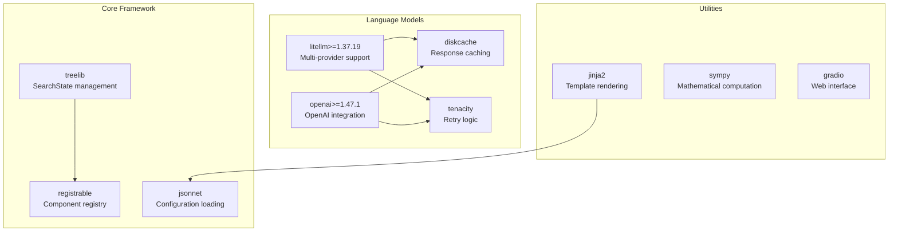

Sources: [requirements.txt:1-10](), [setup.py:51]()

## Environment Configuration

### Required Environment Variables

ReComA requires API keys for language model providers. Set these environment variables based on which models you plan to use:

**OpenAI Models:**
```bash
export OPENAI_API_KEY="your-openai-api-key"
```

**Other LLM Providers (via LiteLLM):**
```bash
# For Anthropic Claude
export ANTHROPIC_API_KEY="your-anthropic-key"

# For Google Gemini
export GEMINI_API_KEY="your-gemini-key"

# For Azure OpenAI
export AZURE_API_KEY="your-azure-key"
export AZURE_API_BASE="your-azure-endpoint"
```

### Optional Configuration

**Cache Directory:**
By default, ReComA uses disk caching for LLM responses. You can customize the cache location:
```bash
export RECOMA_CACHE_DIR="/path/to/cache"
```

**Configuration Directory:**
To use custom configuration files:
```bash
export RECOMA_CONFIG_DIR="/path/to/configs"
```

Sources: Based on LLM integration patterns from system architecture diagrams

## Verification

### Test CLI Installation

After installation, verify the command-line interface is available:

```bash
recoma.run_inference --help
```

This should display the help text for the inference command, confirming that the console script entry point was properly registered.

### Test Demo Mode

Run a simple demo to verify the system is working:

```bash
recoma.run_inference --demo_mode
```

This launches an interactive demo that doesn't require dataset files or complex configuration.

**Verification Flow**

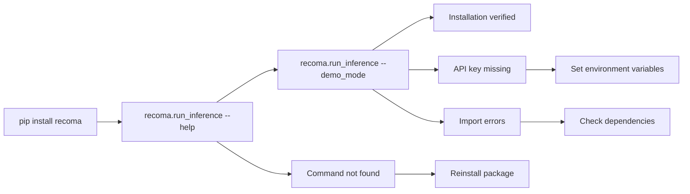

Sources: [setup.py:54](), based on CLI entry point configuration

## Troubleshooting

### Common Issues

**1. Command Not Found**
```bash
recoma.run_inference: command not found
```
- Ensure the package is installed: `pip list | grep recoma`
- Check that the installation directory is in your PATH
- Try reinstalling: `pip uninstall recoma && pip install recoma`

**2. Import Errors**
```bash
ModuleNotFoundError: No module named 'openai'
```
- Install missing dependencies: `pip install -r requirements.txt`
- Verify Python version compatibility: `python --version`

**3. API Key Errors**
```bash
openai.AuthenticationError: Incorrect API key provided
```
- Verify environment variables are set: `echo $OPENAI_API_KEY`
- Check API key validity with the provider
- Restart terminal session after setting environment variables

**4. Version Conflicts**
```bash
ERROR: pip's dependency resolver does not currently consider all constraints
```
- Use a virtual environment: `python -m venv recoma_env && source recoma_env/bin/activate`
- Update pip: `pip install --upgrade pip`
- Install with `--force-reinstall` flag if needed

### Development Setup

For contributors or advanced users modifying the framework:

```bash
# Create development environment
python -m venv recoma_dev
source recoma_dev/bin/activate  # On Windows: recoma_dev\Scripts\activate

# Install in development mode
git clone https://github.com/allenai/recoma.git
cd recoma
pip install -e .

# Install additional development dependencies if needed
pip install pytest black flake8
```

Sources: [setup.py:49-57](), [requirements.txt:4-5](), [.gitignore:7-11]()

---

# Page: Quick Start Guide

# Quick Start Guide

<details>
<summary>Relevant source files</summary>

The following files were used as context for generating this wiki page:

- [README.md](README.md)
- [recoma/models/README.md](recoma/models/README.md)
- [recoma/models/core/README.md](recoma/models/core/README.md)
- [recoma/models/core/utility_models.py](recoma/models/core/utility_models.py)
- [recoma/run_inference.py](recoma/run_inference.py)

</details>


This page provides basic usage patterns to get you started with ReComA quickly, including interactive demo mode and batch inference. It covers the essential command-line interface and configuration concepts needed to run reasoning tasks.

For detailed installation instructions, see [Installation and Setup](#1.1). For comprehensive configuration options, see [Configuration System](#6).

## Core Usage Patterns

ReComA provides three primary modes of operation through the `recoma.run_inference` module. All modes require a configuration file and output directory.

### Interactive Demo Mode

The simplest way to explore ReComA is through the interactive web interface:

```bash
python -m recoma.run_inference \
  --config configs/inference/letter_cat/decomp.jsonnet \
  --output_dir output/letter_cat_decomp/ \
  --gradio_demo
```

This starts a web server at `http://localhost:7860` with an interactive interface where you can:
- Enter questions directly
- View real-time reasoning traces
- Explore the search tree with expandable nodes
- See all underlying prompts and model interactions

**Command-Line Demo Mode**

For command-line interaction:

```bash
python -m recoma.run_inference \
  --config configs/inference/letter_cat/decomp.jsonnet \
  --output_dir output/letter_cat_decomp/ \
  --demo
```

This provides a text-based interface where you can enter questions and see the reasoning process.

### Batch Inference Mode

For processing datasets in batch:

```bash
python -m recoma.run_inference \
  --config configs/inference/letter_cat/decomp.jsonnet \
  --output_dir output/letter_cat_decomp/ \
  --input datasets/letter_cat/n4_eg100_pos2_space.json
```

This processes all examples in the input file and generates comprehensive output files.

Sources: [recoma/run_inference.py:229-250](), [README.md:49-84]()

## Command-Line Interface

### CLI Flow Diagram

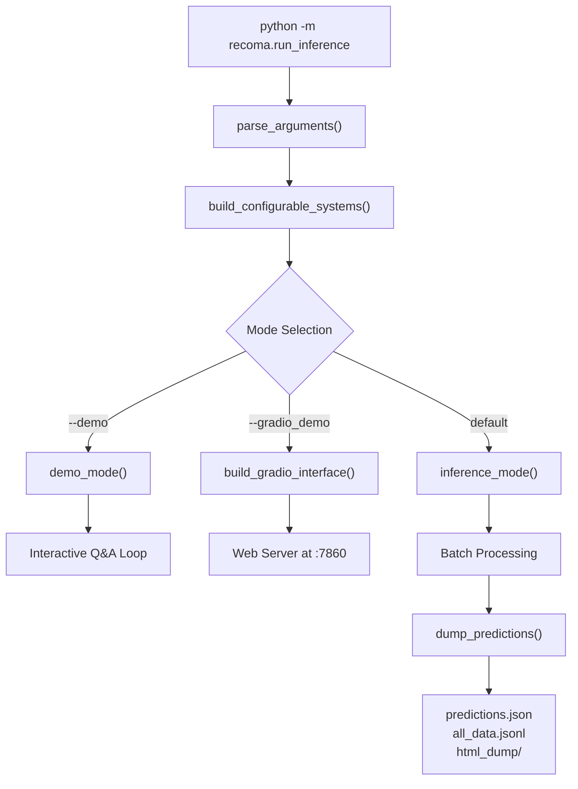

### Essential Command-Line Arguments

| Argument | Required | Description |
|----------|----------|-------------|
| `--config` | Yes | Path to JSONNET configuration file |
| `--output_dir` | Yes | Directory for output files |
| `--input` | No | Input dataset file (for batch mode) |
| `--demo` | No | Enable command-line demo mode |
| `--gradio_demo` | No | Enable web interface demo mode |
| `--debug` | No | Enable debug logging |
| `--dump_prompts` | No | Save all prompts to files |

Sources: [recoma/run_inference.py:31-46]()

## Configuration System Overview

### Configuration Loading Process

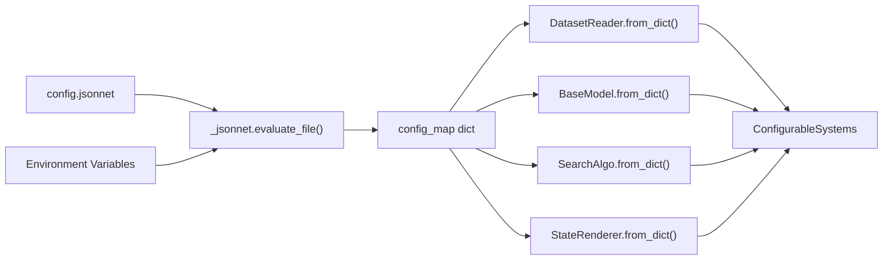

### Core Configuration Structure

Every ReComA configuration file contains these essential sections:

```jsonnet
{
  "reader": {
    "type": "dataset_reader_type",
    // dataset-specific parameters
  },
  "models": {
    "model_name": {
      "type": "model_type",
      // model-specific parameters
    }
  },
  "search": {
    "type": "search_algorithm_type",
    // search-specific parameters
  },
  "renderers": [
    {
      "type": "renderer_type",
      // renderer-specific parameters
    }
  ]
}
```

The `ConfigurableSystems` dataclass combines all components:
- `reader`: Processes input datasets
- `search`: Orchestrates the reasoning process
- `renderers`: Format output for visualization

Sources: [recoma/run_inference.py:49-77](), [recoma/run_inference.py:24-29]()

## Output Files and Structure

### Batch Inference Outputs

When running in batch mode, ReComA generates several output files:

| File | Description |
|------|-------------|
| `predictions.json` | QID-to-prediction mapping |
| `all_data.jsonl` | Complete dataset with predictions and correctness scores |
| `html_dump/` | HTML visualization of reasoning traces |
| `source_config.json` | Configuration used for reproducibility |
| `prompts_dump/` | Individual prompt files (if `--dump_prompts` used) |

### Output Generation Process

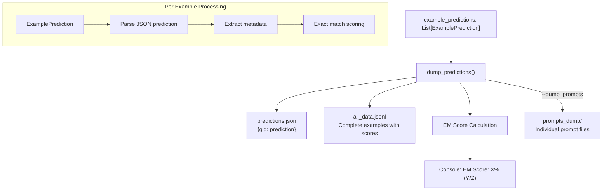

The exact match scoring compares predictions against gold labels, providing immediate feedback on model performance.

Sources: [recoma/run_inference.py:123-169]()

## Interactive Features

### Demo Mode Components

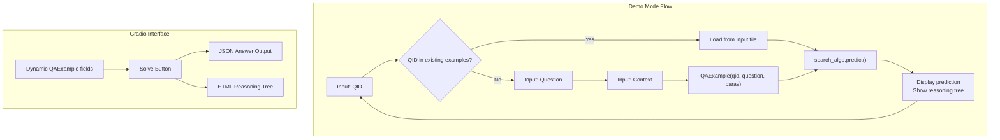

The demo modes provide immediate feedback and visualization, making it easy to understand how ReComA processes reasoning tasks.

Sources: [recoma/run_inference.py:80-107](), [recoma/run_inference.py:171-203](), [recoma/run_inference.py:206-226]()

## Next Steps

After completing this quick start:

1. **Explore Configurations**: Review example configs in the `configs/` directory
2. **Understand Models**: See [Model System Architecture](#2.3) for model types
3. **Custom Datasets**: Learn about [Dataset Reading Pipeline](#2.4)
4. **Advanced Features**: Explore [Search Control and Early Stopping](#7.2)

The ReComA framework provides extensive customization through configuration files, allowing you to adapt it to various reasoning tasks without code modifications.

Sources: [README.md:86-104]()

---

# Page: Core Architecture

# Core Architecture

<details>
<summary>Relevant source files</summary>

The following files were used as context for generating this wiki page:

- [README.md](README.md)
- [recoma/models/README.md](recoma/models/README.md)
- [recoma/models/core/README.md](recoma/models/core/README.md)
- [recoma/models/core/utility_models.py](recoma/models/core/utility_models.py)
- [recoma/run_inference.py](recoma/run_inference.py)

</details>


This document provides an overview of ReComA's fundamental architecture, explaining the main components and their interactions within the reasoning framework. ReComA orchestrates multiple language models through a search-based approach to solve complex reasoning tasks.

For detailed information about specific subsystems, see [Inference Orchestration](#2.1), [Search System](#2.2), [Model System Architecture](#2.3), and [Dataset Reading Pipeline](#2.4).

## System Overview

ReComA's architecture is built around four core components that work together to enable multi-agent reasoning:

1. **Configuration System** - JSONNET-based declarative configuration loading
2. **Model System** - Pluggable language model abstractions with registration
3. **Search System** - Tree-based exploration of reasoning paths
4. **Data Pipeline** - Standardized dataset reading and output generation

## Primary System Components

ReComA's core architecture centers around the `ConfigurableSystems` dataclass, which serves as the primary container for all system components during runtime.

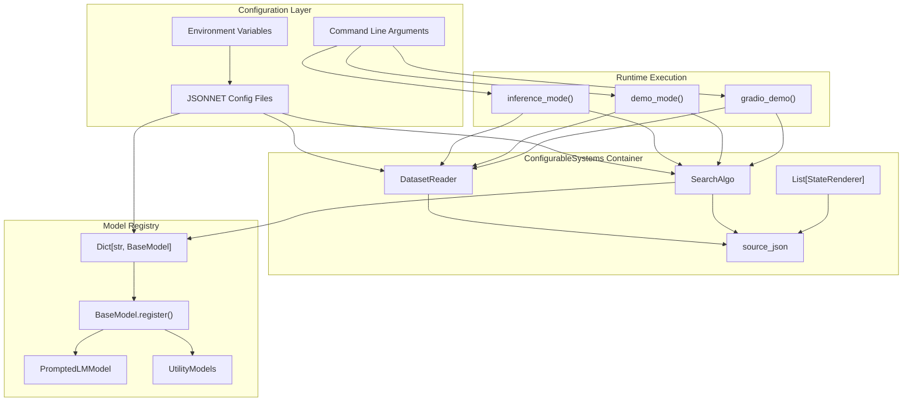

**Configuration to Runtime System Mapping**

Sources: [recoma/run_inference.py:24-30](), [recoma/run_inference.py:59-77]()

## Core Data Flow

The system follows a clear data flow from configuration through execution to output generation:

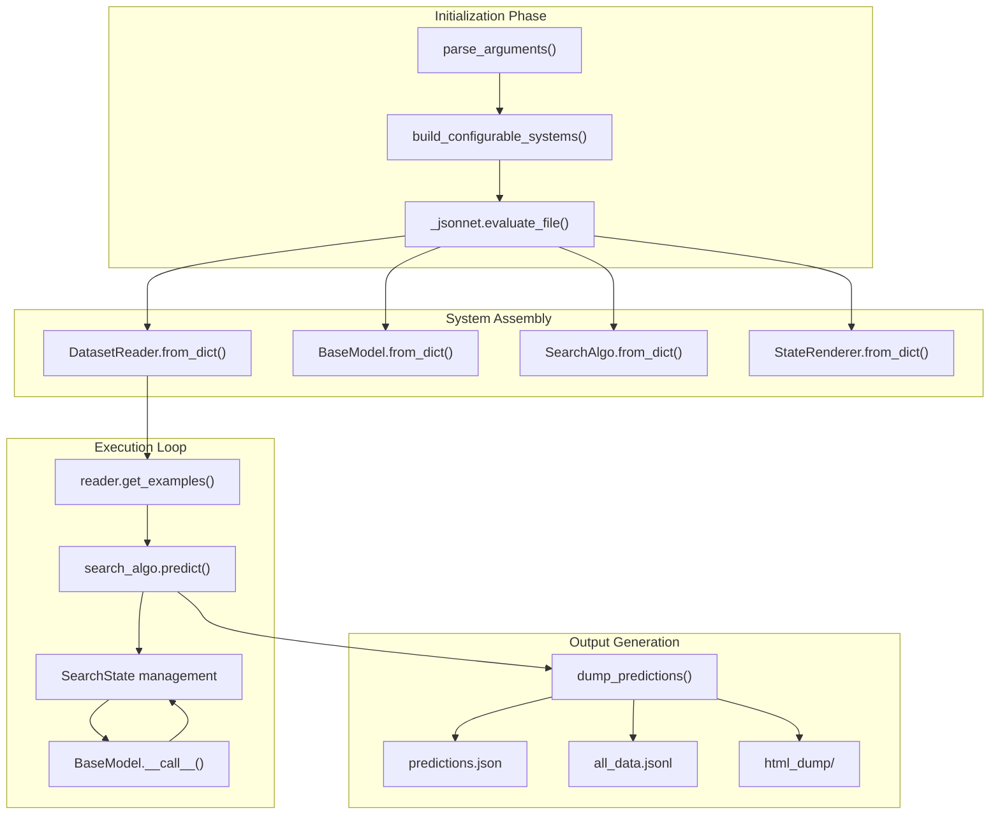

**System Data Flow from Configuration to Output**

Sources: [recoma/run_inference.py:49-77](), [recoma/run_inference.py:109-121](), [recoma/run_inference.py:123-169]()

## Component Interactions

### Configuration System

The configuration system uses JSONNET files to declaratively specify system behavior. The `build_configurable_systems()` function processes these configurations and instantiates the required components.

| Configuration Section | Purpose | Component Created |
|----------------------|---------|-------------------|
| `reader` | Dataset specification | `DatasetReader` |
| `models` | Model definitions | `Dict[str, BaseModel]` |
| `search` | Search algorithm config | `SearchAlgo` |
| `renderers` | Output formatting | `List[StateRenderer]` |

Sources: [recoma/run_inference.py:59-77]()

### Model Registration System

ReComA uses a registration-based pattern for models, allowing runtime discovery and instantiation of different model types:

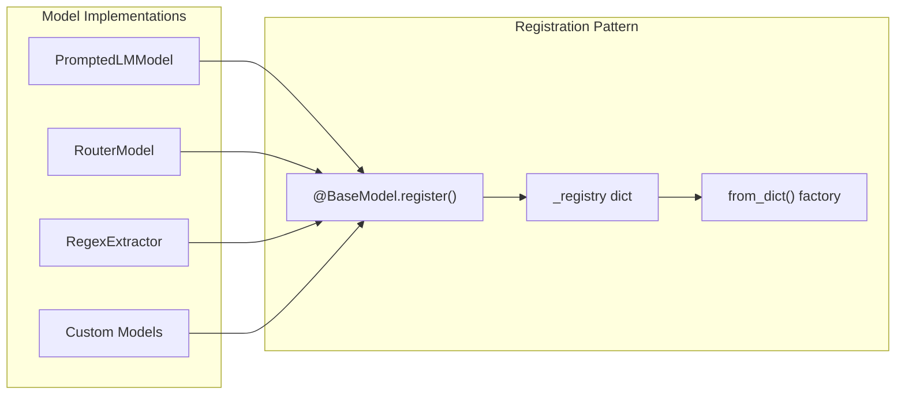

**Model Registration and Discovery System**

Sources: [recoma/models/core/base_model.py](), [recoma/models/core/utility_models.py:12-13](), [recoma/models/core/utility_models.py:41-42]()

### Search Coordination

The search system coordinates model execution through a tree-based state management approach. The `SearchAlgo` receives a model dictionary and orchestrates their execution based on the current search state.

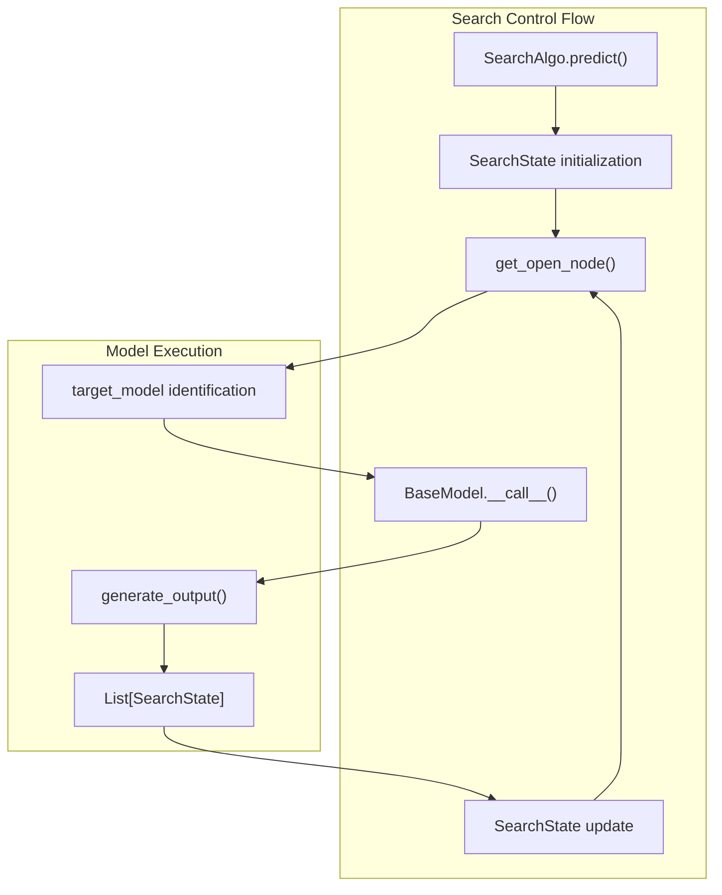

**Search Algorithm Coordination Flow**

Sources: [recoma/search/search.py](), [recoma/models/core/base_model.py]()

## Runtime Modes

ReComA supports three primary runtime modes, each serving different use cases:

### Inference Mode
Batch processing mode for evaluating datasets. Processes all examples from an input file and generates comprehensive outputs including predictions, correctness scores, and execution traces.

### Demo Mode
Interactive command-line mode for testing individual examples. Allows real-time input of questions and provides immediate feedback with full reasoning traces.

### Gradio Demo Mode
Web-based interface mode that provides a GUI for interactive reasoning. Combines the accessibility of a web interface with the detailed output of demo mode.

Each mode uses the same underlying `ConfigurableSystems` but provides different interaction patterns for different use cases.

Sources: [recoma/run_inference.py:109-121](), [recoma/run_inference.py:80-107](), [recoma/run_inference.py:171-204]()

## Extension Points

The architecture provides several extension points for customization:

1. **Model Extensions** - New reasoning patterns via `BaseModel` inheritance
2. **Dataset Extensions** - New data formats via `DatasetReader` inheritance  
3. **Search Extensions** - New search strategies via `SearchAlgo` inheritance
4. **Rendering Extensions** - New output formats via `StateRenderer` inheritance

Each extension point uses the same registration pattern, allowing runtime discovery without code modification.

Sources: [recoma/models/core/README.md:1-22](), [recoma/run_inference.py:236-238]()

---

# Page: Inference Orchestration

# Inference Orchestration

<details>
<summary>Relevant source files</summary>

The following files were used as context for generating this wiki page:

- [recoma/run_inference.py](recoma/run_inference.py)

</details>


## Purpose and Scope

This document covers the core inference orchestration system in ReComA, which serves as the main entry point for running reasoning tasks. The orchestration system handles configuration loading, example processing, and output generation across different execution modes. It coordinates the interaction between dataset readers, search algorithms, and model systems to produce structured predictions.

For details about the search algorithms themselves, see [Search System](#2.2). For information about model system architecture, see [Model System Architecture](#2.3). Dataset processing specifics are covered in [Dataset Reading Pipeline](#2.4).

## System Overview

The inference orchestration system is primarily implemented in `recoma/run_inference.py` and provides three main execution modes:

| Mode | Purpose | Entry Function |
|------|---------|----------------|
| Inference | Batch processing of dataset examples | `inference_mode` |
| Demo | Interactive single-example processing | `demo_mode` |
| Gradio Demo | Web-based interactive interface | `gradio_demo_fn` |

## Core Data Structures

### ConfigurableSystems

The `ConfigurableSystems` dataclass serves as the central container for all configured system components:

```python
@dataclass
class ConfigurableSystems:
    source_json: dict
    reader: DatasetReader
    search: SearchAlgo
    renderers: List[StateRenderer]
```

This structure encapsulates the four main components needed for inference orchestration:

- **source_json**: Original configuration for reproducibility
- **reader**: Dataset reading and example generation
- **search**: Search algorithm for reasoning coordination
- **renderers**: Output formatting and visualization

**Sources**: [recoma/run_inference.py:24-29]()

## Configuration Loading and System Building

### Configuration Processing Flow

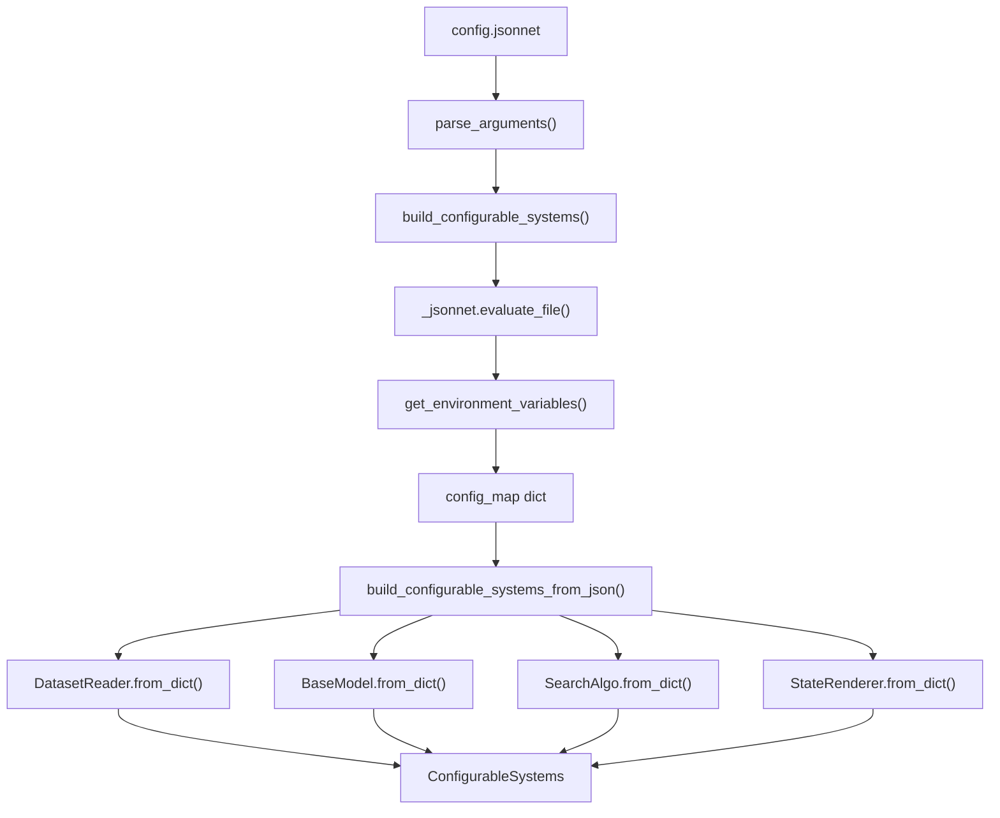

The configuration system supports both JSONNET and JSON formats, with JSONNET enabling dynamic configuration through environment variables.

**Sources**: [recoma/run_inference.py:49-77]()

### Model Registration and Initialization

```mermaid
flowchart LR
    CONFIG_MODELS["config_map['models']"] --> MODEL_LOOP["for k, v in models.items()"]
    MODEL_LOOP --> BASE_MODEL["BaseModel.from_dict(v)"]
    BASE_MODEL --> MODEL_MAP["model_map[k]"]
    
    MODEL_MAP --> SEARCH_DICT["search dictionary"]
    SEARCH_DICT --> SEARCH_ALGO["SearchAlgo.from_dict()"]
    
    SEARCH_ALGO --> OUTPUT_DIR["output_dir + '/files/'"]
    OUTPUT_DIR --> FINAL_SEARCH["configured SearchAlgo"]
```

The system builds a `model_map` dictionary where each key corresponds to a model name and the value is an initialized `BaseModel` instance. This map is then passed to the search algorithm for coordination.

**Sources**: [recoma/run_inference.py:68-75]()

## Execution Modes

### Inference Mode Architecture

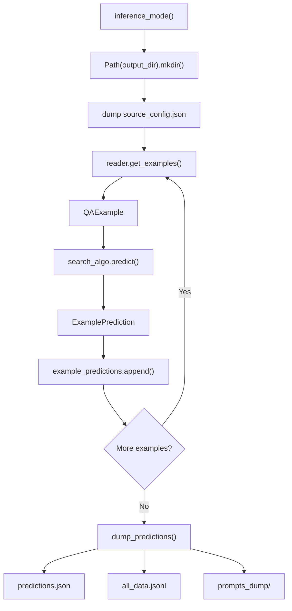

The inference mode processes examples in sequence, collecting predictions and generating multiple output formats for analysis.

**Sources**: [recoma/run_inference.py:109-121]()

### Demo Mode Architecture

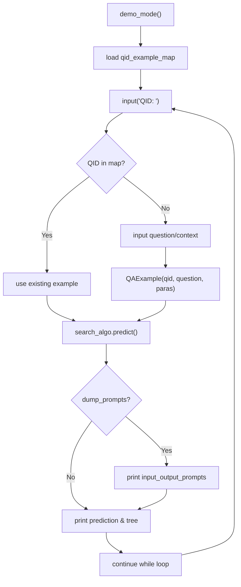

Demo mode provides an interactive interface for testing individual examples, with optional prompt debugging output.

**Sources**: [recoma/run_inference.py:80-107]()

## Output Generation and Prediction Processing

### Prediction Dumping Flow

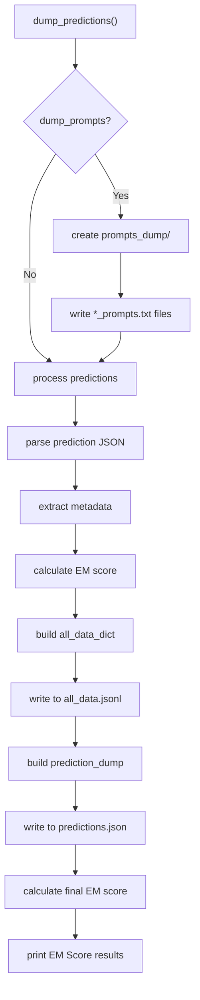

The output generation system produces three main artifacts:

1. **predictions.json**: Clean prediction results keyed by example ID
2. **all_data.jsonl**: Complete example data with predictions and metadata
3. **prompts_dump/**: Individual prompt files for debugging (optional)

**Sources**: [recoma/run_inference.py:123-169]()

### Prediction Processing Logic

The system handles complex prediction parsing and scoring:

```python
# Parse JSON predictions with fallback
try:
    pred_json = json.loads(x.prediction)
    if isinstance(pred_json, dict) and "answer" in pred_json:
        pred_json = pred_json["answer"]
except Exception:
    pred_json = x.prediction

# Calculate exact match score
score = 1 if (x.prediction == gold_answer) else 0
```

**Sources**: [recoma/run_inference.py:140-159]()

## Main Orchestration Flow

### Entry Point and Execution Path

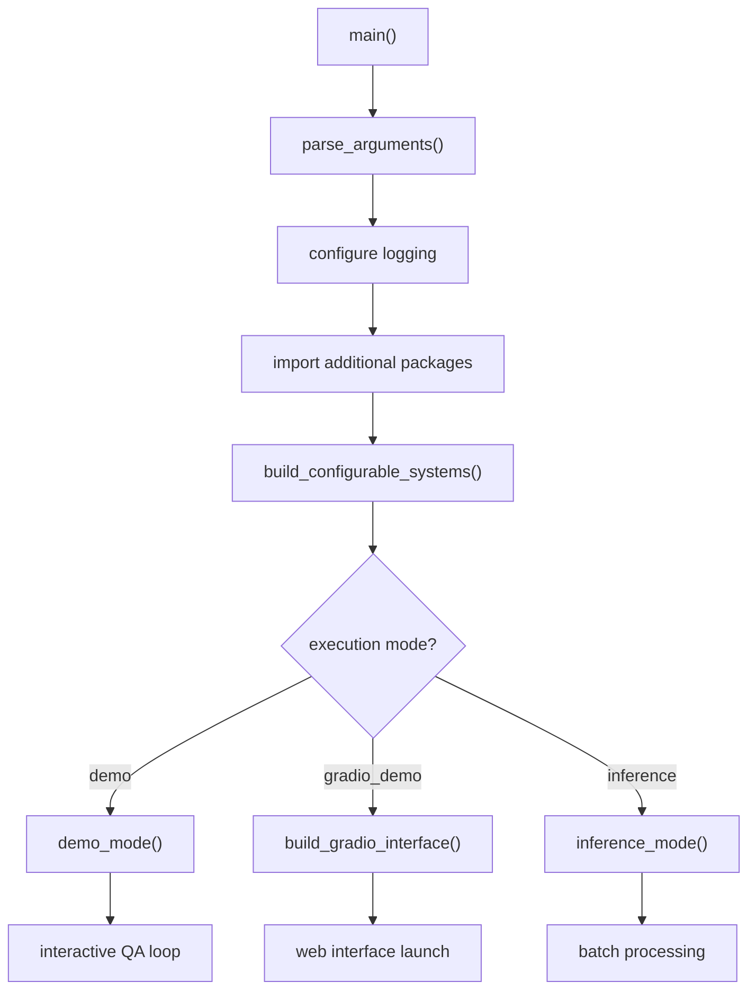

The main function coordinates argument parsing, system configuration, and mode-specific execution based on command-line flags.

**Sources**: [recoma/run_inference.py:229-250]()

### Command Line Interface

The system accepts several key arguments:

| Argument | Purpose | Required |
|----------|---------|----------|
| `--config` | Configuration file path (JSONNET/JSON) | Yes |
| `--output_dir` | Output directory for results | Yes |
| `--input` | Input dataset file | No |
| `--demo` | Enable interactive demo mode | No |
| `--gradio_demo` | Enable web-based demo | No |
| `--dump_prompts` | Enable prompt debugging output | No |

**Sources**: [recoma/run_inference.py:31-46]()

## Integration Points

The inference orchestration system integrates with several core ReComA components:

- **DatasetReader**: Provides `get_examples()` method for batch processing
- **SearchAlgo**: Executes `predict()` method for reasoning coordination  
- **StateRenderer**: Formats output through `output()` method
- **ExamplePrediction**: Encapsulates prediction results and metadata

These integration points enable the orchestration system to coordinate complex reasoning workflows while maintaining clean separation of concerns between configuration, data processing, and output generation.

**Sources**: [recoma/run_inference.py:12-17]()

---

# Page: Search System

# Search System

<details>
<summary>Relevant source files</summary>

The following files were used as context for generating this wiki page:

- [recoma/search/search.py](recoma/search/search.py)
- [recoma/search/state.py](recoma/search/state.py)

</details>


The Search System is the core orchestration layer of ReComA that coordinates model execution through tree-based search algorithms. This system manages the reasoning process by maintaining a tree of intermediate steps, selecting which nodes to expand next, and controlling the search termination conditions.

For information about the models that the search system coordinates, see [Model System Architecture](#2.3). For details about early stopping and search control mechanisms, see [Search Control and Early Stopping](#7.2).

## Core Components

The search system consists of several key components that work together to manage the reasoning process:

### SearchAlgo Hierarchy

The `SearchAlgo` class serves as the abstract base for all search algorithms, with `BestFirstSearch` as the primary concrete implementation.

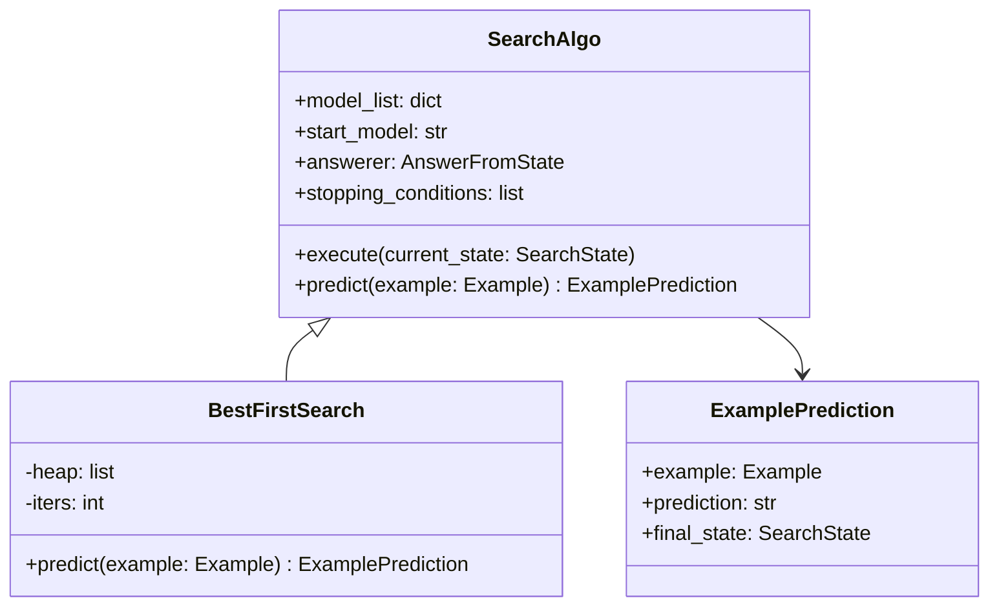

**Sources:** [recoma/search/search.py:20-59](), [recoma/search/search.py:65-127]()

### SearchState and SearchNode Architecture

The search maintains a tree structure where each `SearchState` contains a tree of `SearchNode` objects representing individual reasoning steps.

```mermaid
classDiagram
    class SearchState {
        +example: Example
        +score: float
        +data: dict
        +get_open_node() SearchNode
        +add_next_step(input, model, parent)
        +has_open_node() bool
        +clone() SearchState
        +update_score(score)
    }
    
    class SearchNode {
        +input_str: str
        +target: str
        +output: str
        +is_open() bool
        +target_model() str
        +close(output)
        +tag: str
    }
    
    class Tree {
        <<treelib>>
        +postorder_traversal()
        +add_node(node, parent)
    }
    
    SearchState --|> Tree
    SearchState --> SearchNode
    SearchNode --|> Node
```

**Sources:** [recoma/search/state.py:80-204](), [recoma/search/state.py:11-78]()

## Search Execution Flow

The search execution follows a best-first strategy using a heap-based priority queue to explore the most promising states first.

### BestFirstSearch Algorithm

```mermaid
flowchart TD
    A["predict(example)"] --> B["Initialize SearchState"]
    B --> C["Add root node with start_model"]
    C --> D["Push to heap"]
    D --> E["Pop best state from heap"]
    E --> F{"has_open_node()?"}
    F -->|No| G["Generate answer using answerer"]
    F -->|Yes| H["execute(current_state)"]
    H --> I["Get target_model from open_node"]
    I --> J["Call model_list[target_model]"]
    J --> K["Get new states from model"]
    K --> L["Check stopping_conditions"]
    L --> M["Push valid states to heap"]
    M --> N{"heap empty?"}
    N -->|No| E
    N -->|Yes| O["Return prediction with current state"]
    G --> P["Return ExamplePrediction"]
```

**Sources:** [recoma/search/search.py:68-127]()

### Model Execution Integration

The search system integrates with the model system through the `execute` method, which delegates to the appropriate model based on the target model specified in open nodes.

```mermaid
sequenceDiagram
    participant BFS as BestFirstSearch
    participant SS as SearchState
    participant SN as SearchNode
    participant ML as model_list
    participant BM as BaseModel
    
    BFS->>SS: get_open_node()
    SS->>SN: Return open SearchNode
    SN->>BFS: target_model()
    BFS->>ML: model_list[target_model]
    ML->>BM: __call__(current_state)
    BM->>BFS: List[SearchState]
    BFS->>BFS: Check stopping conditions
    BFS->>BFS: Push to heap
```

**Sources:** [recoma/search/search.py:42-56](), [recoma/search/search.py:104-114]()

## State Management

The search system maintains complex state through the `SearchState` class, which extends `treelib.Tree` to provide specialized tree operations for reasoning.

### Tree Structure Operations

| Operation | Method | Purpose |
|-----------|---------|---------|
| Node Selection | `get_open_node()` | Returns the next node to expand using depth-first traversal |
| State Expansion | `add_next_step()` | Adds new reasoning steps to the tree |
| State Cloning | `clone()` | Creates deep copies for parallel exploration |
| Traversal | `postorder_traversal()` | Custom traversal for finding open nodes |

**Sources:** [recoma/search/state.py:102-198]()

### Node Lifecycle Management

```mermaid
stateDiagram-v2
    [*] --> Open: "SearchNode created"
    Open --> Closed: "close(output)"
    Closed --> [*]
    
    Open: is_open() = True
    Open: output = None
    Open: target_model specified
    
    Closed: is_open() = False
    Closed: output = model_result
```

**Sources:** [recoma/search/state.py:29-37]()

## Integration Points

The search system integrates with several other components in the ReComA architecture:

### Model System Integration

The search system coordinates with the model system through the `model_list` dictionary, where each key corresponds to a registered model name and the value is a callable `BaseModel` instance.

```mermaid
flowchart LR
    SS["SearchState"] --> SN["SearchNode"]
    SN --> TM["target_model()"]
    TM --> ML["model_list[target]"]
    ML --> BM["BaseModel.__call__()"]
    BM --> OSL["List[SearchState]"]
    OSL --> HP["heapq.heappush()"]
```

**Sources:** [recoma/search/search.py:42-56]()

### Early Stopping Integration

The search process is controlled by configurable stopping conditions that are checked after each model execution.

```mermaid
flowchart TD
    A["New states generated"] --> B["For each stopping_condition"]
    B --> C["stopping_condition.should_stop()"]
    C --> D{"Should stop?"}
    D -->|Yes| E["Skip adding to heap"]
    D -->|No| F["heapq.heappush(heap, new_state)"]
    E --> G["Continue to next state"]
    F --> G
```

**Sources:** [recoma/search/search.py:106-114]()

### Answer Generation Integration

The search system uses the `AnswerFromState` abstraction to extract final answers from completed search states.

```mermaid
flowchart LR
    FS["final_state"] --> AFS["answerer.generate_answer()"]
    AFS --> EP["ExamplePrediction"]
    EP --> PR["prediction: str"]
```

**Sources:** [recoma/search/search.py:95-99](), [recoma/search/search.py:118-120]()

---

# Page: Model System Architecture

# Model System Architecture

<details>
<summary>Relevant source files</summary>

The following files were used as context for generating this wiki page:

- [recoma/models/__init__.py](recoma/models/__init__.py)
- [recoma/models/core/generator.py](recoma/models/core/generator.py)

</details>


## Purpose and Scope

This document covers the foundational model system architecture in ReComA, including the model hierarchy, registration system, and base abstractions that enable pluggable language model integrations. The system provides a unified interface for different types of models while maintaining flexibility for specialized reasoning patterns.

For specific language model API integrations, see [Language Model Integrations](#3). For reasoning-specific controller implementations, see [Reasoning Controllers](#4). For utility models and tools, see [Utility Models and Tools](#5).

## Model Hierarchy Overview

The ReComA model system is built around a hierarchical architecture with base classes that provide common functionality and concrete implementations for specific use cases.

### Core Model Architecture

```mermaid
graph TB
    subgraph "Base Classes"
        RegistrableFromDict["RegistrableFromDict<br/>Base registration system"]
        BaseModel["BaseModel<br/>Core model interface"]
        LMGenerator["LMGenerator<br/>Text generation base"]
    end
    
    subgraph "Parameter Classes"
        GeneratorParams["GeneratorParams<br/>LLM configuration"]
        GenerationOutputs["GenerationOutputs<br/>Output structure"]
    end
    
    subgraph "Concrete Generators"
        OpenAIChatGenerator["OpenAIChatGenerator<br/>@register('openai_chat')"]
        LiteLLMGenerator["LiteLLMGenerator<br/>@register('lite_llm')"]
    end
    
    subgraph "Reasoning Controllers"
        ReactController["ReactController<br/>Thought-Action-Observation"]
        LeastToMostController["LeastToMostController<br/>Problem decomposition"]
        DecompController["DecompController<br/>Q&A orchestration"]
    end
    
    subgraph "Utility Models"
        PromptedLMModel["PromptedLMModel<br/>Jinja2 templates"]
        RegexExtractor["RegexExtractor<br/>Pattern matching"]
        RouterModel["RouterModel<br/>Dynamic routing"]
        MathProgramExecuter["MathProgramExecuter<br/>Code execution"]
    end
    
    RegistrableFromDict --> BaseModel
    RegistrableFromDict --> LMGenerator
    
    LMGenerator --> GeneratorParams
    LMGenerator --> GenerationOutputs
    
    LMGenerator --> OpenAIChatGenerator
    LMGenerator --> LiteLLMGenerator
    
    BaseModel --> ReactController
    BaseModel --> LeastToMostController
    BaseModel --> DecompController
    BaseModel --> PromptedLMModel
    BaseModel --> RegexExtractor
    BaseModel --> RouterModel
    BaseModel --> MathProgramExecuter
```

Sources: [recoma/models/core/generator.py:35-51]()

## Registration System

The model system uses a registration pattern through `RegistrableFromDict` that allows models to be instantiated from configuration dictionaries. This enables flexible configuration-driven model selection.

### Registration Pattern

| Component | Registration Key | Purpose |
|-----------|------------------|---------|
| `OpenAIChatGenerator` | `'openai_chat'` | OpenAI API integration |
| `LiteLLMGenerator` | `'lite_llm'` | Multi-provider LLM access |
| `ReactController` | `'react'` | Thought-Action-Observation reasoning |
| `LeastToMostController` | `'least_to_most'` | Problem decomposition |
| `PromptedLMModel` | `'prompted_lm'` | Template-based prompting |

The registration system allows models to be referenced by string keys in configuration files, enabling dynamic model instantiation without hardcoded dependencies.

Sources: [recoma/models/core/generator.py:35]()

## Base Generator Classes

### LMGenerator Abstract Base

The `LMGenerator` class provides the core interface for all text generation models:

```mermaid
classDiagram
    class LMGenerator {
        +drop_params: list
        +generator_params: GeneratorParams
        +generate(input_str, current_state)* GenerationOutputs
        +extract_role_messages(input_str) list
        +generator_params_to_args(generator_params) dict
    }
    
    class GeneratorParams {
        +temperature: float
        +max_tokens: int
        +top_p: float
        +frequency_penalty: float
        +presence_penalty: float
        +stop: list[str]
        +num_sequences: int
        +logprobs: bool
        +top_logprobs: int
        +seed: int
        +json_format: bool
    }
    
    class GenerationOutputs {
        +outputs: list[str]
        +scores: list[float]
        +metadata: list[dict]
    }
    
    LMGenerator --> GeneratorParams
    LMGenerator --> GenerationOutputs
```

### Key Methods

- **`generate(input_str, current_state)`**: Abstract method that all generators must implement
- **`extract_role_messages(input_str)`**: Parses role-based message formats (USER/ASSISTANT/SYSTEM)
- **`generator_params_to_args(generator_params)`**: Converts parameter objects to API-compatible dictionaries

Sources: [recoma/models/core/generator.py:35-98]()

## Parameter Configuration System

### GeneratorParams Structure

The `GeneratorParams` class standardizes language model configuration across different providers:

```mermaid
graph LR
    subgraph "Core Parameters"
        temperature["temperature: float = 0"]
        max_tokens["max_tokens: int = 100"]
        top_p["top_p: float = 1"]
    end
    
    subgraph "Penalty Parameters"
        frequency_penalty["frequency_penalty: float = 0"]
        presence_penalty["presence_penalty: float = 0"]
    end
    
    subgraph "Control Parameters"
        stop["stop: list[str] = ['\\n']"]
        num_sequences["num_sequences: int = 1"]
        seed["seed: Optional[int] = None"]
    end
    
    subgraph "Advanced Parameters"
        logprobs["logprobs: bool = False"]
        top_logprobs["top_logprobs: Optional[int] = None"]
        json_format["json_format: bool = False"]
    end
    
    GeneratorParams --> temperature
    GeneratorParams --> max_tokens
    GeneratorParams --> top_p
    GeneratorParams --> frequency_penalty
    GeneratorParams --> presence_penalty
    GeneratorParams --> stop
    GeneratorParams --> num_sequences
    GeneratorParams --> seed
    GeneratorParams --> logprobs
    GeneratorParams --> top_logprobs
    GeneratorParams --> json_format
```

### Parameter Conversion

The `generator_params_to_args` method converts `GeneratorParams` objects into API-compatible dictionaries, handling:
- Parameter name mapping
- Response format specification (JSON vs text)
- Provider-specific parameter filtering via `drop_params`

Sources: [recoma/models/core/generator.py:12-26](), [recoma/models/core/generator.py:78-98]()

## Message Format Handling

### Role-Based Message Extraction

The `extract_role_messages` method supports multiple input formats:

1. **JSON Format**: Direct JSON with role/content structure
2. **Text Format**: `USER:`, `ASSISTANT:`, `SYSTEM:` prefixed sections
3. **Plain Text**: Automatic wrapping in user role

This flexibility allows the same generator to handle different prompt formats without requiring format-specific implementations.

Sources: [recoma/models/core/generator.py:53-76]()

## Integration with Search System

### SearchState Integration

Generators receive the current `SearchState` as a parameter to the `generate` method, enabling:
- Context-aware generation based on search history
- State-dependent parameter adjustment
- Access to previous model outputs and reasoning traces

### GenerationOutputs Structure

The `GenerationOutputs` class provides structured output containing:
- **`outputs`**: List of generated text strings
- **`scores`**: Optional confidence scores for each output
- **`metadata`**: Provider-specific metadata (tokens used, latency, etc.)

This structure enables the search system to make informed decisions about which generations to pursue further.

Sources: [recoma/models/core/generator.py:28-33](), [recoma/models/core/generator.py:46-51]()

## Model Categories

The model system supports several categories of models:

### Text Generators
- **OpenAI Integration**: Direct API access with caching and retry logic
- **LiteLLM Integration**: Multi-provider support through unified interface

### Reasoning Controllers
- **Structured Reasoning**: Controllers that implement specific reasoning patterns
- **Multi-step Processing**: Models that break down complex problems

### Utility Models
- **Template-based Models**: Using Jinja2 for dynamic prompt generation
- **Pattern Extraction**: Regex and rule-based text processing
- **Program Execution**: Mathematical computation and code execution

Sources: [recoma/models/__init__.py:1-3]()

---

# Page: Dataset Reading Pipeline

# Dataset Reading Pipeline

<details>
<summary>Relevant source files</summary>

The following files were used as context for generating this wiki page:

- [recoma/datasets/bbh_reader.py](recoma/datasets/bbh_reader.py)
- [recoma/datasets/drop_reader.py](recoma/datasets/drop_reader.py)
- [recoma/datasets/gsm8k_reader.py](recoma/datasets/gsm8k_reader.py)
- [recoma/datasets/reader.py](recoma/datasets/reader.py)
- [recoma/search/README.md](recoma/search/README.md)

</details>


## Purpose and Scope

The Dataset Reading Pipeline is responsible for converting various dataset formats into standardized `Example` objects that can be consumed by ReComA's search system. This pipeline provides a unified interface for reading datasets while maintaining support for different data formats and filtering options.

For information about how these standardized examples are processed by the search system, see [Search System](#2.2). For details about the overall inference orchestration that coordinates dataset reading with model execution, see [Inference Orchestration](#2.1).

## Core Architecture

The dataset reading pipeline is built around two main abstractions: the `Example` base class that defines the structure of individual data points, and the `DatasetReader` base class that handles the conversion from raw data files to standardized examples.

### Example Base Class and QAExample

```mermaid
classDiagram
    class Example {
        <<abstract>>
        +fields()* List[str]
        +get_field(field) Any
        +unique_id* str
        +task* str  
        +label* str
    }
    
    class QAExample {
        +qid: str
        +question: str
        +gold_answer: Optional[str]
        +paras: List[str]
        +fields() List[str]
        +unique_id str
        +task str
        +label str
        +__str__() str
    }
    
    Example <|-- QAExample
```

The `Example` abstract base class defines the contract that all data points must implement, providing methods for field access and key properties. The `QAExample` class is the concrete implementation used throughout ReComA for question-answering tasks.

Sources: [recoma/datasets/reader.py:11-65]()

### DatasetReader Registry System

```mermaid
classDiagram
    class RegistrableFromDict {
        <<abstract>>
        +register(name)
    }
    
    class DatasetReader {
        +top_k: Optional[int]
        +sample_p: Optional[float]
        +__init__(top_k, sample_p)
        +read_examples(file)* Iterable[Example]
        +get_examples(file) Iterable[Example]
    }
    
    class GSM8KReader {
        +read_examples(file) Iterable[QAExample]
    }
    
    class BBHReader {
        +read_examples(file) Iterable[QAExample]
    }
    
    class DropReader {
        +read_examples(file) Iterable[QAExample]
    }
    
    RegistrableFromDict <|-- DatasetReader
    DatasetReader <|-- GSM8KReader
    DatasetReader <|-- BBHReader
    DatasetReader <|-- DropReader
    
    note for GSM8KReader "@DatasetReader.register('gsm8k')"
    note for BBHReader "@DatasetReader.register('bbh')"
    note for DropReader "@DatasetReader.register('drop')"
```

The `DatasetReader` class extends `RegistrableFromDict` to provide a registry system where different readers can be registered with string identifiers. This allows configuration-driven instantiation of the appropriate reader for different datasets.

Sources: [recoma/datasets/reader.py:67-111](), [recoma/datasets/gsm8k_reader.py:6](), [recoma/datasets/bbh_reader.py:6](), [recoma/datasets/drop_reader.py:20]()

## Data Processing Flow

The dataset reading pipeline follows a consistent flow from raw data files to standardized examples:

```mermaid
flowchart TD
    FILE["Raw Data File"] --> READER["DatasetReader.read_examples()"]
    READER --> EXAMPLES["Stream of Example objects"]
    EXAMPLES --> FILTER["DatasetReader.get_examples()"]
    FILTER --> TOPK["Apply top_k filtering"]
    FILTER --> SAMPLE["Apply sample_p filtering"]
    FILTER --> PASSTHROUGH["Pass through unchanged"]
    TOPK --> OUTPUT["Filtered Example stream"]
    SAMPLE --> OUTPUT
    PASSTHROUGH --> OUTPUT
    OUTPUT --> SEARCH["Search System"]
    
    READER --> GSM8K["GSM8KReader.read_examples()"]
    READER --> BBH["BBHReader.read_examples()"]
    READER --> DROP["DropReader.read_examples()"]
    
    GSM8K --> QAEXAMPLE["QAExample objects"]
    BBH --> QAEXAMPLE
    DROP --> QAEXAMPLE
```

The `read_examples` method handles the dataset-specific parsing logic, while `get_examples` applies common filtering operations across all dataset types.

Sources: [recoma/datasets/reader.py:82-111]()

## Data Filtering and Sampling

The `DatasetReader` base class provides two filtering mechanisms:

| Parameter | Purpose | Behavior |
|-----------|---------|----------|
| `top_k` | Limit dataset size | Returns only the first `k` examples |
| `sample_p` | Random sampling | Returns each example with probability `p` |

```mermaid
flowchart TD
    START["get_examples() called"] --> CHECK_TOPK{"top_k set?"}
    CHECK_TOPK -->|Yes| TOPK_LOOP["Counter-based iteration"]
    CHECK_TOPK -->|No| CHECK_SAMPLE{"sample_p set?"}
    
    TOPK_LOOP --> TOPK_YIELD["Yield example if counter < top_k"]
    TOPK_YIELD --> TOPK_DONE["Break when counter >= top_k"]
    
    CHECK_SAMPLE -->|Yes| SAMPLE_LOOP["Random sampling iteration"]
    CHECK_SAMPLE -->|No| PASSTHROUGH["Yield all examples"]
    
    SAMPLE_LOOP --> SAMPLE_CHECK["random.random() < sample_p"]
    SAMPLE_CHECK -->|Yes| SAMPLE_YIELD["Yield example"]
    SAMPLE_CHECK -->|No| SAMPLE_SKIP["Skip example"]
    
    SAMPLE_YIELD --> SAMPLE_CONTINUE["Continue to next example"]
    SAMPLE_SKIP --> SAMPLE_CONTINUE
```

The filtering logic ensures that `top_k` takes precedence over `sample_p` when both are specified.

Sources: [recoma/datasets/reader.py:97-110]()

## Concrete Dataset Readers

### GSM8K Reader

The `GSM8KReader` processes the GSM8K mathematical reasoning dataset format:

```mermaid
flowchart TD
    JSONL["JSONL file"] --> PARSE["Parse JSON lines"]
    PARSE --> EXTRACT["Extract question and answer fields"]
    EXTRACT --> SPLIT["Split answer on '####' separator"]
    SPLIT --> QA["Create QAExample"]
    
    QA --> QID["qid: sequential counter"]
    QA --> QUESTION["question: from input"]
    QA --> ANSWER["gold_answer: after ####"]
    QA --> PARAS["paras: empty list"]
```

The GSM8K format stores rationales and answers together, separated by `####`. The reader extracts only the final answer portion.

Sources: [recoma/datasets/gsm8k_reader.py:12-21]()

### BBH Reader

The `BBHReader` handles the Big-Bench Hard dataset format:

```mermaid
flowchart TD
    JSON["JSON file"] --> LOAD["Load entire JSON"]
    LOAD --> EXAMPLES["Access examples array"]
    EXAMPLES --> ITERATE["Iterate through examples"]
    ITERATE --> EXTRACT["Extract input and target"]
    EXTRACT --> QA["Create QAExample"]
    
    QA --> QID["qid: sequential counter"]
    QA --> QUESTION["question: from input"]
    QA --> ANSWER["gold_answer: from target"]
    QA --> PARAS["paras: empty list"]
```

The BBH format uses `input` and `target` fields within an `examples` array structure.

Sources: [recoma/datasets/bbh_reader.py:22-30]()

### DROP Reader

The `DropReader` processes the DROP reading comprehension dataset with its complex answer format:

```mermaid
flowchart TD
    JSON["JSON file"] --> LOAD["Load entire JSON"]
    LOAD --> PASSAGES["Iterate through passages"]
    PASSAGES --> QA_PAIRS["Access qa_pairs array"]
    QA_PAIRS --> EXTRACT["Extract question and answer"]
    EXTRACT --> FORMAT["format_drop_answer()"]
    
    FORMAT --> NUMBER{"answer.number?"}
    FORMAT --> SPANS{"answer.spans?"}
    FORMAT --> DATE{"answer.date?"}
    
    NUMBER -->|Yes| NUM_RETURN["Return number"]
    SPANS -->|Yes| SPAN_RETURN["Return spans"]
    DATE -->|Yes| DATE_FORMAT["Format: day-month-year"]
    
    NUM_RETURN --> CREATE_QA["Create QAExample"]
    SPAN_RETURN --> CREATE_QA
    DATE_FORMAT --> CREATE_QA
    
    CREATE_QA --> QID["qid: from query_id"]
    CREATE_QA --> QUESTION["question: from input"]
    CREATE_QA --> ANSWER["gold_answer: formatted"]
    CREATE_QA --> PARAS["paras: [passage]"]
```

The DROP format supports multiple answer types (numbers, spans, dates) and includes passage text, requiring special formatting logic.

Sources: [recoma/datasets/drop_reader.py:7-34]()

## Integration with Search System

The dataset reading pipeline integrates with ReComA's search system through the standardized `Example` interface:

```mermaid
flowchart TD
    READER["DatasetReader.get_examples()"] --> STREAM["Stream of QAExample"]
    STREAM --> TASK["example.task (question)"]
    STREAM --> LABEL["example.label (gold_answer)"]
    STREAM --> UID["example.unique_id (qid)"]
    
    TASK --> SEARCH_INPUT["SearchState initialization"]
    LABEL --> EVALUATION["Answer evaluation"]
    UID --> TRACKING["Result tracking"]
    
    SEARCH_INPUT --> SEARCH_ALGO["SearchAlgo.predict()"]
    EVALUATION --> METRICS["Exact match scoring"]
    TRACKING --> OUTPUT["ExamplePrediction"]
```

The `task` property provides the input for search initialization, while `label` and `unique_id` support evaluation and result tracking.

Sources: [recoma/datasets/reader.py:48-58]()

---

# Page: Language Model Integrations

# Language Model Integrations

<details>
<summary>Relevant source files</summary>

The following files were used as context for generating this wiki page:

- [recoma/models/impl/lite_llm_generator.py](recoma/models/impl/lite_llm_generator.py)
- [recoma/models/impl/openai_generators.py](recoma/models/impl/openai_generators.py)

</details>


This document covers ReComA's integration with various language model APIs and services. ReComA provides a unified abstraction layer for interacting with different language model providers, including OpenAI's API and multiple providers through LiteLLM. This page focuses on the core generator implementations, caching mechanisms, and API communication patterns.

For information about the base generator abstractions and registration system, see [Generator Base Classes](#3.3). For details on configuring specific models, see [Language Model Configurations](#6.1).

## Architecture Overview

ReComA's language model integration follows a layered architecture with abstract base classes, concrete implementations, and external API connections. The system provides caching, retry logic, cost tracking, and unified interfaces across different providers.

### Language Model Integration Architecture

```mermaid
graph TB
    subgraph "Abstract Layer"
        LMGenerator["LMGenerator<br/>Abstract base class"]
        GenerationOutputs["GenerationOutputs<br/>Standardized response format"]
        GeneratorParams["GeneratorParams<br/>Configuration parameters"]
    end
    
    subgraph "Concrete Implementations"
        OpenAIChatGenerator["OpenAIChatGenerator<br/>@register('openai_chat')"]
        LiteLLMGenerator["LiteLLMGenerator<br/>@register('lite_llm')"]
    end
    
    subgraph "Caching Layer"
        OpenAICache["cached_openai_chat_call<br/>@cache.memoize"]
        LiteLLMCache["cached_litellm_call<br/>@cache.memoize"]
        DiskCache["diskcache.Cache<br/>~/.cache/"]
    end
    
    subgraph "Retry Logic"
        TenacityRetry["@retry decorator<br/>wait_random_exponential"]
        BackoffLog["before_sleep_log<br/>Debug logging"]
    end
    
    subgraph "External APIs"
        OpenAIAPI["OpenAI API<br/>chat.completions.create"]
        LiteLLMAPI["LiteLLM API<br/>completion()"]
        MultipleProviders["Multiple LLM Providers<br/>via litellm"]
    end
    
    subgraph "Cost Tracking"
        CompletionCost["completion_cost()<br/>Token cost calculation"]
        StateCounters["SearchState counters<br/>Cost and usage metrics"]
    end
    
    LMGenerator --> OpenAIChatGenerator
    LMGenerator --> LiteLLMGenerator
    
    OpenAIChatGenerator --> OpenAICache
    LiteLLMGenerator --> LiteLLMCache
    
    OpenAICache --> DiskCache
    LiteLLMCache --> DiskCache
    
    OpenAIChatGenerator --> TenacityRetry
    LiteLLMGenerator --> TenacityRetry
    
    TenacityRetry --> BackoffLog
    
    OpenAIChatGenerator --> OpenAIAPI
    LiteLLMGenerator --> LiteLLMAPI
    
    LiteLLMAPI --> MultipleProviders
    
    OpenAIChatGenerator --> CompletionCost
    LiteLLMGenerator --> CompletionCost
    
    CompletionCost --> StateCounters
    
    GenerationOutputs --> OpenAIChatGenerator
    GenerationOutputs --> LiteLLMGenerator
    
    GeneratorParams --> OpenAIChatGenerator
    GeneratorParams --> LiteLLMGenerator
```

Sources: [recoma/models/impl/openai_generators.py:1-99](), [recoma/models/impl/lite_llm_generator.py:1-107]()

## Core Components

### OpenAI Integration

The `OpenAIChatGenerator` class provides direct integration with OpenAI's chat completions API. It handles authentication, request formatting, response parsing, and includes specialized logic for different model types.

| Component | Purpose | Key Features |
|-----------|---------|--------------|
| `OpenAIChatGenerator` | Primary OpenAI API interface | Chat completions, caching, retry logic |
| `cached_openai_chat_call` | Caching wrapper | Memoization with parameter-based cache keys |
| `completion_with_backoff` | Retry mechanism | Exponential backoff with configurable attempts |

The implementation includes special handling for OpenAI's o1 models, which require different parameter names and constraints:

```python
if "o1" in self.model:
    generator_args["max_completion_tokens"] = generator_args.pop("max_tokens")
    generator_args["temperature"] = 1.0
    generator_args.pop("stop")
```

Sources: [recoma/models/impl/openai_generators.py:40-98]()

### LiteLLM Integration

The `LiteLLMGenerator` class provides access to multiple language model providers through the LiteLLM library. This enables ReComA to work with models from Anthropic, Google, local models, and other providers using a unified interface.

| Component | Purpose | Key Features |
|-----------|---------|--------------|
| `LiteLLMGenerator` | Multi-provider interface | Unified API across providers |
| `cached_litellm_call` | Caching wrapper | Provider-agnostic caching |
| `litellm.drop_params` | Parameter handling | Automatic parameter filtering |

The LiteLLM integration includes additional response processing to handle stop tokens that may not be properly enforced by all providers:

```python
for stop_t in self.generator_params.stop:
    if stop_t in text_response:
        stop_idx = text_response.index(stop_t)
        text_response = text_response[:stop_idx]
```

Sources: [recoma/models/impl/lite_llm_generator.py:43-106]()

## Request Processing Flow

The following diagram illustrates how requests flow through the language model integration system:

### Request Processing Pipeline

```mermaid
flowchart TD
    InputStr["input_str<br/>Raw prompt text"]
    
    subgraph "Message Processing"
        ExtractRoles["extract_role_messages()<br/>Parse role-based messages"]
        MessagesJSON["messages_json<br/>List of role/content dicts"]
        GeneratorArgs["generator_args<br/>API parameters"]
    end
    
    subgraph "Caching Decision"
        CacheCheck{"use_cache &&<br/>temperature == 0?"}
        CachedFunc["cached_*_call<br/>Memoized function"]
        DirectFunc["client.chat.completions.create<br/>Direct API call"]
    end
    
    subgraph "API Execution"
        RetryWrapper["completion_with_backoff<br/>@retry decorator"]
        APICall["External API<br/>OpenAI/LiteLLM"]
        Response["ChatCompletion<br/>API response"]
    end
    
    subgraph "Response Processing"
        CostCalc["completion_cost()<br/>Token cost calculation"]
        StateUpdate["state.update_counter()<br/>Usage tracking"]
        TextExtract["choice.message.content<br/>Extract response text"]
        GenerationOutputs["GenerationOutputs<br/>Standardized format"]
    end
    
    InputStr --> ExtractRoles
    ExtractRoles --> MessagesJSON
    MessagesJSON --> GeneratorArgs
    
    GeneratorArgs --> CacheCheck
    CacheCheck -->|Yes| CachedFunc
    CacheCheck -->|No| DirectFunc
    
    CachedFunc --> RetryWrapper
    DirectFunc --> RetryWrapper
    
    RetryWrapper --> APICall
    APICall --> Response
    
    Response --> CostCalc
    Response --> StateUpdate
    Response --> TextExtract
    
    CostCalc --> StateUpdate
    TextExtract --> GenerationOutputs
```

Sources: [recoma/models/impl/openai_generators.py:55-98](), [recoma/models/impl/lite_llm_generator.py:56-106]()

## Caching and Performance

Both integrations implement disk-based caching to reduce API calls and costs during development and repeated experiments. The caching system uses parameter-based keys to ensure cache validity.

### Caching Implementation

| Feature | OpenAI | LiteLLM | Purpose |
|---------|---------|---------|---------|
| Cache location | `~/.cache/gpt3calls` | `~/.cache/litellmcalls` | Separate cache directories |
| Cache condition | `temperature == 0` and not o1 models | `temperature == 0` | Deterministic responses only |
| Cache key | All generation parameters | All generation parameters | Parameter-based invalidation |
| Cache hits tracking | `cache_hit` global variable | `cache_hit` global variable | Performance monitoring |

The cache memoization decorators ignore specific parameters to ensure proper cache key generation:

```python
@cache.memoize(ignore=("client"))  # OpenAI
@cache.memoize()                   # LiteLLM
```

Sources: [recoma/models/impl/openai_generators.py:19-37](), [recoma/models/impl/lite_llm_generator.py:22-40]()

## Error Handling and Retry Logic

Both integrations use the `tenacity` library for robust error handling with exponential backoff. This ensures reliable operation despite network issues or rate limiting.

### Retry Configuration

| Parameter | Value | Purpose |
|-----------|--------|---------|
| `wait` | `wait_random_exponential(min=1, max=60)` | Exponential backoff with jitter |
| `stop` | `stop_after_attempt(10)` | Maximum retry attempts |
| `before_sleep` | `before_sleep_log(logger, logging.DEBUG)` | Debug logging between retries |

The retry mechanism is applied to wrapper functions that delegate to the appropriate API call:

```python
@retry(wait=wait_random_exponential(min=1, max=60), stop=stop_after_attempt(10),
       before_sleep=before_sleep_log(logger, logging.DEBUG))
def completion_with_backoff(self, function, **kwargs):
    return function(**kwargs)
```

Sources: [recoma/models/impl/openai_generators.py:50-53](), [recoma/models/impl/lite_llm_generator.py:51-54]()

## Usage Tracking and Cost Management

Both integrations provide comprehensive usage tracking through the `SearchState` counter system. This enables monitoring of costs, token usage, and cache performance across reasoning sessions.

### Tracked Metrics

| Metric Category | Examples | Purpose |
|-----------------|----------|---------|
| Cost tracking | `openai.gpt-4.cost`, `litellm.claude-3.cost` | Budget monitoring |
| Token usage | `prompt_tokens`, `completion_tokens`, `total_tokens` | Usage analysis |
| API calls | `openai.gpt-4.calls`, `litellm.gemini.calls` | Request counting |
| Cache performance | `openai.gpt-4.cache_hit`, `litellm.claude.cache_hit` | Cache efficiency |

The cost calculation uses the `completion_cost` function from LiteLLM, which provides pricing information for various model providers:

```python
try:
    cost = completion_cost(response)
    state.update_counter("openai.{}.cost".format(self.model), cost)
except:
    # Unknown model - cost tracking not available
    pass
```

Sources: [recoma/models/impl/openai_generators.py:78-92](), [recoma/models/impl/lite_llm_generator.py:73-86]()

---

# Page: OpenAI Integration

# OpenAI Integration

<details>
<summary>Relevant source files</summary>

The following files were used as context for generating this wiki page:

- [recoma/models/impl/openai_generators.py](recoma/models/impl/openai_generators.py)

</details>


This page documents ReComA's integration with OpenAI's chat completion API, including the `OpenAIChatGenerator` class, caching mechanisms, retry logic, and cost tracking features. The OpenAI integration is one of the core language model providers in ReComA's model system.

For information about other language model integrations, see [LiteLLM Integration](#3.2). For the underlying generator abstractions, see [Generator Base Classes](#3.3).

## Overview

The OpenAI integration provides a production-ready interface to OpenAI's chat completion API with built-in caching, retry logic, and comprehensive cost tracking. The `OpenAIChatGenerator` class implements the `LMGenerator` interface and is registered as `"openai_chat"` in the model registry.

### Key Features

| Feature | Description |
|---------|-------------|
| **Caching** | Disk-based caching for deterministic calls using `diskcache` |
| **Retry Logic** | Exponential backoff with configurable attempts using `tenacity` |
| **Cost Tracking** | Real-time cost calculation and token usage monitoring |
| **Model Support** | Full OpenAI model support including special handling for o1 models |
| **State Integration** | Automatic metrics collection in `SearchState` |

Sources: [recoma/models/impl/openai_generators.py:1-99]()

## Architecture Overview

```mermaid
graph TB
    subgraph "OpenAI Integration Layer"
        OAG["OpenAIChatGenerator"]
        CACHE["cached_openai_chat_call"]
        RETRY["completion_with_backoff"]
    end
    
    subgraph "External Dependencies"
        OPENAI["OpenAI Client"]
        DISKCACHE["diskcache.Cache"]
        TENACITY["tenacity.retry"]
        LITELLM["litellm.completion_cost"]
    end
    
    subgraph "ReComA Core"
        LMG["LMGenerator"]
        STATE["SearchState"]
        GENOUT["GenerationOutputs"]
    end
    
    subgraph "Configuration"
        GENPARAMS["GeneratorParams"]
        MESSAGES["Role Messages"]
        ARGS["Generator Args"]
    end
    
    LMG --> OAG
    OAG --> CACHE
    OAG --> RETRY
    OAG --> OPENAI
    
    CACHE --> DISKCACHE
    RETRY --> TENACITY
    OAG --> LITELLM
    
    OAG --> STATE
    OAG --> GENOUT
    
    GENPARAMS --> ARGS
    MESSAGES --> ARGS
    ARGS --> OPENAI
```

Sources: [recoma/models/impl/openai_generators.py:40-98]()

## Class Implementation

### OpenAIChatGenerator

The `OpenAIChatGenerator` class is the main implementation of the OpenAI integration:

```mermaid
classDiagram
    class OpenAIChatGenerator {
        +str model
        +bool use_cache
        +OpenAI client
        +__init__(model, use_cache, **kwargs)
        +completion_with_backoff(function, **kwargs)
        +generate(input_str, state)
    }
    
    class LMGenerator {
        <<abstract>>
        +generate(input_str, state)
        +extract_role_messages(input_str)
        +generator_params_to_args(params)
    }
    
    class SearchState {
        +update_counter(key, value)
    }
    
    class GenerationOutputs {
        +List outputs
        +List scores
    }
    
    OpenAIChatGenerator --|> LMGenerator
    OpenAIChatGenerator --> SearchState
    OpenAIChatGenerator --> GenerationOutputs
```

The class constructor initializes the OpenAI client and stores configuration parameters [recoma/models/impl/openai_generators.py:43-48](). The `generate` method handles the complete request lifecycle including message formatting, caching, retry logic, and response processing.

Sources: [recoma/models/impl/openai_generators.py:40-98]()

## Caching System

### Cache Implementation

The caching system uses `diskcache` to store responses for deterministic calls:

```mermaid
flowchart LR
    subgraph "Cache Decision Logic"
        TEMP["temperature == 0"]
        CACHE_EN["use_cache == True"]
        O1_CHECK["'o1' not in model"]
        CACHE_USE["Use cached_openai_chat_call"]
        DIRECT["Direct API call"]
    end
    
    TEMP --> CACHE_EN
    CACHE_EN --> O1_CHECK
    O1_CHECK --> CACHE_USE
    
    TEMP --> DIRECT
    CACHE_EN --> DIRECT
    O1_CHECK --> DIRECT
```

The cache is initialized with a user-specific directory path [recoma/models/impl/openai_generators.py:16]() and uses the `@cache.memoize` decorator to automatically cache function calls based on input parameters [recoma/models/impl/openai_generators.py:19-37]().

Cache hits are tracked using a global variable and recorded in the search state for monitoring purposes [recoma/models/impl/openai_generators.py:84-85]().

Sources: [recoma/models/impl/openai_generators.py:16-37](), [recoma/models/impl/openai_generators.py:62-69]()

## Retry Logic and Error Handling

### Exponential Backoff

The retry mechanism uses `tenacity` with exponential backoff:

```mermaid
graph TD
    subgraph "Retry Configuration"
        WAIT["wait_random_exponential(min=1, max=60)"]
        STOP["stop_after_attempt(10)"]
        LOG["before_sleep_log(logger, DEBUG)"]
    end
    
    subgraph "Retry Flow"
        CALL["API Call"]
        FAIL["Request Failed"]
        BACKOFF["Exponential Backoff"]
        RETRY["Retry Attempt"]
        SUCCESS["Success"]
        FINAL_FAIL["Final Failure"]
    end
    
    CALL --> FAIL
    FAIL --> BACKOFF
    BACKOFF --> RETRY
    RETRY --> SUCCESS
    RETRY --> FAIL
    FAIL --> FINAL_FAIL
    
    WAIT --> BACKOFF
    STOP --> FINAL_FAIL
    LOG --> BACKOFF
```

The `completion_with_backoff` method wraps the OpenAI API call with retry logic [recoma/models/impl/openai_generators.py:50-53](), providing resilience against transient API failures.

Sources: [recoma/models/impl/openai_generators.py:50-53]()

## Cost and Usage Tracking

### Metrics Collection

The OpenAI integration automatically tracks various metrics in the `SearchState`:

| Metric Type | Counter Key | Description |
|-------------|-------------|-------------|
| **Cost** | `openai.{model}.cost` | Total API cost in USD |
| **Calls** | `openai.{model}.calls` | Number of API calls made |
| **Cache Hits** | `openai.{model}.cache_hit` | Number of cache hits |
| **Token Usage** | `openai.{model}.{usage_key}` | Token counts by type |

```mermaid
flowchart TD
    subgraph "Cost Tracking Flow"
        RESPONSE["ChatCompletion Response"]
        COST_CALC["completion_cost(response)"]
        USAGE["response.usage"]
        COUNTERS["SearchState Counters"]
    end
    
    subgraph "Tracked Metrics"
        TOTAL_COST["Total Cost"]
        PROMPT_TOKENS["Prompt Tokens"]
        COMPLETION_TOKENS["Completion Tokens"]
        TOTAL_TOKENS["Total Tokens"]
        CALL_COUNT["API Calls"]
        CACHE_HITS["Cache Hits"]
    end
    
    RESPONSE --> COST_CALC
    RESPONSE --> USAGE
    COST_CALC --> COUNTERS
    USAGE --> COUNTERS
    
    COUNTERS --> TOTAL_COST
    COUNTERS --> PROMPT_TOKENS
    COUNTERS --> COMPLETION_TOKENS
    COUNTERS --> TOTAL_TOKENS
    COUNTERS --> CALL_COUNT
    COUNTERS --> CACHE_HITS
```

The cost calculation uses the `litellm.completion_cost` function [recoma/models/impl/openai_generators.py:79-83](), and usage statistics are extracted from the response object [recoma/models/impl/openai_generators.py:88-92]().

Sources: [recoma/models/impl/openai_generators.py:79-92]()

## Special Model Handling

### o1 Model Support

The OpenAI integration includes special handling for o1 models, which have different parameter requirements:

```mermaid
graph TD
    subgraph "o1 Model Adjustments"
        CHECK["'o1' in model"]
        MAX_TOKENS["max_tokens → max_completion_tokens"]
        TEMP["temperature → 1.0"]
        STOP["remove stop parameter"]
        CACHE_DISABLE["disable caching"]
    end
    
    CHECK --> MAX_TOKENS
    CHECK --> TEMP
    CHECK --> STOP
    CHECK --> CACHE_DISABLE
```

The special handling includes:
- Renaming `max_tokens` to `max_completion_tokens` [recoma/models/impl/openai_generators.py:73]()
- Setting temperature to 1.0 [recoma/models/impl/openai_generators.py:74]()
- Removing the `stop` parameter [recoma/models/impl/openai_generators.py:75]()
- Disabling caching for o1 models [recoma/models/impl/openai_generators.py:63]()

Sources: [recoma/models/impl/openai_generators.py:71-76]()

## Response Processing

### Output Generation

The response processing converts OpenAI's `ChatCompletion` objects into `GenerationOutputs`:

```mermaid
flowchart LR
    subgraph "Response Processing"
        RESPONSE["ChatCompletion"]
        CHOICES["response.choices"]
        CONTENT["choice.message.content"]
        STRIP["content.lstrip()"]
        OUTPUTS["GenerationOutputs"]
    end
    
    RESPONSE --> CHOICES
    CHOICES --> CONTENT
    CONTENT --> STRIP
    STRIP --> OUTPUTS
```

The processing handles multiple choices in the response and strips leading whitespace from the content [recoma/models/impl/openai_generators.py:93-97]().

Sources: [recoma/models/impl/openai_generators.py:93-97]()

## Configuration and Registration

The `OpenAIChatGenerator` is registered with the model registry using the `@LMGenerator.register("openai_chat")` decorator [recoma/models/impl/openai_generators.py:40](), making it available for use in configuration files and programmatic instantiation.

The class accepts standard generator parameters through the `**kwargs` mechanism and inherits parameter processing from the base `LMGenerator` class.

Sources: [recoma/models/impl/openai_generators.py:40-48]()

---

# Page: LiteLLM Integration

# LiteLLM Integration

<details>
<summary>Relevant source files</summary>

The following files were used as context for generating this wiki page:

- [recoma/models/impl/lite_llm_generator.py](recoma/models/impl/lite_llm_generator.py)

</details>


This document covers how ReComA integrates with LiteLLM to provide a unified interface for multiple language model providers. The LiteLLM integration enables ReComA to work with various LLM APIs through a single consistent interface, including OpenAI, Anthropic, Google, and many others supported by the LiteLLM library.

For information about the OpenAI-specific integration, see [OpenAI Integration](#3.1). For details about the base generator abstractions, see [Generator Base Classes](#3.3).

## Architecture Overview

The LiteLLM integration is implemented through the `LiteLLMGenerator` class, which extends the base `LMGenerator` abstraction to provide access to multiple LLM providers through LiteLLM's unified API.

### LiteLLM Generator Architecture

```mermaid
graph TD
    subgraph "Model Registration System"
        REG["LMGenerator.register('lite_llm')"]
        BASE["LMGenerator"]
    end
    
    subgraph "LiteLLMGenerator Class"
        LITE["LiteLLMGenerator"]
        INIT["__init__(model, use_cache, **kwargs)"]
        GEN["generate(input_str, state)"]
        BACKOFF["completion_with_backoff()"]
    end
    
    subgraph "LiteLLM Library"
        COMPLETION["litellm.completion()"]
        COST["litellm.completion_cost()"]
        PROVIDERS["Multiple LLM Providers"]
    end
    
    subgraph "Infrastructure"
        CACHE["diskcache.Cache"]
        RETRY["tenacity retry logic"]
        LOGGING["logging system"]
    end
    
    subgraph "State Management"
        STATE["SearchState"]
        COUNTERS["usage counters"]
        NODES["SearchNode updates"]
    end
    
    REG --> LITE
    BASE --> LITE
    LITE --> INIT
    LITE --> GEN
    LITE --> BACKOFF
    
    GEN --> COMPLETION
    GEN --> COST
    GEN --> CACHE
    GEN --> RETRY
    GEN --> STATE
    
    BACKOFF --> RETRY
    COMPLETION --> PROVIDERS
    
    STATE --> COUNTERS
    STATE --> NODES
    
    CACHE --> LOGGING
    RETRY --> LOGGING
```

Sources: [recoma/models/impl/lite_llm_generator.py:1-107]()

## Key Features

### Multi-Provider Support

The `LiteLLMGenerator` leverages LiteLLM's ability to provide a unified interface across multiple language model providers. The specific provider is determined by the `model` parameter passed during initialization.

### Caching System

The integration includes a sophisticated caching mechanism:

- **Disk Cache**: Uses `diskcache.Cache` to store responses locally at `~/.cache/litellmcalls`
- **Conditional Caching**: Only caches responses when `use_cache=True` and `temperature=0`
- **Cache Hit Tracking**: Tracks cache hits vs. API calls for monitoring

### Retry Logic

Robust retry handling is implemented using the `tenacity` library:

- **Exponential Backoff**: Waits between 1-60 seconds with exponential backoff
- **Maximum Attempts**: Retries up to 10 times before failing
- **Debug Logging**: Logs retry attempts for debugging

### Cost and Usage Tracking

The system tracks detailed usage metrics:

| Metric Type | Description | Counter Key |
|-------------|-------------|-------------|
| API Calls | Number of API requests | `litellm.{model}.calls` |
| Cache Hits | Number of cache hits | `litellm.{model}.cache_hit` |
| Cost | Total cost in dollars | `litellm.{model}.cost` |
| Tokens | Completion, prompt, and total tokens | `litellm.{model}.{token_type}` |

## Generation Process Flow

```mermaid
flowchart TD
    START["generate(input_str, state)"] --> EXTRACT["extract_role_messages(input_str)"]
    EXTRACT --> FORMAT["json.dumps(messages_json)"]
    FORMAT --> PARAMS["generator_params_to_args()"]
    
    PARAMS --> CACHE_CHECK{"use_cache && temperature == 0?"}
    CACHE_CHECK -->|Yes| CACHED["cached_litellm_call()"]
    CACHE_CHECK -->|No| DIRECT["litellm.completion()"]
    
    CACHED --> BACKOFF["completion_with_backoff()"]
    DIRECT --> BACKOFF
    
    BACKOFF --> RESPONSE["LiteLLM Response"]
    RESPONSE --> COST_CALC["completion_cost()"]
    RESPONSE --> USAGE_TRACK["Track usage metrics"]
    RESPONSE --> PROCESS["Process response choices"]
    
    COST_CALC --> UPDATE_STATE["state.update_counter()"]
    USAGE_TRACK --> UPDATE_STATE
    PROCESS --> STOP_FILTER["Filter stop tokens"]
    
    STOP_FILTER --> OUTPUT["GenerationOutputs"]
    OUTPUT --> NODE_UPDATE["Update SearchNode"]
    NODE_UPDATE --> RETURN["Return GenerationOutputs"]
```

Sources: [recoma/models/impl/lite_llm_generator.py:56-106]()

## Configuration and Usage

### Basic Configuration

The `LiteLLMGenerator` is registered with the identifier `"lite_llm"` and can be configured in JSONNET files:

```jsonnet
{
  model: {
    type: "lite_llm",
    model: "gpt-3.5-turbo",  // or any LiteLLM-supported model
    use_cache: true,
    // other LMGenerator parameters...
  }
}
```

### Supported Parameters

| Parameter | Type | Description |
|-----------|------|-------------|
| `model` | string | LiteLLM model identifier |
| `use_cache` | boolean | Enable/disable caching |
| `**kwargs` | various | Additional LMGenerator parameters |

### Model Identifiers

The `model` parameter accepts any model identifier supported by LiteLLM, including:

- OpenAI: `gpt-4`, `gpt-3.5-turbo`, etc.
- Anthropic: `claude-3-opus`, `claude-3-sonnet`, etc.
- Google: `gemini-pro`, `gemini-1.5-pro`, etc.
- Local models: `ollama/llama2`, `huggingface/model-name`, etc.

## Implementation Details

### Message Processing

The generator processes input through several steps:

1. **Message Extraction**: Converts input string to role-based messages using `extract_role_messages()`
2. **Parameter Mapping**: Maps generator parameters to LiteLLM arguments via `generator_params_to_args()`
3. **API Call**: Makes cached or direct API calls based on configuration

### Error Handling

The implementation includes robust error handling:

- **Unknown Models**: Gracefully handles cost calculation failures for unsupported models
- **Stop Token Processing**: Manually filters stop tokens from responses when LiteLLM doesn't handle them properly
- **Retry Logic**: Automatically retries failed requests with exponential backoff

### State Integration

```mermaid
graph LR
    subgraph "SearchState Updates"
        COUNTERS["Usage Counters"]
        NODES["SearchNode Updates"]
    end
    
    subgraph "Tracked Metrics"
        CALLS["API Calls"]
        CACHE["Cache Hits"]
        COST["API Costs"]
        TOKENS["Token Usage"]
    end
    
    subgraph "Node Context"
        PROMPTS["Input Prompts"]
        OUTPUTS["Generated Outputs"]
        HISTORY["Conversation History"]
    end
    
    CALLS --> COUNTERS
    CACHE --> COUNTERS
    COST --> COUNTERS
    TOKENS --> COUNTERS
    
    PROMPTS --> NODES
    OUTPUTS --> NODES
    HISTORY --> NODES
```

Sources: [recoma/models/impl/lite_llm_generator.py:73-105]()

## Integration with Search System

The `LiteLLMGenerator` integrates seamlessly with ReComA's search system by:

1. **State Updates**: Automatically updates search state counters for monitoring
2. **Node Enhancement**: Adds input/output prompts to search nodes for visualization
3. **Cost Tracking**: Enables cost-based early stopping conditions
4. **Usage Monitoring**: Provides detailed metrics for search optimization

The integration maintains consistency with other generators in the system while providing access to the broader ecosystem of language models available through LiteLLM.

Sources: [recoma/models/impl/lite_llm_generator.py:1-107]()

---

# Page: Generator Base Classes

# Generator Base Classes

<details>
<summary>Relevant source files</summary>

The following files were used as context for generating this wiki page:

- [recoma/models/core/generator.py](recoma/models/core/generator.py)

</details>


This page covers the foundational abstractions that enable ReComA to integrate with various language model APIs and services. The generator base classes define the common interface and data structures that all language model integrations must implement.

For specific language model implementations, see [OpenAI Integration](#3.1) and [LiteLLM Integration](#3.2). For higher-level reasoning patterns that use these generators, see [Reasoning Controllers](#4).

## Core Data Structures

ReComA defines two primary data structures for managing language model generation parameters and outputs.

### GeneratorParams

The `GeneratorParams` dataclass standardizes configuration parameters across different language model providers:

```mermaid
classDiagram
    class GeneratorParams {
        +float temperature
        +int max_tokens
        +float top_p
        +float frequency_penalty
        +float presence_penalty
        +list[str] stop
        +int num_sequences
        +bool logprobs
        +Optional[int] top_logprobs
        +Optional[int] seed
        +bool json_format
    }
```

| Parameter | Type | Default | Purpose |
|-----------|------|---------|---------|
| `temperature` | float | 0 | Controls randomness in generation |
| `max_tokens` | int | 100 | Maximum tokens to generate |
| `top_p` | float | 1 | Nucleus sampling parameter |
| `frequency_penalty` | float | 0 | Reduces repetition of frequent tokens |
| `presence_penalty` | float | 0 | Reduces repetition of any tokens |
| `stop` | list[str] | ["\n"] | Stop sequences to end generation |
| `num_sequences` | int | 1 | Number of completions to generate |
| `logprobs` | bool | False | Whether to return log probabilities |
| `top_logprobs` | Optional[int] | None | Number of top logprobs to return |
| `seed` | Optional[int] | None | Random seed for reproducibility |
| `json_format` | bool | False | Whether to enforce JSON output format |

Sources: [recoma/models/core/generator.py:12-26]()

### GenerationOutputs

The `GenerationOutputs` dataclass provides a consistent structure for language model responses:

```mermaid
classDiagram
    class GenerationOutputs {
        +list[str] outputs
        +list[float] scores
        +list[dict] metadata
    }
```

- `outputs`: List of generated text completions
- `scores`: Optional confidence scores for each output
- `metadata`: Additional provider-specific information

Sources: [recoma/models/core/generator.py:28-33]()

## LMGenerator Abstract Base Class

The `LMGenerator` class serves as the foundation for all language model integrations in ReComA. It extends `RegistrableFromDict` to enable automatic registration and configuration from dictionaries.

```mermaid
classDiagram
    class RegistrableFromDict {
        <<interface>>
    }
    
    class LMGenerator {
        +list drop_params
        +GeneratorParams generator_params
        +generate(input_str, current_state)* GenerationOutputs
        +extract_role_messages(input_str) list
        +generator_params_to_args(generator_params) dict
    }
    
    class OpenAIChatGenerator {
        +generate(input_str, current_state) GenerationOutputs
    }
    
    class LiteLLMGenerator {
        +generate(input_str, current_state) GenerationOutputs
    }
    
    RegistrableFromDict <|-- LMGenerator
    LMGenerator <|-- OpenAIChatGenerator
    LMGenerator <|-- LiteLLMGenerator
```

### Core Methods

#### generate()

The abstract `generate()` method must be implemented by all subclasses:

```python
def generate(self, input_str: str, current_state: SearchState) -> GenerationOutputs
```

This method takes an input string and the current search state, returning structured generation outputs. The search state provides context for tracking generation costs, managing caching, and maintaining conversation history.

Sources: [recoma/models/core/generator.py:45-51]()

#### extract_role_messages()

The `extract_role_messages()` method parses various input formats into standardized message structures:

```mermaid
graph TD
    A["input_str"] --> B{"Format Detection"}
    B -->|"JSON with roles"| C["Parse JSON directly"]
    B -->|"USER:/ASSISTANT: format"| D["Parse role-based format"]
    B -->|"Plain text"| E["Wrap in user message"]
    C --> F["list[dict] messages"]
    D --> F
    E --> F
```

The method handles three input formats:
1. JSON strings with explicit role-based messages
2. Text with `USER:`, `ASSISTANT:`, and `SYSTEM:` prefixes
3. Plain text (wrapped as a user message)

Sources: [recoma/models/core/generator.py:53-76]()

#### generator_params_to_args()

The `generator_params_to_args()` method converts the standardized `GeneratorParams` into API-specific keyword arguments:

```mermaid
graph LR
    A["GeneratorParams"] --> B["generator_params_to_args()"]
    B --> C["API-specific kwargs"]
    C --> D["Remove dropped params"]
    D --> E["Final kwargs dict"]
```

This method:
- Maps standard parameter names to API-specific names
- Handles JSON format requests by setting `response_format`
- Removes parameters specified in `drop_params` for API compatibility
- Ensures consistent parameter handling across different providers

Sources: [recoma/models/core/generator.py:78-98]()

## Registration System Integration

The generator base classes integrate with ReComA's registration system to enable dynamic model loading from configuration files. The `LMGenerator` class inherits from `RegistrableFromDict`, allowing models to be registered with string identifiers and instantiated from JSONNET configurations.

```mermaid
graph TD
    A["JSONNET Config"] --> B["RegistrableFromDict.from_dict()"]
    B --> C["Model Registry Lookup"]
    C --> D["Class Instantiation"]
    D --> E["LMGenerator Instance"]
    E --> F["SearchAlgo.execute()"]
```

This pattern enables the search system to dynamically instantiate and coordinate different language model implementations based on configuration, supporting the flexible multi-model reasoning capabilities of ReComA.

Sources: [recoma/models/core/generator.py:35-44]()

## Integration with Search System

The generator base classes are designed to work seamlessly with ReComA's search-based reasoning system. The `generate()` method receives a `SearchState` parameter that provides:

- Access to conversation history and context
- Cost tracking for budget management
- Caching mechanisms for efficiency
- State-specific metadata for debugging

This integration allows language model generators to participate in the broader search process while maintaining clean abstractions between the search logic and model implementations.

Sources: [recoma/models/core/generator.py:8](), [recoma/models/core/generator.py:46]()

---

# Page: Reasoning Controllers

# Reasoning Controllers

<details>
<summary>Relevant source files</summary>

The following files were used as context for generating this wiki page:

- [configs/inference/drop/react.jsonnet](configs/inference/drop/react.jsonnet)
- [configs/prompts/gsm8k/l2m_qa.txt](configs/prompts/gsm8k/l2m_qa.txt)
- [configs/prompts/letter_cat/l2m_qa.txt](configs/prompts/letter_cat/l2m_qa.txt)
- [recoma/models/core/__init__.py](recoma/models/core/__init__.py)
- [recoma/models/core/base_react_controller.py](recoma/models/core/base_react_controller.py)
- [recoma/models/impl/__init__.py](recoma/models/impl/__init__.py)
- [recoma/models/impl/l2m_controller.py](recoma/models/impl/l2m_controller.py)
- [recoma/models/impl/react_controller.py](recoma/models/impl/react_controller.py)

</details>


Reasoning controllers are specialized models that implement structured reasoning patterns within the ReComA framework. They coordinate multiple language model calls through systematic approaches like thought-action-observation loops, problem decomposition, and question-answer synthesis. Unlike simple language model generators, reasoning controllers maintain state across multiple inference steps and orchestrate complex multi-step reasoning workflows.

For information about the base model system and registration, see [Model System Architecture](#2.3). For details on language model generators, see [Language Model Integrations](#3).

## Controller Architecture

Reasoning controllers in ReComA extend the `BaseModel` class and implement specialized logic for multi-step reasoning patterns. They integrate with the search system to create branching reasoning paths and maintain conversation state across multiple model invocations.

```mermaid
graph TD
    subgraph "Base Classes"
        BaseModel["BaseModel<br/>@register pattern"]
        BaseReactController["BaseReactController<br/>ABC with step types"]
    end
    
    subgraph "Concrete Controllers"
        SimpleReactController["SimpleReactController<br/>@register('simple_react')"]
        LeastToMostController["LeastToMostController<br/>@register('l2m_control')"]
        DecompController["DecompController<br/>@register('decomp_control')"]
    end
    
    subgraph "Step Types"
        THOUGHT["THOUGHT = 0"]
        ACTION["ACTION = 1"] 
        OBSERVATION["OBSERVATION = 2"]
        STEP_TYPES["STEP_TYPES = 3"]
    end
    
    subgraph "State Management"
        SearchState["SearchState<br/>Tree container"]
        SearchNode["SearchNode<br/>Individual steps"]
        History["history: List[Any]<br/>Conversation state"]
    end
    
    BaseModel --> BaseReactController
    BaseModel --> LeastToMostController
    BaseModel --> DecompController
    BaseReactController --> SimpleReactController
    
    BaseReactController --> THOUGHT
    BaseReactController --> ACTION
    BaseReactController --> OBSERVATION
    BaseReactController --> STEP_TYPES
    
    SimpleReactController --> SearchState
    LeastToMostController --> SearchState
    DecompController --> SearchState
    
    SearchState --> SearchNode
    SearchNode --> History
```

**Controller Types Overview**

| Controller | Registration Key | Primary Pattern | Use Case |
|------------|------------------|-----------------|----------|
| `SimpleReactController` | `simple_react` | Thought-Action-Observation | Interactive reasoning with tool usage |
| `LeastToMostController` | `l2m_control` | Problem decomposition | Breaking complex questions into sub-questions |
| `DecompController` | `decomp_control` | Question decomposition | General Q&A orchestration |

Sources: [recoma/models/core/base_react_controller.py:8-12](), [recoma/models/impl/react_controller.py:19-20](), [recoma/models/impl/l2m_controller.py:7-8](), [recoma/models/impl/__init__.py:1-6]()

## React Controller Pattern

The React (Reasoning-Action) pattern implements a structured dialogue between thinking, acting, and observing. The `SimpleReactController` maintains conversation history and alternates between generating thoughts, actions, and observations.

```mermaid
sequenceDiagram
    participant SearchAlgo as "SearchAlgo"
    participant ReactController as "SimpleReactController"
    participant ActionModel as "action_model"
    participant ObservationModel as "observation_model"
    participant State as "SearchState"
    
    SearchAlgo->>ReactController: __call__(state)
    ReactController->>State: get_open_node()
    ReactController->>State: get_children()
    
    alt No children (start)
        ReactController->>ReactController: next_step_and_action_input()
        ReactController->>ActionModel: generate(thought_prompt)
        ActionModel-->>ReactController: thought_output
        ReactController->>State: add_next_step(THOUGHT)
    else Last step was THOUGHT
        ReactController->>ReactController: next_step_and_action_input()
        ReactController->>ActionModel: generate(action_prompt)
        ActionModel-->>ReactController: action_output
        ReactController->>State: add_next_step(ACTION)
    else Last step was ACTION
        ReactController->>ReactController: next_step_and_observation_input()
        ReactController->>ObservationModel: generate(observation_prompt)
        ObservationModel-->>ReactController: observation_output
        ReactController->>State: add_next_step(OBSERVATION)
    end
    
    ReactController->>ReactController: terminate_with_output()
    alt Termination condition met
        ReactController->>State: close(answer)
    else Continue reasoning
        ReactController-->>SearchAlgo: [new_state]
    end
```

The controller uses configurable prefixes and regex patterns to structure the conversation:

- `thought_prefix`: Prefix for thought statements (default: "Thought:")
- `action_prefix`: Prefix for action statements (default: "Action:")
- `obs_prefix`: Prefix for observation statements (default: "Observation:")
- `eoq_re`: Regex pattern for termination (default: "Finish\\[(.*)\\]")

Sources: [recoma/models/impl/react_controller.py:25-31](), [recoma/models/core/base_react_controller.py:111-135](), [recoma/models/impl/react_controller.py:33-57]()

## Least-to-Most Controller Pattern

The `LeastToMostController` implements problem decomposition by breaking complex questions into simpler sequential sub-questions. It operates in two phases: decomposition and question-answering.

```mermaid
graph TD
    subgraph "Phase 1: Decomposition"
        Input["Complex Question"]
        DecompModel["l2m_decomp_model"]
        ParseDecomp["parse_decomposition()"]
        Questions["List of sub-questions"]
    end
    
    subgraph "Phase 2: Sequential Q&A"
        Q1["Sub-question 1"]
        QAModel1["l2m_qa_model"]
        A1["Answer 1"]
        Q2["Sub-question 2<br/>+ Previous context"]
        QAModel2["l2m_qa_model"]
        A2["Answer 2"]
        QN["Sub-question N<br/>+ All previous context"]
        QAModelN["l2m_qa_model"]
        FinalAnswer["Final Answer"]
    end
    
    subgraph "Regex Patterns"
        StepRegex["step_regex<br/>To answer (.*)we need to know: (.*)"]
        QuesRegex["ques_regex<br/>Extract quoted questions"]
    end
    
    Input --> DecompModel
    DecompModel --> ParseDecomp
    ParseDecomp --> StepRegex
    ParseDecomp --> QuesRegex
    ParseDecomp --> Questions
    
    Questions --> Q1
    Q1 --> QAModel1
    QAModel1 --> A1
    A1 --> Q2
    Q2 --> QAModel2
    QAModel2 --> A2
    A2 --> QN
    QN --> QAModelN
    QAModelN --> FinalAnswer
```

The controller maintains the decomposition state in the node data and builds contextual prompts for each sub-question by accumulating previous question-answer pairs.

**Key Implementation Details:**

- **Decomposition Parsing**: Uses `step_regex` to extract the main question and sub-questions from the decomposition model output
- **Context Building**: Accumulates previous Q&A pairs to provide context for subsequent questions
- **State Management**: Stores parsed questions in `current_node.data["questions"]` for persistence across calls

Sources: [recoma/models/impl/l2m_controller.py:20-32](), [recoma/models/impl/l2m_controller.py:34-77](), [recoma/models/impl/l2m_controller.py:10-18]()

## Integration with Search System

Reasoning controllers integrate seamlessly with the search system by implementing the `BaseModel.__call__` interface. They receive a `SearchState`, manipulate it to add new reasoning steps, and return updated states for the search algorithm to process.

```mermaid
graph LR
    subgraph "Search Algorithm"
        SearchAlgo["BestFirstSearch"]
        OpenNode["get_open_node()"]
        Execute["execute()"]
    end
    
    subgraph "Controller Interface"
        Controller["ReasoningController"]
        Call["__call__(state)"]
        Clone["state.clone(deep=True)"]
        AddStep["add_next_step()"]
    end
    
    subgraph "State Manipulation"
        CurrentNode["current_node"]
        Children["get_children()"]
        NodeData["node.data"]
        History["conversation history"]
    end
    
    subgraph "Model Delegation"
        TargetModel["target_model"]
        NextStepModel["next_step_model"]
        ModelList["model_list"]
    end
    
    SearchAlgo --> OpenNode
    OpenNode --> Execute
    Execute --> Controller
    Controller --> Call
    Call --> Clone
    Clone --> CurrentNode
    CurrentNode --> Children
    Children --> NodeData
    NodeData --> History
    
    Controller --> AddStep
    AddStep --> TargetModel
    TargetModel --> NextStepModel
    NextStepModel --> ModelList
    
    Controller --> SearchAlgo
```

**State Management Operations:**

- `state.get_open_node()`: Retrieves the current node being processed
- `state.get_children()`: Gets child nodes for history reconstruction
- `state.add_next_step()`: Creates new reasoning steps with specified models
- `node.data`: Persistent storage for controller-specific state (history, questions, etc.)
- `node.close()`: Marks a node as complete with final output

Sources: [recoma/models/core/base_react_controller.py:60-78](), [recoma/models/impl/l2m_controller.py:34-77](), [recoma/search/state.py]()

## Configuration and Usage

Reasoning controllers are configured through JSONNET files that specify the controller type, associated models, and parameters. They integrate with the search system's model registry and can be chained with other models.

**React Controller Configuration Example:**

```json
{
  "models": {
    "drop_react": {
      "type": "simple_react",
      "action_model": "react_lm",
      "observation_model": "qa"
    },
    "react_lm": {
      "type": "prompted_lm",
      "prompt_file": "configs/prompts/drop/react.txt"
    }
  },
  "search": {
    "type": "best_first",
    "start_model": "drop_react"
  }
}
```

**Least-to-Most Controller Configuration:**

The L2M controller requires two specialized models for decomposition and question-answering phases, typically configured with task-specific prompts that demonstrate the expected input/output format.

Sources: [configs/inference/drop/react.jsonnet:1-38](), [configs/prompts/gsm8k/l2m_qa.txt:1-24](), [configs/prompts/letter_cat/l2m_qa.txt:1-19]()

---

# Page: React Controller

# React Controller

<details>
<summary>Relevant source files</summary>

The following files were used as context for generating this wiki page:

- [configs/inference/drop/react.jsonnet](configs/inference/drop/react.jsonnet)
- [recoma/models/core/__init__.py](recoma/models/core/__init__.py)
- [recoma/models/core/base_react_controller.py](recoma/models/core/base_react_controller.py)
- [recoma/models/impl/__init__.py](recoma/models/impl/__init__.py)
- [recoma/models/impl/react_controller.py](recoma/models/impl/react_controller.py)

</details>


## Purpose and Scope

The React Controller implements the Thought-Action-Observation reasoning pattern within the ReComA framework. This controller orchestrates a multi-step reasoning process where a language model alternates between thinking about a problem, taking actions, and observing the results of those actions. The React Controller is one of several reasoning controllers available in ReComA; for problem decomposition approaches, see [Least-to-Most Controller](#4.2) and [Decomposition Controller](#4.3).

## Overview

The React Controller implements the ReAct (Reasoning and Acting) paradigm, which structures language model reasoning as a cyclical process:

1. **Thought**: The model reasons about the current state and decides what to do next
2. **Action**: The model takes a specific action (like querying a tool or making a calculation)  
3. **Observation**: The model observes the result of the action and incorporates it into its reasoning

This pattern enables language models to interact with external tools and maintain longer reasoning chains while staying grounded in observable results.

## Architecture and Components

### Class Hierarchy

```mermaid
classDiagram
    class BaseReactController {
        <<abstract>>
        +THOUGHT: int
        +ACTION: int  
        +OBSERVATION: int
        +action_model: str
        +observation_model: str
        +max_steps: int
        +summarize_history()*
        +next_step_and_action_input()*
        +next_step_and_observation_input()*
        +terminate_with_output()*
        +append_message_to_history()*
        +__call__()
    }
    
    class SimpleReactController {
        +action_prefix: str
        +thought_prefix: str
        +obs_prefix: str
        +eoq_re: str
        +next_step_and_action_input()
        +next_step_and_observation_input()
        +terminate_with_output()
        +build_message_thread()
    }
    
    class Message {
        +message_type: int
        +message_str: str
    }
    
    BaseReactController <|-- SimpleReactController
    SimpleReactController ..> Message : uses
```

**Sources**: [recoma/models/core/base_react_controller.py:1-136](), [recoma/models/impl/react_controller.py:1-102]()

### Step Flow and State Management

```mermaid
stateDiagram-v2
    [*] --> THOUGHT
    THOUGHT --> ACTION
    ACTION --> OBSERVATION
    OBSERVATION --> THOUGHT
    THOUGHT --> [*] : terminate_with_output()
    ACTION --> [*] : terminate_with_output()
    
    note right of THOUGHT
        next_step_and_action_input()
        Uses action_model
    end note
    
    note right of ACTION
        next_step_and_observation_input()
        Uses observation_model
    end note
    
    note right of OBSERVATION
        Processes action result
        Appends to history
    end note
```

**Sources**: [recoma/models/core/base_react_controller.py:100-135](), [recoma/models/impl/react_controller.py:33-57]()

## Implementation Details

### Base React Controller

The `BaseReactController` class provides the foundational abstract interface and shared functionality:

| Component | Purpose | Key Methods |
|-----------|---------|-------------|
| **Step Constants** | Define reasoning stages | `THOUGHT`, `ACTION`, `OBSERVATION` |
| **Model References** | Connect to action/observation models | `action_model`, `observation_model` |
| **History Management** | Track conversation state | `get_history()`, `append_message_to_history()` |
| **Step Coordination** | Orchestrate reasoning flow | `next_step_and_input()`, `__call__()` |
| **Termination Logic** | Determine when to stop | `terminate_with_output()` |

The controller maintains conversation history in the search node's data structure and coordinates between different models based on the current step type.

**Sources**: [recoma/models/core/base_react_controller.py:8-136]()

### Simple React Controller

The `SimpleReactController` provides a concrete implementation with structured message formatting:

```mermaid
flowchart TD
    A["__call__()"] --> B["get_react_node()"]
    B --> C["get_children()"]
    C --> D{"last_child exists?"}
    D -->|Yes| E["append_message_to_history()"]
    D -->|No| F["terminate_with_output()"]
    E --> F
    F --> G{"should terminate?"}
    G -->|Yes| H["current_node.close()"]
    G -->|No| I["next_step_and_input()"]
    I --> J{"step == OBSERVATION?"}
    J -->|Yes| K["use observation_model"]
    J -->|No| L["use action_model"]
    K --> M["add_next_step()"]
    L --> M
    M --> N["set_step()"]
    N --> O["return [new_state]"]
    H --> O
```

**Sources**: [recoma/models/core/base_react_controller.py:111-135](), [recoma/models/impl/react_controller.py:33-101]()

### Message Structure and Formatting

The `SimpleReactController` uses a structured `Message` class to track conversation history:

| Field | Type | Purpose |
|-------|------|---------|
| `message_type` | `int` | One of `THOUGHT`, `ACTION`, `OBSERVATION` |
| `message_str` | `str` | The actual message content |

The controller formats messages with configurable prefixes and can optionally add role markers for chat-based models. The `build_message_thread()` method [recoma/models/impl/react_controller.py:70-87]() constructs the conversation string by iterating through the message history and applying appropriate formatting.

**Sources**: [recoma/models/impl/react_controller.py:13-17](), [recoma/models/impl/react_controller.py:70-87]()

## Configuration and Usage

### Model Configuration

The React Controller requires configuration of two key models:

```json
{
  "drop_react": {
    "type": "simple_react",
    "action_model": "react_lm",
    "observation_model": "qa"
  },
  "react_lm": {
    "type": "prompted_lm",
    "prompt_file": "configs/prompts/drop/react.txt"
  }
}
```

| Parameter | Purpose | Example |
|-----------|---------|---------|
| `action_model` | Handles thought and action steps | `"react_lm"` |
| `observation_model` | Processes observations | `"qa"` |
| `max_steps` | Limits reasoning depth | `100` |
| `action_prefix` | Formats action messages | `"Action:"` |
| `thought_prefix` | Formats thought messages | `"Thought:"` |
| `obs_prefix` | Formats observation messages | `"Observation:"` |
| `eoq_re` | Regex for termination detection | `"Finish\\[(.*)\\]"` |

**Sources**: [configs/inference/drop/react.jsonnet:1-38](), [recoma/models/impl/react_controller.py:25-31]()

### Registration and Integration

The React Controller integrates with ReComA's model registry system:

```python
@BaseModel.register("simple_react")
class SimpleReactController(BaseReactController):
```

This registration allows the controller to be instantiated through configuration files and integrated into the search system. The controller returns new search states that continue the reasoning process until termination conditions are met.

**Sources**: [recoma/models/impl/react_controller.py:19-20](), [recoma/models/impl/__init__.py:5]()

## Integration with Search System

### Search State Management

The React Controller operates within ReComA's search framework by:

1. **Receiving Search States**: The `__call__()` method receives a `SearchState` containing the current reasoning context
2. **Managing Node Hierarchy**: Uses `get_react_node()` and `get_children()` to navigate the search tree
3. **Creating New States**: Returns new `SearchState` objects that continue the reasoning process
4. **Storing History**: Maintains conversation history in node data structures

### Termination and Output

The controller implements termination logic through `terminate_with_output()` [recoma/models/impl/react_controller.py:89-101](), which:

- Checks for completion patterns using regex matching
- Enforces maximum step limits
- Extracts final answers from the reasoning trace
- Closes nodes when reasoning is complete

**Sources**: [recoma/models/core/base_react_controller.py:111-135](), [recoma/models/impl/react_controller.py:89-101]()

---

# Page: Least-to-Most Controller

# Least-to-Most Controller

<details>
<summary>Relevant source files</summary>

The following files were used as context for generating this wiki page:

- [configs/prompts/gsm8k/l2m_qa.txt](configs/prompts/gsm8k/l2m_qa.txt)
- [configs/prompts/letter_cat/l2m_qa.txt](configs/prompts/letter_cat/l2m_qa.txt)
- [recoma/models/impl/l2m_controller.py](recoma/models/impl/l2m_controller.py)

</details>


This document covers the `LeastToMostController` implementation, which provides a problem decomposition approach that breaks complex questions into simpler sequential sub-questions. The controller orchestrates a two-phase process: first decomposing problems into sub-questions, then answering each sub-question in sequence to build up to the final answer.

For information about other reasoning patterns, see [React Controller](#4.1) and [Decomposition Controller](#4.3). For general model architecture concepts, see [Model System Architecture](#2.3).

## Algorithm Overview

The Least-to-Most approach follows a structured decomposition strategy where complex problems are broken down into simpler, sequential sub-problems. Each sub-problem is solved in order, with the solution to each feeding into the next until the original question is answered.

### Two-Phase Execution Model

```mermaid
graph TD
    START["SearchState with open node"] --> CHECK_CHILDREN["Check if node has children"]
    CHECK_CHILDREN -->|"No children"| DECOMPOSE["Phase 1: Decomposition"]
    CHECK_CHILDREN -->|"Has children"| QA_PHASE["Phase 2: Question-Answering"]
    
    DECOMPOSE --> CALL_DECOMP["Call l2m_decomp_model"]
    CALL_DECOMP --> PARSE_QUESTIONS["Parse questions from output"]
    PARSE_QUESTIONS --> CACHE_QUESTIONS["Cache questions in node.data"]
    
    QA_PHASE --> GET_NEXT_Q["Get next unanswered question"]
    GET_NEXT_Q --> BUILD_CONTEXT["Build context from previous QA"]
    BUILD_CONTEXT --> CALL_QA["Call l2m_qa_model"]
    CALL_QA --> CHECK_COMPLETE["All questions answered?"]
    CHECK_COMPLETE -->|"No"| QA_PHASE
    CHECK_COMPLETE -->|"Yes"| CLOSE_NODE["Close node with final answer"]
    
    CLOSE_NODE --> NEXT_MODEL["Call next_model if configured"]
```

Sources: [recoma/models/impl/l2m_controller.py:34-77]()

## Implementation Details

### Core Class Structure

The `LeastToMostController` class is registered as `"l2m_control"` and extends `BaseModel`. It requires two sub-models to function:

| Component | Purpose | Configuration Key |
|-----------|---------|------------------|
| `l2m_decomp_model` | Decomposes complex questions into sub-questions | `l2m_decomp_model` |
| `l2m_qa_model` | Answers individual sub-questions sequentially | `l2m_qa_model` |

Sources: [recoma/models/impl/l2m_controller.py:7-18]()

### Question Parsing and Regex Configuration

The controller uses configurable regex patterns to parse decomposition outputs:

```mermaid
graph LR
    DECOMP_OUTPUT["Decomposition output text"] --> STEP_REGEX["step_regex pattern"]
    STEP_REGEX --> EXTRACT_PARTS["Extract final_q and decomposition"]
    EXTRACT_PARTS --> QUES_REGEX["ques_regex pattern"]
    QUES_REGEX --> QUESTION_LIST["List of sub-questions"]
    QUESTION_LIST --> ADD_FINAL["Add original question as final"]
```

Default regex patterns:
- `step_regex`: `"To answer the question \"(.*)\", we need to know: (.*)"`
- `ques_regex`: `"\"(.*?)\"(?:,|\\.|$)"`

Sources: [recoma/models/impl/l2m_controller.py:10-16](), [recoma/models/impl/l2m_controller.py:20-32]()

### State Management and Node Tracking

The controller maintains state through the `SearchState` tree structure, tracking progress through node children and cached question lists:

```mermaid
graph TD
    CURRENT_NODE["current_node (open)"] --> CHECK_CHILDREN["children = get_children(current_node)"]
    CHECK_CHILDREN -->|"len(children) == 0"| DECOMP_STEP["Add decomposition step"]
    CHECK_CHILDREN -->|"len(children) > 0"| PARSE_CHECK["Check if questions parsed"]
    
    PARSE_CHECK -->|"'questions' not in node.data"| PARSE_DECOMP["Parse decomposition from children[0].output"]
    PARSE_DECOMP --> CACHE_QUESTIONS["node.data['questions'] = questions"]
    
    PARSE_CHECK -->|"'questions' in node.data"| GET_CACHED["questions = node.data['questions']"]
    CACHE_QUESTIONS --> PROGRESS_CHECK["Check answering progress"]
    GET_CACHED --> PROGRESS_CHECK
    
    PROGRESS_CHECK -->|"len(questions) + 1 == len(children)"| COMPLETE["All questions answered"]
    PROGRESS_CHECK -->|"len(questions) + 1 > len(children)"| NEXT_QA["Answer next question"]
    
    COMPLETE --> CLOSE_NODE["current_node.close(answer)"]
    NEXT_QA --> BUILD_INPUT["Build input with context"]
    BUILD_INPUT --> ADD_QA_STEP["Add QA step to state"]
```

Sources: [recoma/models/impl/l2m_controller.py:34-77]()

### Context Building for Sequential QA

When answering sub-questions, the controller builds context by accumulating previous question-answer pairs:

```mermaid
graph LR
    PREV_QA["Previous Q&A pairs"] --> CONTEXT_BUILD["Build new_input string"]
    CONTEXT_BUILD --> CURR_Q["Current question"]
    CURR_Q --> FORMAT_INPUT["Format as 'Q: ... A:'"]
    FORMAT_INPUT --> DISPLAY_FORMAT["Create display version with '...'"]
```

The input format follows the pattern:
- Accumulated context from previous QA pairs
- Current question formatted as `"Q: {question}\nA:"`
- Display version truncated with `"..."` prefix

Sources: [recoma/models/impl/l2m_controller.py:62-75]()

## Configuration and Usage

### Model Registration and Initialization

```python
@BaseModel.register("l2m_control")
class LeastToMostController(BaseModel):
    def __init__(self, l2m_decomp_model: str, l2m_qa_model: str, **kwargs):
```

The controller requires configuration of two sub-models that handle the decomposition and QA phases respectively.

Sources: [recoma/models/impl/l2m_controller.py:7-18]()

### Prompt Template Examples

#### GSM8K Math Problems
The GSM8K prompt template demonstrates the sequential QA approach for math word problems:

```
Q: How old was Mohamed four years ago?
A: We were told that Mohamed is currently twice 30 years old, so he is currently 30 * 2 = 60 years old. That means that four years ago he must have been 60 - 4 = 56 years old. The answer is 56.

Q: How old is Kody?
A: Four years ago, Kody was half as old as Mohamed, so Kody must have been 56 / 2 = 28 years old then. Since Kody was 28 years old four years ago, she must now be 28 + 4 = 32 years old. The answer is 32.
```

Sources: [configs/prompts/gsm8k/l2m_qa.txt:1-23]()

#### Letter Concatenation Tasks
The letter concatenation prompt template shows how to build solutions incrementally:

```
Q: Take the last letters of the words in "Augusta Ada" and concatenate them using a space.
A: The words in "Augusta Ada" are "Augusta" and "Ada". The letters and their positions in "Augusta" are "[(A, 1), (u, 2), (g, 3), (u, 4), (s, 5), (t, 6), (a, 7)]". The last letter in this sequence is "a". The letters and their positions in "Ada" are "[(A, 1), (d, 2), (a, 3)]". The last letter in this sequence is "a". Concatenating "a", "a" using a space leads to "a a". So, "Augusta Ada" outputs "a a".

Q: Take the last letters of the words in "Augusta Ada King" and concatenate them using a space.
A: "Augusta Ada" outputs "a a". The letters and their positions in "King" are "[(K, 1), (i, 2), (n, 3), (g, 4)]". The last letter in this sequence is "g". Concatenating "a a", "g" using a space leads to "a a g". So, "Augusta Ada King" outputs "a a g".
```

Sources: [configs/prompts/letter_cat/l2m_qa.txt:1-19]()

## Error Handling and Validation

The controller includes validation for proper decomposition parsing and state management:

- **Missing decomposition questions**: Raises `ValueError` when regex patterns fail to extract questions
- **Missing open nodes**: Raises `ValueError` when called without an open node in the state
- **Invalid decomposition format**: Raises `ValueError` when generated decomposition doesn't match expected format

Sources: [recoma/models/impl/l2m_controller.py:20-32](), [recoma/models/impl/l2m_controller.py:37-38]()

---

# Page: Decomposition Controller

# Decomposition Controller

<details>
<summary>Relevant source files</summary>

The following files were used as context for generating this wiki page:

- [recoma/models/core/base_model.py](recoma/models/core/base_model.py)
- [recoma/models/impl/decomp_controller.py](recoma/models/impl/decomp_controller.py)
- [recoma/models/impl/math_executer.py](recoma/models/impl/math_executer.py)

</details>


The Decomposition Controller (`DecompController`) is a reasoning controller that implements a general-purpose question decomposition and answer synthesis pattern. It orchestrates the breakdown of complex questions into simpler sub-questions and then synthesizes the final answer from the sub-answers.

This controller differs from other reasoning patterns in the framework: for the ReAct controller's thought-action-observation pattern, see [ReAct Controller](#4.1), and for the sequential problem decomposition approach, see [Least-to-Most Controller](#4.2).

## Core Architecture

The `DecompController` class is registered as `"decomp_control"` and extends the `BaseModel` base class. It coordinates between two specialized models: a decomposition model that generates sub-questions, and a question-answering model that answers those sub-questions.

### Controller Flow Diagram

```mermaid
graph TD
    Start["SearchState with open node"] --> CheckChildren["Check number of children"]
    CheckChildren --> EvenChildren{"Even number of children?"}
    
    EvenChildren -->|Yes| DecompPhase["Decomposition Phase"]
    EvenChildren -->|No| QAPhase["QA Phase"]
    
    DecompPhase --> BuildInput["Build input with Q&A pairs"]
    BuildInput --> AddDecompStep["Add decomp_model step"]
    AddDecompStep --> ReturnState["Return new SearchState"]
    
    QAPhase --> CheckEOQ{"Last question is EOQ?"}
    CheckEOQ -->|Yes| ExtractAnswer["Extract final answer"]
    CheckEOQ -->|No| BuildVarAssign["Build variable assignments"]
    
    ExtractAnswer --> CloseNode["Close current node"]
    CloseNode --> ReturnState
    
    BuildVarAssign --> UpdateQuestion["Update question with variables"]
    UpdateQuestion --> AddQAStep["Add qa_model step"]
    AddQAStep --> ReturnState
```

Sources: [recoma/models/impl/decomp_controller.py:16-56]()

## Decomposition and QA Phases

The controller alternates between two distinct phases based on the number of child nodes in the search state:

### Decomposition Phase (Even Children)

When there are an even number of children, the controller enters decomposition mode. It constructs a prompt containing all previous question-answer pairs and requests the next sub-question.

```mermaid
graph LR
    subgraph "Input Construction"
        CurrentInput["current_node.input_str"]
        QAPairs["Previous Q&A pairs"]
        NextQPrompt["Next question prompt"]
    end
    
    subgraph "Child Processing"
        Child0["children[0]: decomp_node"]
        Child1["children[1]: qa_node"]
        Child2["children[2]: decomp_node"]
        Child3["children[3]: qa_node"]
    end
    
    subgraph "Output Format"
        Q1["Q1: <sub-question>"]
        A1["#1: <answer>"]
        Q2["Q2: <next-question>"]
        NextModel["-> decomp_model"]
    end
    
    Child0 --> Q1
    Child1 --> A1
    Child2 --> Q2
    Child3 --> A1
    
    CurrentInput --> NextQPrompt
    QAPairs --> NextQPrompt
    NextQPrompt --> NextModel
```

Sources: [recoma/models/impl/decomp_controller.py:22-38]()

### QA Phase (Odd Children)

When there are an odd number of children, the controller enters QA mode. It checks if the last question is the end-of-questions marker. If not, it processes the question with variable substitution and sends it to the QA model.

| Condition | Action |
|-----------|---------|
| Last question is `eoq_string` | Extract final answer and close node |
| Last question is not `eoq_string` | Build variable assignments and update question |

Sources: [recoma/models/impl/decomp_controller.py:39-55]()

## Variable Assignment System

The controller maintains a variable assignment system that allows sub-questions to reference previous answers using numbered placeholders.

### Variable Assignment Process

```mermaid
graph TD
    subgraph "Variable Building"
        QAChildren["QA children nodes (odd indices)"]
        BuildVars["build_var_assignments()"]
        VarDict["{'#1': answer1, '#2': answer2, ...}"]
    end
    
    subgraph "Question Update"
        LastQuestion["Last decomposition question"]
        UpdateVars["update_question_with_vars()"]
        FinalQuestion["Question with variables replaced"]
    end
    
    subgraph "Example"
        Original["'What is #1 + #2?'"]
        Assignments["{'#1': '5', '#2': '3'}"]
        Result["'What is 5 + 3?'"]
    end
    
    QAChildren --> BuildVars
    BuildVars --> VarDict
    VarDict --> UpdateVars
    LastQuestion --> UpdateVars
    UpdateVars --> FinalQuestion
    
    Original --> Result
    Assignments --> Result
```

Sources: [recoma/models/impl/decomp_controller.py:58-70]()

## Configuration Options

The `DecompController` accepts several configuration parameters:

| Parameter | Type | Default | Description |
|-----------|------|---------|-------------|
| `decomp_model` | str | Required | Model name for generating sub-questions |
| `qa_model` | str | Required | Model name for answering sub-questions |
| `use_number_format` | bool | `False` | Use numbered format (Q1, Q2) vs generic format (QS) |
| `eoq_string` | str | `"[EOQ]"` | End-of-questions marker |
| `next_model` | str | Optional | Next model to call after completion |

### Number Format Examples

```mermaid
graph TB
    subgraph "use_number_format=True"
        Numbered["Q1: What is 2+2?<br/>#1: 4<br/>Q2: What is #1 * 3?<br/>#2: 12<br/>Q3: [EOQ]"]
    end
    
    subgraph "use_number_format=False"
        Generic["QS: What is 2+2?<br/>A: 4<br/>QS: What is A * 3?<br/>A: 12<br/>QS: [EOQ]"]
    end
```

Sources: [recoma/models/impl/decomp_controller.py:8-14](), [recoma/models/impl/decomp_controller.py:28-35]()

## Integration with Search System

The controller integrates with the ReComA search system by extending `BaseModel` and implementing the standard search state manipulation pattern.

### Search State Manipulation

```mermaid
graph TD
    InputState["Input SearchState"]
    CloneState["new_state = state.clone(deep=True)"]
    GetNode["current_node = new_state.get_open_node()"]
    
    ProcessPhase["Process decomposition or QA phase"]
    
    subgraph "State Updates"
        AddStep["new_state.add_next_step()"]
        CloseNode["current_node.close()"]
        UpdateScore["new_state.update_score()"]
    end
    
    ReturnList["Return [new_state]"]
    
    InputState --> CloneState
    CloneState --> GetNode
    GetNode --> ProcessPhase
    ProcessPhase --> AddStep
    ProcessPhase --> CloseNode
    AddStep --> ReturnList
    CloseNode --> ReturnList
```

The controller always returns a single new search state, maintaining the tree structure while progressing through the decomposition and synthesis process.

Sources: [recoma/models/impl/decomp_controller.py:16-56](), [recoma/models/core/base_model.py:19-29]()

---

# Page: Utility Models and Tools

# Utility Models and Tools

<details>
<summary>Relevant source files</summary>

The following files were used as context for generating this wiki page:

- [recoma/models/core/base_model.py](recoma/models/core/base_model.py)
- [recoma/models/core/prompted_lm_model.py](recoma/models/core/prompted_lm_model.py)
- [recoma/models/impl/decomp_controller.py](recoma/models/impl/decomp_controller.py)
- [recoma/models/impl/math_executer.py](recoma/models/impl/math_executer.py)

</details>


This page documents the utility models and specialized tools in ReComA that provide essential text processing, mathematical computation, and routing capabilities. These models complement the main reasoning controllers by handling specific computational tasks and text manipulation operations.

For information about core reasoning patterns like ReAct and Least-to-Most, see [Reasoning Controllers](#4). For language model integrations, see [Language Model Integrations](#3).

## Architecture Overview

The utility models in ReComA extend the `BaseModel` class and provide specialized functionality that supports the main reasoning workflows. These models handle template-based text generation, mathematical computation, and orchestration of multi-step reasoning processes.

```mermaid
graph TD
    subgraph "BaseModel Registry"
        BaseModel["BaseModel<br/>@register pattern"]
    end
    
    subgraph "Utility Models"
        PromptedLM["PromptedLMModel<br/>@register('prompted_lm')"]
        MathExec["MathProgramExecuter<br/>@register('math_exec')"]
        DecompCtrl["DecompController<br/>@register('decomp_control')"]
    end
    
    subgraph "Core Components"
        LMGen["LMGenerator<br/>Text generation interface"]
        Jinja["Jinja2 Template<br/>Dynamic prompting"]
        SymPy["SymPy Integration<br/>Symbolic math"]
        SearchState["SearchState<br/>Tree management"]
    end
    
    subgraph "Processing Flow"
        InputStr["input_str<br/>Node input"]
        Template["template.render()<br/>Prompt generation"]
        Execution["exec() / generate()<br/>Computation"]
        Output["GenerationOutputs<br/>Model output"]
    end
    
    BaseModel --> PromptedLM
    BaseModel --> MathExec
    BaseModel --> DecompCtrl
    
    PromptedLM --> LMGen
    PromptedLM --> Jinja
    MathExec --> SymPy
    
    InputStr --> Template
    Template --> Execution
    Execution --> Output
    
    PromptedLM --> SearchState
    MathExec --> SearchState
    DecompCtrl --> SearchState
```

**Sources:** [recoma/models/core/base_model.py:8-72](), [recoma/models/core/prompted_lm_model.py:13-71](), [recoma/models/impl/math_executer.py:31-53](), [recoma/models/impl/decomp_controller.py:5-71]()

## Prompted Language Models

The `PromptedLMModel` class provides a template-based approach to language model prompting using Jinja2 templates. This model reads prompt templates from files and dynamically populates them with context from the search state.

### Core Implementation

```mermaid
graph LR
    subgraph "PromptedLMModel Workflow"
        Init["__init__<br/>Load prompt_file"]
        Template["populate_template_dictionary<br/>Extract state fields"]
        Render["build_lm_input<br/>Jinja2 rendering"]
        Generate["generate_output<br/>LMGenerator call"]
    end
    
    subgraph "Template Context"
        InputStr["input_str<br/>Current node input"]
        ExampleFields["example.fields()<br/>QA data"]
        StateData["SearchState<br/>Tree context"]
    end
    
    subgraph "Output Processing"
        LMInput["lm_input<br/>Rendered prompt"]
        GenOutput["GenerationOutputs<br/>Model response"]
        NodeUpdate["add_input_output_prompt<br/>Node metadata"]
    end
    
    Init --> Template
    Template --> Render
    Render --> Generate
    
    InputStr --> Template
    ExampleFields --> Template
    StateData --> Template
    
    Render --> LMInput
    Generate --> GenOutput
    GenOutput --> NodeUpdate
```

**Sources:** [recoma/models/core/prompted_lm_model.py:32-71]()

### Template Population

The `populate_template_dictionary` method creates a context dictionary for Jinja2 templates:

| Context Variable | Source | Purpose |
|------------------|---------|---------|
| `input_str` | Current node input | Direct input to the model |
| Dynamic fields | `state.example.fields()` | Question, answer, context data |
| State context | `SearchState` | Tree traversal information |

The template rendering process in `build_lm_input` uses these variables to create contextual prompts that adapt to the current reasoning state.

**Sources:** [recoma/models/core/prompted_lm_model.py:41-54]()

## Mathematical Program Execution

The `MathProgramExecuter` class provides safe execution of mathematical programs with symbolic computation capabilities through SymPy integration.

### Execution Architecture

```mermaid
graph TD
    subgraph "MathProgramExecuter Flow"
        Input["input_str<br/>Python math program"]
        Compile["compile()<br/>AST compilation"]
        Execute["exec()<br/>Safe execution"]
        Extract["input_locals['answer']<br/>Result extraction"]
        Format["json.dumps()<br/>Output formatting"]
    end
    
    subgraph "Mathematical Functions"
        BuiltinMath["math module<br/>Standard functions"]
        SymPy["solve_it()<br/>Symbolic solving"]
        LCM["lcm()<br/>Custom utilities"]
        GCD["math.gcd()<br/>Number theory"]
    end
    
    subgraph "Error Handling"
        TryExec["try/except<br/>Exception handling"]
        Logger["logger.error<br/>Execution failures"]
        EmptyReturn["return ''<br/>Safe fallback"]
    end
    
    Input --> Compile
    Compile --> Execute
    Execute --> Extract
    Extract --> Format
    
    Execute --> BuiltinMath
    Execute --> SymPy
    Execute --> LCM
    Execute --> GCD
    
    Execute --> TryExec
    TryExec --> Logger
    Logger --> EmptyReturn
```

**Sources:** [recoma/models/impl/math_executer.py:43-53](), [recoma/models/impl/math_executer.py:14-29]()

### Symbolic Computation Integration

The `solve_it` function wraps SymPy's `solve` method to handle equation solving:

```python
def solve_it(equation, variable):
    solution = solve(equation, variable, dict=True)
    if not solution:
        if isinstance(variable, list):
            solution = {v: None for v in variable}
        else:
            solution = {variable: None}
        return solution
    else:
        solution = solution[0]
        return solution
```

This provides robust symbolic computation for mathematical reasoning tasks while handling edge cases gracefully.

**Sources:** [recoma/models/impl/math_executer.py:18-28]()

## Decomposition Controller

The `DecompController` orchestrates multi-step reasoning by alternating between question decomposition and question-answering phases.

### Control Flow Logic

```mermaid
graph TD
    subgraph "DecompController State Machine"
        CheckChildren["len(children) % 2<br/>Phase determination"]
        DecompPhase["Even children<br/>Decomposition phase"]
        QAPhase["Odd children<br/>QA phase"]
    end
    
    subgraph "Decomposition Phase"
        BuildInput["Build input_str<br/>Q1, A1, Q2, A2, ..."]
        AddDecompStep["add_next_step<br/>decomp_model"]
    end
    
    subgraph "QA Phase"
        CheckEOQ["last_question == eoq_string<br/>End of questions?"]
        CloseNode["current_node.close<br/>Final answer"]
        VarSubst["update_question_with_vars<br/>Variable substitution"]
        AddQAStep["add_next_step<br/>qa_model"]
    end
    
    CheckChildren --> DecompPhase
    CheckChildren --> QAPhase
    
    DecompPhase --> BuildInput
    BuildInput --> AddDecompStep
    
    QAPhase --> CheckEOQ
    CheckEOQ --> CloseNode
    CheckEOQ --> VarSubst
    VarSubst --> AddQAStep
```

**Sources:** [recoma/models/impl/decomp_controller.py:16-56]()

### Variable Substitution Mechanism

The controller maintains variable assignments from previous QA pairs and substitutes them into new questions:

| Component | Function | Purpose |
|-----------|----------|---------|
| `build_var_assignments` | Extract answers from QA children | Create variable mappings |
| `update_question_with_vars` | Replace variables in questions | Substitute computed values |
| `eoq_string` | End-of-questions marker | Terminate decomposition |

This enables complex reasoning chains where later questions depend on answers from earlier sub-questions.

**Sources:** [recoma/models/impl/decomp_controller.py:58-71]()

## Model Integration Pattern

All utility models follow the standard `BaseModel` pattern for integration with the search system:

### Common Interface

```mermaid
graph LR
    subgraph "BaseModel Interface"
        Call["__call__<br/>Main entry point"]
        GenOutput["generate_output<br/>Core computation"]
        BuildStates["build_new_states<br/>State management"]
    end
    
    subgraph "State Management"
        OpenNode["get_open_node<br/>Current context"]
        CloseNode["close(output)<br/>Result storage"]
        AddStep["add_next_step<br/>Chain continuation"]
    end
    
    subgraph "Output Format"
        GenOutputs["GenerationOutputs<br/>Standardized output"]
        Metadata["metadata<br/>Additional data"]
        Scores["scores<br/>Quality metrics"]
    end
    
    Call --> GenOutput
    GenOutput --> BuildStates
    
    GenOutput --> OpenNode
    BuildStates --> CloseNode
    BuildStates --> AddStep
    
    GenOutput --> GenOutputs
    GenOutputs --> Metadata
    GenOutputs --> Scores
```

**Sources:** [recoma/models/core/base_model.py:19-71]()

### Registration System

Each utility model registers with the `BaseModel` registry using decorators:

- `@BaseModel.register("prompted_lm")` - Template-based prompting
- `@BaseModel.register("math_exec")` - Mathematical computation  
- `@BaseModel.register("decomp_control")` - Multi-step orchestration

This registration system enables dynamic model loading and configuration through the JSONNET configuration system.

**Sources:** [recoma/models/core/prompted_lm_model.py:13](), [recoma/models/impl/math_executer.py:31](), [recoma/models/impl/decomp_controller.py:5]()

---

# Page: Mathematical Program Execution

# Mathematical Program Execution

<details>
<summary>Relevant source files</summary>

The following files were used as context for generating this wiki page:

- [recoma/models/core/base_model.py](recoma/models/core/base_model.py)
- [recoma/models/impl/decomp_controller.py](recoma/models/impl/decomp_controller.py)
- [recoma/models/impl/math_executer.py](recoma/models/impl/math_executer.py)

</details>


This document covers ReComA's mathematical program execution system, which enables the execution of Python programs containing mathematical computations and symbolic algebra. The `MathProgramExecuter` model serves as a specialized tool for evaluating mathematical expressions, solving equations, and performing symbolic computations within the reasoning framework.

For information about other utility models like prompted language models, see [Prompted Language Models](#5.2). For general text processing and answer extraction, see [Answer Extraction and Formatting](#5.3).

## Architecture Overview

The mathematical program execution system is built on ReComA's `BaseModel` architecture, implementing a specialized model that can execute Python code and perform symbolic mathematics.

### MathProgramExecuter Class Structure

```mermaid
graph TB
    BaseModel["BaseModel<br/>Abstract base class"]
    MathProgramExecuter["MathProgramExecuter<br/>@register('math_exec')"]
    SearchState["SearchState<br/>Container for execution context"]
    GenerationOutputs["GenerationOutputs<br/>Execution results"]
    
    subgraph "Core Methods"
        generate_output["generate_output(state)"]
        eval_program["eval_program(input_prog)"]
        __call__["__call__(state)"]
    end
    
    subgraph "Utility Functions"
        lcm_func["lcm(a, b)"]
        solve_it["solve_it(equation, variable)"]
    end
    
    subgraph "External Dependencies"
        sympy["sympy.solve"]
        python_exec["Python exec()"]
        json_mod["json.dumps()"]
    end
    
    BaseModel --> MathProgramExecuter
    MathProgramExecuter --> generate_output
    MathProgramExecuter --> eval_program
    BaseModel --> __call__
    
    generate_output --> SearchState
    generate_output --> GenerationOutputs
    eval_program --> python_exec
    eval_program --> json_mod
    
    solve_it --> sympy
    lcm_func --> "math.gcd"
    
    MathProgramExecuter --> lcm_func
    MathProgramExecuter --> solve_it
```

**Sources:** [recoma/models/impl/math_executer.py:1-53](), [recoma/models/core/base_model.py:8-72]()

## Code Execution Mechanism

The `MathProgramExecuter` processes mathematical programs through a secure execution pipeline that compiles and runs Python code while capturing results.

### Program Execution Flow

```mermaid
flowchart TD
    SearchState["SearchState<br/>Contains open node"]
    open_node["curr_node = state.get_open_node()"]
    input_prog["input_prog = curr_node.input_str"]
    
    subgraph "eval_program Method"
        input_locals["input_locals = {}"]
        replace_newlines["input_prog.replace('\\n', '\\n')"]
        compile_prog["compile(input_prog, 'temp', 'exec')"]
        exec_prog["exec(compiled_prog, globals(), input_locals)"]
        extract_answer["json.dumps(input_locals['answer'])"]
    end
    
    subgraph "Error Handling"
        exception_catch["Exception caught"]
        logger_error["logger.error()"]
        empty_return["return ''"]
    end
    
    subgraph "Output Processing"
        format_input["curr_node.input_str = '```\\n' + input + '\\n```'"]
        generation_outputs["GenerationOutputs(outputs=[output])"]
    end
    
    SearchState --> open_node
    open_node --> input_prog
    input_prog --> input_locals
    input_locals --> replace_newlines
    replace_newlines --> compile_prog
    compile_prog --> exec_prog
    exec_prog --> extract_answer
    
    compile_prog --> exception_catch
    exec_prog --> exception_catch
    exception_catch --> logger_error
    logger_error --> empty_return
    
    extract_answer --> format_input
    format_input --> generation_outputs
    empty_return --> generation_outputs
```

**Sources:** [recoma/models/impl/math_executer.py:34-53]()

The execution process follows these steps:

1. **Input Extraction**: Retrieves the program code from the current open node's `input_str`
2. **Code Compilation**: Compiles the Python code using `compile()` with 'exec' mode
3. **Execution**: Runs the compiled code with isolated local scope in `input_locals`
4. **Answer Extraction**: Expects the program to set an `answer` variable and serializes it as JSON
5. **Error Handling**: Catches exceptions and logs errors, returning empty string on failure

## Symbolic Computation Features

The system integrates SymPy for symbolic mathematics, providing equation solving and mathematical utilities.

### Mathematical Utilities

| Function | Purpose | Implementation |
|----------|---------|----------------|
| `lcm(a, b)` | Least Common Multiple | `(a * b) // math.gcd(a, b)` |
| `solve_it(equation, variable)` | Equation solving with fallback | Uses `sympy.solve()` with dict output |

### Equation Solving Process

```mermaid
graph TD
    equation_input["equation, variable"]
    sympy_solve["sympy.solve(equation, variable, dict=True)"]
    
    subgraph "Solution Processing"
        check_solution{"solution exists?"}
        extract_first["solution = solution[0]"]
        create_none["Create None dict for variables"]
    end
    
    subgraph "Return Formats"
        single_var["{variable: value}"]
        multi_var["{var1: val1, var2: val2, ...}"]
        none_result["{variable: None}"]
    end
    
    equation_input --> sympy_solve
    sympy_solve --> check_solution
    check_solution -->|Yes| extract_first
    check_solution -->|No| create_none
    
    extract_first --> single_var
    extract_first --> multi_var
    create_none --> none_result
```

**Sources:** [recoma/models/impl/math_executer.py:18-29]()

The `solve_it` function provides robust equation solving:
- Returns first solution from SymPy's `solve()` function
- Handles multiple variables by returning a dictionary
- Provides fallback behavior when no solution exists
- Maintains consistent return format as dictionary

## Integration with Search System

The `MathProgramExecuter` integrates with ReComA's search system through the standard `BaseModel` interface.

### Search State Integration

```mermaid
sequenceDiagram
    participant SearchAlgo
    participant SearchState
    participant MathProgramExecuter
    participant Node
    
    SearchAlgo->>SearchState: get_open_node()
    SearchState->>Node: return current open node
    SearchAlgo->>MathProgramExecuter: __call__(state)
    MathProgramExecuter->>MathProgramExecuter: generate_output(state)
    MathProgramExecuter->>Node: get input_str (program code)
    MathProgramExecuter->>MathProgramExecuter: eval_program(input_prog)
    MathProgramExecuter->>Node: format input_str with backticks
    MathProgramExecuter->>SearchAlgo: return GenerationOutputs
    SearchAlgo->>SearchState: build_new_states()
```

**Sources:** [recoma/models/impl/math_executer.py:34-42](), [recoma/models/core/base_model.py:19-29]()

## Usage Patterns

The mathematical program executor is typically used in reasoning chains where:

1. **Problem Decomposition**: Earlier models generate Python code to solve mathematical problems
2. **Symbolic Computation**: The executor runs the code and performs calculations
3. **Answer Extraction**: Results are formatted and passed to subsequent models

### Expected Program Structure

Mathematical programs executed by this model should:
- Be valid Python code
- Set an `answer` variable containing the final result
- Use available mathematical functions and imports
- Handle edge cases appropriately

Example program structure:
```python
# Mathematical computation
result = some_calculation()
answer = result
```

The system provides access to mathematical utilities like `lcm()` and `solve_it()` through the global namespace during execution.

**Sources:** [recoma/models/impl/math_executer.py:43-53]()

---

# Page: Prompted Language Models

# Prompted Language Models

<details>
<summary>Relevant source files</summary>

The following files were used as context for generating this wiki page:

- [recoma/models/core/prompted_lm_model.py](recoma/models/core/prompted_lm_model.py)

</details>


This document covers the `PromptedLMModel` class, which provides a simple wrapper around language model generators that uses Jinja2 templates for dynamic prompt generation. This utility model allows users to create reusable prompt templates that can be populated with data from search states and examples.

For information about the underlying language model generators, see [Generator Base Classes](#3.3). For complex reasoning patterns that build upon prompted models, see [Reasoning Controllers](#4).

## Purpose and Architecture

The `PromptedLMModel` serves as a bridge between static prompt templates and dynamic language model execution within ReComA's search framework. It combines Jinja2 templating with the `LMGenerator` abstraction to create flexible, reusable prompt-based models.

### Core Components

```mermaid
graph TD
    PromptedLMModel["PromptedLMModel<br/>@register('prompted_lm')"]
    BaseModel["BaseModel<br/>Abstract base class"]
    LMGenerator["LMGenerator<br/>Text generation interface"]
    Jinja2["Jinja2.Template<br/>Prompt templating"]
    SearchState["SearchState<br/>Execution context"]
    
    PromptedLMModel --> BaseModel
    PromptedLMModel --> LMGenerator
    PromptedLMModel --> Jinja2
    PromptedLMModel --> SearchState
    
    BaseModel --> |"inherits from"| PromptedLMModel
    LMGenerator --> |"generates text via"| PromptedLMModel
    Jinja2 --> |"renders prompts in"| PromptedLMModel
    SearchState --> |"provides context to"| PromptedLMModel
```

Sources: [recoma/models/core/prompted_lm_model.py:13-71]()

## Template System

The `PromptedLMModel` uses Jinja2 templates to create dynamic prompts that can access data from the current search state and example fields. Templates are loaded from files during initialization and rendered at runtime with contextual data.

### Template Parameter Population

The model automatically populates template parameters from two main sources:

| Parameter Source | Description | Access Method |
|------------------|-------------|---------------|
| `input_str` | Input string from the current open node | Direct parameter |
| Example fields | All fields from the current example | `state.example.get_field(field)` |

### Template Rendering Process

```mermaid
flowchart TD
    OpenNode["open_node<br/>Current search node"]
    InputStr["input_str<br/>Node input string"]
    ExampleFields["example.fields()<br/>Dynamic field access"]
    
    TemplateParams["template_params<br/>Dictionary"]
    Jinja2Template["Template.render()<br/>Jinja2 processing"]
    LMInput["lm_input<br/>Final prompt string"]
    
    OpenNode --> InputStr
    OpenNode --> ExampleFields
    InputStr --> TemplateParams
    ExampleFields --> TemplateParams
    TemplateParams --> Jinja2Template
    Jinja2Template --> LMInput
```

Sources: [recoma/models/core/prompted_lm_model.py:32-54]()

## Implementation Details

### Initialization

The `PromptedLMModel` constructor accepts a `prompt_file` path and `generator_params` dictionary:

```python
def __init__(self, prompt_file: str, generator_params, **kwargs)
```

The prompt file is read entirely into memory and stored as a string, while the generator is instantiated using `LMGenerator.from_dict()`.

Sources: [recoma/models/core/prompted_lm_model.py:23-30]()

### Output Generation Pipeline

The main execution flow follows this sequence:

```mermaid
sequenceDiagram
    participant State as "SearchState"
    participant Model as "PromptedLMModel"
    participant Template as "Jinja2.Template"
    participant Generator as "LMGenerator"
    
    State->>Model: generate_output(state)
    Model->>State: get_open_node()
    State-->>Model: open_node
    Model->>Model: populate_template_dictionary()
    Model->>Template: render(template_params)
    Template-->>Model: lm_input
    Model->>Generator: generate(lm_input, state)
    Generator-->>Model: GenerationOutputs
    Model->>State: add_input_output_prompt()
```

Sources: [recoma/models/core/prompted_lm_model.py:56-71]()

## Integration with Search System

The `PromptedLMModel` integrates seamlessly with ReComA's search framework through the `BaseModel` interface. When called during search execution, it:

1. Retrieves the current open node from the search state
2. Populates template parameters with contextual data
3. Renders the Jinja2 template to create the final prompt
4. Calls the underlying `LMGenerator` to produce outputs
5. Stores the input/output pair in the search node

### Error Handling

The model includes validation to ensure it's called with a valid open node:

```python
if open_node is None:
    raise ValueError("Model called without any open node!!")
```

Sources: [recoma/models/core/prompted_lm_model.py:62-64]()

## Usage Patterns

The `PromptedLMModel` is typically used for:

- **Simple question-answering tasks** where a single prompt template suffices
- **Preprocessing steps** that require dynamic prompt generation
- **Baseline models** for comparison with more complex reasoning controllers
- **Template-based reasoning** where the logic is embedded in the prompt rather than the controller

The model's simplicity makes it ideal for straightforward language model interactions where the complexity lies in the prompt design rather than the execution flow.

Sources: [recoma/models/core/prompted_lm_model.py:15-21]()

---

# Page: Answer Extraction and Formatting

# Answer Extraction and Formatting

<details>
<summary>Relevant source files</summary>

The following files were used as context for generating this wiki page:

- [recoma/search/answerfromstate.py](recoma/search/answerfromstate.py)

</details>


This document covers how ReComA extracts final answers from search states and formats them into structured outputs. The answer extraction system determines how to retrieve the final answer from the complex reasoning traces generated during search-based inference.

For information about the search system that generates these states, see [Search System](#2.2). For details about how outputs are integrated into the broader inference pipeline, see [Inference Orchestration](#2.1).

## Purpose and Scope

The answer extraction system in ReComA serves as the bridge between the complex search states containing reasoning traces and the final answers needed for evaluation and output. This system handles the extraction of meaningful answers from tree-structured search states and their formatting into standardized prediction objects.

## Answer Extraction Architecture

The answer extraction system is built around a registry-based architecture that allows different strategies for extracting answers from search states:

```mermaid
graph TD
    subgraph "Answer Extraction System"
        BASE["AnswerFromState<br/>Base Class"]
        REGISTRY["RegistrableFromDict<br/>@register pattern"]
        GENERATE["generate_answer()<br/>Abstract method"]
    end
    
    subgraph "Concrete Implementations"
        TAIL["TailOutputAnswerer<br/>@register('tail')"]
        ROOT["RootAnswerer<br/>@register('root')"]
    end
    
    subgraph "Search State Input"
        STATE["SearchState<br/>Tree container"]
        NODES["SearchNode<br/>Individual steps"]
        DEPTH["get_depth_nth_node()<br/>Access by depth"]
        ROOT_NODE["state.root<br/>Root node access"]
    end
    
    subgraph "Output Integration"
        ANSWER["Final Answer<br/>String output"]
        PREDICTION["ExamplePrediction<br/>Structured result"]
    end
    
    BASE --> REGISTRY
    BASE --> GENERATE
    REGISTRY --> TAIL
    REGISTRY --> ROOT
    
    TAIL --> STATE
    ROOT --> STATE
    STATE --> NODES
    STATE --> DEPTH
    STATE --> ROOT_NODE
    
    TAIL --> ANSWER
    ROOT --> ANSWER
    ANSWER --> PREDICTION
```

Sources: [recoma/search/answerfromstate.py:1-32]()

## Base Answer Extraction Class

The `AnswerFromState` class provides the foundation for all answer extraction strategies:

```mermaid
classDiagram
    class AnswerFromState {
        +generate_answer(state: SearchState)
        <<abstract>>
    }
    
    class RegistrableFromDict {
        +register(name: str)
        +from_dict(config: dict)
    }
    
    class SearchState {
        +get_depth_nth_node(n: int)
        +root: str
        +__getitem__(node_id: str)
    }
    
    AnswerFromState --|> RegistrableFromDict
    AnswerFromState ..> SearchState : uses
```

The base class defines the interface that all answer extraction strategies must implement. The `generate_answer` method takes a `SearchState` and returns the extracted answer as a string.

Sources: [recoma/search/answerfromstate.py:5-10]()

## Tail Output Answerer

The `TailOutputAnswerer` extracts answers from the deepest node in the search state, representing the final step in the reasoning process:

| Parameter | Type | Default | Description |
|-----------|------|---------|-------------|
| `n_tail` | `int` | `-1` | Depth index for node selection (negative values count from end) |

```mermaid
graph LR
    subgraph "Search State Tree"
        ROOT_N["Root Node<br/>depth=0"]
        MIDDLE_N["Middle Node<br/>depth=1"]
        TAIL_N["Tail Node<br/>depth=2"]
    end
    
    subgraph "TailOutputAnswerer"
        TAIL_ANSWERER["TailOutputAnswerer<br/>n_tail=-1"]
        GET_NODE["get_depth_nth_node(-1)"]
        EXTRACT["node.output"]
    end
    
    ROOT_N --> MIDDLE_N
    MIDDLE_N --> TAIL_N
    
    TAIL_ANSWERER --> GET_NODE
    GET_NODE --> TAIL_N
    TAIL_N --> EXTRACT
```

This approach is useful when the reasoning process builds up to a final answer, and the last step contains the most relevant output.

Sources: [recoma/search/answerfromstate.py:13-21]()

## Root Answerer

The `RootAnswerer` extracts answers from the root node of the search state, representing the initial or summary-level output:

```mermaid
graph LR
    subgraph "Search State Tree"
        ROOT_N["Root Node<br/>state.root"]
        CHILD1["Child Node 1"]
        CHILD2["Child Node 2"]
    end
    
    subgraph "RootAnswerer"
        ROOT_ANSWERER["RootAnswerer"]
        ACCESS["state[state.root]"]
        EXTRACT["node.output"]
    end
    
    ROOT_N --> CHILD1
    ROOT_N --> CHILD2
    
    ROOT_ANSWERER --> ACCESS
    ACCESS --> ROOT_N
    ROOT_N --> EXTRACT
```

This approach is useful when the root node contains a summary or the primary answer, while child nodes contain supporting reasoning steps.

Sources: [recoma/search/answerfromstate.py:24-31]()

## Integration with Search System

The answer extraction system integrates with the broader search architecture to produce final predictions:

```mermaid
flowchart TD
    subgraph "Search Execution"
        SEARCH["BestFirstSearch<br/>execute()"]
        STATE["SearchState<br/>Final state"]
        NODES["SearchNode<br/>Tree structure"]
    end
    
    subgraph "Answer Extraction"
        ANSWERER["AnswerFromState<br/>Configured strategy"]
        GENERATE["generate_answer()"]
        ANSWER["Final Answer<br/>String output"]
    end
    
    subgraph "Output Formation"
        PREDICTION["ExamplePrediction<br/>Structured result"]
        DUMP["dump_predictions()"]
        FILES["Output files<br/>JSON/JSONL/HTML"]
    end
    
    SEARCH --> STATE
    STATE --> NODES
    STATE --> ANSWERER
    ANSWERER --> GENERATE
    GENERATE --> ANSWER
    ANSWER --> PREDICTION
    PREDICTION --> DUMP
    DUMP --> FILES
```

The answer extraction occurs after search completion but before final output formatting, ensuring that the reasoning trace is fully developed before answer extraction.

Sources: [recoma/search/answerfromstate.py:1-32]()

## Configuration and Usage

Answer extraction strategies are configured through the registry system and can be specified in configuration files:

| Strategy | Registration Key | Use Case |
|----------|------------------|----------|
| `TailOutputAnswerer` | `"tail"` | Extract from deepest reasoning step |
| `RootAnswerer` | `"root"` | Extract from initial/summary node |

The answer extraction strategy is typically configured as part of the broader search algorithm configuration, allowing different tasks to use different extraction approaches based on their reasoning patterns.

Sources: [recoma/search/answerfromstate.py:13-31]()

---

# Page: Configuration System

# Configuration System

<details>
<summary>Relevant source files</summary>

The following files were used as context for generating this wiki page:

- [configs/inference/common/default_gemini_pro.libsonnet](configs/inference/common/default_gemini_pro.libsonnet)
- [configs/inference/common/default_gpt_gpt3.5.libsonnet](configs/inference/common/default_gpt_gpt3.5.libsonnet)
- [configs/inference/common/default_togetherai_llama3_70B.libsonnet](configs/inference/common/default_togetherai_llama3_70B.libsonnet)
- [configs/inference/letter_cat/l2m.jsonnet](configs/inference/letter_cat/l2m.jsonnet)

</details>


## Purpose and Scope

The Configuration System in ReComA provides a declarative approach to defining and managing inference setups through JSONNET configuration files. This system orchestrates the entire inference pipeline by specifying models, search algorithms, datasets, and their interconnections. For specific model configurations, see [Language Model Configurations](#6.1). For task-specific examples, see [Task-Specific Configurations](#6.2). For prompt template management, see [Prompt Templates](#6.3).

## Configuration Architecture Overview

The configuration system uses JSONNET files to define inference setups, which are processed by the `build_configurable_systems` function to create a `ConfigurableSystems` dataclass containing all necessary components.

### Configuration Flow Diagram

```mermaid
graph TD
    subgraph "Configuration Files"
        JSONNET["JSONNET Config Files"]
        DEFAULTS["Default LLM Configs<br/>(.libsonnet files)"]
        PROMPTS["Prompt Templates<br/>(.txt files)"]
    end
    
    subgraph "Configuration Processing"
        BUILD["build_configurable_systems"]
        SYSTEMS["ConfigurableSystems<br/>(dataclass)"]
        REGISTRY["Registry Pattern<br/>(@register decorators)"]
    end
    
    subgraph "System Components"
        MODELS["models: Dict[str, BaseModel]"]
        SEARCH["search_algo: SearchAlgo"]
        READER["reader: DatasetReader"]
        RENDERERS["renderers: List[StateRenderer]"]
        ANSWERERS["answerers: List[AnswerFromState]"]
    end
    
    subgraph "Runtime Execution"
        INFERENCE["run_inference main"]
        PREDICT["SearchAlgo.predict"]
        EXECUTE["Model execution"]
    end
    
    JSONNET --> BUILD
    DEFAULTS --> BUILD
    PROMPTS --> BUILD
    
    BUILD --> SYSTEMS
    BUILD --> REGISTRY
    
    SYSTEMS --> MODELS
    SYSTEMS --> SEARCH
    SYSTEMS --> READER
    SYSTEMS --> RENDERERS
    SYSTEMS --> ANSWERERS
    
    SYSTEMS --> INFERENCE
    INFERENCE --> PREDICT
    PREDICT --> EXECUTE
```

Sources: [configs/inference/letter_cat/l2m.jsonnet:1-32](), [configs/inference/common/default_gpt_gpt3.5.libsonnet:1-9]()

## Configuration File Structure

ReComA configurations are structured as JSONNET files that define four main sections: `models`, `search`, `reader`, and optional components like `renderers` and `answerers`.

### Core Configuration Schema

| Section | Purpose | Required | Example |
|---------|---------|----------|---------|
| `models` | Dictionary of model definitions | Yes | `{"model_name": {"type": "openai_chat", ...}}` |
| `search` | Search algorithm configuration | Yes | `{"type": "best_first", "start_model": "model_name"}` |
| `reader` | Dataset reader configuration | Yes | `{"type": "drop"}` |
| `renderers` | State visualization components | No | `[{"type": "html_renderer"}]` |
| `answerers` | Answer extraction components | No | `[{"type": "tail_output"}]` |

### Configuration Hierarchy and Imports

```mermaid
graph TD
    subgraph "Configuration Structure"
        MAIN["Main Config<br/>(task.jsonnet)"]
        DEFAULTS["Default Configs<br/>(.libsonnet files)"]
        PROMPTS["Prompt Files<br/>(.txt files)"]
    end
    
    subgraph "Import Relationships"
        IMPORT["local generator_params = import '../common/default_gpt.libsonnet'"]
        REFERENCE["'prompt_file': 'configs/prompts/task/prompt.txt'"]
        OVERRIDE["generator_params + {'max_tokens': 300}"]
    end
    
    subgraph "Processed Configuration"
        RESOLVED["Fully Resolved Config"]
        VALIDATED["Registry Validation"]
        INSTANTIATED["Component Instantiation"]
    end
    
    MAIN --> IMPORT
    DEFAULTS --> IMPORT
    PROMPTS --> REFERENCE
    
    IMPORT --> RESOLVED
    REFERENCE --> RESOLVED
    OVERRIDE --> RESOLVED
    
    RESOLVED --> VALIDATED
    VALIDATED --> INSTANTIATED
```

Sources: [configs/inference/letter_cat/l2m.jsonnet:1-2](), [configs/inference/letter_cat/l2m.jsonnet:12-13]()

## Model Configuration Patterns

The configuration system supports multiple model types through a registry pattern, where each model type corresponds to a registered class.

### Model Definition Structure

```mermaid
graph LR
    subgraph "Model Configuration"
        TYPE["'type': 'model_type'"]
        PARAMS["Model-specific Parameters"]
        GENERATOR["'generator_params': {...}"]
    end
    
    subgraph "Registry Resolution"
        REGISTRY["@register('model_type')"]
        CLASS["BaseModel Subclass"]
        INIT["Class.__init__(params)"]
    end
    
    subgraph "Common Model Types"
        OPENAI["'openai_chat'<br/>OpenAIChatGenerator"]
        LITELLM["'lite_llm'<br/>LiteLLMGenerator"]
        PROMPTED["'prompted_lm'<br/>PromptedLMModel"]
        L2M["'l2m_control'<br/>LeastToMostController"]
        REGEX["'regex_ext'<br/>RegexExtractor"]
    end
    
    TYPE --> REGISTRY
    PARAMS --> INIT
    GENERATOR --> INIT
    
    REGISTRY --> CLASS
    CLASS --> INIT
    
    REGISTRY --> OPENAI
    REGISTRY --> LITELLM
    REGISTRY --> PROMPTED
    REGISTRY --> L2M
    REGISTRY --> REGEX
```

Sources: [configs/inference/letter_cat/l2m.jsonnet:4-23](), [configs/inference/common/default_gpt_gpt3.5.libsonnet:2]()

## Generator Parameters and Defaults

Default configurations for language models are stored in `.libsonnet` files and can be imported and extended in task-specific configurations.

### Default Configuration Parameters

| Parameter | Purpose | Common Values |
|-----------|---------|---------------|
| `type` | Model implementation class | `"openai_chat"`, `"lite_llm"` |
| `model` | Model identifier | `"gpt-3.5-turbo-0613"`, `"gemini/gemini-1.5-pro-latest"` |
| `max_tokens` | Maximum output tokens | `100`, `300`, `500` |
| `temperature` | Sampling temperature | `0`, `0.7`, `1.0` |
| `top_p` | Nucleus sampling parameter | `1` |
| `use_cache` | Enable response caching | `true`, `false` |
| `stop` | Stop sequences | `["\n"]`, `["<|endoftext|>"]` |

### Configuration Extension Pattern

```mermaid
graph TD
    subgraph "Default Configuration"
        DEFAULT["default_gpt_gpt3.5.libsonnet"]
        BASE_PARAMS["Base generator_params"]
    end
    
    subgraph "Task Configuration"
        TASK["task.jsonnet"]
        IMPORT["local generator_params = import '...'"]
        EXTEND["generator_params + {'max_tokens': 300}"]
    end
    
    subgraph "Final Configuration"
        MERGED["Merged Parameters"]
        OVERRIDES["Override Values"]
        RESOLVED["Final Model Config"]
    end
    
    DEFAULT --> BASE_PARAMS
    TASK --> IMPORT
    IMPORT --> BASE_PARAMS
    
    BASE_PARAMS --> EXTEND
    EXTEND --> MERGED
    MERGED --> OVERRIDES
    OVERRIDES --> RESOLVED
```

Sources: [configs/inference/letter_cat/l2m.jsonnet:1](), [configs/inference/letter_cat/l2m.jsonnet:18]()

## Search Algorithm Configuration

The search configuration defines how the reasoning process explores the search space through model execution.

### Search Configuration Schema

```mermaid
graph LR
    subgraph "Search Configuration"
        SEARCH_TYPE["'type': 'best_first'"]
        START_MODEL["'start_model': 'model_name'"]
        EARLY_STOP["Early Stopping Conditions"]
    end
    
    subgraph "Search Algorithm Classes"
        BFS["BestFirstSearch"]
        REGISTRY_SEARCH["@register('best_first')"]
        SEARCH_ALGO["SearchAlgo base class"]
    end
    
    subgraph "Search State Management"
        SEARCH_STATE["SearchState"]
        TREE_LIB["treelib.Tree"]
        SEARCH_NODE["SearchNode"]
    end
    
    SEARCH_TYPE --> REGISTRY_SEARCH
    START_MODEL --> BFS
    EARLY_STOP --> BFS
    
    REGISTRY_SEARCH --> BFS
    BFS --> SEARCH_ALGO
    
    BFS --> SEARCH_STATE
    SEARCH_STATE --> TREE_LIB
    SEARCH_STATE --> SEARCH_NODE
```

Sources: [configs/inference/letter_cat/l2m.jsonnet:25-28]()

## Configuration Loading and Validation

The configuration system processes JSONNET files through a validation and instantiation pipeline that ensures all components are properly registered and configured.

### Configuration Processing Pipeline

```mermaid
graph TD
    subgraph "Loading Phase"
        JSONNET_FILE["JSONNET Config File"]
        PARSE["JSON Parsing"]
        RESOLVE["Import Resolution"]
    end
    
    subgraph "Validation Phase"
        TYPE_CHECK["Type Validation"]
        REGISTRY_CHECK["Registry Lookup"]
        PARAM_VALIDATE["Parameter Validation"]
    end
    
    subgraph "Instantiation Phase"
        CREATE_MODELS["Model Instantiation"]
        CREATE_SEARCH["Search Algorithm Creation"]
        CREATE_READER["DatasetReader Creation"]
        CONFIGURABLE_SYSTEMS["ConfigurableSystems Assembly"]
    end
    
    subgraph "Error Handling"
        MISSING_TYPE["Missing 'type' field"]
        UNREGISTERED["Unregistered type"]
        INVALID_PARAMS["Invalid parameters"]
    end
    
    JSONNET_FILE --> PARSE
    PARSE --> RESOLVE
    RESOLVE --> TYPE_CHECK
    
    TYPE_CHECK --> REGISTRY_CHECK
    REGISTRY_CHECK --> PARAM_VALIDATE
    
    PARAM_VALIDATE --> CREATE_MODELS
    CREATE_MODELS --> CREATE_SEARCH
    CREATE_SEARCH --> CREATE_READER
    CREATE_READER --> CONFIGURABLE_SYSTEMS
    
    TYPE_CHECK --> MISSING_TYPE
    REGISTRY_CHECK --> UNREGISTERED
    PARAM_VALIDATE --> INVALID_PARAMS
```

Sources: [configs/inference/letter_cat/l2m.jsonnet:1-32](), [configs/inference/common/default_gpt_gpt3.5.libsonnet:1-9]()

---

# Page: Language Model Configurations

# Language Model Configurations

<details>
<summary>Relevant source files</summary>

The following files were used as context for generating this wiki page:

- [configs/inference/common/default_api_chat_model.libsonnet](configs/inference/common/default_api_chat_model.libsonnet)
- [configs/inference/common/default_api_model.libsonnet](configs/inference/common/default_api_model.libsonnet)
- [configs/inference/common/default_gemini_pro.libsonnet](configs/inference/common/default_gemini_pro.libsonnet)
- [configs/inference/common/default_gpt_davinci003.libsonnet](configs/inference/common/default_gpt_davinci003.libsonnet)
- [configs/inference/common/default_gpt_gpt3.5.libsonnet](configs/inference/common/default_gpt_gpt3.5.libsonnet)
- [configs/inference/common/default_togetherai_llama3_70B.libsonnet](configs/inference/common/default_togetherai_llama3_70B.libsonnet)

</details>


This document covers the default language model configurations provided in ReComA, including parameter settings for OpenAI models, Gemini, and various other language models accessible through different API providers. These configurations define the baseline behavior and settings for language model generators used throughout the reasoning framework.

For information about specific API integrations and how these configurations are used, see [OpenAI Integration](#3.1) and [LiteLLM Integration](#3.2). For task-specific configuration examples, see [Task-Specific Configurations](#6.2).

## Configuration File Structure

ReComA uses Jsonnet configuration files to define default parameters for different language models. These configurations are located in the `configs/inference/common/` directory and follow a standardized structure that maps to the generator parameters expected by the model system.

### Configuration Parameter Mapping

```mermaid
graph TB
    subgraph "Configuration Files"
        CONFIG_FILES["default_*.libsonnet"]
    end
    
    subgraph "Core Parameters"
        TYPE["type"]
        MODEL["model"]
        MAX_TOKENS["max_tokens"]
        TEMPERATURE["temperature"]
        TOP_P["top_p"]
        USE_CACHE["use_cache"]
        STOP["stop"]
    end
    
    subgraph "Generator Types"
        OPENAI_CHAT["openai_chat"]
        LITE_LLM["lite_llm"]
        OPENAI_COMPLETION["openai_completion"]
    end
    
    subgraph "Model Implementations"
        OPENAI_CHAT_GEN["OpenAIChatGenerator"]
        LITE_LLM_GEN["LiteLLMGenerator"]
        OPENAI_COMPLETION_GEN["OpenAICompletionGenerator"]
    end
    
    CONFIG_FILES --> TYPE
    CONFIG_FILES --> MODEL
    CONFIG_FILES --> MAX_TOKENS
    CONFIG_FILES --> TEMPERATURE
    CONFIG_FILES --> TOP_P
    CONFIG_FILES --> USE_CACHE
    CONFIG_FILES --> STOP
    
    TYPE --> OPENAI_CHAT
    TYPE --> LITE_LLM
    TYPE --> OPENAI_COMPLETION
    
    OPENAI_CHAT --> OPENAI_CHAT_GEN
    LITE_LLM --> LITE_LLM_GEN
    OPENAI_COMPLETION --> OPENAI_COMPLETION_GEN
```

**Sources:** [configs/inference/common/default_gpt_gpt3.5.libsonnet:1-9](), [configs/inference/common/default_gemini_pro.libsonnet:1-9](), [configs/inference/common/default_togetherai_llama3_70B.libsonnet:1-9]()

## OpenAI Model Configurations

### GPT-3.5 Turbo Configuration

The `default_gpt_gpt3.5.libsonnet` configuration provides settings for OpenAI's GPT-3.5 Turbo model using the chat completion API:

| Parameter | Value | Purpose |
|-----------|-------|---------|
| `type` | `"openai_chat"` | Uses `OpenAIChatGenerator` |
| `model` | `"gpt-3.5-turbo-0613"` | Specific model version |
| `max_tokens` | `100` | Response length limit |
| `temperature` | `0` | Deterministic responses |
| `top_p` | `1` | Full probability distribution |
| `use_cache` | `true` | Enable response caching |
| `stop` | `["\n"]` | Stop at newline |

### GPT-3 Davinci Configuration

The `default_gpt_davinci003.libsonnet` configuration uses the completion API for the older GPT-3 model:

| Parameter | Value | Purpose |
|-----------|-------|---------|
| `type` | `"openai_completion"` | Uses completion API |
| `model` | `"text-davinci-003"` | GPT-3 model variant |
| `max_tokens` | `100` | Response length limit |
| `temperature` | `0` | Deterministic responses |
| `top_p` | `1` | Full probability distribution |
| `stop` | `["\n"]` | Stop at newline |

**Sources:** [configs/inference/common/default_gpt_gpt3.5.libsonnet:1-9](), [configs/inference/common/default_gpt_davinci003.libsonnet:1-7]()

## LiteLLM Model Configurations

### Gemini Pro Configuration

The `default_gemini_pro.libsonnet` configuration accesses Google's Gemini model through the LiteLLM interface:

```json
{
    "type": "lite_llm",
    "model": "gemini/gemini-1.5-pro-latest",
    "max_tokens": 100,
    "temperature": 0,
    "top_p": 1,
    "use_cache": true,
    "stop": ["\n"]
}
```

### TogetherAI Llama Configuration

The `default_togetherai_llama3_70B.libsonnet` configuration provides access to Meta's Llama 3 70B model through TogetherAI:

```json
{
    "type": "lite_llm",
    "model": "together_ai/meta-llama/Llama-3-70b-chat-hf",
    "max_tokens": 100,
    "temperature": 0,
    "top_p": 1,
    "use_cache": false,
    "stop": ["<|endoftext|>", "<|start_header_id|>", "\n"]
}
```

Note the more comprehensive stop sequences for Llama models and disabled caching.

**Sources:** [configs/inference/common/default_gemini_pro.libsonnet:1-9](), [configs/inference/common/default_togetherai_llama3_70B.libsonnet:1-9]()

## Custom API Configurations

### Chat Model Configuration

The `default_api_chat_model.libsonnet` provides a template for custom chat-based models:

| Parameter | Value | Purpose |
|-----------|-------|---------|
| `type` | `"openai_chat"` | Uses chat completion format |
| `model` | `"TheBloke/Llama-2-70b-Chat-AWQ"` | Custom model identifier |
| `presence_penalty` | `null` | Disabled penalty |
| `frequency_penalty` | `null` | Disabled penalty |
| `best_of` | `null` | Disabled best-of sampling |

### Completion Model Configuration

The `default_api_model.libsonnet` provides a template for custom completion models with similar parameters but using the completion API type.

**Sources:** [configs/inference/common/default_api_chat_model.libsonnet:1-11](), [configs/inference/common/default_api_model.libsonnet:1-11]()

## Configuration Usage Pattern

```mermaid
graph LR
    subgraph "Configuration Loading"
        JSONNET_FILE["default_*.libsonnet"]
        JSONNET_PARSER["Jsonnet Parser"]
        CONFIG_DICT["Configuration Dict"]
    end
    
    subgraph "Model Registry"
        REGISTRY["BaseModel.registry"]
        LOOKUP["get_registered_model"]
    end
    
    subgraph "Generator Instantiation"
        GENERATOR_CLASS["Generator Class"]
        GENERATOR_PARAMS["GeneratorParams"]
        GENERATOR_INSTANCE["Generator Instance"]
    end
    
    JSONNET_FILE --> JSONNET_PARSER
    JSONNET_PARSER --> CONFIG_DICT
    CONFIG_DICT --> REGISTRY
    REGISTRY --> LOOKUP
    LOOKUP --> GENERATOR_CLASS
    CONFIG_DICT --> GENERATOR_PARAMS
    GENERATOR_CLASS --> GENERATOR_INSTANCE
    GENERATOR_PARAMS --> GENERATOR_INSTANCE
```

**Sources:** [configs/inference/common/default_gpt_gpt3.5.libsonnet:1-9](), [configs/inference/common/default_gemini_pro.libsonnet:1-9]()

## Parameter Guidelines

### Common Parameters

All configurations share these standard parameters:

- **`type`**: Maps to registered generator class names
- **`model`**: Provider-specific model identifier
- **`max_tokens`**: Response length limit (typically 100 for reasoning steps)
- **`temperature`**: Set to 0 for deterministic reasoning
- **`top_p`**: Usually 1 for full distribution access
- **`stop`**: Critical for controlling response boundaries

### Provider-Specific Considerations

- **OpenAI models**: Support additional parameters like `presence_penalty` and `frequency_penalty`
- **LiteLLM models**: May require provider-specific model paths (e.g., `"gemini/gemini-1.5-pro-latest"`)
- **Custom APIs**: Can use OpenAI-compatible endpoints with custom model identifiers

### Caching Strategy

- **`use_cache: true`**: Recommended for expensive models (GPT-4, Gemini Pro)
- **`use_cache: false`**: May be used for cheaper models or when response variance is desired

**Sources:** [configs/inference/common/default_gpt_gpt3.5.libsonnet:1-9](), [configs/inference/common/default_gemini_pro.libsonnet:1-9](), [configs/inference/common/default_togetherai_llama3_70B.libsonnet:1-9]()

---

# Page: Task-Specific Configurations

# Task-Specific Configurations

<details>
<summary>Relevant source files</summary>

The following files were used as context for generating this wiki page:

- [configs/inference/common/default_gpt_davinci002.libsonnet](configs/inference/common/default_gpt_davinci002.libsonnet)
- [configs/inference/drop/answer_only.jsonnet](configs/inference/drop/answer_only.jsonnet)
- [configs/inference/drop/cot.jsonnet](configs/inference/drop/cot.jsonnet)
- [configs/inference/gsm8k/faithful_cot_nl_sl.jsonnet](configs/inference/gsm8k/faithful_cot_nl_sl.jsonnet)
- [configs/inference/letter_cat/l2m.jsonnet](configs/inference/letter_cat/l2m.jsonnet)

</details>


This page documents how to configure ReComA for different reasoning tasks and datasets. Task-specific configurations define the complete pipeline for a particular reasoning problem, including model orchestration, search parameters, and dataset integration.

For language model parameters and generator configurations, see [Language Model Configurations](#6.1). For prompt template creation and formatting, see [Prompt Templates](#6.3).

## Configuration Structure

ReComA uses JSONNET configuration files to define task-specific setups. Each configuration file specifies three main components:

| Component | Purpose | Required |
|-----------|---------|----------|
| `models` | Dictionary of model definitions and their chaining | Yes |
| `search` | Search algorithm configuration | Yes |
| `reader` | Dataset reader specification | Yes |

### Configuration File Pattern

```mermaid
graph TD
    CONFIG["Task Configuration<br/>(JSONNET)"] --> MODELS["models:<br/>Dict[str, ModelConfig]"]
    CONFIG --> SEARCH["search:<br/>SearchConfig"]
    CONFIG --> READER["reader:<br/>ReaderConfig"]
    
    MODELS --> IMPORT["import common params<br/>from .libsonnet"]
    MODELS --> CHAIN["Model chaining via<br/>next_model"]
    
    SEARCH --> ALGO["Algorithm type<br/>(best_first)"]
    SEARCH --> START["start_model:<br/>Entry point"]
    
    READER --> DATASET["Dataset type<br/>(drop, gsm8k, bbh)"]
```

Sources: [configs/inference/drop/cot.jsonnet:1-22](), [configs/inference/letter_cat/l2m.jsonnet:1-32]()

## Task-Specific Examples

### DROP Dataset Configuration

The DROP (Discrete Reasoning Over Paragraphs) dataset requires reading comprehension with numerical reasoning. Configurations typically use chain-of-thought or answer extraction patterns.

#### Chain-of-Thought Configuration

```mermaid
graph LR
    START["cot<br/>prompted_lm"] --> EXTRACT["answer_ext<br/>regex_ext"]
    
    COT_DETAILS["Prompt: configs/prompts/drop/cot.txt<br/>Generator: default_gpt_davinci002<br/>Max tokens: 300"]
    REGEX_DETAILS["Pattern: .* answer is (.*)\\.<br/>Extracts final answer"]
    
    START -.- COT_DETAILS
    EXTRACT -.- REGEX_DETAILS
```

The basic structure chains a prompted language model with regex extraction:
- `cot` model uses [configs/prompts/drop/cot.txt]() for chain-of-thought reasoning
- `answer_ext` model extracts answers using regex pattern `".* answer is (.*)\\."` [configs/inference/drop/cot.jsonnet:12]()
- Uses `"drop"` reader for dataset loading [configs/inference/drop/cot.jsonnet:20]()

#### Answer-Only Configuration

For simpler cases, direct answer generation without intermediate reasoning:
- Single `answer_only` model with [configs/prompts/drop/answer_only.txt]() [configs/inference/drop/answer_only.jsonnet:6]()
- No model chaining or answer extraction step

Sources: [configs/inference/drop/cot.jsonnet:1-22](), [configs/inference/drop/answer_only.jsonnet:1-17]()

### GSM8K Mathematical Reasoning

GSM8K requires mathematical problem solving with program execution capabilities.

```mermaid
graph LR
    PROGRAM["program_cot<br/>prompted_lm"] --> EXEC["program_exec<br/>math_exec"]
    
    PROG_DETAILS["Prompt: faithful_cot_nl_sl.txt<br/>Generator: default_gpt_gpt3.5<br/>Max tokens: 500<br/>Stop: [\"\\n\\n\"]"]
    EXEC_DETAILS["Mathematical program<br/>execution engine"]
    
    PROGRAM -.- PROG_DETAILS
    EXEC -.- EXEC_DETAILS
```

Key configuration elements:
- `program_cot` generates mathematical programs using [configs/prompts/gsm8k/faithful_cot_nl_sl.txt]()
- `program_exec` executes the generated programs using `"math_exec"` type [configs/inference/gsm8k/faithful_cot_nl_sl.jsonnet:10-12]()
- Uses `"gsm8k"` reader for dataset loading [configs/inference/gsm8k/faithful_cot_nl_sl.jsonnet:19]()

Sources: [configs/inference/gsm8k/faithful_cot_nl_sl.jsonnet:1-21]()

### Least-to-Most Reasoning

The L2M (Least-to-Most) pattern decomposes complex problems into simpler sub-problems.

```mermaid
graph TD
    L2M["l2m_letter_cat<br/>l2m_control"] --> DECOMP["l2m_decomp<br/>prompted_lm"]
    L2M --> QA["l2m_qa<br/>prompted_lm"]
    L2M --> ANSWER["answer_ext<br/>regex_ext"]
    
    DECOMP_DETAILS["Prompt: l2m_decomp.txt<br/>Problem decomposition"]
    QA_DETAILS["Prompt: l2m_qa.txt<br/>Max tokens: 300<br/>Sub-question answering"]
    ANSWER_DETAILS["Pattern: .* outputs \"(.*)\"\\.<br/>Final answer extraction"]
    
    DECOMP -.- DECOMP_DETAILS
    QA -.- QA_DETAILS
    ANSWER -.- ANSWER_DETAILS
```

The L2M configuration uses three coordinated models:
- `l2m_letter_cat` as the main controller with type `"l2m_control"` [configs/inference/letter_cat/l2m.jsonnet:4-9]()
- `l2m_decomp` for problem decomposition [configs/inference/letter_cat/l2m.jsonnet:10-14]()
- `l2m_qa` for answering sub-questions [configs/inference/letter_cat/l2m.jsonnet:15-19]()
- `answer_ext` for final answer extraction [configs/inference/letter_cat/l2m.jsonnet:20-23]()

Sources: [configs/inference/letter_cat/l2m.jsonnet:1-32]()

## Model Chaining Patterns

### Linear Chaining

Most configurations use linear model chaining through the `next_model` parameter:

| Pattern | Description | Example |
|---------|-------------|---------|
| Reasoning → Extraction | Language model generates reasoning, regex extracts answer | `cot` → `answer_ext` |
| Generation → Execution | Language model generates program, executor runs it | `program_cot` → `program_exec` |
| Single Model | Direct answer generation without chaining | `answer_only` (no next_model) |

### Controller-Based Orchestration

Advanced reasoning patterns use controller models that orchestrate multiple sub-models:

```mermaid
graph TB
    CONTROLLER["Controller Model<br/>(l2m_control, react_control)"] --> SUB1["Sub-model 1<br/>(decomposition)"]
    CONTROLLER --> SUB2["Sub-model 2<br/>(qa)"]
    CONTROLLER --> SUB3["Sub-model 3<br/>(extraction)"]
    
    CONFIG["Controller Configuration"] --> DECOMP_REF["l2m_decomp_model: \"l2m_decomp\""]
    CONFIG --> QA_REF["l2m_qa_model: \"l2m_qa\""]
    CONFIG --> NEXT_REF["next_model: \"answer_ext\""]
```

Controllers reference other models by name rather than using simple chaining:
- `l2m_decomp_model` references the decomposition model [configs/inference/letter_cat/l2m.jsonnet:6]()
- `l2m_qa_model` references the QA model [configs/inference/letter_cat/l2m.jsonnet:7]()
- `next_model` defines the final processing step [configs/inference/letter_cat/l2m.jsonnet:8]()

Sources: [configs/inference/letter_cat/l2m.jsonnet:4-9]()

## Common Configuration Parameters

### Generator Parameter Inheritance

Task configurations inherit base generator parameters and can override specific values:

```mermaid
graph LR
    BASE["default_gpt_davinci002.libsonnet<br/>Base parameters"] --> TASK["Task Configuration<br/>Parameter overrides"]
    
    BASE_PARAMS["type: \"openai_completion\"<br/>model: \"text-davinci-002\"<br/>max_tokens: 100<br/>temperature: 0"]
    OVERRIDE["generator_params +<br/>{ \"max_tokens\": 300 }"]
    
    BASE -.- BASE_PARAMS
    TASK -.- OVERRIDE
```

Common parameter overrides:
- `max_tokens` for longer generation [configs/inference/drop/cot.jsonnet:7]()
- `stop` sequences for specific termination [configs/inference/gsm8k/faithful_cot_nl_sl.jsonnet:7]()
- `temperature` for deterministic vs. creative generation

### Search Configuration

All task configurations specify search parameters:
- `type`: Always `"best_first"` for BestFirstSearch algorithm
- `start_model`: Entry point model name that begins the reasoning process

### Reader Configuration

Dataset readers are specified by type:
- `"drop"`: For DROP dataset reading
- `"gsm8k"`: For GSM8K mathematical problems  
- `"bbh"`: For BigBench Hard tasks

Sources: [configs/inference/common/default_gpt_davinci002.libsonnet:1-8](), [configs/inference/drop/cot.jsonnet:15-21]()

---

# Page: Prompt Templates

# Prompt Templates

<details>
<summary>Relevant source files</summary>

The following files were used as context for generating this wiki page:

- [configs/prompts/drop/decomp.txt](configs/prompts/drop/decomp.txt)
- [configs/prompts/drop/react.txt](configs/prompts/drop/react.txt)
- [configs/prompts/drop/textqa.txt](configs/prompts/drop/textqa.txt)

</details>


This document covers the structure, format, and usage of prompt templates in ReComA. Prompt templates define the few-shot examples and formatting patterns that guide language model behavior for specific reasoning tasks. These templates use Jinja2 templating syntax to create dynamic prompts that integrate with ReComA's reasoning controllers.

For implementation details of how these templates are rendered and used, see [Prompted Language Models](#5.2). For configuration of specific reasoning controllers that use these templates, see [React Controller](#4.1) and [Least-to-Most Controller](#4.2).

## Template Architecture

ReComA's prompt templates are organized in a hierarchical structure under the `configs/prompts/` directory, typically grouped by dataset and reasoning pattern. The templates integrate with the model execution pipeline through the `PromptedLMModel` class and various reasoning controllers.

```mermaid
graph TB
    subgraph "Template System"
        TEMPLATE_DIR["configs/prompts/"]
        JINJA2["Jinja2 Template Engine"]
        PROMPTED_MODEL["PromptedLMModel"]
    end
    
    subgraph "Template Types"
        TEXTQA["textqa.txt<br/>Few-shot QA"]
        DECOMP["decomp.txt<br/>Question Decomposition"]
        REACT["react.txt<br/>ReAct Pattern"]
    end
    
    subgraph "Reasoning Controllers"
        REACT_CTRL["ReactController"]
        L2M_CTRL["LeastToMostController"]
        DECOMP_CTRL["DecompController"]
    end
    
    subgraph "Model Execution"
        LM_GENERATOR["LMGenerator"]
        API_CALL["Language Model API"]
    end
    
    TEMPLATE_DIR --> TEXTQA
    TEMPLATE_DIR --> DECOMP
    TEMPLATE_DIR --> REACT
    
    TEXTQA --> JINJA2
    DECOMP --> JINJA2
    REACT --> JINJA2
    
    JINJA2 --> PROMPTED_MODEL
    PROMPTED_MODEL --> REACT_CTRL
    PROMPTED_MODEL --> L2M_CTRL
    PROMPTED_MODEL --> DECOMP_CTRL
    
    REACT_CTRL --> LM_GENERATOR
    L2M_CTRL --> LM_GENERATOR
    DECOMP_CTRL --> LM_GENERATOR
    
    LM_GENERATOR --> API_CALL
```

Sources: [configs/prompts/drop/textqa.txt:1-35](), [configs/prompts/drop/decomp.txt:1-71](), [configs/prompts/drop/react.txt:1-94]()

## Template Structure and Format

### Basic Template Components

ReComA prompt templates consist of several key components:

| Component | Purpose | Example |
|-----------|---------|---------|
| Few-shot Examples | Demonstrate the expected input-output format | Question-answer pairs with context |
| Jinja2 Variables | Dynamic content insertion | `{{ input_str }}`, `{{ paras }}` |
| Control Flow | Template logic for loops and conditionals | `` |
| Formatting Patterns | Consistent structure for model understanding | Q:/A: prefixes, numbered steps |

### Template Variable Types

```mermaid
graph LR
    subgraph "Input Variables"
        INPUT_STR["input_str<br/>Main question"]
        PARAS["paras<br/>Context passages"]
        CONTEXT["context<br/>Additional data"]
    end
    
    subgraph "Template Processing"
        JINJA2_ENGINE["Jinja2 Engine"]
        VARIABLE_SUB["Variable Substitution"]
        LOOP_PROC["Loop Processing"]
    end
    
    subgraph "Output Format"
        RENDERED_PROMPT["Rendered Prompt"]
        MODEL_INPUT["Model Input"]
    end
    
    INPUT_STR --> JINJA2_ENGINE
    PARAS --> JINJA2_ENGINE
    CONTEXT --> JINJA2_ENGINE
    
    JINJA2_ENGINE --> VARIABLE_SUB
    JINJA2_ENGINE --> LOOP_PROC
    
    VARIABLE_SUB --> RENDERED_PROMPT
    LOOP_PROC --> RENDERED_PROMPT
    
    RENDERED_PROMPT --> MODEL_INPUT
```

Sources: [configs/prompts/drop/textqa.txt:31-35]()

## Template Types

### Few-Shot QA Templates

The `textqa.txt` template demonstrates basic question-answering with context passages. It provides multiple examples of reading comprehension followed by the target question.

**Structure:**
- Multiple context paragraphs with associated questions and answers
- Jinja2 loop to render context passages: ``
- Template variable for the target question: `{{ input_str }}`

**Example Pattern:**
```
[Context paragraph]

Q: [Question]
A: [Answer]

[Next context paragraph]
...
```

Sources: [configs/prompts/drop/textqa.txt:1-35]()

### Decomposition Templates

The `decomp.txt` template implements question decomposition where complex questions (`QC`) are broken down into simpler sub-questions (`Q1`, `Q2`, etc.). Each sub-question can be routed to different tools.

**Structure:**
- `QC:` prefix for complex questions
- Sequential sub-questions (`Q1:`, `Q2:`, etc.)
- Tool routing with brackets: `[textqa]`, `[basic_math]`
- Answer references: `#1`, `#2`, etc.
- End-of-question marker: `[EOQ]`

**Tool Routing:**
- `[textqa]`: Route to text-based QA
- `[basic_math]`: Route to mathematical computation
- `[EOQ]`: End of question sequence

Sources: [configs/prompts/drop/decomp.txt:1-71]()

### ReAct Templates

The `react.txt` template implements the ReAct (Reasoning and Acting) pattern with explicit thought-action-observation cycles.

**Structure:**
- `Thought:` reasoning steps
- `Action:` tool calls with routing syntax
- `Observation:` tool responses
- `Finish[]` termination with final answer

**Reasoning Pattern:**
```
Thought: [Reasoning step]
Action: [tool] [Query]
Observation: [Tool response]
Thought: [Next reasoning step]
...
Thought: Finish[Final Answer]
```

Sources: [configs/prompts/drop/react.txt:1-94]()

## Template Integration with Controllers

### Controller-Template Mapping

Different reasoning controllers utilize specific template patterns:

```mermaid
graph TB
    subgraph "Template Patterns"
        TEXTQA_PATTERN["Few-shot QA Pattern<br/>Direct Q&A examples"]
        DECOMP_PATTERN["Decomposition Pattern<br/>QC → Q1,Q2,Q3 → EOQ"]
        REACT_PATTERN["ReAct Pattern<br/>Thought-Action-Observation"]
    end
    
    subgraph "Controller Implementation"
        REACT_CONTROLLER["ReactController<br/>Orchestrates T-A-O cycles"]
        L2M_CONTROLLER["LeastToMostController<br/>Manages decomposition"]
        DECOMP_CONTROLLER["DecompController<br/>Handles Q&A synthesis"]
    end
    
    subgraph "Model Execution"
        PROMPTED_LM["PromptedLMModel<br/>Jinja2 rendering"]
        MODEL_CALL["BaseModel.__call__"]
    end
    
    TEXTQA_PATTERN --> PROMPTED_LM
    DECOMP_PATTERN --> L2M_CONTROLLER
    REACT_PATTERN --> REACT_CONTROLLER
    
    L2M_CONTROLLER --> PROMPTED_LM
    REACT_CONTROLLER --> PROMPTED_LM
    DECOMP_CONTROLLER --> PROMPTED_LM
    
    PROMPTED_LM --> MODEL_CALL
```

Sources: [configs/prompts/drop/textqa.txt:1-35](), [configs/prompts/drop/decomp.txt:1-71](), [configs/prompts/drop/react.txt:1-94]()

## Jinja2 Template Features

### Variable Substitution

Templates use standard Jinja2 variable syntax:
- `{{ input_str }}`: Main question or input
- `{{ paras }}`: Context paragraphs or passages
- `{{ context }}`: Additional contextual information

### Control Flow

Templates support Jinja2 control structures:
- ``: Iterate over context passages
- ``: End loop
- ``: Conditional rendering
- ``: End conditional

### Template Inheritance

Templates can extend base templates and override specific blocks, though the provided examples use self-contained templates.

Sources: [configs/prompts/drop/textqa.txt:31-35]()

## Answer Format Patterns

### Structured Answer Types

Templates demonstrate different answer formats based on question complexity:

| Answer Type | Format | Example |
|-------------|--------|---------|
| Simple Value | Direct answer | `7.70%` |
| List Format | JSON-like array | `["1997", "2000"]` |
| Descriptive | Natural language | `41-yard touchdown run` |
| Unknown | Explicit unknown | `Unknown` |

### Tool-Specific Formatting

Different tools expect specific input/output formats:
- `[textqa]`: Natural language questions
- `[basic_math]`: Mathematical expressions
- `[EOQ]`: Termination marker

Sources: [configs/prompts/drop/textqa.txt:1-30](), [configs/prompts/drop/decomp.txt:1-71]()

## Creating Custom Templates

### Template Development Guidelines

1. **Consistent Format**: Follow established patterns for question-answer structure
2. **Clear Examples**: Provide diverse, representative few-shot examples
3. **Tool Integration**: Use proper routing syntax for multi-tool scenarios
4. **Variable Naming**: Use descriptive Jinja2 variable names
5. **Error Handling**: Include examples of edge cases and unknown answers

### Template Testing

Templates should be tested with:
- Various question types and complexities
- Different context lengths
- Edge cases (missing information, ambiguous questions)
- Tool routing accuracy

### Integration Points

New templates integrate with the system through:
- Configuration files specifying template paths
- `PromptedLMModel` class for rendering
- Reasoning controllers for execution flow
- Model registry for tool routing

Sources: [configs/prompts/drop/textqa.txt:1-35](), [configs/prompts/drop/decomp.txt:1-71](), [configs/prompts/drop/react.txt:1-94]()

---

# Page: Advanced Features

# Advanced Features

<details>
<summary>Relevant source files</summary>

The following files were used as context for generating this wiki page:

- [configs/inference/drop/decomp.jsonnet](configs/inference/drop/decomp.jsonnet)
- [recoma/search/early_stopping.py](recoma/search/early_stopping.py)
- [recoma/utils/state_renderer.py](recoma/utils/state_renderer.py)

</details>


This document covers advanced functionality for monitoring, debugging, and extending ReComA beyond basic inference operations. These features enable developers to visualize search processes, control resource usage, and extend the framework with custom components.

For basic usage patterns, see [Quick Start Guide](#1.2). For core system architecture, see [Core Architecture](#2).

## State Visualization and Debugging

ReComA provides comprehensive visualization tools for debugging search processes and understanding model interactions through the `StateRenderer` system.

### StateRenderer Architecture

The state rendering system uses a registry pattern to support multiple output formats for search state visualization:

```mermaid
graph TB
    subgraph "StateRenderer System"
        BASE["StateRenderer"]
        REGISTRY["RegistrableFromDict"]
        
        BLOCK["BlockRenderer"]
        TREE["TreeRenderer"]
        OLD["OldStateRenderer"]
        FULL["FullJsonRenderer"]
        SIMPLE["SimpleJsonRenderer"]
    end
    
    subgraph "Output Formats"
        HTML["HTML Output"]
        JSON["JSON Output"]
    end
    
    subgraph "Search State Data"
        STATE["SearchState"]
        NODE["SearchNode"]
        TREE_DATA["Tree Structure"]
    end
    
    BASE --> REGISTRY
    BASE --> BLOCK
    BASE --> TREE
    BASE --> OLD
    BASE --> FULL
    BASE --> SIMPLE
    
    BLOCK --> HTML
    TREE --> HTML
    OLD --> HTML
    FULL --> JSON
    SIMPLE --> JSON
    
    STATE --> NODE
    STATE --> TREE_DATA
    
    BLOCK --> STATE
    TREE --> STATE
    OLD --> STATE
    FULL --> STATE
    SIMPLE --> STATE
```

**Sources:** [recoma/utils/state_renderer.py:1-419]()

### HTML Visualization Renderers

ReComA includes several HTML renderers for different visualization needs:

| Renderer | Registration Key | Purpose | Features |
|----------|------------------|---------|----------|
| `BlockRenderer` | `"block"` | Modern collapsible interface | Inter font, clean styling, expandable details |
| `TreeRenderer` | `"tree"` | Tree-like hierarchical view | CSS tree lines, nested structure |
| `OldStateRenderer` | `"old"` | Legacy styling | Simple details/summary format |

The `BlockRenderer` provides the most polished visualization with modern CSS styling:

```mermaid
graph LR
    subgraph "BlockRenderer Features"
        STYLE["Inter Font Styling"]
        COLLAPSIBLE["Collapsible Details"]
        PROMPTS["Prompt History"]
        CLEAN["Clean HTML Output"]
    end
    
    subgraph "Node Components"
        TAG["Node Tag"]
        INPUT["Input Display"]
        OUTPUT["Output Display"]
        TARGET["Target Model"]
    end
    
    STYLE --> CLEAN
    COLLAPSIBLE --> CLEAN
    PROMPTS --> CLEAN
    
    TAG --> NODE_HTML["HTML Node Representation"]
    INPUT --> NODE_HTML
    OUTPUT --> NODE_HTML
    TARGET --> NODE_HTML
    
    NODE_HTML --> CLEAN
```

**Sources:** [recoma/utils/state_renderer.py:31-207]()

### JSON Export Renderers

For programmatic access to search state data, ReComA provides JSON renderers:

- **`FullJsonRenderer`**: Exports complete search state with all metadata via `SearchState.to_json()`
- **`SimpleJsonRenderer`**: Exports only leaf nodes with essential fields (input, output, model)

The `SimpleJsonRenderer` creates a simplified view focusing on final outputs:

```mermaid
graph TD
    subgraph "SimpleJsonRenderer Process"
        TRAVERSE["Postorder Traversal"]
        FILTER["Filter Leaf Nodes"]
        EXTRACT["Extract Key Fields"]
        FORMAT["JSON Format"]
    end
    
    subgraph "Output Fields"
        INPUT_FIELD["input: node.input_str"]
        OUTPUT_FIELD["output: node.output"]
        MODEL_FIELD["model: node.target"]
    end
    
    TRAVERSE --> FILTER
    FILTER --> EXTRACT
    EXTRACT --> FORMAT
    
    EXTRACT --> INPUT_FIELD
    EXTRACT --> OUTPUT_FIELD
    EXTRACT --> MODEL_FIELD
```

**Sources:** [recoma/utils/state_renderer.py:401-419]()

## Search Control and Early Stopping

ReComA provides multiple mechanisms to control search execution and prevent excessive resource consumption through the `EarlyStoppingCondition` system.

### Early Stopping Architecture

The early stopping system uses a registry pattern with pluggable conditions:

```mermaid
graph TB
    subgraph "EarlyStoppingCondition System"
        BASE["EarlyStoppingCondition"]
        ABSTRACT["should_stop() method"]
        
        DEPTH["MaxSearchDepth"]
        ITERS["MaxSearchIterations"]
        CALLS["MaximumLLMCalls"]
        COST["MaximumLLMCost"]
    end
    
    subgraph "Monitoring Data"
        STATE_DATA["SearchState.data"]
        COUNTERS["Counter objects"]
        REGEX_MATCH["Regex pattern matching"]
    end
    
    subgraph "Stop Conditions"
        DEPTH_LIMIT["Depth > max_search_depth"]
        ITER_LIMIT["Iterations >= max_search_iters"]
        CALL_LIMIT["LLM calls >= max_llm_calls"]
        COST_LIMIT["Total cost >= max_llm_cost"]
    end
    
    BASE --> ABSTRACT
    BASE --> DEPTH
    BASE --> ITERS
    BASE --> CALLS
    BASE --> COST
    
    DEPTH --> DEPTH_LIMIT
    ITERS --> ITER_LIMIT
    CALLS --> CALL_LIMIT
    COST --> COST_LIMIT
    
    CALLS --> STATE_DATA
    COST --> STATE_DATA
    STATE_DATA --> COUNTERS
    STATE_DATA --> REGEX_MATCH
```

**Sources:** [recoma/search/early_stopping.py:1-87]()

### Resource Monitoring

The LLM call and cost monitoring systems track usage through regex pattern matching on `SearchState.data` keys:

| Pattern | Purpose | Example Keys |
|---------|---------|--------------|
| `openai.(.*).calls` | Track OpenAI API calls | `openai.gpt-3.5-turbo.calls` |
| `litellm.(.*).calls` | Track LiteLLM API calls | `litellm.gemini-pro.calls` |
| `openai.(.*).cost` | Track OpenAI costs | `openai.gpt-4.cost` |
| `litellm.(.*).cost` | Track LiteLLM costs | `litellm.claude-3.cost` |

The monitoring system aggregates these values across all models:

```mermaid
graph LR
    subgraph "Cost Monitoring Flow"
        SEARCH_DATA["SearchState.data"]
        REGEX_EXTRACT["Regex Pattern Matching"]
        COUNTER["Counter Aggregation"]
        THRESHOLD["Threshold Checking"]
    end
    
    subgraph "Data Sources"
        OPENAI_CALLS["openai.*.calls"]
        LITELLM_CALLS["litellm.*.calls"]
        OPENAI_COST["openai.*.cost"]
        LITELLM_COST["litellm.*.cost"]
    end
    
    SEARCH_DATA --> REGEX_EXTRACT
    REGEX_EXTRACT --> COUNTER
    COUNTER --> THRESHOLD
    
    OPENAI_CALLS --> SEARCH_DATA
    LITELLM_CALLS --> SEARCH_DATA
    OPENAI_COST --> SEARCH_DATA
    LITELLM_COST --> SEARCH_DATA
```

**Sources:** [recoma/search/early_stopping.py:46-87]()

## Extending the Framework

ReComA uses a consistent registry pattern throughout the codebase that enables easy extension with custom components.

### Registration System

All extensible components inherit from `RegistrableFromDict` and use the `@register` decorator:

```mermaid
graph TB
    subgraph "Registry Pattern"
        REGISTRABLE["RegistrableFromDict"]
        DECORATOR["@register decorator"]
        REGISTRY["Class registry"]
    end
    
    subgraph "Extensible Components"
        MODELS["BaseModel"]
        SEARCH["SearchAlgo"]
        RENDERERS["StateRenderer"]
        EARLY_STOP["EarlyStoppingCondition"]
        READERS["DatasetReader"]
        GENERATORS["LMGenerator"]
    end
    
    subgraph "Configuration Loading"
        JSONNET["JSONNET configs"]
        TYPE_FIELD["type field"]
        INSTANTIATION["Dynamic instantiation"]
    end
    
    REGISTRABLE --> DECORATOR
    DECORATOR --> REGISTRY
    
    REGISTRABLE --> MODELS
    REGISTRABLE --> SEARCH
    REGISTRABLE --> RENDERERS
    REGISTRABLE --> EARLY_STOP
    REGISTRABLE --> READERS
    REGISTRABLE --> GENERATORS
    
    JSONNET --> TYPE_FIELD
    TYPE_FIELD --> REGISTRY
    REGISTRY --> INSTANTIATION
```

### Adding Custom Components

To extend ReComA with custom components:

1. **Inherit from appropriate base class**: Use `BaseModel`, `StateRenderer`, `EarlyStoppingCondition`, etc.
2. **Register with decorator**: Use `@YourBaseClass.register("your_key")`
3. **Implement required methods**: Follow the abstract method signatures
4. **Configure in JSONNET**: Reference by registration key in configuration files

Example registration pattern from the codebase:

```mermaid
graph LR
    subgraph "Custom StateRenderer Example"
        INHERIT["class CustomRenderer(StateRenderer)"]
        REGISTER["@StateRenderer.register('custom')"]
        IMPLEMENT["def to_html(self, search_state)"]
        CONFIG["'renderer': {'type': 'custom'}"]
    end
    
    subgraph "Framework Integration"
        REGISTRY_LOOKUP["Registry lookup by 'custom' key"]
        INSTANTIATION["Dynamic instantiation"]
        USAGE["Used in search pipeline"]
    end
    
    INHERIT --> REGISTER
    REGISTER --> IMPLEMENT
    IMPLEMENT --> CONFIG
    
    CONFIG --> REGISTRY_LOOKUP
    REGISTRY_LOOKUP --> INSTANTIATION
    INSTANTIATION --> USAGE
```

**Sources:** [recoma/utils/state_renderer.py:8-419](), [recoma/search/early_stopping.py:12-87]()

### Configuration Integration

The framework automatically discovers and instantiates registered components based on JSONNET configuration files. The `type` field in configuration objects corresponds to registration keys, enabling declarative component composition.

**Sources:** [configs/inference/drop/decomp.jsonnet:1-39]()

---

# Page: State Visualization and Debugging

# State Visualization and Debugging

<details>
<summary>Relevant source files</summary>

The following files were used as context for generating this wiki page:

- [recoma/utils/state_renderer.py](recoma/utils/state_renderer.py)

</details>


This document covers ReComA's state visualization and debugging capabilities, which provide tools for inspecting and understanding the reasoning process during search-based inference. The system allows users to visualize search trees, examine model inputs and outputs, and debug complex reasoning chains through multiple rendering formats.

For information about search control and resource management, see [Search Control and Early Stopping](#7.2). For details about the core search algorithms, see [Search System](#2.2).

## Overview

ReComA's state visualization system centers around the `StateRenderer` abstraction, which converts `SearchState` objects into human-readable formats for debugging and analysis. The system supports multiple visualization formats including interactive HTML views and structured JSON outputs.

```mermaid
graph TD
    SearchState["SearchState"] --> StateRenderer["StateRenderer"]
    StateRenderer --> HTMLRenderers["HTML Renderers"]
    StateRenderer --> JSONRenderers["JSON Renderers"]
    
    HTMLRenderers --> BlockRenderer["BlockRenderer"]
    HTMLRenderers --> TreeRenderer["TreeRenderer"] 
    HTMLRenderers --> OldStateRenderer["OldStateRenderer"]
    
    JSONRenderers --> FullJsonRenderer["FullJsonRenderer"]
    JSONRenderers --> SimpleJsonRenderer["SimpleJsonRenderer"]
    
    BlockRenderer --> HTMLOutput["Interactive HTML<br/>Collapsible Blocks"]
    TreeRenderer --> TreeOutput["Tree-style HTML<br/>Hierarchical View"]
    OldStateRenderer --> LegacyOutput["Legacy HTML Format"]
    
    FullJsonRenderer --> FullJSON["Complete JSON<br/>All State Data"]
    SimpleJsonRenderer --> SimpleJSON["Simplified JSON<br/>Leaf Nodes Only"]
```

Sources: [recoma/utils/state_renderer.py:1-419]()

## StateRenderer Base Class and Registration

The `StateRenderer` class serves as the foundation for all visualization implementations, using ReComA's registration system to enable dynamic renderer selection through configuration.

```mermaid
classDiagram
    class StateRenderer {
        +output_format: str
        +special_suffix: str
        +output(search_state: SearchState)
        +to_html(search_state: SearchState, relative_node)
        +to_json(search_state: SearchState)
        +to_html_node(node: SearchNode)
    }
    
    class RegistrableFromDict {
        +register(name: str)
    }
    
    StateRenderer --|> RegistrableFromDict
    
    class BlockRenderer {
        +style_header: str
        +clean_text(text: str)
    }
    
    class TreeRenderer {
        +style_header: str
    }
    
    class FullJsonRenderer {
        +output_format: "json"
        +special_suffix: "_full"
    }
    
    class SimpleJsonRenderer {
        +output_format: "json"
    }
    
    StateRenderer <|-- BlockRenderer
    StateRenderer <|-- TreeRenderer
    StateRenderer <|-- OldStateRenderer
    StateRenderer <|-- FullJsonRenderer
    StateRenderer <|-- SimpleJsonRenderer
```

The base class defines the interface for rendering search states and provides format selection logic through the `output` method [recoma/utils/state_renderer.py:14-20](). Concrete renderers register themselves using decorators like `@StateRenderer.register("block")` [recoma/utils/state_renderer.py:31]().

Sources: [recoma/utils/state_renderer.py:8-30]()

## HTML Renderers

### BlockRenderer

The `BlockRenderer` creates interactive HTML visualizations using collapsible details elements. It provides the most user-friendly interface for exploring search trees with embedded CSS styling.

Key features:
- Collapsible blocks for each search node
- Separate sections for input, output, and prompts
- Clean text formatting with code block support
- Interactive expansion/collapse of tree branches

The renderer includes comprehensive CSS styling [recoma/utils/state_renderer.py:36-153]() and implements recursive tree traversal [recoma/utils/state_renderer.py:156-170]() to create nested HTML structures.

### TreeRenderer

The `TreeRenderer` displays search states as hierarchical tree structures using CSS-based visual connectors. It provides a more compact view compared to the block renderer.

Features:
- Tree-style visual connectors between nodes
- Hierarchical indentation
- Hover effects on model names
- Integrated prompt details

The renderer uses specialized CSS for tree visualization [recoma/utils/state_renderer.py:214-262]() and generates `<li>` elements with proper nesting [recoma/utils/state_renderer.py:265-278]().

### Node Rendering Details

All HTML renderers share common node rendering logic that handles:
- Model name display with special formatting
- Input/output text cleaning and HTML escaping
- Prompt history expansion
- Open vs. closed node state visualization

```mermaid
flowchart TD
    SearchNode["SearchNode"] --> NodeRenderer["to_html_node()"]
    NodeRenderer --> CheckTag["Check node._tag"]
    NodeRenderer --> CheckOpen["Check node.is_open()"]
    NodeRenderer --> FormatModel["Format model name"]
    NodeRenderer --> FormatIO["Format input/output"]
    NodeRenderer --> FormatPrompts["Format prompts data"]
    
    CheckTag --> TagDisplay["Display custom tag"]
    CheckOpen --> OpenDisplay["Display <target> placeholder"]
    CheckOpen --> ClosedDisplay["Display model name badge"]
    
    FormatModel --> ModelName["<span class='model_name'>"]
    FormatIO --> CleanText["clean_text() processing"]
    FormatPrompts --> PromptDetails["Collapsible prompt section"]
    
    TagDisplay --> HTMLOutput["Final HTML"]
    OpenDisplay --> HTMLOutput
    ClosedDisplay --> HTMLOutput
    ModelName --> HTMLOutput
    CleanText --> HTMLOutput
    PromptDetails --> HTMLOutput
```

Sources: [recoma/utils/state_renderer.py:177-207](), [recoma/utils/state_renderer.py:280-305]()

## JSON Renderers

### FullJsonRenderer

The `FullJsonRenderer` outputs complete JSON representations of search states by calling the `SearchState.to_json()` method. This provides comprehensive debugging information including all internal state data.

Configuration:
- `output_format`: "json"
- `special_suffix`: "_full"

### SimpleJsonRenderer

The `SimpleJsonRenderer` creates simplified JSON outputs containing only leaf nodes (final results) from the search tree. It extracts:
- Input text
- Output text  
- Model name

The renderer uses `postorder_traversal()` to identify leaf nodes and formats them as a clean JSON array [recoma/utils/state_renderer.py:408-418]().

```mermaid
flowchart TD
    SearchState["SearchState"] --> Traversal["postorder_traversal()"]
    Traversal --> FilterLeaves["Filter leaf nodes"]
    FilterLeaves --> ExtractData["Extract input/output/model"]
    ExtractData --> FormatJSON["Format as JSON array"]
    
    FormatJSON --> OutputExample["{
        'input': 'question text',
        'output': 'answer text', 
        'model': 'model_name'
    }"]
```

Sources: [recoma/utils/state_renderer.py:401-419]()

## Integration with Search System

State renderers integrate with ReComA's search system through the inference pipeline, where they process `SearchState` objects after search completion.

```mermaid
graph LR
    SearchAlgo["SearchAlgo.predict()"] --> SearchState["SearchState"]
    SearchState --> RendererList["List[StateRenderer]"]
    RendererList --> HTMLOutput["HTML Files"]
    RendererList --> JSONOutput["JSON Files"]
    
    ConfigSys["ConfigurableSystems"] --> RendererList
    ConfigSys --> OutputDir["html_dump/ directory"]
    
    HTMLOutput --> OutputDir
    JSONOutput --> OutputDir
```

The renderers are configured through the main configuration system and applied to each prediction result during batch inference. They enable comprehensive debugging of the reasoning process by preserving the complete search tree structure and all intermediate model interactions.

Sources: [recoma/utils/state_renderer.py:8-419]()

## Debugging Workflows

The visualization system supports several debugging workflows:

| Renderer Type | Use Case | Output Format |
|---------------|----------|---------------|
| `BlockRenderer` | Interactive exploration of reasoning chains | HTML with collapsible sections |
| `TreeRenderer` | Hierarchical visualization of search structure | HTML with tree-style layout |
| `SimpleJsonRenderer` | Programmatic analysis of final results | JSON array of leaf nodes |
| `FullJsonRenderer` | Complete state inspection and replay | Full JSON representation |

The HTML renderers are particularly valuable for understanding complex reasoning patterns, as they allow users to expand and collapse different branches of the search tree while examining the detailed input/output interactions at each step.

Sources: [recoma/utils/state_renderer.py:1-419]()

---

# Page: Search Control and Early Stopping

# Search Control and Early Stopping

<details>
<summary>Relevant source files</summary>

The following files were used as context for generating this wiki page:

- [configs/inference/drop/decomp.jsonnet](configs/inference/drop/decomp.jsonnet)
- [recoma/search/early_stopping.py](recoma/search/early_stopping.py)

</details>


This document covers the mechanisms for controlling and terminating search operations in ReComA. The search control system provides configurable conditions to automatically stop the search process based on various criteria such as depth limits, iteration counts, resource usage, and cost thresholds.

For information about the broader search system architecture, see [Search System](#2.2). For details about search state management, see [State Visualization and Debugging](#7.1).

## Overview

ReComA's search control system prevents runaway search processes by implementing early stopping conditions that monitor various aspects of the search execution. These conditions are evaluated at each search iteration to determine whether the search should continue or terminate early.

The system is built around the `EarlyStoppingCondition` abstract base class, which provides a registry pattern for different stopping criteria. Multiple conditions can be combined to create sophisticated stopping logic.

## Early Stopping Architecture

The following diagram shows how early stopping conditions integrate with the search system:

```mermaid
graph TB
    subgraph "Search Execution"
        SearchAlgo["SearchAlgo"]
        BestFirstSearch["BestFirstSearch"]
        SearchLoop["search_loop"]
    end
    
    subgraph "State Management"
        SearchState["SearchState"]
        SearchData["SearchState.data"]
        SearchDepth["SearchState.depth()"]
    end
    
    subgraph "Early Stopping System"
        EarlyStoppingCondition["EarlyStoppingCondition"]
        ShouldStop["should_stop(current_state, num_iters, heap)"]
    end
    
    subgraph "Concrete Stopping Conditions"
        MaxSearchDepth["MaxSearchDepth"]
        MaxSearchIterations["MaxSearchIterations"]
        MaximumLLMCalls["MaximumLLMCalls"]
        MaximumLLMCost["MaximumLLMCost"]
    end
    
    SearchAlgo --> BestFirstSearch
    BestFirstSearch --> SearchLoop
    SearchLoop --> EarlyStoppingCondition
    SearchLoop --> SearchState
    
    EarlyStoppingCondition --> ShouldStop
    EarlyStoppingCondition --> MaxSearchDepth
    EarlyStoppingCondition --> MaxSearchIterations
    EarlyStoppingCondition --> MaximumLLMCalls
    EarlyStoppingCondition --> MaximumLLMCost
    
    ShouldStop --> SearchState
    ShouldStop --> SearchData
    ShouldStop --> SearchDepth
    
    MaxSearchDepth --> SearchDepth
    MaximumLLMCalls --> SearchData
    MaximumLLMCost --> SearchData
```

Sources: [recoma/search/early_stopping.py:1-87]()

## Early Stopping Conditions

### Base Class: EarlyStoppingCondition

The `EarlyStoppingCondition` class provides the foundation for all stopping conditions. It uses the `RegistrableFromDict` pattern to enable configuration-based instantiation.

```python
@abstractmethod
def should_stop(self, current_state: SearchState, num_iters: int, heap: list[SearchState]):
    raise NotImplementedError
```

The `should_stop` method receives three parameters:
- `current_state`: The current search state being evaluated
- `num_iters`: The number of search iterations completed
- `heap`: The priority queue of remaining search states

### Search Depth Control

The `MaxSearchDepth` condition terminates search when the tree depth exceeds a specified limit:

| Parameter | Default Value | Purpose |
|-----------|---------------|---------|
| `max_search_depth` | 100 | Maximum allowed depth in the search tree |

This condition prevents infinite recursion and controls the complexity of reasoning chains.

### Iteration Limits

The `MaxSearchIterations` condition limits the total number of search iterations:

| Parameter | Default Value | Purpose |
|-----------|---------------|---------|
| `max_search_iters` | 100 | Maximum number of search loop iterations |

This provides a simple upper bound on computation time regardless of tree structure.

### Resource Usage Control

#### LLM Call Limits

The `MaximumLLMCalls` condition tracks and limits the total number of language model API calls:

| Parameter | Default Value | Purpose |
|-----------|---------------|---------|
| `max_llm_calls` | 200 | Maximum total LLM API calls |

The condition examines `SearchState.data` for keys matching patterns like `openai.*.calls` and `litellm.*.calls` to count total API usage.

#### Cost Control

The `MaximumLLMCost` condition monitors the total monetary cost of LLM usage:

| Parameter | Default Value | Purpose |
|-----------|---------------|---------|
| `max_llm_cost` | 2.00 | Maximum total cost in dollars |

Similar to call tracking, this examines `SearchState.data` for keys matching `openai.*.cost` and `litellm.*.cost` patterns.

Sources: [recoma/search/early_stopping.py:19-86]()

## Integration with Search System

Early stopping conditions are evaluated during the search loop execution. The following diagram shows the control flow:

```mermaid
flowchart TD
    StartSearch["Start Search"] --> InitializeState["Initialize SearchState"]
    InitializeState --> SearchLoop["Search Loop Iteration"]
    
    SearchLoop --> GetNextNode["Get Next Open Node"]
    GetNextNode --> ExecuteModel["Execute Target Model"]
    ExecuteModel --> UpdateState["Update SearchState"]
    
    UpdateState --> CheckEarlyStopping["Check Early Stopping Conditions"]
    CheckEarlyStopping --> EvaluateConditions["Evaluate should_stop()"]
    
    EvaluateConditions --> StopDecision{"Should Stop?"}
    StopDecision -->|"Yes"| LogWarning["Log Warning Message"]
    StopDecision -->|"No"| ContinueSearch["Continue Search"]
    
    LogWarning --> TerminateSearch["Terminate Search"]
    ContinueSearch --> SearchLoop
    
    TerminateSearch --> ReturnResults["Return Search Results"]
```

Sources: [recoma/search/early_stopping.py:25-86]()

## Configuration Usage

Early stopping conditions are configured through the search configuration. Here's an example configuration pattern:

```json
{
  "search": {
    "type": "best_first",
    "start_model": "decomp_control",
    "early_stopping": [
      {
        "type": "max_search_depth",
        "max_search_depth": 50
      },
      {
        "type": "max_llm_cost", 
        "max_llm_cost": 1.00
      }
    ]
  }
}
```

Multiple conditions can be specified, and the search will stop when any condition is met.

### Registered Condition Types

| Registration Key | Class Name | Purpose |
|------------------|------------|---------|
| `max_search_depth` | `MaxSearchDepth` | Limit tree depth |
| `max_search_iters` | `MaxSearchIterations` | Limit iterations |
| `max_llm_calls` | `MaximumLLMCalls` | Limit API calls |
| `max_llm_cost` | `MaximumLLMCost` | Limit monetary cost |

Sources: [recoma/search/early_stopping.py:19-68](), [configs/inference/drop/decomp.jsonnet:29-35]()

## Implementation Details

### State Data Tracking

The resource-based stopping conditions (`MaximumLLMCalls` and `MaximumLLMCost`) rely on metadata stored in `SearchState.data`. This data is populated by language model generators during API calls.

The conditions use regular expressions to identify relevant keys:
- API call counts: `openai.*.calls`, `litellm.*.calls`  
- API costs: `openai.*.cost`, `litellm.*.cost`

### Logging and Monitoring

All stopping conditions emit warning-level log messages when triggered, providing visibility into why searches terminate:

```python
logger.warning("Hit max search depth: {} >= {}".format(current_state.depth(), self.max_search_depth))
logger.warning("Hit max calls: {} >= {}".format(num_calls, self.max_llm_calls))
logger.warning("Hit max cost: {} >= {}".format(total_cost, self.max_llm_cost))
```

These logs are essential for debugging and monitoring search behavior in production systems.

Sources: [recoma/search/early_stopping.py:27-84]()

---

# Page: Extending the Framework

# Extending the Framework

<details>
<summary>Relevant source files</summary>

The following files were used as context for generating this wiki page:

- [recoma/search/controller.py](recoma/search/controller.py)
- [recoma/utils/class_utils.py](recoma/utils/class_utils.py)

</details>


This document provides a comprehensive guide for developers who want to extend the ReComA framework by adding new components such as models, dataset readers, search algorithms, and reasoning controllers. The framework is designed with extensibility in mind, using a registration system that allows new components to be added without modifying core framework code.

For basic usage patterns, see [Quick Start Guide](#1.2). For understanding the core architecture before extending it, see [Core Architecture](#2).

## Overview of Extension Points

The ReComA framework provides several key extension points through its registration system. All major components inherit from `RegistrableFromDict`, enabling them to be dynamically loaded from configuration files.

```mermaid
graph TB
    subgraph "Core Extension Points"
        REG["RegistrableFromDict<br/>@registrable pattern"]
        BASE["BaseModel<br/>Main model registry"]
        READER["DatasetReader<br/>Data ingestion"]
        SEARCH["SearchAlgo<br/>Search strategies"]
        RENDER["StateRenderer<br/>Output formatting"]
    end
    
    subgraph "Model Extensions"
        LMG["LMGenerator<br/>Language model interface"]
        CTRL["Controller Models<br/>Reasoning patterns"]
        UTIL["Utility Models<br/>Helper functions"]
    end
    
    subgraph "Configuration Integration"
        JSONNET["JSONNET configs<br/>Declarative setup"]
        DICT["from_dict method<br/>Dynamic instantiation"]
    end
    
    REG --> BASE
    REG --> READER
    REG --> SEARCH
    REG --> RENDER
    
    BASE --> LMG
    BASE --> CTRL
    BASE --> UTIL
    
    JSONNET --> DICT
    DICT --> REG
```

**Sources:** [recoma/utils/class_utils.py:13-33]()

## Registration System

The framework uses a sophisticated registration system based on the `registrable` library. The `RegistrableFromDict` class extends the basic `Registrable` pattern to support configuration-driven instantiation.

### Core Registration Pattern

```mermaid
graph LR
    subgraph "Registration Flow"
        CONFIG["Config Dict<br/>{'type': 'model_name', ...}"]
        FROM_DICT["from_dict()<br/>Factory method"]
        REGISTRY["Class Registry<br/>@register decorators"]
        INSTANCE["Component Instance<br/>Configured object"]
    end
    
    subgraph "Registration Components"
        TYPE["type field<br/>Registry key"]
        BY_NAME["by_name()<br/>Registry lookup"]
        IS_REG["is_registered()<br/>Validation"]
    end
    
    CONFIG --> FROM_DICT
    FROM_DICT --> TYPE
    TYPE --> BY_NAME
    BY_NAME --> REGISTRY
    REGISTRY --> INSTANCE
    
    FROM_DICT --> IS_REG
    IS_REG --> BY_NAME
```

The registration system works through these key methods:

| Method | Purpose | Location |
|--------|---------|----------|
| `from_dict()` | Creates instances from configuration dictionaries | [recoma/utils/class_utils.py:20-32]() |
| `is_registered()` | Checks if a type is registered | [recoma/utils/class_utils.py:27-29]() |
| `by_name()` | Retrieves registered class by name | [recoma/utils/class_utils.py:30]() |

**Sources:** [recoma/utils/class_utils.py:13-33]()

### Module Loading System

The framework automatically discovers and loads modules containing registered classes:

```mermaid
graph TD
    subgraph "Module Discovery"
        IMPORT["import_module_and_submodules()<br/>Recursive package loading"]
        WALK["pkgutil.walk_packages<br/>Find all modules"]
        EXCLUDE["Exclude private/test modules"]
    end
    
    subgraph "Path Management"
        PUSH["push_python_path()<br/>Context manager"]
        RESOLVE["Path.resolve()<br/>Absolute paths"]
        SYSPATH["sys.path manipulation"]
    end
    
    IMPORT --> WALK
    WALK --> EXCLUDE
    PUSH --> RESOLVE
    RESOLVE --> SYSPATH
    IMPORT --> PUSH
```

**Sources:** [recoma/utils/class_utils.py:59-96](), [recoma/utils/class_utils.py:40-57]()

## Extending Models

The model system is the primary extension point for adding new language model integrations and reasoning capabilities.

### BaseModel Hierarchy

```mermaid
graph TB
    subgraph "BaseModel Extensions"
        BASE["BaseModel<br/>@register pattern"]
        CALL["__call__ method<br/>SearchState -> List[SearchState]"]
    end
    
    subgraph "Language Model Types"
        LMG["LMGenerator<br/>Text generation"]
        PROMPTED["PromptedLMModel<br/>Template-based"]
        OPENAI["OpenAIChatGenerator<br/>@register('openai_chat')"]
        LITE["LiteLLMGenerator<br/>@register('lite_llm')"]
    end
    
    subgraph "Reasoning Controllers"
        REACT["ReactController<br/>@register('react')"]
        L2M["LeastToMostController<br/>@register('least_to_most')"]
        DECOMP["DecompController<br/>@register('decomp')"]
    end
    
    subgraph "Utility Models"
        REGEX["RegexExtractor<br/>Pattern matching"]
        MATH["MathProgramExecuter<br/>Code execution"]
        ROUTER["RouterModel<br/>Dynamic routing"]
    end
    
    BASE --> LMG
    BASE --> PROMPTED
    BASE --> REACT
    BASE --> L2M
    BASE --> DECOMP
    BASE --> REGEX
    BASE --> MATH
    BASE --> ROUTER
    
    LMG --> OPENAI
    LMG --> LITE
    PROMPTED --> LMG
```

### Creating New Model Types

To add a new model type, follow this pattern:

1. **Inherit from appropriate base class** - Choose `BaseModel`, `LMGenerator`, or a reasoning controller
2. **Add registration decorator** - Use `@register('your_model_name')`
3. **Implement required methods** - Typically `__call__` for `BaseModel` or `generate` for `LMGenerator`
4. **Handle SearchState** - Transform input states to output states

### Model Execution Flow

```mermaid
graph LR
    subgraph "Controller Execution"
        CTRL["Controller.execute()"]
        OPEN["current_state.get_open_node()"]
        TARGET["open_node.target_model()"]
        LOOKUP["model_list[target_model]"]
        CALL["model(current_state)"]
    end
    
    subgraph "Model Processing"
        STATE_IN["SearchState input"]
        PROCESS["Model-specific processing"]
        STATE_OUT["List[SearchState] output"]
    end
    
    CTRL --> OPEN
    OPEN --> TARGET
    TARGET --> LOOKUP
    LOOKUP --> CALL
    CALL --> STATE_IN
    STATE_IN --> PROCESS
    PROCESS --> STATE_OUT
```

**Sources:** [recoma/search/controller.py:14-27]()

## Extending Dataset Readers

Dataset readers enable the framework to process different data formats and sources.

### DatasetReader Pattern

```mermaid
graph TD
    subgraph "Reader Registration"
        READER_BASE["DatasetReader<br/>@register pattern"]
        GSM8K["GSM8KReader<br/>@register('gsm8k')"]
        BBH["BBHReader<br/>@register('bbh')"]
        DROP["DropReader<br/>@register('drop')"]
    end
    
    subgraph "Data Flow"
        EXAMPLES["get_examples()<br/>Generator method"]
        QA["QAExample<br/>Standardized format"]
        FIELDS["Dynamic field access<br/>question, answer, etc."]
    end
    
    subgraph "Configuration"
        CONFIG["Reader config<br/>file_path, limit, etc."]
        FROM_DICT["from_dict()<br/>Factory instantiation"]
    end
    
    READER_BASE --> GSM8K
    READER_BASE --> BBH
    READER_BASE --> DROP
    
    GSM8K --> EXAMPLES
    BBH --> EXAMPLES
    DROP --> EXAMPLES
    
    EXAMPLES --> QA
    QA --> FIELDS
    
    CONFIG --> FROM_DICT
    FROM_DICT --> READER_BASE
```

### Creating New Dataset Readers

To add support for a new dataset format:

1. **Inherit from DatasetReader** - Base class provides registration
2. **Implement get_examples()** - Return generator of `QAExample` objects
3. **Handle file formats** - Parse JSON, JSONL, CSV, or custom formats
4. **Register with decorator** - Use `@register('dataset_name')`

**Sources:** Based on architecture diagrams showing GSM8K, BBH, and DROP readers

## Extending Search Algorithms

Search algorithms coordinate the execution of models and manage the search state.

### SearchAlgo Extension Points

```mermaid
graph TB
    subgraph "Search Algorithm Base"
        ALGO["SearchAlgo<br/>Abstract base class"]
        PREDICT["predict() method<br/>Main entry point"]
        INIT_STATE["initialize_search_state()"]
    end
    
    subgraph "Concrete Implementations"
        BFS["BestFirstSearch<br/>@register('best_first')"]
        HEAP["Priority queue<br/>heapq-based"]
        EXECUTE["execute() method<br/>Controller delegation"]
    end
    
    subgraph "Search Control"
        EARLY["EarlyStoppingCondition<br/>Termination logic"]
        DEPTH["MaxSearchDepth"]
        ITERS["MaxSearchIterations"]
        COST["MaximumLLMCost"]
    end
    
    ALGO --> BFS
    ALGO --> PREDICT
    ALGO --> INIT_STATE
    
    BFS --> HEAP
    BFS --> EXECUTE
    BFS --> EARLY
    
    EARLY --> DEPTH
    EARLY --> ITERS
    EARLY --> COST
```

### Search Algorithm Components

| Component | Purpose | Extension Point |
|-----------|---------|----------------|
| `SearchAlgo` | Base algorithm interface | Inherit and implement `predict()` |
| `EarlyStoppingCondition` | Termination logic | Add new stopping criteria |
| `SearchState` | State management | Custom state representations |
| `SearchNode` | Individual search steps | Custom node types |

**Sources:** Based on search system architecture diagrams

## Extending Reasoning Controllers

Reasoning controllers implement specific reasoning patterns that coordinate multiple model calls.

### Controller Architecture

```mermaid
graph LR
    subgraph "Controller Base"
        BASE_CTRL["BaseModel<br/>Controller base"]
        CALL_METHOD["__call__()<br/>SearchState processing"]
    end
    
    subgraph "Reasoning Patterns"
        REACT["ReactController<br/>Thought-Action-Observation"]
        L2M["LeastToMostController<br/>Problem decomposition"]
        DECOMP["DecompController<br/>Q&A orchestration"]
    end
    
    subgraph "Model Coordination"
        SUB_MODELS["Sub-model calls<br/>LMGenerator instances"]
        STATE_CHAIN["State chaining<br/>Sequential processing"]
        PATTERN["Pattern-specific logic"]
    end
    
    BASE_CTRL --> REACT
    BASE_CTRL --> L2M
    BASE_CTRL --> DECOMP
    
    REACT --> SUB_MODELS
    L2M --> SUB_MODELS
    DECOMP --> SUB_MODELS
    
    SUB_MODELS --> STATE_CHAIN
    STATE_CHAIN --> PATTERN
```

### Creating New Reasoning Patterns

To implement a new reasoning controller:

1. **Inherit from BaseModel** - Use the standard model interface
2. **Implement coordination logic** - Orchestrate multiple model calls
3. **Handle state transitions** - Transform input states through reasoning steps
4. **Register with framework** - Use `@register('controller_name')`

**Sources:** Based on reasoning controller architecture from system diagrams

## Configuration Integration

All extensions must integrate with the configuration system to be usable in practice.

### Configuration Flow

```mermaid
graph TD
    subgraph "Configuration Sources"
        JSONNET["JSONNET files<br/>Declarative configs"]
        DEFAULTS["Default configs<br/>Reusable parameters"]
        CLI["Command line<br/>Override parameters"]
    end
    
    subgraph "Configuration Processing"
        BUILD["build_configurable_systems()"]
        SYSTEMS["ConfigurableSystems<br/>Dataclass container"]
        FROM_DICT["from_dict() calls<br/>Component instantiation"]
    end
    
    subgraph "Component Creation"
        MODELS["model_list<br/>Dict[str, BaseModel]"]
        READERS["dataset_reader<br/>DatasetReader instance"]
        SEARCH["search_algo<br/>SearchAlgo instance"]
        RENDERERS["state_renderers<br/>List[StateRenderer]"]
    end
    
    JSONNET --> BUILD
    DEFAULTS --> BUILD
    CLI --> BUILD
    
    BUILD --> SYSTEMS
    SYSTEMS --> FROM_DICT
    FROM_DICT --> MODELS
    FROM_DICT --> READERS
    FROM_DICT --> SEARCH
    FROM_DICT --> RENDERERS
```

### Making Extensions Configurable

To make your extensions configurable:

1. **Accept configuration parameters** - Add parameters to `__init__`
2. **Provide sensible defaults** - Make extensions easy to use
3. **Document parameters** - Clear documentation for configuration options
4. **Create example configs** - Provide JSONNET configuration examples

**Sources:** Based on configuration system architecture from diagrams

## Best Practices for Extensions

### Error Handling

Extensions should handle errors gracefully and provide meaningful error messages. The `Controller.execute()` method shows proper error handling patterns:

```python
# Handle missing models
if target_model not in self.model_list:
    logger.error("Can not handle next state: " + str(target_model))
    return []

# Handle runtime errors
try:
    output_states = self.model_list[target_model](current_state)
    return output_states
except RecursionError:
    return []
```

### Testing Extensions

- **Unit tests** - Test individual component functionality
- **Integration tests** - Test configuration loading and execution
- **End-to-end tests** - Test complete workflows with your extensions

### Documentation

- **Registration names** - Document the string names used for registration
- **Configuration parameters** - Document all configurable parameters
- **Usage examples** - Provide configuration file examples

**Sources:** [recoma/search/controller.py:18-25]()